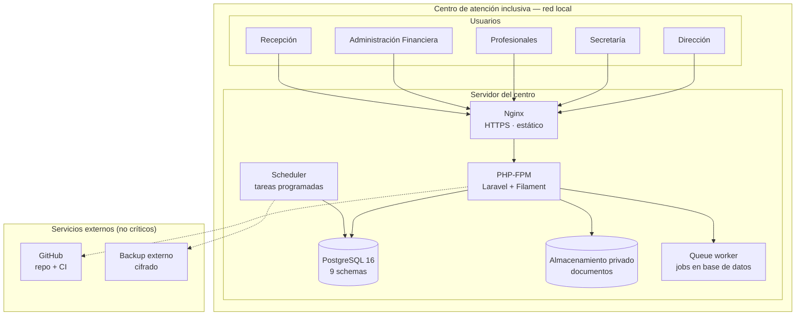
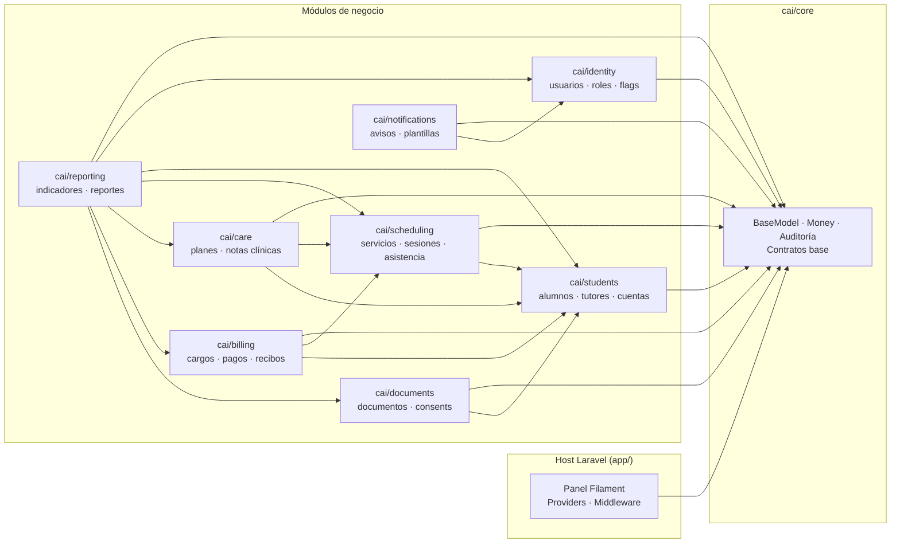

# Arquitectura General

---

## 1. Vista de una frase

> Un **monolito modular en Laravel**, con **9 paquetes Composer** que aíslan dominios,
> **9 schemas PostgreSQL** que aíslan datos, **Filament** como panel interno, y un
> despliegue por **releases versionadas con symlink** que hace que cualquier cambio se
> pueda deshacer en menos de 5 minutos.

---

## 2. Diagrama de contenedores



> [!important] Ningún servicio externo es crítico
> Si GitHub o el backup externo no están disponibles, **el centro sigue operando**. El
> sistema no depende de internet. Ver [[07.01 Arquitectura del Servidor del Centro]].

---

## 3. Capas del sistema

| Capa | Contenido | Responsabilidad |
|---|---|---|
| **Panel administrativo** | Filament (recursos, páginas, widgets) | Interfaz para el personal del centro |
| **Aplicación (host)** | `app/` | Composition root: providers, middleware, panel, configuración |
| **Dominio** | `packages/*/src/{Actions,Services,Models,Contracts}` | Reglas de negocio. No depende de la interfaz |
| **Persistencia** | Eloquent + PostgreSQL | Almacenamiento, integridad, índices |
| **Servicios transversales** | Auditoría, colas, almacenamiento, notificaciones | Capacidades compartidas por todos los módulos |
| **Infraestructura** | Nginx, PHP-FPM, PostgreSQL, Supervisor, cron | Ejecución y operación |

---

## 4. Módulos (dominios)



**Dependencias permitidas** (verificadas por Deptrac en la CI):

| Módulo | Puede depender de |
|---|---|
| `core` | — (nadie) |
| `identity` | `core` |
| `students` | `core`, `identity` |
| `scheduling` | `core`, `students`, `identity` |
| `care` | `core`, `students`, `scheduling`, `identity` |
| `billing` | `core`, `students`, `scheduling`, `identity` |
| `documents` | `core`, `students`, `identity` |
| `notifications` | `core`, `identity` |
| `reporting` | todos (solo lectura, por contratos) |

---

## 5. Principios de la arquitectura

| # | Principio | Consecuencia práctica |
|---|---|---|
| AP-1 | **Modularidad estructural** | Las fronteras las impone el autoload de Composer y la CI, no la disciplina |
| AP-2 | **Un módulo, un schema** | `billing` no puede ver tablas de `care` salvo cualificación explícita |
| AP-3 | **La lógica de negocio no vive en la interfaz** | Filament es un cliente más del dominio; el portal familiar del futuro será otro cliente |
| AP-4 | **Comunicación por contrato o evento** | Sin dependencias circulares, sin acoplamiento temporal |
| AP-5 | **Transacciones dentro del módulo** | La atomicidad crítica vive en `billing`; entre módulos se usan eventos post-commit |
| AP-6 | **Mínimo privilegio por defecto** | Un rol abre la puerta; la Policy decide sobre el registro |
| AP-7 | **Cambios reversibles** | Expand–contract + feature flags + releases con symlink |
| AP-8 | **Sin dependencia de internet** | Todo el stack vive en el servidor del centro |
| AP-9 | **YAGNI estricto** | No se agrega infraestructura sin una necesidad observada |
| AP-10 | **Documentado antes de coded** | Cada fase tiene documento con alcance y gate |

---

## 6. Decisiones que sostienen esta arquitectura

| ADR | Decisión | Efecto |
|---|---|---|
| [[ADR-0001 Monolito Modular en Paquetes]] | Monolito modular en paquetes Composer | Modularidad verificable por CI |
| [[ADR-0002 Schema por Módulo en PostgreSQL]] | Un schema PostgreSQL por módulo | Aislamiento de datos y dumps por módulo |
| [[ADR-0003 Expand-Contract y Feature Flags]] | Migraciones compatibles + flags | Rollback de código sin tocar la base |
| [[ADR-0004 Trunk-based con Tags SemVer]] | `main` siempre desplegable | Historial legible y releases trazables |
| [[ADR-0005 Release por Symlink]] | Releases en carpetas + symlink `current` | Rollback en segundos |
| [[ADR-0006 Cifrado de Notas Clínicas]] | Cifrado en aplicación | El contenido clínico no es legible en un dump sin la clave |
| [[ADR-0007 Cuentas Familiares Compartidas]] | Cobro por cuenta familiar | El saldo se consolida sin mezclar fichas |
| [[ADR-0008 Stack Laravel Filament PostgreSQL]] | Stack único | Un solo lenguaje, un solo ecosistema |
| [[ADR-0009 Sin Redis en el MVP]] | Cola en base de datos | Una pieza menos que mantener |
| [[ADR-0010 Backups Externos Cifrados]] | Backup cifrado fuera del edificio | El hardware puede fallar sin perder la información |

---

## 7. Decisiones explícitamente descartadas

| Opción | Motivo |
|---|---|
| Microservicios | Volumen 10× inferior al umbral; costo operativo prohibitivo para 1 dev. Ver [[ADR-0001 Monolito Modular en Paquetes]] |
| Event sourcing | No hay requerimiento de auditoría temporal exhaustiva; el costo es alto |
| CQRS | Los reportes se resuelven con consultas agregadas sobre schemas separados |
| Next.js en el MVP | Filament cubre el panel interno; Next.js se reserva para el portal familiar |
| Redis | Ver [[ADR-0009 Sin Redis en el MVP]] |
| Base de datos por módulo (múltiples instancias) | Un solo PostgreSQL con 9 schemas es suficiente y drásticamente más simple de respaldar |

---

## 8. Vista de Requests (un caso completo)

```mermaid
sequenceDiagram
  actor U as Recepción
  participant N as Nginx
  participant L as Laravel / Filament
  participant P as Policy
  participant DB as PostgreSQL
  participant A as Auditoría

  U->>N: POST /admin/sessions/{id}/attendance
  N->>L: HTTPS (autenticado por sesión)
  L->>P: authorize(verAttendance, session)
  P->>DB: ¿usuario asignado a esta sesión?
  DB-->>P: sí
  P-->>L: permitido
  L->>DB: BEGIN; UPDATE attendance_records; INSERT audit_events; COMMIT
  L-->>U: 200 OK
```

**Puntos clave del diagrama:**
1. La autorización ocurre **en el servidor**, antes de tocar datos.
2. La auditoría se escribe **en la misma transacción** que la operación.
3. La UI no es la barrera: un `POST` directo sin sesión también es rechazado.

---

## 9. Documentos relacionados

- [[02.02 Arquitectura Modular en Paquetes]] — el detalle de los paquetes
- [[02.03 Reglas de Frontera entre Módulos]] — las reglas normativas
- [[02.04 Capas Internas de un Paquete]] — qué va dentro de cada paquete
- [[02.05 Esquema de Base de Datos por Módulo]] — el aislamiento de datos
- [[02.06 Modelo de Autorización y Permisos]] — cómo se controla el acceso
- [[05.03 Convenciones de Código]] — cómo se escribe
- [[08.01 Hoja de Ruta]] — el orden de construcción
