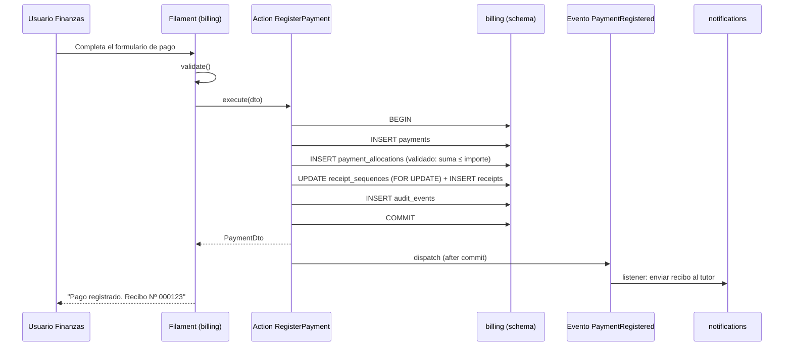

# Reglas de Frontera entre Módulos

> [!danger] Estas reglas son normativas
> No son recomendaciones. La CI las verifica automáticamente. Un PR que las viola **no
> se mergea**. Si una regla resulta incorrecta, se cambia la regla (con un ADR), no se
> rompe la regla.

---

## 1. Las 4 reglas

### R1 — Propiedad de sus datos

> Cada módulo es **dueño** de sus tablas y de su schema. Ningún otro módulo escribe en
> ellos.

**Cómo se verifica:**
- Una conexión de base de datos por módulo, con `search_path` propio. `billing` no puede
  resolver `students.students` sin cualificar explícitamente.
- Deptrac marca la dependencia si un módulo referencia clases de otro que no sea un
  contrato permitido.

**Excepción única:** las **claves foráneas cross-schema** se permiten para mantener la
integridad del historial (por ejemplo, `billing.charges.student_id →
students.students.id` con `ON DELETE RESTRICT`). No permiten leer ni escribir datos del
otro módulo; solo garantizan que no se referencie un id inexistente.

### R2 — Comunicación por contrato

> Para leer datos de otro módulo se consume una **interfaz publicada** en
> `packages/<módulo>/src/Contracts/`.

```php
// ✅ Correcto
use Cai\Students\Contracts\StudentDirectory;
use Cai\Students\Contracts\Dto\StudentSummary;

public function __construct(private StudentDirectory $students) {}

// ❌ Prohibido
use Cai\Students\Models\Student;   // no existe en el autoload de billing
```

**Tipos de contrato:**

| Tipo | Cuándo | Ejemplo |
|---|---|---|
| **Consulta** | El consumidor necesita datos de lectura | `StudentDirectory::summary(int $id): ?StudentSummary` |
| **Comando** | El consumidor necesita que otro módulo ejecute una acción | `EnrollmentService::enroll(int $studentId, int $serviceId)` |
| **Notificación** | El consumidor solo necesita enterarse de un hecho | Evento de dominio |

### R3 — Comunicación por evento

> Para **reaccionar** a un hecho de otro módulo se escucha un evento. No se consulta
> "qué cambió" ni se sondea la base.

```php
// En cai/students/src/Events/
final class StudentRegistered
{
    use Dispatchable, SerializesModels;

    // Payload plano: sin modelos Eloquent, sin datos clínicos.
    public function __construct(
        public readonly int $studentId,
        public readonly string $studentCode,
        public readonly int $familyAccountId,
    ) {}
}
```

**Reglas de los eventos:**
- Se despachan **después del commit** (`ShouldDispatchAfterCommit`).
- El payload es **plano** (scalares, arrays, DTOs). Nunca un modelo Eloquent
  (serializar un modelo a la cola expone atributos y crea acoplamiento).
- **Nunca** un evento contiene contenido clínico.
- El evento vive en el módulo **emisor**.
- Si cambia la forma del payload → se crea `EventoV2` y conviven ambos durante la
  transición.

**Tabla de eventos (se mantiene en esta documento):**

| Evento | Emisor | Consumidores | Estado |
|---|---|---|---|
| `StudentRegistered` | `students` | `billing` (crea la cuenta si no existe), `notifications` | Planificado |
| `StudentTransferredToAccount` | `students` | `billing` (recalcula pertenencia) | Planificado |
| `EnrollmentCreated` | `scheduling` | `billing` (genera cargo), `care` (ofrece plan) | Planificado |
| `EnrollmentEnded` | `scheduling` | `billing` (cierra el cargo) | Planificado |
| `SessionCompleted` | `scheduling` | `care` (ofrece redactar nota), `billing` (factura por unidad) | Planificado |
| `PaymentRegistered` | `billing` | `notifications` (envía recibo) | Planificado |
| `ClinicalNoteFinalized` | `care` | `notifications` (aviso opcional al tutor) | Planificado |

### R4 — Sin relaciones Eloquent cross-módulo

> `belongsTo`, `hasMany`, `hasOne` **solo** dentro del propio módulo.

**Por qué:** una relación Eloquent cross-módulo crea un acoplamiento invisible. El modelo
de `billing` con `belongsTo(Student::class)` compila, funciona, y un día el nombre de la
tabla de `students` cambia y `billing` falla en runtime, en producción.

**Cómo se reemplaza:**

```php
// ❌ Antes
class Charge extends Model {
    public function student() { return $this->belongsTo(Student::class); }
}

// ✅ Después
class Charge extends Model {
    public function studentId(): int { return $this->student_id; }

    // Para mostrar el nombre, se usa el contrato del módulo students
    public function studentLabel(StudentDirectory $students): ?string {
        return $students->summary($this->student_id)?->fullName;
    }
}
```

---

## 2. Tabla de dependencias permitidas

```
core        → (nadie)
identity    → core
students    → core, identity
scheduling  → core, students, identity
care        → core, students, scheduling, identity
billing     → core, students, scheduling, identity
documents   → core, students, identity
notifications→ core, identity
reporting   → todos (solo lectura, por contratos)
```

**Excepciones a la tabla:**

| Excepción | Regla |
|---|---|
| `reporting` lee de todos | **Solo** lectura agregada y **solo** por contratos. Prohibido el acceso directo a tablas ajenas. |
| `core` no depende de nadie | Ni siquiera de `illuminate/database` en su API pública (los tipos base se reciben por parámetro). |
| Eventos entre módulos | Un evento **no** es una dependencia de código: el emisor no importa al receptor. El acoplamiento es de datos, no de clases. |

---

## 3. Definición de "dato agregado" para `reporting`

`reporting` puede leer datos de todos los módulos, pero **solo** en forma agregada y a
través de contratos. Ejemplos válidos:

- Total de alumnos activos (un número).
- Asistencia por periodo (un número por profesional).
- Recaudación del mes (un número).

Ejemplos **inválidos**:

- Listado de alumnos con su última nota clínica.
- Exportación que combine saldo de cuenta y diagnóstico.
- Cualquier conjunto que permita reconstruir información clínica.

> [!important] Test de la agregación
> Debe existir un test que verifique que `reporting` no puede devolver registros que
> incluyan campos de `care`. Ver [[04.04 Datos Clínicos: Cifrado y Acceso]].

---

## 4. Verificación en la CI

### 4.1 Deptrac (capas y módulos)

La verificación de las fronteras entre módulos se realiza en el **repositorio de código de producto** con `composer deptrac`, usando `deptrac.yaml`. Las reglas de dependencia son las siguientes (guía de referencia): 

| Capa | Puede depender de |
|---|---|
| `Core` | Ninguna |
| `Identity` | `Core` |
| `Students` | `Core`, `Identity` |
| `Scheduling` | `Core`, `Students`, `Identity` |
| `Care` | `Core`, `Students`, `Scheduling`, `Identity` |
| `Billing` | `Core`, `Students`, `Scheduling`, `Identity` |
| `Documents` | `Core`, `Students`, `Identity` |
| `Notifications` | `Core`, `Identity` |
| `Reporting` | `Core`, `Identity`, `Students`, `Scheduling`, `Care`, `Billing`, `Documents` |

### 4.2 Arch test (prohibiciones explícitas)

Los arch tests de Pest expresan reglas que Deptrac no puede verificar (como "nadie importa
modelos desde el paquete equivocado").

```php
// packages/core/tests/Arch/ModuleBoundariesTest.php

it('no importa modelos de otro modulo', function () {
    // Regla: un paquete NUNCA importa App\Models\ (los modelos viven en los paquetes)
    expect('App\Models')->not->toBeUsed();

    // Regla: un paquete solo importa Contracts del modulo que ya depende
    $allowed = [
        'cai/core'        => [],
        'cai/identity'    => ['cai/core'],
        'cai/students'    => ['cai/core', 'cai/identity'],
        'cai/scheduling'  => ['cai/core', 'cai/identity', 'cai/students'],
        'cai/care'        => ['cai/core', 'cai/identity', 'cai/students', 'cai/scheduling'],
        'cai/billing'     => ['cai/core', 'cai/identity', 'cai/students', 'cai/scheduling'],
        'cai/documents'   => ['cai/core', 'cai/identity', 'cai/students'],
        'cai/notifications'=> ['cai/core', 'cai/identity'],
        'cai/reporting'   => ['cai/core', 'cai/identity', 'cai/students', 'cai/scheduling',
                              'cai/care', 'cai/billing', 'cai/documents'],
    ];

    foreach ($allowed as $package => $permitted) {
        // se revisa el AST de cada archivo del paquete
        // y se verifica que cada import Cai\X\Contracts cae en $permitted
    }
});
```

### 4.3 Reglas adicionales por test

| Test | Qué verifica |
|---|---|
| `no_contract_without_readme` | Todo `Contracts/` público tiene documentación |
| `events_have_flat_payloads` | Ningún evento contiene un modelo Eloquent |
| `events_do_not_leak_clinical_data` | Ningún evento de `students`/`scheduling` contiene campos clínicos |
| `models_live_in_their_module` | Los modelos Eloquent están en `src/Models` de su paquete |
| `filament_is_not_the_domain` | Las clases de Filament no contienen lógica de negocio (llaman a `Actions`) |
| `migrations_are_immutable` | Detecta cambios en migraciones ya aplicadas (comparación contra `main`) |

---

## 5. Proceso para cambiar una regla

1. Se escribe un **ADR** con el problema y la propuesta.
2. Se actualiza `deptrac.yaml` (en el repositorio de código) y/o los arch tests.
3. Se ajusta el código que viola la regla.
4. Se actualiza este documento.
5. Se comunica al equipo.

> **Nunca** se relaja una regla para que un PR pase. Se relaja la regla **por decisión
> explícita y documentada**.

---

## 6. Ejemplo completo: registrar un pago



**Puntos clave:**
- Toda la operación financiera está **dentro** de `billing` y **en una transacción**.
- La notificación al tutor es un **efecto posterior**: si falla, el pago sigue registrado
  y el job queda en `failed_jobs` para reintento.
- `billing` no toca `students` directamente: si necesita el nombre del alumno, usa
  `StudentDirectory`.

---

## 7. Documentos relacionados

- [[02.02 Arquitectura Modular en Paquetes]]
- [[02.04 Capas Internas de un Paquete]]
- [[02.08 Eventos de Dominio]]
- [[04.03 Autorización por Registro]]
- [[05.04 Checklist de Pull Request]]
- [[05.05 Estrategia de Pruebas]]
