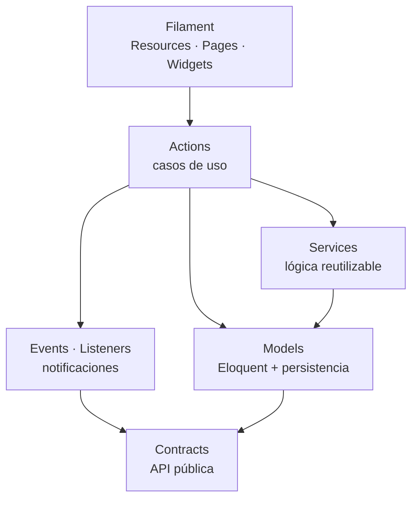

# Capas Internas de un Paquete

---

## 1. Regla de dependencia interna

Dentro de un paquete, las dependencias fluyen **en un solo sentido**:



**Nunca:**
- `Models` → `Actions` (el modelo no conoce la lógica de negocio).
- `Services` → `Filament` (el dominio no conoce la interfaz).
- `Contracts` → nada interno (un contrato es una interfaz, no importa nada).

---

## 2. Qué va en cada capa

### `Contracts/` — la API pública

Interfaces que **expone** el módulo. Son lo único que otros módulos pueden consumir.

```php
namespace Cai\Students\Contracts;

use Cai\Students\Contracts\Dto\StudentSummary;

interface StudentDirectory
{
    public function summary(int $studentId): ?StudentSummary;

    /**
     * @return list<StudentSummary>
     */
    public function summariesFor(array $studentIds): array;

    public function fullName(int $studentId): ?string;
}
```

**Reglas:**
- Los DTO son `readonly` y tienen solo `scalar`/`array`/`enum`/DTO.
- Los contratos **no** devuelven modelos Eloquent.
- Cada método tiene PHPDoc con la forma del retorno.
- Un contrato público se considera API: cambiarlo rompe a sus consumidores → requiere
  versionado SemVer del paquete.

### `Actions/` — los casos de uso

**Una Action = una intención de negocio.** Es la unidad que se invoca desde la interfaz.

```php
namespace Cai\Students\Actions;

use Cai\Students\DTOs\CreateStudentData;
use Cai\Students\Models\Student;

final class CreateStudent
{
    public function __construct(
        private readonly StudentCodeGenerator $codes,
    ) {}

    public function execute(CreateStudentData $data): Student
    {
        return DB::transaction(function () use ($data) {
            $student = Student::create([
                'student_code' => $this->codes->next(),
                'first_name'  => $data->firstName,
                'last_name'   => $data->lastName,
                'birth_date'  => $data->birthDate,
                'status'      => StudentStatus::Active,
            ]);

            StudentRegistered::dispatch(
                studentId: $student->id,
                studentCode: $student->student_code,
                familyAccountId: $data->familyAccountId,
            );

            return $student;
        });
    }
}
```

**Reglas:**
- El nombre es un verbo en infinitivo: `CreateStudent`, `RegisterPayment`, `FinalizeNote`.
- Recibe un DTO de entrada, devuelve el modelo o un DTO de salida.
- Si necesita una transacción, la abre ella misma.
- **No** contiene lógica de presentación (no sabe qué campos tiene el formulario).
- **No** lanza excepciones HTTP. Lanza excepciones de dominio.

### `Services/` — la lógica reutilizable

Lógica que **más de una Action** necesita. Ejemplos: `StudentCodeGenerator`,
`FamilyAccountResolver`, `MoneyCalculator`, `ReceiptNumberGenerator`.

**Regla:** si solo la usa una Action, va dentro de la Action. Un Service que tiene un solo
llamador es ruido.

### `Models/` — la persistencia

Los modelos Eloquent, con sus relaciones **internas** al módulo, casts, y accesores.

```php
namespace Cai\Students\Models;

use Cai\Students\Enums\StudentStatus;
use Illuminate\Database\Eloquent\Model;
use Illuminate\Database\Eloquent\SoftDeletes;

final class Student extends Model
{
    use SoftDeletes;

    protected $connection = 'students';

    protected $table = 'students';

    protected $fillable = [
        'student_code', 'first_name', 'last_name', 'birth_date', 'status',
    ];

    protected $casts = [
        'birth_date' => 'date',
        'status'    => StudentStatus::class,
    ];

    // Relaciones SOLO dentro del módulo students
    public function guardians()
    {
        return $this->belongsToMany(
            Guardian::class,
            'student_guardians',
            'student_id',
            'guardian_id'
        )->withPivot(['relationship', 'is_primary', 'can_pick_up']);
    }
}
```

**Reglas:**
- `protected $connection` **siempre** — es lo que aísla el módulo.
- Las relaciones solo apuntan a modelos del propio módulo.
- Los casts se declaran explícitamente (nunca se relya en el cast implícito de la BD).
- `final` en las clases de dominio; `final` NO en los modelos que se extienden.

### `Events/` y `Listeners/` — la comunicación

```php
namespace Cai\Students\Events;

use Illuminate\Foundation\Events\Dispatchable;
use Illuminate\Queue\SerializesModels;

final class StudentRegistered
{
    use Dispatchable, SerializesModels;

    public function __construct(
        public readonly int $studentId,
        public readonly string $studentCode,
        public readonly int $familyAccountId,
    ) {}
}
```

**Reglas de eventos:**
- `ShouldDispatchAfterCommit` (implementado en la clase base de eventos de `core`).
- Payload plano. Sin modelos. Sin datos clínicos.
- `final`.
- Nombre en pasado: `StudentRegistered`, `PaymentRegistered`.

```php
namespace Cai\Billing\Listeners;

use Cai\Students\Events\StudentRegistered;

final class CreateAccountForNewStudent
{
    public function handle(StudentRegistered $event): void
    {
        // Billing reacciona; no conoce la implementación de students
    }
}
```

**Reglas de listeners:**
- **Idempotentes**: ejecutarlos dos veces no debe duplicar efectos.
- Con `tries` y `backoff` definidos.
- Si fallan, van a `failed_jobs` y se reintentan desde el panel.

### `Policies/` — la autorización

```php
namespace Cai\Students\Policies;

use Cai\Students\Models\Student;

final class StudentPolicy
{
    public function viewAny(User $user): bool
    {
        return $user->hasPermissionTo('students.view');
    }

    public function view(User $user, Student $student): bool
    {
        if (! $user->hasPermissionTo('students.view')) {
            return false;
        }

        return $this->hasScope($user, $student);
    }
}
```

**Reglas:**
- Una Policy por modelo (o por concepto de negocio si el modelo es compartido).
- El permiso es **condición necesaria**, no suficiente: después se verifica el alcance.
- Nunca `return true` sin Justificación explícita.

### `Filament/` — la interfaz

```php
namespace Cai\Students\Filament\Resources;

final class StudentResource extends Resource
{
    protected static ?string $model = Student::class;

    protected static ?string $navigationGroup = 'Alumnos';

    // Formularios y tablas. NADA de lógica de negocio aquí.

    protected static function mutateFormDataBeforeCreate(array $data): array
    {
        // Transformaciones de presentación, no reglas de negocio.
        return $data;
    }
}
```

**Regla de oro:** un recurso de Filament **llama a una Action**. Nunca implementa la
regla de negocio en el método del formulario.

```php
// ❌ Prohibido
public static function table(Table $table): Table
{
    return $table->...->action(fn ($record) => $record->update([...]));
}

// ✅ Correcto
->action(fn (Student $record) => app(CreateStudentNoteAction::class)->execute(...))
```

> [!tip] Por qué importa
> El portal familiar de la etapa 2 consumirá las **mismas Actions** vía API. Si la lógica
> estuviera en los formularios de Filament, habría que duplicarla, y la portal podría
> comportarse distinto al panel. Ver [[ADR-0001 Monolito Modular en Paquetes]].

### `DTOs/`, `Enums/`, `Exceptions/` — apoyo

| Carpeta | Contenido | Regla |
|---|---|---|
| `DTOs` | Objetos de transferencia de entrada/salida | `readonly`, sin comportamiento de negocio |
| `Enums` | Estados y tipos | PHP 8.1 backed enums, un caso por valor de columna |
| `Exceptions` | Errores de dominio | Extienden una excepción base de `core`; llevan un código estable |

---

## 3. Exceptions de dominio

```php
namespace Cai\Students\Exceptions;

use Cai\Core\Exceptions\DomainException;

final class StudentNotFound extends DomainException
{
    public function __construct(public readonly int $studentId)
    {
        parent::__construct("No existe el alumno {$studentId}.");
    }

    public static function code(): string
    {
        return 'STUDENT_NOT_FOUND';
    }
}
```

**Reglas:**
- Código de error **estable** (cambiarlo rompe la integración con el futuro portal).
- La UI traduce el código a un mensaje en español.
- Nunca se lanza una `ValidationException` de Laravel desde una Action: la validación de
  entrada es de la capa de presentación; la Action valida **reglas de negocio**.

---

## 4. Nombres de archivo y clases

| Elemento | Convención | Ejemplo |
|---|---|---|
| Modelo | `Singular` + `Model.php` | `Student.php` |
| Action | `VerboInfinitivo` + `Action.php` | `CreateStudent.php` |
| Service | `Sustantivo` + `Service.php` | `StudentCodeGenerator.php` |
| Policy | `Modelo` + `Policy.php` | `StudentPolicy.php` |
| Evento | `Sujeto` + `Pasado` | `StudentRegistered.php` |
| Listener | `Acción` + `Consecuencia` | `CreateAccountForNewStudent.php` |
| DTO | `Concepto` + `Data` / `Summary` | `CreateStudentData.php` |
| Excepción | `Problema` | `StudentNotFound.php` |
| Enum | `Concepto` + `Status`/`Type` | `StudentStatus.php` |
| Test | `describe` + `test` | `tests/Feature/CreateStudentTest.php` |

---

## 5. Documentos relacionados

- [[02.02 Arquitectura Modular en Paquetes]]
- [[02.03 Reglas de Frontera entre Módulos]]
- [[02.06 Modelo de Autorización y Permisos]]
- [[05.03 Convenciones de Código]]
- [[05.05 Estrategia de Pruebas]]
