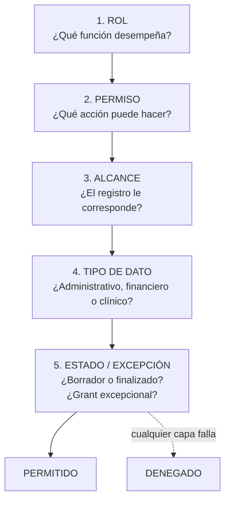
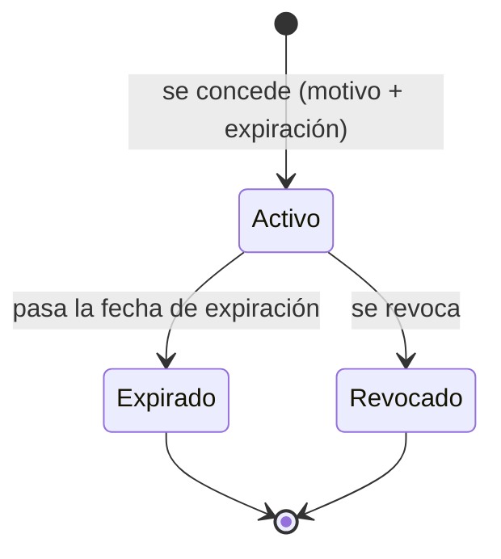

# Modelo de Autorización y Permisos

---

## 1. Idea central

> **El rol abre la puerta. La Policy decide si se puede entrar.**

Un permiso dice *qué tipo de acción* puede hacer alguien. Una Policy dice *si esa acción
aplica sobre **este** registro concreto* y para **esta** persona.

```
¿Tiene el permiso?  →  ¿El registro le corresponde?  →  ¿Hay un estado que lo impida?
```

Las dos preguntas son necesarias. Con solo permisos, un profesional vería **todos** los
alumnos. Con solo asignación, Dirección no podría ver nada.

---

## 2. Las 5 capas de decisión



| Capa | Implementación | Dónde vive |
|---|---|---|
| 1. Rol | `spatie/laravel-permission` | `identity.roles` |
| 2. Permiso | `spatie/laravel-permission` | `identity.permissions` |
| 3. Alcance | `Policies` + filtros de consulta | `src/Policies/` |
| 4. Tipo de dato | Schema separado + `search_path` + cifrado | `care` vs. resto |
| 5. Estado / excepción | `Policy` + `clinical_note_access_grants` | `care` |

---

## 3. Taxonomía de permisos

Formato: `<módulo>.<recurso>.<acción>`

| Módulo | Ejemplos |
|---|---|
| `identity` | `identity.users.view`, `identity.users.create`, `identity.roles.manage`, `identity.audit.view`, `identity.flags.manage` |
| `students` | `students.students.view`, `students.students.create`, `students.students.update`, `students.guardians.manage`, `students.family_accounts.view`, `students.family_accounts.manage` |
| `scheduling` | `scheduling.services.manage`, `scheduling.enrollments.manage`, `scheduling.sessions.view`, `scheduling.sessions.create`, `scheduling.sessions.update`, `scheduling.attendance.record` |
| `care` | `care.plans.view`, `care.plans.manage`, `care.notes.view`, `care.notes.create`, `care.notes.finalize`, `care.documents.view`, `care.grants.issue` |
| `billing` | `billing.charges.view`, `billing.charges.create`, `billing.charges.void`, `billing.payments.view`, `billing.payments.create`, `billing.payments.void`, `billing.receipts.view`, `billing.cash.open`, `billing.cash.close`, `billing.reports.view` |
| `documents` | `documents.documents.view`, `documents.documents.upload`, `documents.documents.download`, `documents.consents.manage` |
| `notifications` | `notifications.messages.send`, `notifications.templates.manage` |
| `reporting` | `reporting.reports.view`, `reporting.reports.export`, `reporting.financial.view` |
| `care` (especial) | `care.clinical.read` — permiso **adicional** para el área clínica |

**Acciones transversales:**

| Permiso | Significado |
|---|---|
| `system.audit.view` | Ver la auditoría |
| `system.settings.manage` | Configurar el centro |
| `system.flags.manage` | Activar/desactivar módulos |

---

## 4. Las Policies

### 4.1 Estructura

```php
namespace Cai\Care\Policies;

use Cai\Care\Models\ClinicalNote;
use Cai\Care\Models\StudentAssignment;
use Illuminate\Auth\Access\HandlesAuthorization;

final class ClinicalNotePolicy
{
    use HandlesAuthorization;

    public function viewAny(User $user): bool
    {
        // El permiso base abre la puerta.
        return $user->hasPermissionTo('care.notes.view');
    }

    public function view(User $user, ClinicalNote $note): bool
    {
        if (! $user->hasPermissionTo('care.notes.view')) {
            return false;
        }

        // El autor siempre accede a sus notas.
        if ($note->author_user_id === $user->id) {
            return true;
        }

        // Acceso excepcional con grant vigente.
        if ($note->hasActiveGrantFor($user->id)) {
            return true;
        }

        // Alcance: asignación profesional vigente al alumno.
        return $user->hasActiveClinicalAssignmentFor($note->student_id);
    }

    public function create(User $user): bool
    {
        return $user->hasPermissionTo('care.notes.create')
            && $user->hasActiveProfessionalProfile();
    }

    public function update(User $user, ClinicalNote $note): bool
    {
        // Solo el autor, solo en borrador, solo con el permiso específico.
        return $note->status === ClinicalNoteStatus::Draft
            && $note->author_user_id === $user->id
            && $user->hasPermissionTo('care.notes.update-own-drafts');
    }

    public function delete(User $user, ClinicalNote $note): bool
    {
        // No se borra. Solo se puede "anular" una nota en borrador
        // antes de finalizarla.
        return false;
    }
}
```

### 4.2 Reglas para todas las Policies

| Regla | Detalle |
|---|---|
| **Permiso primero** | La primera línea de cada método es la verificación de permiso |
| **Alcance después** | El permiso sin alcance es insuficiente |
| **Negación temprana** | `if (! $user->hasPermissionTo(...)) return false;` |
| **Sin `return true` desnudo** | Cada `true` va con una razón |
| **Sin `delete` permisivo** | Nada se borra; se anula |
| **Determinismo** | La misma llamada con el mismo estado da el mismo resultado |
| **Sin efectos secundarios** | Una Policy no escribe en la base |

### 4.3 Registro

Las Policies se registran en el ServiceProvider del paquete:

```php
// packages/care/src/Providers/CareServiceProvider.php
public function boot(): void
{
    Gate::policy(ClinicalNote::class, ClinicalNotePolicy::class);
    Gate::policy(CarePlan::class, CarePlanPolicy::class);
}
```

---

## 5. Filtrado de consultas (segunda barrera)

La Policy protege **una acción**. Para los **listados**, se necesita además que la consulta
no devuelva lo que el usuario no puede ver.

### 5.1 Alcance del usuario

```php
namespace Cai\Identity\Models;

final class User extends Authenticatable
{
    public function scopeWithScope(Builder $query): Builder
    {
        // Un usuario sin rol clínico solo ve alumnos con asignación profesional.
        // Dirección y Coordinación con rol clínico ven todos.
        if ($this->hasPermissionTo('care.clinical.read')) {
            return $query;
        }

        return $query->whereIn('id', $this->assignedStudentIds());
    }
}
```

### 5.2 Uso en Filament

```php
protected static function getEloquentQuery(): Builder
{
    // El listado ya viene filtrado por el scope del usuario.
    return parent::getEloquentQuery()->withScope();
}
```

### 5.3 Reglas

| Regla | Detalle |
|---|---|
| **Filtrar siempre** | Un listado sin filtro de alcance es una fuga |
| **La Policy sigue estando** | El filtro es la primera barrera; la Policy, la segunda. No se sustituyen |
| **Las exportaciones respetan el filtro** | Una exportación sin filtro es una fuga masiva |
| **Las búsquedas globales excluyen lo clínico** | La búsqueda global de Filament nunca incluye notas clínicas |

---

## 6. Separación de las áreas de datos

| Área | Schema | Cifrado | Quién accede |
|---|---|---|---|
| Administrativa | `students`, `scheduling` | No | Según matriz de permisos |
| Financiera | `billing` | No | Finanzas + Dirección (agregado) |
| **Clínica** | `care` | **Sí (contenido)** | **Solo roles clínicos** |
| Auditoría | `identity` | No | Dirección + Administración Técnica |

**Regla dura:** el contenido de `clinical_notes.content` está cifrado con el cast
`encrypted`. Un `pg_dump` sin la `APP_KEY` **no** revela las notas. Ver
[[04.04 Datos Clínicos: Cifrado y Acceso]].

---

## 7. Acceso excepcional (grants)



**Conceder un grant:**
- Solo `care.grants.issue` (Dirección + responsable clínico).
- **Motivo obligatorio** (texto libre, mínimo 20 caracteres).
- **Fecha de expiración obligatoria** (máximo 30 días por defecto).
- Queda registrado en `security_events` y en `audit_events`.

**Verificar un grant:**
- `hasActiveGrantFor($userId)` verifica: existe, no expiró, no fue revocado, y aplica al
  alumno y al recurso concretos.

**Nunca** se concede un grant "para siempre". Si se necesita acceso permanente, se
resuelve **reasignando** al profesional o dando el rol clínico.

---

## 8. Verificación de permisos en la CI

Cada fase incluye tests de autorización. El patrón mínimo:

```php
it('impide que un profesional vea notas de un alumno no asignado', function () {
    $profesional = Professional::factory()->create();
    $otro = Professional::factory()->create();

    $nota = ClinicalNote::factory()->create([
        'student_id' => Student::factory()->create(),
        'author_user_id' => $otro->user_id,
    ]);

    $this->actingAs($profesional->user)
        ->get("/admin/care/notes/{$nota->id}")
        ->assertForbidden();
});
```

> Ver [[05.05 Estrategia de Pruebas]] y [[04.03 Autorización por Registro]].

---

## 9. Revisión periódica de permisos

| Frecuencia | Acción | Responsable |
|---|---|---|
| Trimestral | Revisar la lista de usuarios con roles privilegiados | Dirección |
| Trimestral | Revisar permisos que nadie usa (permisos huérfanos) | Técnico |
| Mensual | Verificar que los grants expirados ya no dan acceso | Técnico |
| Inmediato | Al alta o baja de personal | Dirección |

Ver [[10.02 Calendario de Checklists]].

---

## 10. Documentos relacionados

- [[04.02 Matriz de Permisos por Rol]]
- [[04.03 Autorización por Registro]]
- [[04.04 Datos Clínicos: Cifrado y Acceso]]
- [[01.03 Actores y Roles del Centro]]
- [[05.05 Estrategia de Pruebas]]
