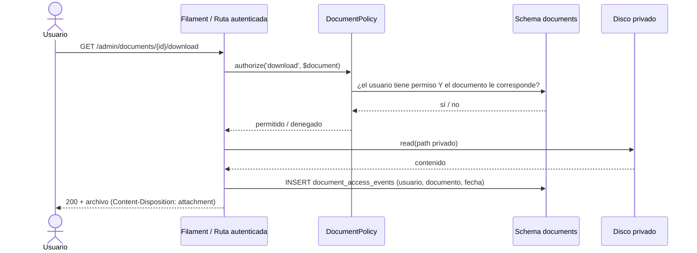

# Almacenamiento de Archivos Privados

---

## 1. Regla innegociable

> **Ningún archivo del sistema vive en el directorio público.**
> No hay enlaces públicos permanentes. No hay "carpetas compartidas" en la web.

El directorio `public/` sirve **solo**: CSS, JS, imágenes de la interfaz, favicon. Nada más.

---

## 2. Estructura de almacenamiento

```
storage/app/private/
├── students/
│   └── ALU-0001/
│       ├── documentos/
│       │   ├── cedula-12345678.pdf
│       │   └── autorizacion-retiro.pdf
│       └── clinicos/
│           ├── evaluacion-2026-03.pdf
│           └── informe-psicopedagogico.pdf
├── families/
│   └── FA-0001/
│       └── documentos/
├── billing/
│   └── FA-0001/
│       └── comprobantes/
├── care/
│   └── ALU-0001/
│       └── notas-adjuntas/
├── consignas/
│   └── {uuid}.pdf
└── temporal/
    └── {uuid}.tmp
```

**Reglas de nombres:**
- El nombre del archivo **original** se guarda en la base de datos, no en el disco.
- En disco se usa un **nombre UUID** para evitar colisiones, adivinar rutas y filtrar
  información por el nombre.
- La estructura por entidad (`ALU-0001/`) permite localizar y depurar, pero el UUID real
  impide adivinar URLs.

---

## 3. Configuración de Laravel

```php
// config/filesystems.php
'disks' => [

    'local' => [
        'driver' => 'local',
        'root' => storage_path('app/private'),
        'serve' => false,          // ← CRÍTICO: nunca servir archivos directamente
        'throw' => true,
    ],

    'documents' => [
        'driver' => 'local',
        'root' => storage_path('app/private/documents'),
        'visibility' => 'private',
        'throw' => true,
    ],

    // Reservado para el futuro (etapa 2) o para backups externos
    's3' => [
        'driver' => 's3',
        'key' => env('AWS_ACCESS_KEY_ID'),
        'secret' => env('AWS_SECRET_ACCESS_KEY'),
        'region' => env('AWS_DEFAULT_REGION'),
        'bucket' => env('AWS_BUCKET'),
        'url' => env('AWS_URL'),
        'endpoint' => env('AWS_ENDPOINT'),
        'use_path_style_endpoint' => true,
        'throw' => true,
    ],

],
```

> [!warning] `'serve' => false`
> Con `serve => true`, Laravel genera una URL temporal firmada. **No se usa** para
> documentos sensibles: la URL firmada depende de la configuración del servidor y es
> difícil de auditar. El acceso se controla **siempre** por una ruta autenticada de la
> aplicación.

**Permisos en el sistema de archivos:**

```bash
# storage/app/private debe ser legible solo por el usuario del servicio
chmod 750 storage/app/private
chown -R deploy:deploy storage/app/private
```

---

## 4. El flujo de descarga (controlado)



**Características del flujo:**
1. La autorización se verifica **en cada solicitud**, no solo al mostrar el listado.
2. La descarga se **audita** siempre.
3. El archivo se sirve con `Content-Disposition: attachment` y `X-Content-Type-Options: nosniff`.
4. El path real se resuelve desde la base de datos, **nunca** desde el input del usuario.

---

## 5. Código de referencia (ilustrativo)

```php
namespace Cai\Documents\Actions;

final class DownloadDocument
{
    public function __construct(
        private readonly Filesystem $filesystem,
    ) {}

    public function execute(User $user, Document $document): StreamedResponse
    {
        // 1. Autorización: permiso + alcance + categoría sensible
        Gate::authorize('download', $document);

        // 2. El path sale de la BD, no del request
        $path = $document->storage_path;

        abort_unless($this->filesystem->exists($path), 404);

        // 3. Auditoría de la lectura
        $document->recordAccess($user, DocumentAccessEvent::ACTION_DOWNLOAD);

        // 4. Se sirve con nombre original y sin inline
        return response()->streamDownload(
            fn () => readfile($this->filesystem->path($path)),
            $document->original_name,
            [
                'Content-Type' => $document->mime_type,
                'X-Content-Type-Options' => 'nosniff',
                'Content-Disposition' => 'attachment; filename="'.addslashes($document->original_name).'"',
            ]
        );
    }
}
```

> **Nunca** `Storage::url()` para documentos. Esa API genera una ruta pública o una URL
> firmada fuera del control de la aplicación.

---

## 6. Validación de archivos al subir

| Regla | Detalle |
|---|---|
| Tamaño máximo | Configurable por categoría (por defecto 20 MB) |
| Tipos permitidos | Lista blanca por categoría: PDF, JPG, PNG, DOCX |
| Nombre original | Se conserva como metadato; **nunca** se usa como nombre en disco |
| MIME real | Se verifica con `finfo`, no por la extensión |
| Contenido malicioso | Se considera el antivirus en el MVP; la lista blanca reduce el riesgo |
| Hash | Se calcula SHA-256 del contenido para verificar integridad |
| Duplicados | Hash idéntico + misma entidad → se reutiliza el archivo, no se duplica |

---

## 7. Ciclo de vida y retención

| Etapa | Regla |
|---|---|
| **Carga** | Se guarda en `temporal/` primero; al asociarlo a un documento se mueve a la carpeta final |
| **Vigencia** | El documento existe mientras su entidad exista |
| **Sustitución** | Si se sube una versión nueva, la anterior queda con `superseded_by` (no se borra) |
| **Eliminación** | Solo por política de conservación. Ver P4 en [[01.07 Preguntas Abiertas y Decisiones Pendientes]] |
| **Respaldo** | `storage/app/private` se incluye en el backup, cifrado |

> [!important] Nada se borra automáticamente
> La purga automática de documentos es un riesgo legal (puede borrar un documento que se
> debía conservar). **No se implementa** hasta que Dirección defina los plazos.

---

## 8. Documentos clínicos: categoría especial

Los documentos clínicos (evaluaciones, informes) usan una categoría que fuerza:

1. Verificación del permiso `care.documents.view` **además** del permiso del recurso.
2. Registro obligatorio en `document_access_events` con el motivo cuando no es el
   responsable del alumno.
3. Acceso restringido al profesional asignado, a Dirección con grant, y al responsable
   clínico.

Los documentos clínicos **nunca** se adjuntan a comunicaciones masivas (ver
[[03.07 Documentos, Consentimientos y Notificaciones]]).

---

## 9. Copias de seguridad de los archivos

| Aspecto | Regla |
|---|---|
| Qué se respalda | `storage/app/private` **completo** |
| Cómo | `rsync` o `tar` diario, cifrado con `gpg` o `openssl enc` |
| Dónde | Local + externo cifrado (fuera del edificio) |
| Retención | 7 diarios + 4 semanales + 3 mensuales |
| Verificación | Mensual: restaurar un archivo y verificar su hash |
| Clave de cifrado | En el gestor de contraseñas, **no** junto al backup |

> [!danger] Un backup sin clave no es un backup
> Si los archivos y la base están cifrados, la clave debe estar **separada**. Si la clave
> se pierde junto con el disco, el backup es inservible.

---

## 10. Verificación en la CI

| Test | Qué comprueba |
|---|---|
| `document_is_not_publicly_accessible` | Un archivo con path conocido no se descarga por URL directa |
| `download_requires_permission` | Un usuario sin permiso recibe 403 |
| `download_is_audited` | La descarga deja registro |
| `private_storage_is_not_served` | `storage/app/private` no es accesible por HTTP |

---

## 11. Documentos relacionados

- [[03.07 Documentos, Consentimientos y Notificaciones]]
- [[04.04 Datos Clínicos: Cifrado y Acceso]]
- [[06.07 Backups y Recuperación]]
- [[07.03 Instalación del Sistema]]
