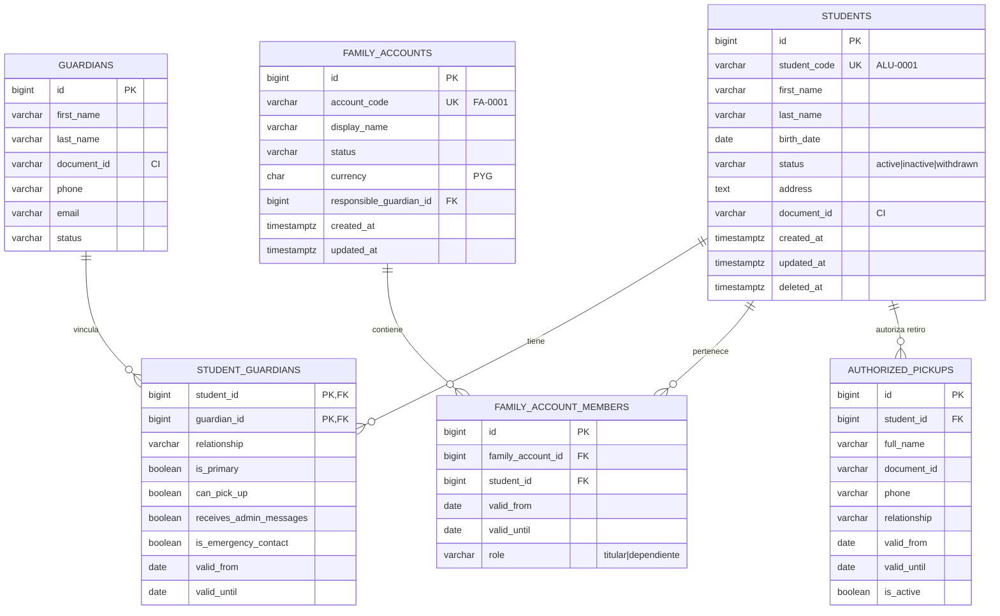

# Alumnos, Tutores y Cuentas Familiares

**Schema:** `students` · **Paquete:** `cai/students`

---

## 1. Diagrama



---

## 2. `students`

```sql
CREATE TABLE students.students (
    id            BIGSERIAL PRIMARY KEY,
    student_code  VARCHAR(30) NOT NULL UNIQUE,
    first_name    VARCHAR(100) NOT NULL,
    last_name     VARCHAR(100) NOT NULL,
    birth_date    DATE,
    gender        VARCHAR(20),
    status        VARCHAR(20) NOT NULL DEFAULT 'active',
    document_id   VARCHAR(30),
    address       TEXT,
    district      VARCHAR(80),
    city          VARCHAR(80),
    phone         VARCHAR(40),
    email         VARCHAR(254),
    photo_path    VARCHAR(255),
    admission_date DATE,
    notes         TEXT,
    created_by    BIGINT REFERENCES identity.users(id),
    updated_by    BIGINT REFERENCES identity.users(id),
    created_at    TIMESTAMPTZ NOT NULL DEFAULT NOW(),
    updated_at    TIMESTAMPTZ NOT NULL DEFAULT NOW(),
    deleted_at    TIMESTAMPTZ,

    CONSTRAINT students_status_check
        CHECK (status IN ('active', 'inactive', 'withdrawn')),
    CONSTRAINT students_birth_date_check
        CHECK (birth_date IS NULL OR birth_date <= CURRENT_DATE)
);

CREATE INDEX students_status_index    ON students.students (status);
CREATE INDEX students_last_name_index ON students.students (last_name, first_name);
CREATE INDEX students_document_index  ON students.students (document_id);
```

**Decisiones:**
- **`student_code` es estable.** Se genera una vez (`ALU-0001`) y **nunca se reutiliza ni
  se modifica**, aunque el alumno se dé de baja. Es el identificador que aparece en
  documentos, listados y reportes.
- **`document_id` es texto, no número.** Paraguay no tiene un documento numérico único para
  menores; es un string con guiones. Se indexa para búsqueda.
- **La edad no se almacena.** Se deriva de `birth_date`.
- **Soft delete.** Un alumno con historial no se borra (RN-007).
- **`photo_path`** es una ruta relativa a `storage/app/private/students/{code}/`.
- **`created_by` / `updated_by`** permiten saber quién cargó la ficha (auditoría de primer
  nivel, complementaria a `audit_events`).

---

## 3. `guardians`

```sql
CREATE TABLE students.guardians (
    id           BIGSERIAL PRIMARY KEY,
    first_name   VARCHAR(100) NOT NULL,
    last_name    VARCHAR(100) NOT NULL,
    document_id  VARCHAR(30),
    phone        VARCHAR(40),
    email        VARCHAR(254),
    address      TEXT,
    occupation   VARCHAR(120),
    status       VARCHAR(20) NOT NULL DEFAULT 'active',
    notes        TEXT,
    created_at   TIMESTAMPTZ NOT NULL DEFAULT NOW(),
    updated_at   TIMESTAMPTZ NOT NULL DEFAULT NOW(),
    deleted_at   TIMESTAMPTZ,

    CONSTRAINT guardians_status_check
        CHECK (status IN ('active', 'inactive'))
);

CREATE INDEX guardians_document_index ON students.guardians (document_id);
CREATE INDEX guardians_last_name_index ON students.guardians (last_name);
```

> [!warning] Un tutor puede ser de varias familias
> La misma persona puede ser responsable de varios alumnos de familias distintas (por
> ejemplo, una abuela que lleva a sus dos nietos de familias diferentes). Por eso
> `guardians` **no** tiene `family_account_id`: la relación es a través de
> `student_guardians`.

---

## 4. `student_guardians`

```sql
CREATE TABLE students.student_guardians (
    student_id              BIGINT NOT NULL REFERENCES students.students(id) ON DELETE CASCADE,
    guardian_id             BIGINT NOT NULL REFERENCES students.guardians(id) ON DELETE RESTRICT,
    relationship            VARCHAR(50) NOT NULL,
    is_primary              BOOLEAN NOT NULL DEFAULT FALSE,
    can_pick_up             BOOLEAN NOT NULL DEFAULT FALSE,
    receives_admin_messages BOOLEAN NOT NULL DEFAULT FALSE,
    is_emergency_contact    BOOLEAN NOT NULL DEFAULT FALSE,
    valid_from              DATE NOT NULL DEFAULT CURRENT_DATE,
    valid_until             DATE,
    created_at              TIMESTAMPTZ NOT NULL DEFAULT NOW(),

    PRIMARY KEY (student_id, guardian_id),
    CONSTRAINT student_guardians_valid_check
        CHECK (valid_until IS NULL OR valid_until >= valid_from)
);

CREATE INDEX student_guardians_guardian_index ON students.student_guardians (guardian_id);
```

**Restricción de un solo tutor principal:**

```sql
-- Un solo tutor principal por alumno y vigente.
CREATE UNIQUE INDEX student_guardians_one_primary
    ON students.student_guardians (student_id)
    WHERE is_primary AND valid_until IS NULL;
```

**Qué significa cada flag:**

| Flag | Significado |
|---|---|
| `is_primary` | Es el contacto administrativo principal. Solo uno por alumno |
| `can_pick_up` | Está autorizado a retirar al alumno |
| `receives_admin_messages` | Recibe las comunicaciones administrativas (avisos de cuota, etc.) |
| `is_emergency_contact` | Se contacta en emergencia |

> [!important] `can_pick_up` y `authorized_pickups` son cosas distintas
> `student_guardians.can_pick_up` marca a un **tutor legal** que además puede retirar.
> `authorized_pickups` registra a **personas no tutores** autorizadas por el tutor
> (por ejemplo, un chofer o un familiar sin vínculo legal). Ambas son necesarias.

---

## 5. `family_accounts`

```sql
CREATE TABLE students.family_accounts (
    id                      BIGSERIAL PRIMARY KEY,
    account_code            VARCHAR(30) NOT NULL UNIQUE,
    display_name            VARCHAR(180) NOT NULL,
    status                  VARCHAR(20) NOT NULL DEFAULT 'active',
    currency                CHAR(3) NOT NULL DEFAULT 'PYG',
    responsible_guardian_id BIGINT REFERENCES students.guardians(id) ON DELETE RESTRICT,
    address                 TEXT,
    phone                   VARCHAR(40),
    email                   VARCHAR(254),
    notes                   TEXT,
    created_at              TIMESTAMPTZ NOT NULL DEFAULT NOW(),
    updated_at              TIMESTAMPTZ NOT NULL DEFAULT NOW(),

    CONSTRAINT family_accounts_status_check
        CHECK (status IN ('active', 'inactive', 'closed')),
    CONSTRAINT family_accounts_currency_check
        CHECK (currency = 'PYG')
);

CREATE INDEX family_accounts_status_index ON students.family_accounts (status);
```

**`display_name`** es un nombre legible para el operador: *"Familia González (Ana y Luis)"*.
No se usa en la interfaz pública.

**`responsible_guardian_id`** es el responsable de pago **principal**. Puede haber más de
un responsable; los adicionales se registran en `family_account_members` con rol
`titular` o en una lista de autorizados de pago. Ver P9 en
[[01.07 Preguntas Abiertas y Decisiones Pendientes]].

---

## 6. `family_account_members`

```sql
CREATE TABLE students.family_account_members (
    id                BIGSERIAL PRIMARY KEY,
    family_account_id BIGINT NOT NULL REFERENCES students.family_accounts(id) ON DELETE RESTRICT,
    student_id        BIGINT NOT NULL REFERENCES students.students(id) ON DELETE RESTRICT,
    role              VARCHAR(20) NOT NULL DEFAULT 'dependiente',
    valid_from        DATE NOT NULL,
    valid_until       DATE,
    created_at        TIMESTAMPTZ NOT NULL DEFAULT NOW(),
    updated_at        TIMESTAMPTZ NOT NULL DEFAULT NOW(),

    CONSTRAINT family_account_members_role_check
        CHECK (role IN ('titular', 'dependiente')),
    CONSTRAINT family_account_members_valid_check
        CHECK (valid_until IS NULL OR valid_until >= valid_from)
);

CREATE INDEX fam_acc_members_account_index
    ON students.family_account_members (family_account_id, valid_until);
CREATE INDEX fam_acc_members_student_index
    ON students.family_account_members (student_id, valid_from);
```

### 6.1 Restricción de exclusión: un alumno, una cuenta activa

```sql
-- Impide que un alumno pertenezca a dos cuentas familiares simultáneamente.
CREATE EXTENSION IF NOT EXISTS btree_gist;

ALTER TABLE students.family_account_members
    ADD CONSTRAINT family_account_members_no_overlap
    EXCLUDE USING gist (
        student_id WITH =,
        daterange(valid_from, COALESCE(valid_until, 'infinity'::date), '[]') WITH &&
    )
    WHERE (valid_until IS NULL OR valid_until >= CURRENT_DATE);
```

**Cómo funciona:** PostgreSQL evalúa el rango de vigencia de cada membresía. Si dos
membresías del mismo alumno se solapan, la segunda es **rechazada por el motor**.

**Efecto colateral deseado:** si un alumno se da de baja (su rango se cierra), puede entrar
en otra cuenta. El historial anterior queda intacto.

> [!note] Por qué no un `UNIQUE(student_id)`
> Un `UNIQUE` impediría el historial. La exclusión sobre rango es lo que permite
> "el alumno estuvo en FA-0001 hasta el 2026-03-15 y ahora está en FA-0002".

### 6.2 Transferencia entre cuentas

```
1. Cerrar el membresía actual:   valid_until = fecha_transferencia
2. Crear el membresía nuevo:     valid_from = fecha_transferencia, valid_until = NULL
3. Emitir evento: StudentTransferredToAccount
4. `billing` recalcula la pertenencia del alumno a efectos de saldo
```

Ambas operaciones en **una sola transacción**.

---

## 7. `authorized_pickups`

```sql
CREATE TABLE students.authorized_pickups (
    id           BIGSERIAL PRIMARY KEY,
    student_id   BIGINT NOT NULL REFERENCES students.students(id) ON DELETE CASCADE,
    full_name    VARCHAR(150) NOT NULL,
    document_id  VARCHAR(30) NOT NULL,
    phone        VARCHAR(40),
    relationship VARCHAR(80),
    valid_from   DATE NOT NULL,
    valid_until  DATE,
    is_active    BOOLEAN NOT NULL DEFAULT TRUE,
    created_by   BIGINT REFERENCES identity.users(id),
    created_at   TIMESTAMPTZ NOT NULL DEFAULT NOW(),
    updated_at   TIMESTAMPTZ NOT NULL DEFAULT NOW()
);

CREATE INDEX authorized_pickups_student_index
    ON students.authorized_pickups (student_id, is_active);
```

**Uso en Recepción:** al retirar un alumno, se verifica la lista vigente. Se registra la
entrega en `audit_events` con la acción `pickup.authorized_verified`.

**Regla:** una autorización vencida **no** habilita la retiro. Recepción ve solo las
vigentes.

---

## 8. Índices y rendimiento

| Consulta | Índice |
|---|---|
| Listado de alumnos por estado | `students_status_index` |
| Búsqueda por nombre | `students_last_name_index` |
| Búsqueda por documento | `students_document_index` |
| Alumnos de una cuenta | `fam_acc_members_account_index` |
| Tutor de un alumno | PK compuesta `student_guardians` |
| Contacts de un tutor | `student_guardians_guardian_index` |

**Nota de volumen:** con 800 alumnos, todas estas consultas son triviales. Los índices
existen por disciplina, no por necesidad inmediata. Ver
[[01.06 Requisitos No Funcionales]] §2.

---

## 9. Importación de datos iniciales

El importador de la planilla actual:

| Aspecto | Regla |
|---|---|
| Ejecución | **Siempre en staging primero.** Nunca directamente en producción |
| Modo | Inserción en lote (`upsert` por `student_code` o documento) |
| Idempotencia | Reejecutar el importador no duplica ni corrompe |
| Reporte de rechazos | Archivo CSV con: fila, columna, valor, motivo |
| Validaciones | Código único, documento válido, fecha de nacimiento coherente, tutor con teléfono |
| CODE generation | Se genera `student_code` en el importador si la planilla no lo trae |
| Trazabilidad | Cada fila importada deja `audit_events` con `import.student` |
| Cuenta familiar | Si la planilla no distingue hermanos, se crea **una cuenta por alumno** inicialmente y Dirección decide si unifica |

Ver [[09.07 Importación de Datos Iniciales]].

---

## 10. Invariantes a verificar con tests

| # | Invariante |
|---|---|
| I-01 | No existen dos alumnos con el mismo `student_code` |
| I-02 | Un alumno no tiene dos tutores principales vigentes |
| I-03 | Un alumno pertenece a una sola cuenta familiar en un momento dado |
| I-04 | Tras transferir un alumno, la membresía anterior queda cerrada, no borrada |
| I-05 | Un tutor principal no puede tener `valid_until` anterior a `valid_from` |
| I-06 | La edad derivada nunca es negativa |
| I-07 | Un alumno con `status = 'withdrawn'` no aparece en los listados de activos |
| I-08 | El `responsible_guardian_id` de una cuenta apunta a un tutor activo |

---

## 11. Documentos relacionados

- [[03.03 Servicios, Profesionales y Matrículas]]
- [[03.06 Finanzas Familiares]]
- [[03.08 Catálogo de Enumeraciones e Integridad]]
- [[09.07 Importación de Datos Iniciales]]
- [[01.04 Reglas de Negocio]]
