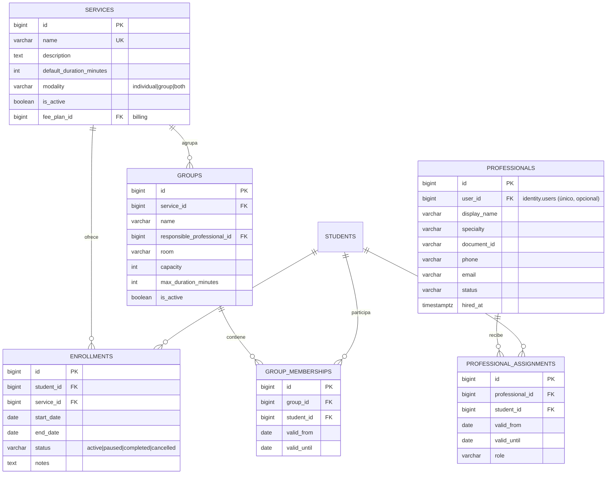

# Servicios, Profesionales y Matrículas

**Schema:** `scheduling` · **Paquete:** `cai/scheduling`

---

## 1. Diagrama



---

## 2. `services`

```sql
CREATE TABLE scheduling.services (
    id                       BIGSERIAL PRIMARY KEY,
    name                     VARCHAR(150) NOT NULL UNIQUE,
    description              TEXT,
    default_duration_minutes INTEGER,
    modality                 VARCHAR(20) NOT NULL DEFAULT 'both',
    color                    CHAR(7),
    is_active                BOOLEAN NOT NULL DEFAULT TRUE,
    sort_order               SMALLINT NOT NULL DEFAULT 0,
    created_at               TIMESTAMPTZ NOT NULL DEFAULT NOW(),
    updated_at               TIMESTAMPTZ NOT NULL DEFAULT NOW(),

    CONSTRAINT services_duration_check
        CHECK (default_duration_minutes IS NULL OR default_duration_minutes > 0),
    CONSTRAINT services_modality_check
        CHECK (modality IN ('individual', 'group', 'both'))
);
```

**`modality`** indica si el servicio se presta individual, en grupo o de ambas formas.
Restringe la creación de sesiones: un servicio `group` no admite sesión `individual`.

**`color`** se usa para el calendario. Es de presentación, no de negocio.

> [!note] `fee_plan_id`
> El plan de cuotas vive en `billing.fee_plans` y referencia el servicio. Para evitar una
> dependencia de schema (`scheduling` → `billing`, que no está permitida), el vínculo se
> hace **desde `billing`**: `billing.fee_plans.service_id → scheduling.services.id`.

---

## 3. `professionals`

```sql
CREATE TABLE scheduling.professionals (
    id          BIGSERIAL PRIMARY KEY,
    user_id     BIGINT UNIQUE REFERENCES identity.users(id) ON DELETE SET NULL,
    display_name VARCHAR(200) NOT NULL,
    specialty   VARCHAR(120),
    document_id VARCHAR(30),
    phone       VARCHAR(40),
    email       VARCHAR(254),
    license_number VARCHAR(80),
    status      VARCHAR(20) NOT NULL DEFAULT 'active',
    hired_at    DATE,
    notes       TEXT,
    created_at  TIMESTAMPTZ NOT NULL DEFAULT NOW(),
    updated_at  TIMESTAMPTZ NOT NULL DEFAULT NOW(),

    CONSTRAINT professionals_status_check
        CHECK (status IN ('active', 'inactive', 'on_leave'))
);
```

**Decisiones:**
- **`user_id` es opcional y único.** Hay profesionales que no usan el sistema (contratados
  externos que solo asisten de forma esporádica) y hay usuarios del sistema que no son
  profesionales (recepción, administración técnica).
- **`display_name`** es el nombre que se muestra en la agenda. Puede diferir del nombre de
  la cuenta de usuario.
- **`status = 'on_leave'`** para ausencias prolongadas: el profesional no puede ser
  asignado a sesiones nuevas, pero su historial se conserva.

---

## 4. `enrollments` (matrículas)

```sql
CREATE TABLE scheduling.enrollments (
    id         BIGSERIAL PRIMARY KEY,
    student_id BIGINT NOT NULL REFERENCES students.students(id) ON DELETE RESTRICT,
    service_id BIGINT NOT NULL REFERENCES scheduling.services(id) ON DELETE RESTRICT,
    start_date DATE NOT NULL,
    end_date   DATE,
    status     VARCHAR(20) NOT NULL DEFAULT 'active',
    notes      TEXT,
    created_at TIMESTAMPTZ NOT NULL DEFAULT NOW(),
    updated_at TIMESTAMPTZ NOT NULL DEFAULT NOW(),

    CONSTRAINT enrollments_status_check
        CHECK (status IN ('active', 'paused', 'completed', 'cancelled')),
    CONSTRAINT enrollments_dates_check
        CHECK (end_date IS NULL OR end_date >= start_date)
);

CREATE INDEX enrollments_student_index ON scheduling.enrollments (student_id, status);
CREATE INDEX enrollments_service_index ON scheduling.enrollments (service_id, status);
```

### 4.1 Restricción de exclusión: una matrícula activa por servicio

```sql
CREATE EXTENSION IF NOT EXISTS btree_gist;

ALTER TABLE scheduling.enrollments
    ADD CONSTRAINT enrollments_no_overlap
    EXCLUDE USING gist (
        student_id WITH =,
        service_id WITH =,
        daterange(start_date, COALESCE(end_date, 'infinity'::date), '[]') WITH &&
    )
    WHERE (status IN ('active', 'paused'));
```

**Comportamiento:**
- No se puede matricular dos veces al mismo alumno en el mismo servicio mientras la
  primera esté activa.
- Una matrícula `completed` o `cancelled` **no** bloquea una nueva (el rango cerrado no
  se solapa con el nuevo).
- Si el servicio cambia de precio, se cierra la matrícula anterior y se abre una nueva.

---

## 5. `groups`

```sql
CREATE TABLE scheduling.groups (
    id                          BIGSERIAL PRIMARY KEY,
    service_id                  BIGINT NOT NULL REFERENCES scheduling.services(id) ON DELETE RESTRICT,
    name                        VARCHAR(150) NOT NULL,
    responsible_professional_id BIGINT REFERENCES scheduling.professionals(id) ON DELETE RESTRICT,
    room                        VARCHAR(80),
    capacity                    SMALLINT NOT NULL,
    max_duration_minutes        INTEGER NOT NULL DEFAULT 60,
    notes                       TEXT,
    is_active                   BOOLEAN NOT NULL DEFAULT TRUE,
    created_at                  TIMESTAMPTZ NOT NULL DEFAULT NOW(),
    updated_at                  TIMESTAMPTZ NOT NULL DEFAULT NOW(),

    CONSTRAINT groups_capacity_check CHECK (capacity > 0),
    CONSTRAINT groups_duration_check  CHECK (max_duration_minutes > 0),
    CONSTRAINT groups_name_unique    UNIQUE (service_id, name)
);
```

**`capacity`** es el máximo de alumnos por sesión del grupo. Se valida al agregar
participantes y **también** con un trigger o una verificación al generar la sesión.

---

## 6. `group_memberships`

```sql
CREATE TABLE scheduling.group_memberships (
    id         BIGSERIAL PRIMARY KEY,
    group_id   BIGINT NOT NULL REFERENCES scheduling.groups(id) ON DELETE CASCADE,
    student_id BIGINT NOT NULL REFERENCES students.students(id) ON DELETE RESTRICT,
    valid_from DATE NOT NULL,
    valid_until DATE,
    created_at TIMESTAMPTZ NOT NULL DEFAULT NOW(),
    updated_at TIMESTAMPTZ NOT NULL DEFAULT NOW(),

    CONSTRAINT group_memberships_valid_check
        CHECK (valid_until IS NULL OR valid_until >= valid_from),
    CONSTRAINT group_memberships_unique UNIQUE (group_id, student_id, valid_from)
);

CREATE INDEX group_memberships_group_index   ON scheduling.group_memberships (group_id, valid_until);
CREATE INDEX group_memberships_student_index ON scheduling.group_memberships (student_id, valid_until);
```

**Un alumno puede estar en varios grupos** de servicios distintos. El historial permite
saber en qué grupo estaba cuando se dio una sesión.

---

## 7. `professional_assignments`

```sql
CREATE TABLE scheduling.professional_assignments (
    id             BIGSERIAL PRIMARY KEY,
    professional_id BIGINT NOT NULL REFERENCES scheduling.professionals(id) ON DELETE CASCADE,
    student_id     BIGINT NOT NULL REFERENCES students.students(id) ON DELETE CASCADE,
    role           VARCHAR(40) NOT NULL DEFAULT 'attendant',
    valid_from     DATE NOT NULL,
    valid_until    DATE,
    created_at     TIMESTAMPTZ NOT NULL DEFAULT NOW(),
    updated_at     TIMESTAMPTZ NOT NULL DEFAULT NOW(),

    CONSTRAINT professional_assignments_role_check
        CHECK (role IN ('attendant', 'responsible', 'supervisor', 'referent')),
    CONSTRAINT professional_assignments_valid_check
        CHECK (valid_until IS NULL OR valid_until >= valid_from)
);

CREATE INDEX prof_assign_prof_index   ON scheduling.professional_assignments (professional_id, valid_until);
CREATE INDEX prof_assign_student_index ON scheduling.professional_assignments (student_id, valid_until);
```

**Esta tabla es la base del control de alcance clínico.** El `care` módulo la consulta
(vía contrato) para verificar si un profesional tiene asignación vigente sobre un alumno.

**Roles:**
| Rol | Significado |
|---|---|
| `attendant` | Atiende al alumno efectivamente |
| `responsible` | Responsable principal (1 por alumno) |
| `supervisor` | Supervisa el plan de atención (Coordinación) |
| `referent` | Consulta puntualmente (referente externo,ikap) |

---

## 8. `availability_rules`

```sql
CREATE TABLE scheduling.availability_rules (
    id             BIGSERIAL PRIMARY KEY,
    professional_id BIGINT NOT NULL REFERENCES scheduling.professionals(id) ON DELETE CASCADE,
    weekday        SMALLINT NOT NULL,
    start_time     TIME NOT NULL,
    end_time       TIME NOT NULL,
    room           VARCHAR(80),
    valid_from     DATE NOT NULL,
    valid_until    DATE,
    created_at     TIMESTAMPTZ NOT NULL DEFAULT NOW(),
    updated_at     TIMESTAMPTZ NOT NULL DEFAULT NOW(),

    CONSTRAINT availability_weekday_check CHECK (weekday BETWEEN 0 AND 6),
    CONSTRAINT availability_time_check   CHECK (end_time > start_time)
);

CREATE INDEX availability_prof_index ON scheduling.availability_rules (professional_id, weekday);
```

`weekday`: 0 = domingo … 6 = sábado (convención PostgreSQL).

**Uso:** la plantilla de sesiones recurrentes usa estas reglas para generar el calendario.
Es una **pauta**, no una garantía: la validación dura es la de no-superposición (§8 de
[[03.04 Grupos, Sesiones y Asistencia]]).

---

## 9. Reglas de integridad

| # | Regla | Implementación |
|---|---|---|
| S-01 | Un alumno no tiene dos matrículas activas del mismo servicio | `EXCLUDE USING gist` |
| S-02 | Un servicio inactivo no admite nuevas matrículas | Validación en la Action |
| S-03 | Un profesional `on_leave` no puede recibir nuevas asignaciones | Validación |
| S-04 | La capacidad del grupo no se supera | Validación + verificación al generar sesión |
| S-05 | Un participante de una sesión grupal tiene matrícula activa del servicio | Validación |
| S-06 | Un profesional tiene como máximo un `responsible` por alumno | `UNIQUE` parcial sobre `(student_id) WHERE role='responsible'` |
| S-07 | Un miembro de grupo tiene matrícula activa del servicio del grupo | Validación |

---

## 10. Pruebas de integración

| Test | Escenario |
|---|---|
| `it_rejects_overlapping_enrollments` | Matricular dos veces al mismo alumno en el mismo servicio activo → error de DB |
| `it_allows_new_enrollment_after_completion` | Cerrar la primera matrícula y matricular de nuevo → OK |
| `it_transfers_preserve_history` | Transferir de cuenta deja la membresía anterior cerrada |
| `it_rejects_overlapping_family_memberships` | Meter al mismo alumno en dos cuentas → error de DB |
| `it_allows_family_membership_after_closing_previous` | Cerrar y volver a membership → OK |
| `it_assigns_responsible_once` | Dos `responsible` para el mismo alumno → error |

---

## 11. Documentos relacionados

- [[03.04 Grupos, Sesiones y Asistencia]]
- [[03.05 Planes de Atención y Notas Clínicas]]
- [[03.06 Finanzas Familiares]]
- [[02.04 Capas Internas de un Paquete]]
