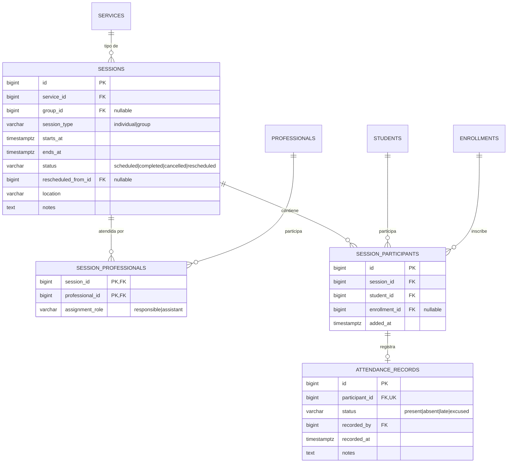
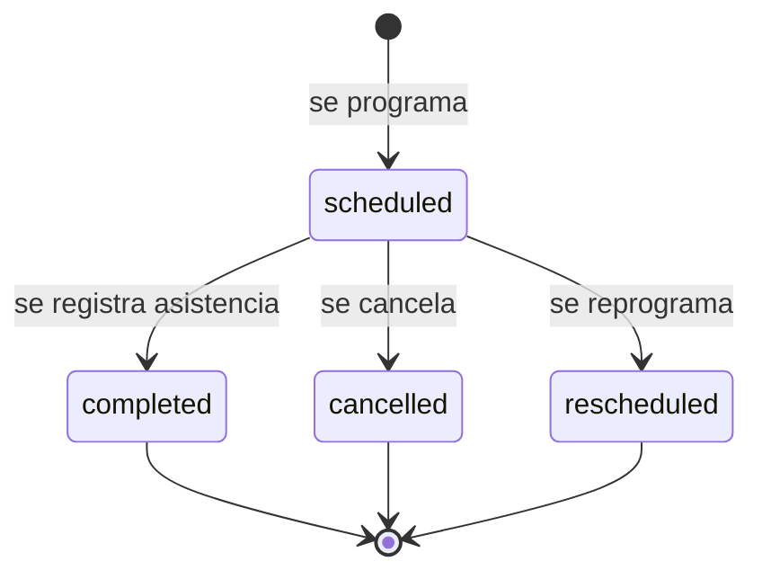

# Grupos, Sesiones y Asistencia

**Schema:** `scheduling` · **Paquete:** `cai/scheduling`

---

## 1. La distinción crítica

> **Inscripción ≠ Sesión ≠ Asistencia**

| Concepto | Tabla | Significado |
|---|---|---|
| Inscripción (*enrollment*) | `enrollments` | Qué servicio recibe el alumno y en qué periodo |
| Sesión (*session*) | `sessions` | Qué atención se programa, cuándo, dónde y con qué profesional |
| Participante | `session_participants` | Que alumno está en esa sesión concreta |
| Asistencia | `attendance_records` | Qué ocurrió con ese alumno en esa sesión |

**Una sesión grupal de 10 alumnos = 1 registro de `sessions` + 10 de
`session_participants` + hasta 10 de `attendance_records`.**

Nunca 10 sesiones duplicadas.

---

## 2. Diagrama



---

## 3. `sessions`

```sql
CREATE TABLE scheduling.sessions (
    id                   BIGSERIAL PRIMARY KEY,
    service_id           BIGINT NOT NULL REFERENCES scheduling.services(id) ON DELETE RESTRICT,
    group_id             BIGINT REFERENCES scheduling.groups(id) ON DELETE SET NULL,
    session_type         VARCHAR(20) NOT NULL,
    starts_at            TIMESTAMPTZ NOT NULL,
    ends_at              TIMESTAMPTZ NOT NULL,
    status               VARCHAR(20) NOT NULL DEFAULT 'scheduled',
    rescheduled_from_id  BIGINT REFERENCES scheduling.sessions(id) ON DELETE SET NULL,
    location             VARCHAR(150),
    notes                TEXT,
    created_by           BIGINT REFERENCES identity.users(id),
    updated_by           BIGINT REFERENCES identity.users(id),
    created_at           TIMESTAMPTZ NOT NULL DEFAULT NOW(),
    updated_at           TIMESTAMPTZ NOT NULL DEFAULT NOW(),

    CONSTRAINT sessions_type_check
        CHECK (session_type IN ('individual', 'group')),
    CONSTRAINT sessions_status_check
        CHECK (status IN ('scheduled', 'completed', 'cancelled', 'rescheduled')),
    CONSTRAINT sessions_time_check
        CHECK (ends_at > starts_at)
);

CREATE INDEX sessions_start_index    ON scheduling.sessions (starts_at);
CREATE INDEX sessions_range_index    ON scheduling.sessions USING gist (tstzrange(starts_at, ends_at));
CREATE INDEX sessions_service_index  ON scheduling.sessions (service_id, starts_at);
CREATE INDEX sessions_status_index   ON scheduling.sessions (status, starts_at);
```

**Decisiones:**
- **`TIMESTAMPTZ`** siempre. El centro opera en una zona horaria; guardar hora local sin
  offset lleva a errores en horario de verano o cambios de hora oficial.
- **`group_id` nullable**: una sesión grupal puede no provenir de un grupo (sesión
  puntual). Una sesión individual siempre tiene `group_id = NULL`.
- **`rescheduled_from_id`**: la reprogramación crea una sesión **nueva**; la original pasa
  a `rescheduled`. Se conserva el historial completo.
- **`notes`**: observaciones operativas (no clínicas). Las observaciones clínicas van en
  `care.clinical_notes`.

---

## 4. Restricción de no-superposición (la garantía clave)

```sql
CREATE EXTENSION IF NOT EXISTS btree_gist;

-- Un profesional no puede tener dos sesiones que se solapen.
ALTER TABLE scheduling.session_professionals
    ADD CONSTRAINT no_overlapping_sessions
    EXCLUDE USING gist (
        professional_id WITH =,
        tstzrange(session.starts_at, session.ends_at, '[]') WITH &&
    );
```

> [!important] Limitación técnica conocida
> PostgreSQL **no permite** `EXCLUDE` sobre una tabla con clave foránea a otra tabla (las
> columnas de la restricción deben pertenecer a la tabla). Por eso la restricción se
> aplica sobre la tabla pivote `session_professionals`, **usando un denormalizado de
> `starts_at`/`ends_at`**.
>
> **Solución adopted:** agregar `starts_at` y `ends_at` como columnas denormalizadas en
> `session_professionals`, mantenidas por la aplicación y verificadas por un trigger
> `BEFORE INSERT OR UPDATE` que las sincroniza con `sessions`. La restricción de
> exclusión entonces sí funciona.
>
> **Alternativa (preferida si se confirma):** usar una vista materializada o una función
> `STRETCHED` trigger que lance la excepción. Se evalúa en la F4.

**Implementación con columnas denormalizadas:**

```sql
CREATE TABLE scheduling.session_professionals (
    session_id      BIGINT NOT NULL REFERENCES scheduling.sessions(id) ON DELETE CASCADE,
    professional_id BIGINT NOT NULL REFERENCES scheduling.professionals(id) ON DELETE CASCADE,
    assignment_role VARCHAR(50) NOT NULL DEFAULT 'responsible',
    starts_at       TIMESTAMPTZ NOT NULL,
    ends_at         TIMESTAMPTZ NOT NULL,
    created_at      TIMESTAMPTZ NOT NULL DEFAULT NOW(),

    PRIMARY KEY (session_id, professional_id),
    CONSTRAINT session_professionals_time_check CHECK (ends_at > starts_at)
);

ALTER TABLE scheduling.session_professionals
    ADD CONSTRAINT no_overlapping_sessions
    EXCLUDE USING gist (
        professional_id WITH =,
        tstzrange(starts_at, ends_at, '[]') WITH &&
    );

-- Trigger que mantiene la denormalización sincronizada.
CREATE OR REPLACE FUNCTION scheduling.sync_session_times()
RETURNS TRIGGER AS $$
BEGIN
    SELECT starts_at, ends_at INTO NEW.starts_at, NEW.ends_at
    FROM scheduling.sessions WHERE id = NEW.session_id;
    RETURN NEW;
END;
$$ LANGUAGE plpgsql;

CREATE TRIGGER session_professionals_sync
    BEFORE INSERT OR UPDATE ON scheduling.session_professionals
    FOR EACH ROW EXECUTE FUNCTION scheduling.sync_session_times();
```

---

## 5. `session_professionals`

```sql
CREATE TABLE scheduling.session_professionals (
    session_id      BIGINT NOT NULL REFERENCES scheduling.sessions(id) ON DELETE CASCADE,
    professional_id BIGINT NOT NULL REFERENCES scheduling.professionals(id) ON DELETE CASCADE,
    assignment_role VARCHAR(50) NOT NULL DEFAULT 'responsible',
    starts_at       TIMESTAMPTZ NOT NULL,
    ends_at         TIMESTAMPTZ NOT NULL,
    created_at      TIMESTAMPTZ NOT NULL DEFAULT NOW(),

    PRIMARY KEY (session_id, professional_id),
    CONSTRAINT session_professionals_role_check
        CHECK (assignment_role IN ('responsible', 'assistant', 'observer')),
    CONSTRAINT session_professionals_time_check CHECK (ends_at > starts_at)
);
```

| Rol | Puede registrar asistencia | Puede escribir nota clínica |
|---|---|---|
| `responsible` | ✅ | ✅ |
| `assistant` | ✅ (si el responsable no está) | ⚠️ Solo si tiene asignación vigente al alumno |
| `observer` | ❌ | ❌ |

---

## 6. `session_participants`

```sql
CREATE TABLE scheduling.session_participants (
    id            BIGSERIAL PRIMARY KEY,
    session_id    BIGINT NOT NULL REFERENCES scheduling.sessions(id) ON DELETE CASCADE,
    student_id    BIGINT NOT NULL REFERENCES students.students(id) ON DELETE RESTRICT,
    enrollment_id BIGINT REFERENCES scheduling.enrollments(id) ON DELETE SET NULL,
    added_by      BIGINT REFERENCES identity.users(id),
    created_at    TIMESTAMPTZ NOT NULL DEFAULT NOW(),

    CONSTRAINT session_participants_unique UNIQUE (session_id, student_id)
);

CREATE INDEX session_participants_student_index
    ON scheduling.session_participants (student_id, session_id);
CREATE INDEX session_participants_session_index
    ON scheduling.session_participants (session_id);
```

**¿Por qué `enrollment_id` nullable?**
Porque en una sesión grupal, un participante puede estar ahí sin que su matrícula del
servicio específico esté activa (por ejemplo, una sesión de evaluación puntual). Cuando
sí hay matrícula, se guarda el enlace para poder saber qué cobertura contractual tenía.

---

## 7. `attendance_records`

```sql
CREATE TABLE scheduling.attendance_records (
    id            BIGSERIAL PRIMARY KEY,
    participant_id BIGINT NOT NULL UNIQUE REFERENCES scheduling.session_participants(id) ON DELETE CASCADE,
    status        VARCHAR(20) NOT NULL,
    recorded_by   BIGINT NOT NULL REFERENCES identity.users(id),
    recorded_at   TIMESTAMPTZ NOT NULL DEFAULT NOW(),
    notes         TEXT
);

CREATE INDEX attendance_status_index ON scheduling.attendance_records (status);

ALTER TABLE scheduling.attendance_records
    ADD CONSTRAINT attendance_status_check
    CHECK (status IN ('present', 'absent', 'late', 'excused'));
```

**Reglas:**
- **Un registro por participante** (`UNIQUE(participant_id)`). Si se corrige, se
  **actualiza** el registro y se deja el valor anterior en `audit_events`
  (`attendance.corrected` con el diff).
- **`recorded_by` no se borra**: si el profesional que registró se va del centro, el
  registro sigue diciendo quién lo hizo.
- **`recorded_at`** es el momento real del registro (puede diferir del momento de la
  sesión si se registra después).

---

## 8. Máquina de estados de la sesión



**Transiciones válidas:**

| Desde | Hacia | Quién | Efectos |
|---|---|---|---|
| `scheduled` | `completed` | Profesional responsable | Habilita el registro de notas de esa sesión |
| `scheduled` | `cancelled` | Coordinación, Secretaría | Notifica a los tutores; conserva participantes |
| `scheduled` | `rescheduled` | Coordinación | Crea la sesión nueva con `rescheduled_from_id` |
| `completed` | — | — | **No se puede volver atrás.** Una corrección de asistencia sí se permite, pero queda auditada |

---

## 9. Generador de sesiones desde plantillas

**Entrada:** grupo + profesional responsable + regla de recurrencia (días de la semana,
rango de fechas, hora, duración, sala).

**Algoritmo:**

```
1. Expandir la recurrencia en fechas entre valid_from y valid_until.
2. Para cada fecha:
   a. Crear la sesión (session_type = 'group', group_id, starts_at, ends_at).
   b. Copiar los miembros vigentes del grupo como participantes.
   c. Asignar el profesional responsable (+ ayudantes).
3. Verificar no-superposición: si choca, se omite y se reporta.
```

**Reglas:**
- Idempotente por (`group_id`, `starts_at`): reejecutar no duplica.
- Días feriados: una tabla de días no laborables por año (en `identity.settings` o tabla
  propia). **P4 pendiente** — ver [[01.07 Preguntas Abiertas y Decisiones Pendientes]].
- El generador se ejecuta en la **F4** y **no** en la F3.

---

## 10. Consultas frecuentes e índices

| Consulta | Índice |
|---|---|
| Agenda del día por profesional | `sessions_start_index` + `session_professionals` |
| Agenda del mes (calendario) | `sessions_range_index` (GiST) |
| Historial de un alumno | `session_participants_student_index` |
| Sesiones sin completar | `sessions_status_index` |
| Por grupo | `sessions_service_index` + filtro `group_id` |

**Índice GiST sobre `tstzrange`:** permite consultas de solapamiento eficientes
("¿qué sesiones se superponen con esta?") y es requisito de la restricción de exclusión.

---

## 11. Reportes que este modelo habilita

| Reporte | Consulta |
|---|---|
| Asistencia por periodo y servicio | `attendance_records` + `sessions` + `services` |
| Sesiones programadas vs. realizadas | `sessions` por `status` |
| Alumnos que faltan más | `attendance_records` con `status IN ('absent','late')` agrupado por alumno |
| Carga por profesional | `session_professionals` por profesional y rango de fechas |
| Ocupación de sala | `sessions` por `location` y rango de horas |

---

## 12. Documentos relacionados

- [[03.03 Servicios, Profesionales y Matrículas]]
- [[03.05 Planes de Atención y Notas Clínicas]]
- [[03.08 Catálogo de Enumeraciones e Integridad]]
- [[01.04 Reglas de Negocio]]
