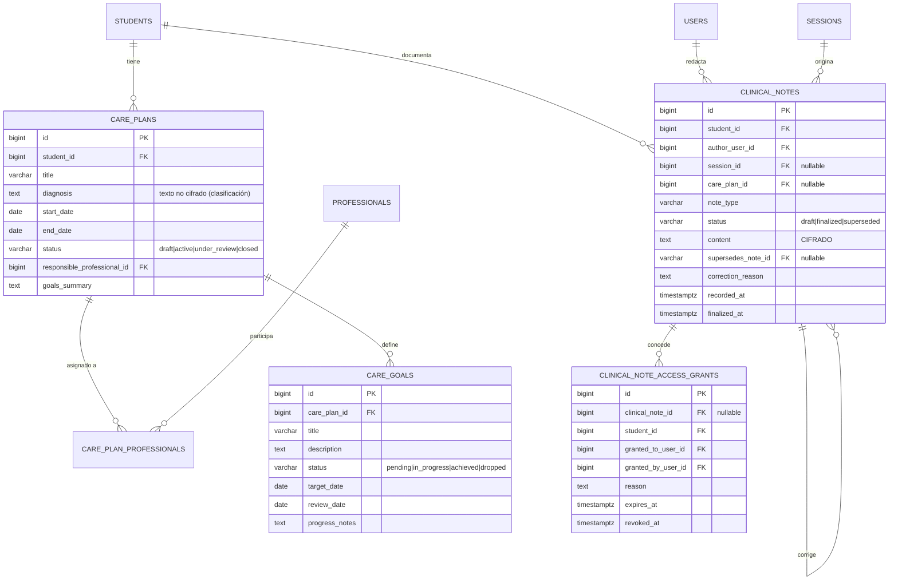
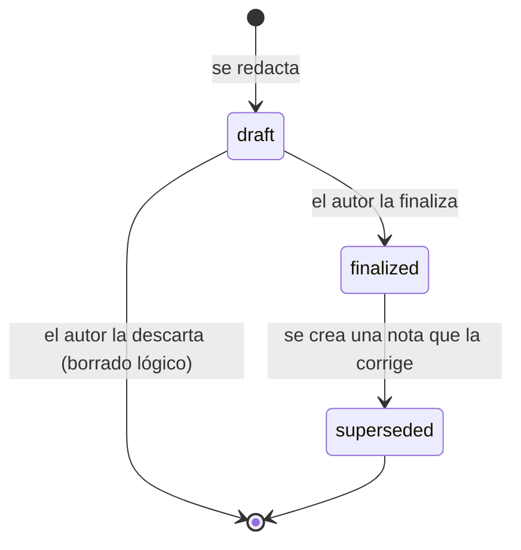

# Planes de Atención y Notas Clínicas

**Schema:** `care` · **Paquete:** `cai/care`

> [!danger] Área de datos sensibles
> Este es el módulo con **mayor riesgo legal y ético** del sistema. Todo lo que sigue
> aplica reglas más estrictas que el resto. Ver
> [[04.04 Datos Clínicos: Cifrado y Acceso]].

---

## 1. Diagrama



---

## 2. `care_plans`

```sql
CREATE TABLE care.care_plans (
    id                          BIGSERIAL PRIMARY KEY,
    student_id                  BIGINT NOT NULL REFERENCES students.students(id) ON DELETE RESTRICT,
    title                       VARCHAR(200) NOT NULL,
    diagnosis                   TEXT,
    start_date                  DATE NOT NULL,
    end_date                    DATE,
    status                      VARCHAR(20) NOT NULL DEFAULT 'draft',
    responsible_professional_id BIGINT REFERENCES scheduling.professionals(id) ON DELETE RESTRICT,
    goals_summary               TEXT,
    review_interval_days        SMALLINT NOT NULL DEFAULT 90,
    created_by                  BIGINT REFERENCES identity.users(id),
    created_at                  TIMESTAMPTZ NOT NULL DEFAULT NOW(),
    updated_at                  TIMESTAMPTZ NOT NULL DEFAULT NOW(),

    CONSTRAINT care_plans_status_check
        CHECK (status IN ('draft', 'active', 'under_review', 'closed')),
    CONSTRAINT care_plans_dates_check
        CHECK (end_date IS NULL OR end_date >= start_date)
);

CREATE INDEX care_plans_student_index ON care.care_plans (student_id, status);
```

> [!warning] `diagnosis` NO está cifrada
> Es un dato clínico, pero **clasificatorio** (p. ej. *"Trastorno del lenguaje"*), y se
> necesita para reportes de gestión y para el índice de búsqueda. El contenido narrativo
> de la atención sí está cifrado (en `clinical_notes.content`).
>
> **Decisión a revisar con Dirección** (ver P7 en
> [[01.07 Preguntas Abiertas y Decisiones Pendientes]]): ¿el panel de Dirección necesita
> ver la clasificación diagnóstica? Si no, `diagnosis` también se cifra y los reportes
> clínicos dejan de ser accesibles a la Dirección.

---

## 3. `care_plan_professionals`

```sql
CREATE TABLE care.care_plan_professionals (
    id             BIGSERIAL PRIMARY KEY,
    care_plan_id   BIGINT NOT NULL REFERENCES care.care_plans(id) ON DELETE CASCADE,
    professional_id BIGINT NOT NULL REFERENCES scheduling.professionals(id) ON DELETE RESTRICT,
    role           VARCHAR(40) NOT NULL DEFAULT 'responsible',
    created_at     TIMESTAMPTZ NOT NULL DEFAULT NOW(),

    PRIMARY KEY (care_plan_id, professional_id),
    CONSTRAINT care_plan_professionals_role_check
        CHECK (role IN ('responsible', 'collaborator', 'reviewer'))
);

-- Un solo responsable por plan
CREATE UNIQUE INDEX care_plans_one_responsible
    ON care.care_plan_professionals (care_plan_id)
    WHERE role = 'responsible';
```

---

## 4. `care_goals`

```sql
CREATE TABLE care.care_goals (
    id             BIGSERIAL PRIMARY KEY,
    care_plan_id   BIGINT NOT NULL REFERENCES care.care_plans(id) ON DELETE CASCADE,
    title          VARCHAR(200) NOT NULL,
    description    TEXT,
    baseline       TEXT,
    status         VARCHAR(20) NOT NULL DEFAULT 'pending',
    target_date    DATE,
    review_date    DATE,
    progress_notes TEXT,
    sort_order     SMALLINT NOT NULL DEFAULT 0,
    created_at     TIMESTAMPTZ NOT NULL DEFAULT NOW(),
    updated_at     TIMESTAMPTZ NOT NULL DEFAULT NOW(),

    CONSTRAINT care_goals_status_check
        CHECK (status IN ('pending', 'in_progress', 'achieved', 'dropped', 'postponed'))
);

CREATE INDEX care_goals_plan_index   ON care.care_goals (care_plan_id, status);
CREATE INDEX care_goals_review_index ON care.care_goals (review_date) WHERE status IN ('pending','in_progress');
```

`review_date` permite generar la lista de objetivos a revisar en el panel del
profesional.

---

## 5. `clinical_notes` — la tabla sensible

```sql
CREATE TABLE care.clinical_notes (
    id                 BIGSERIAL PRIMARY KEY,
    student_id         BIGINT NOT NULL REFERENCES students.students(id) ON DELETE RESTRICT,
    author_user_id     BIGINT NOT NULL REFERENCES identity.users(id) ON DELETE RESTRICT,
    session_id         BIGINT REFERENCES scheduling.sessions(id) ON DELETE SET NULL,
    care_plan_id       BIGINT REFERENCES care.care_plans(id) ON DELETE SET NULL,
    note_type          VARCHAR(40) NOT NULL,
    status             VARCHAR(20) NOT NULL DEFAULT 'draft',
    content            TEXT NOT NULL,          -- ← CIFRADO EN APLICACIÓN
    summary            VARCHAR(300),           -- ← metadato en claro (no clínico)
    supersedes_note_id BIGINT REFERENCES care.clinical_notes(id) ON DELETE SET NULL,
    correction_reason  TEXT,
    recorded_at        TIMESTAMPTZ NOT NULL DEFAULT NOW(),
    finalized_at       TIMESTAMPTZ,
    created_at         TIMESTAMPTZ NOT NULL DEFAULT NOW(),
    updated_at         TIMESTAMPTZ NOT NULL DEFAULT NOW(),

    CONSTRAINT clinical_notes_status_check
        CHECK (status IN ('draft', 'finalized', 'superseded')),
    CONSTRAINT clinical_notes_type_check
        CHECK (note_type IN ('session', 'evaluation', 'progress', 'incident',
                             'family_contact', 'referral', 'administrative')),
    CONSTRAINT clinical_notes_finalized_check
        CHECK (status = 'draft' OR finalized_at IS NOT NULL),
    CONSTRAINT clinical_notes_correction_check
        CHECK (supersedes_note_id IS NULL OR correction_reason IS NOT NULL)
);

CREATE INDEX clinical_notes_student_index  ON care.clinical_notes (student_id, recorded_at DESC);
CREATE INDEX clinical_notes_author_index   ON care.clinical_notes (author_user_id, recorded_at DESC);
CREATE INDEX clinical_notes_session_index  ON care.clinical_notes (session_id);
CREATE INDEX clinical_notes_drafts_index   ON care.clinical_notes (author_user_id) WHERE status = 'draft';
```

### 5.1 El criterio de cifrado

| Columna | Cifrada | Motivo |
|---|---|---|
| `content` | ✅ **Sí** | Contenido narrativo de la atención. Es el dato más sensible del sistema |
| `summary` | ❌ No | Metadato de ≤300 caracteres para listados. **Debe redactarse sin información clínica sensible** |
| `note_type`, `status`, `recorded_at` | ❌ No | Necesarios para filtrar, indexar y ordenar |
| `student_id`, `author_user_id` | ❌ No | Necesarios para filtros y para la auditoría de lectura |
| `correction_reason` | ❌ No | Es un motivo administrativo ("error de tipeo"), no clínico |
| `diagnosis` (en `care_plans`) | ❌ No (revisar) | Ver §2 |

### 5.2 Implementación del cifrado

```php
namespace Cai\Care\Models;

use Illuminate\Database\Eloquent\Casts\Attribute;
use Illuminate\Database\Eloquent\Model;

final class ClinicalNote extends Model
{
    protected $connection = 'care';

    protected $table = 'clinical_notes';

    protected $fillable = [
        'student_id', 'author_user_id', 'session_id', 'care_plan_id',
        'note_type', 'status', 'content', 'summary',
        'supersedes_note_id', 'correction_reason', 'recorded_at', 'finalized_at',
    ];

    protected $casts = [
        'recorded_at'  => 'immutable_datetime',
        'finalized_at' => 'immutable_datetime',
        'content'      => 'encrypted',      // ← cifrado de aplicación (AES-256-GCM)
    ];
}
```

> [!important] Consecuencia operacional
> El contenido cifrado **no se puede buscar con SQL**. Por eso:
> - El campo `summary` existe para los listados.
> - Los filtros (por alumno, autor, tipo, fecha, estado) funcionan sobre columnas en claro.
> - La búsqueda de texto libre dentro de notas **no está disponible** en el MVP.
> - `ILIKE '%texto%'` sobre `content` no funciona. **No intentar.**

### 5.3 Ciclo de vida



**Reglas:**
- `draft`: solo el autor puede editarla o eliminarla.
- `finalized`: **inmutable**. Ni el autor ni Dirección pueden editarla.
- Corrección: se crea una nota nueva con `supersedes_note_id` y `correction_reason`
  obligatorio. La original pasa a `superseded`. **Nada se borra ni se reescribe.**
- El `status` de una nota finalizada nunca vuelve a `draft`.

---

## 6. `clinical_note_access_grants`

```sql
CREATE TABLE care.clinical_note_access_grants (
    id                   BIGSERIAL PRIMARY KEY,
    clinical_note_id     BIGINT REFERENCES care.clinical_notes(id) ON DELETE CASCADE,
    student_id           BIGINT NOT NULL REFERENCES students.students(id) ON DELETE CASCADE,
    granted_to_user_id   BIGINT NOT NULL REFERENCES identity.users(id) ON DELETE CASCADE,
    granted_by_user_id   BIGINT NOT NULL REFERENCES identity.users(id) ON DELETE RESTRICT,
    reason               TEXT NOT NULL,
    expires_at           TIMESTAMPTZ NOT NULL,
    revoked_at           TIMESTAMPTZ,
    revoked_by_user_id   BIGINT REFERENCES identity.users(id),
    created_at           TIMESTAMPTZ NOT NULL DEFAULT NOW(),

    CONSTRAINT grants_reason_check CHECK (length(reason) >= 20),
    CONSTRAINT grants_expiry_check  CHECK (expires_at > created_at),
    CONSTRAINT grants_target_check
        CHECK (clinical_note_id IS NOT NULL OR student_id IS NOT NULL)
);

CREATE INDEX grants_user_index    ON care.clinical_note_access_grants (granted_to_user_id, expires_at);
CREATE INDEX grants_student_index  ON care.clinical_note_access_grants (student_id, expires_at);
CREATE INDEX grants_active_index   ON care.clinical_note_access_grants (granted_to_user_id)
    WHERE revoked_at IS NULL;
```

**Dos alcances posibles:**
- `clinical_note_id` → acceso a **una nota concreta**.
- `student_id` → acceso a **todas las notas de un alumno** (más amplio, se usa con más
  cautela).

**Verificación de un grant activo:**

```sql
-- Un grant está activo si: no fue revocado, no expiró y el usuario sigue activo.
SELECT EXISTS (
    SELECT 1 FROM care.clinical_note_access_grants
    WHERE granted_to_user_id = :user
      AND (clinical_note_id = :note OR student_id = :student)
      AND revoked_at IS NULL
      AND expires_at > NOW()
);
```

**Reglas:**
- **Motivo mínimo 20 caracteres.** Es una justificación, no un "ok".
- **Expiración obligatoria**, máximo por defecto 30 días.
- **Máximo 30 días** por grant, salvo excepción expresa de Dirección (auditada).
- Todo grant emitido, revocado o expirado queda en `identity.security_events`.

---

## 7. Tipos de nota clínica

| Tipo | Cuándo se usa | Visible para |
|---|---|---|
| `session` | Observación de una sesión | Profesional asignado, responsable del plan |
| `evaluation` | Evaluación inicial o periódica | Profesional asignado, responsable del plan |
| `progress` | Registro de progreso entre sesiones | Ídem |
| `incident` | Incidente durante la atención | Dirección (obligatorio), profesional, responsable del plan |
| `family_contact` | Comunicación relevante con la familia | Profesional, Dirección |
| `referral` | Derivación a otro servicio o profesional | Profesional, Coordinación |
| `administrative` | Trámite, no clínico | Profesional, Secretaría (según permiso) |

> [!note] `incident` y `family_contact` tienen visibilidad ampliada
> Un incidente (agresión, accidente, conducta) debe ser visible por Dirección por
> obligación de supervisión. La nota sigue requiriendo el permiso `care.notes.view`.

---

## 8. Reglas de integridad

| # | Regla | Implementación |
|---|---|---|
| C-01 | Una nota finalizada tiene `finalized_at` | Check en DB |
| C-02 | Una nota que corrige a otra tiene motivo | Check en DB |
| C-03 | El autor de una nota es el único que puede finalizarla | Policy |
| C-04 | Solo el autor puede editar una nota en borrador | Policy |
| C-05 | Una nota finalizada no se borra | No hay `deleted_at` en la tabla; el estado `superseded` reemplaza al borrado |
| C-06 | Los grants tienen motivo ≥ 20 caracteres y expiración futura | Checks |
| C-07 | Un plan tiene un solo responsable | Índice único parcial |
| C-08 | Toda lectura de una nota genera auditoría | Observer + `audit_events` |

---

## 9. Pruebas obligatorias del módulo

| Test | Escenario |
|---|---|
| `it_hides_clinical_notes_from_other_students` | Profesional A no ve notas del alumno B |
| `it_shows_own_notes_to_author` | El autor ve su nota |
| `it_blocks_admin_from_reading_clinical_notes` | Administración técnica recibe 403 |
| `it_prevents_editing_finalized_note` | Actualizar una nota finalizada falla |
| `it_requires_reason_when_superseding` | Corregir sin motivo falla (validación) |
| `it_encrypts_content_at_rest` | El valor en la base no es el texto plano |
| `it_records_audit_event_on_read` | Leer una nota deja registro |
| `it_expires_grants_automatically` | Un grant vencido no da acceso |
| `it_requires_reason_length_on_grant` | Grant con motivo corto falla |
| `it_excludes_clinical_notes_from_exports` | Una exportación de dirección no incluye notas |

---

## 10. Reportes del módulo

| Reporte | Contenido | Quién lo ve |
|---|---|---|
| Objetivos a revisar | Objetivos con `review_date` vencida | Profesional, Coordinación |
| Planes activos por alumno | Listado de planes y objetivos | Profesional asignado |
| Progreso del alumno | Objetivos con estado y fechas | Profesional, Dirección (agregado, sin texto) |
| Actividad clínica por periodo | Cantidad de notas por tipo y periodo | Dirección (agregado) |

**Ninguno de estos reportes incluye el contenido de las notas** sin el permiso específico.

---

## 11. Documentos relacionados

- [[03.04 Grupos, Sesiones y Asistencia]]
- [[04.04 Datos Clínicos: Cifrado y Acceso]]
- [[04.05 Auditoría de Datos Sensibles]]
- [[02.06 Modelo de Autorización y Permisos]]
- [[ADR-0006 Cifrado de Notas Clínicas]]
