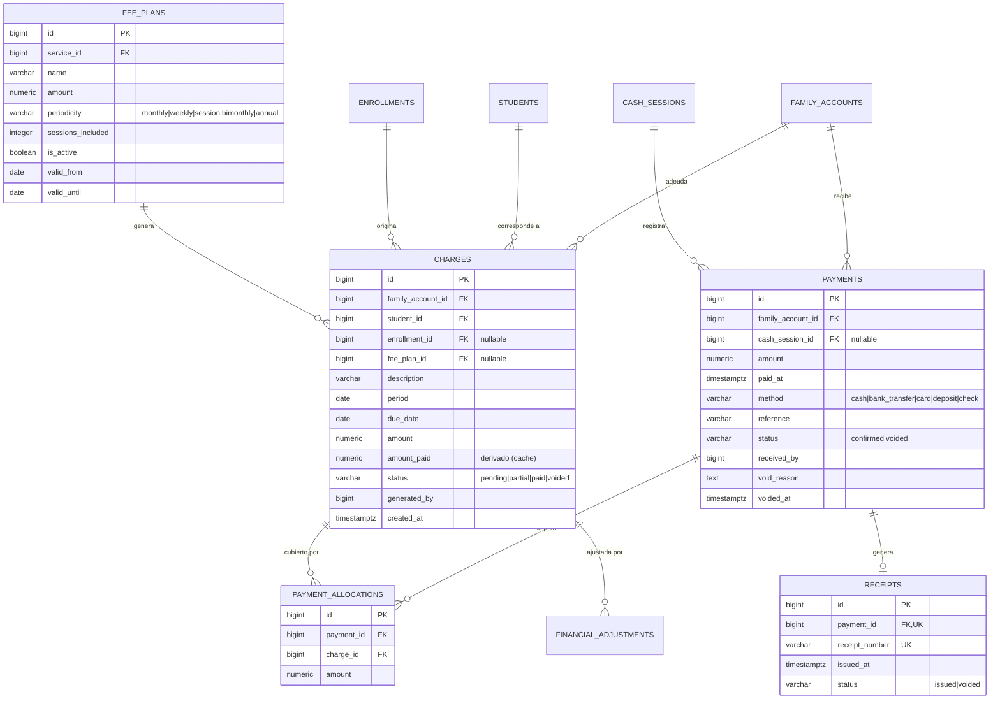
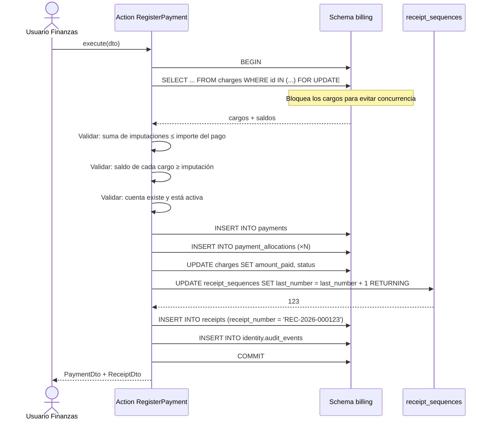

# Finanzas Familiares

**Schema:** `billing` · **Paquete:** `cai/billing`

> [!danger] Módulo de mayor impacto económico
> Un error aquí se traduce en pérdida de plata real y en desconfianza de las familias. Por
> eso: **el saldo se calcula, nunca se edita**; **nada se borra**; **todo se anula con
> motivo**; y **la operación crítica es atómica**.

---

## 1. Diagrama



---

## 2. Principio: el saldo es un cálculo

```
Saldo de un cargo   = cargo.amount − Σ(imputaciones válidas sobre ese cargo)
Saldo de la cuenta  = Σ(saldos de sus cargos) − pagos no imputados
```

**No existe columna `balance` en ninguna tabla.** No se puede editar un saldo a mano.

> [!note] `amount_paid` en `charges`
> Es una **caché de lectura** calculada por trigger o por la aplicación, no la fuente de
> verdad. Puede estar desactualizada un instante; el saldo real siempre se recalcula desde
> `payment_allocations`. Si se decide eliminarla, el sistema sigue siendo correcto (más
> lento). Se mantiene porque el listado de deuda lo muestra en miles de filas.

---

## 3. `fee_plans`

```sql
CREATE TABLE billing.fee_plans (
    id                  BIGSERIAL PRIMARY KEY,
    service_id          BIGINT NOT NULL REFERENCES scheduling.services(id) ON DELETE RESTRICT,
    name                VARCHAR(150) NOT NULL,
    description         TEXT,
    amount              NUMERIC(14,2) NOT NULL,
    periodicity         VARCHAR(20) NOT NULL DEFAULT 'monthly',
    sessions_included   INTEGER,
    discount_percent    NUMERIC(5,2) NOT NULL DEFAULT 0,
    is_active           BOOLEAN NOT NULL DEFAULT TRUE,
    valid_from          DATE NOT NULL,
    valid_until         DATE,
    created_at          TIMESTAMPTZ NOT NULL DEFAULT NOW(),
    updated_at          TIMESTAMPTZ NOT NULL DEFAULT NOW(),

    CONSTRAINT fee_plans_amount_check    CHECK (amount > 0),
    CONSTRAINT fee_plans_discount_check  CHECK (discount_percent >= 0 AND discount_percent <= 100),
    CONSTRAINT fee_plans_period_check
        CHECK (periodicity IN ('monthly', 'bimonthly', 'weekly', 'annual', 'session')),
    CONSTRAINT fee_plans_dates_check     CHECK (valid_until IS NULL OR valid_until >= valid_from)
);

CREATE INDEX fee_plans_service_index ON billing.fee_plans (service_id, is_active);
```

**`periodicity = 'session'`** cubre el caso de cobro por unidad (P1 en
[[01.07 Preguntas Abiertas y Decisiones Pendientes]]). Si la respuesta es "por sesión",
el cargo se genera al cerrar la sesión.

---

## 4. `charges`

```sql
CREATE TABLE billing.charges (
    id                 BIGSERIAL PRIMARY KEY,
    family_account_id  BIGINT NOT NULL REFERENCES students.family_accounts(id) ON DELETE RESTRICT,
    student_id         BIGINT NOT NULL REFERENCES students.students(id) ON DELETE RESTRICT,
    enrollment_id      BIGINT REFERENCES scheduling.enrollments(id) ON DELETE SET NULL,
    fee_plan_id        BIGINT REFERENCES billing.fee_plans(id) ON DELETE SET NULL,
    description        VARCHAR(200) NOT NULL,
    period             DATE,
    due_date           DATE NOT NULL,
    amount             NUMERIC(14,2) NOT NULL,
    amount_paid        NUMERIC(14,2) NOT NULL DEFAULT 0,
    status             VARCHAR(20) NOT NULL DEFAULT 'pending',
    generated_by       BIGINT REFERENCES identity.users(id),
    generation_source  VARCHAR(20) NOT NULL DEFAULT 'plan',
    created_at         TIMESTAMPTZ NOT NULL DEFAULT NOW(),
    updated_at         TIMESTAMPTZ NOT NULL DEFAULT NOW(),

    CONSTRAINT charges_amount_check   CHECK (amount > 0),
    CONSTRAINT charges_paid_check     CHECK (amount_paid >= 0 AND amount_paid <= amount),
    CONSTRAINT charges_status_check   CHECK (status IN ('pending', 'partial', 'paid', 'voided')),
    CONSTRAINT charges_source_check   CHECK (generation_source IN ('plan', 'manual', 'session'))
);

CREATE INDEX charges_account_due_index  ON billing.charges (family_account_id, due_date);
CREATE INDEX charges_student_index      ON billing.charges (student_id, period);
CREATE INDEX charges_status_index       ON billing.charges (status, due_date);
CREATE INDEX charges_period_index       ON billing.charges (period);
```

**Puntos clave:**
- **`family_account_id` + `student_id` + `enrollment_id`**: la cuenta consolidada, el
  alumno beneficiario y el origen. Se puede saber a qué hijo y servicio pertenece cada
  deuda sin perder la visión de familia.
- **`period`**: el mes/periodo facturado (no la fecha de vencimiento).
- **`generation_source`**: distingue el cargo automático del manual. Un cargo manual
  exige autorización (RN-072).
- **`status`**: `pending` (sin pago), `partial` (pago parcial), `paid` (cubierto),
  `voided` (anulado). El estado se **recalcula** al imputar o anular.

---

## 5. `payments`

```sql
CREATE TABLE billing.payments (
    id                BIGSERIAL PRIMARY KEY,
    family_account_id BIGINT NOT NULL REFERENCES students.family_accounts(id) ON DELETE RESTRICT,
    cash_session_id   BIGINT REFERENCES billing.cash_sessions(id) ON DELETE SET NULL,
    amount            NUMERIC(14,2) NOT NULL,
    paid_at           TIMESTAMPTZ NOT NULL,
    method            VARCHAR(30) NOT NULL,
    reference         VARCHAR(100),
    payer_name        VARCHAR(150),
    status            VARCHAR(20) NOT NULL DEFAULT 'confirmed',
    received_by       BIGINT NOT NULL REFERENCES identity.users(id),
    void_reason       TEXT,
    voided_at         TIMESTAMPTZ,
    voided_by         BIGINT REFERENCES identity.users(id),
    created_at        TIMESTAMPTZ NOT NULL DEFAULT NOW(),
    updated_at        TIMESTAMPTZ NOT NULL DEFAULT NOW(),

    CONSTRAINT payments_amount_check CHECK (amount > 0),
    CONSTRAINT payments_method_check
        CHECK (method IN ('cash', 'bank_transfer', 'card', 'deposit', 'check')),
    CONSTRAINT payments_status_check
        CHECK (status IN ('confirmed', 'voided')),
    CONSTRAINT payments_void_check
        CHECK (status <> 'voided' OR void_reason IS NOT NULL)
);

CREATE INDEX payments_account_date_index ON billing.payments (family_account_id, paid_at DESC);
CREATE INDEX payments_status_index       ON billing.payments (status, paid_at DESC);
CREATE INDEX payments_received_by_index  ON billing.payments (received_by);
```

> [!important] `void_reason` obligatorio
> Un pago anulado sin motivo es un hueco de auditoría. El `CHECK` de la base lo hace
> **imposible** a nivel de motor.

---

## 6. `payment_allocations`

```sql
CREATE TABLE billing.payment_allocations (
    id         BIGSERIAL PRIMARY KEY,
    payment_id BIGINT NOT NULL REFERENCES billing.payments(id) ON DELETE CASCADE,
    charge_id  BIGINT NOT NULL REFERENCES billing.charges(id) ON DELETE CASCADE,
    amount     NUMERIC(14,2) NOT NULL,
    created_at TIMESTAMPTZ NOT NULL DEFAULT NOW(),

    CONSTRAINT allocations_amount_check CHECK (amount > 0),
    CONSTRAINT allocations_unique UNIQUE (payment_id, charge_id)
);

CREATE INDEX allocations_payment_index ON billing.payment_allocations (payment_id);
CREATE INDEX allocations_charge_index  ON billing.payment_allocations (charge_id);
```

**Restricciones de consistencia (RN-074 y RN-075):**

```sql
-- Trigger: la suma de imputaciones de un pago no puede superar el importe del pago.
CREATE OR REPLACE FUNCTION billing.check_payment_allocations()
RETURNS TRIGGER AS $$
DECLARE
    v_total NUMERIC(14,2);
    v_payment NUMERIC(14,2);
BEGIN
    SELECT amount INTO v_payment FROM billing.payments WHERE id = NEW.payment_id;

    SELECT COALESCE(SUM(amount), 0) INTO v_total
    FROM billing.payment_allocations
    WHERE payment_id = NEW.payment_id
      AND (TG_OP = 'INSERT' OR id <> NEW.id);

    IF v_total + NEW.amount > v_payment THEN
        RAISE EXCEPTION 'Imputación (% + %) supera el importe del pago (%)',
            v_total, NEW.amount, v_payment;
    END IF;

    RETURN NEW;
END;
$$ LANGUAGE plpgsql;

CREATE TRIGGER payment_allocations_check
    BEFORE INSERT OR UPDATE ON billing.payment_allocations
    FOR EACH ROW EXECUTE FUNCTION billing.check_payment_allocations();
```

El trigger equivalente para `charge_id` verifica que la suma de imputaciones de un cargo
no supere el importe del cargo.

**¿Por qué trigger y no solo validación en la aplicación?**
Porque la validación en la aplicación puede esquivarse (otro script, una migración, un
`psql` manual). El trigger es la **última línea de defensa** y no se puede saltar por
error.

---

## 7. `receipts` y `receipt_sequences`

```sql
CREATE TABLE billing.receipt_sequences (
    id         BIGSERIAL PRIMARY KEY,
    year       SMALLINT NOT NULL,
    last_number BIGINT NOT NULL DEFAULT 0,
    prefix     VARCHAR(20) NOT NULL DEFAULT 'REC',
    updated_at TIMESTAMPTZ NOT NULL DEFAULT NOW(),

    CONSTRAINT receipt_sequences_unique UNIQUE (year, prefix)
);

CREATE TABLE billing.receipts (
    id             BIGSERIAL PRIMARY KEY,
    payment_id     BIGINT NOT NULL UNIQUE REFERENCES billing.payments(id) ON DELETE RESTRICT,
    receipt_number VARCHAR(50) NOT NULL UNIQUE,
    issued_at      TIMESTAMPTZ NOT NULL DEFAULT NOW(),
    status         VARCHAR(20) NOT NULL DEFAULT 'issued',
    void_reason    TEXT,
    voided_at      TIMESTAMPTZ,
    issued_by      BIGINT REFERENCES identity.users(id),
    created_at     TIMESTAMPTZ NOT NULL DEFAULT NOW(),
    updated_at     TIMESTAMPTZ NOT NULL DEFAULT NOW(),

    CONSTRAINT receipts_status_check CHECK (status IN ('issued', 'voided')),
    CONSTRAINT receipts_void_check   CHECK (status <> 'voided' OR void_reason IS NOT NULL)
);
```

### 7.1 Numeración correlativa sin huecos

```sql
-- Numeración segura bajo concurrencia: bloquea la fila de la secuencia.
UPDATE billing.receipt_sequences
SET last_number = last_number + 1, updated_at = NOW()
WHERE year = EXTRACT(YEAR FROM CURRENT_DATE) AND prefix = 'REC'
RETURNING last_number;
```

El `UPDATE ... RETURNING` es atómico en PostgreSQL: dos transacciones concurrentes
obtienen números **distintos** y consecutivos. No hay huecos porque el número se
**consume** al asignarse, no al confirmarse.

> [!note] ¿Y si el pago falla después de asignar el número?
> El número queda consumido → hay un hueco. Se acepta: los recibos anulados conservan su
> número y el hueco se documenta. La alternativa (numerar al imprimir) permite duplicados,
> que es peor. Un recibo anulado **no libera su número**.

### 7.2 Formato del número

```
REC-2026-000123
│    │    └── consecutivo de 6 dígitos
│    └─────── año
└──────────── prefijo
```

---

## 8. `cash_sessions`

```sql
CREATE TABLE billing.cash_sessions (
    id            BIGSERIAL PRIMARY KEY,
    user_id       BIGINT NOT NULL REFERENCES identity.users(id),
    opened_at     TIMESTAMPTZ NOT NULL DEFAULT NOW(),
    closed_at     TIMESTAMPTZ,
    opening_amount NUMERIC(14,2) NOT NULL DEFAULT 0,
    closing_amount NUMERIC(14,2),
    expected_amount NUMERIC(14,2),
    difference     NUMERIC(14,2),
    status        VARCHAR(20) NOT NULL DEFAULT 'open',
    notes         TEXT,
    closed_by     BIGINT REFERENCES identity.users(id),
    created_at    TIMESTAMPTZ NOT NULL DEFAULT NOW(),
    updated_at    TIMESTAMPTZ NOT NULL DEFAULT NOW(),

    CONSTRAINT cash_sessions_status_check CHECK (status IN ('open', 'closed')),
    CONSTRAINT cash_sessions_close_check CHECK (status <> 'closed' OR closed_at IS NOT NULL)
);

CREATE INDEX cash_sessions_user_status_index ON billing.cash_sessions (user_id, status);
```

**Reglas:**
- Un usuario tiene **una sola** sesión de caja abierta a la vez.
- Al cerrar: `closing_amount` (lo que el usuario declara), `expected_amount` (calculado:
  apertura + pagos del día − anulaciones), `difference` = esperado − declarado.
- Una diferencia **distinta de cero** obliga a una nota antes de cerrar.

---

## 9. `financial_adjustments`

```sql
CREATE TABLE billing.financial_adjustments (
    id            BIGSERIAL PRIMARY KEY,
    charge_id     BIGINT REFERENCES billing.charges(id) ON DELETE CASCADE,
    family_account_id BIGINT NOT NULL REFERENCES students.family_accounts(id) ON DELETE RESTRICT,
    kind          VARCHAR(30) NOT NULL,
    amount        NUMERIC(14,2) NOT NULL,
    reason        TEXT NOT NULL,
    authorized_by BIGINT NOT NULL REFERENCES identity.users(id),
    created_by    BIGINT NOT NULL REFERENCES identity.users(id),
    created_at    TIMESTAMPTZ NOT NULL DEFAULT NOW(),

    CONSTRAINT adjustments_kind_check
        CHECK (kind IN ('discount', 'scholarship', 'correction', 'waiver', 'surcharge')),
    CONSTRAINT adjustments_amount_check CHECK (amount <> 0),
    CONSTRAINT adjustments_reason_check CHECK (length(reason) >= 10)
);
```

**Efecto del ajuste:** se suma al saldo de la cuenta. Si va contra un cargo específico, ese
cargo se recalcula con el ajuste aplicado.

---

## 10. El flujo atómico de registro de pago



**Aspectos críticos:**

| Aspecto | Detalle |
|---|---|
| `SELECT ... FOR UPDATE` | Bloquea los cargos implicados → dos pagos concurrentes no pueden imputar al mismo cargo más de lo debido |
| Una sola transacción | Pago + imputaciones + recibo + auditoría: o pasa todo, o no pasa nada |
| Numeración dentro de la transacción | Si la transacción falla, el número se devuelve (rollback) → no hay huecos por error |
| Auditoría en la misma transacción | El evento de auditoría se escribe con el mismo `DB::transaction` |

---

## 11. Casos de borde

| Caso | Comportamiento esperado |
|---|---|
| Pago mayor que la deuda total | Se imputa a todos los cargos y el excedente queda como **saldo a favor** |
| Pago sin cargos pendientes | Queda como **saldo a favor** (crédito). Se puede imputar a cargos futuros |
| Pago parcial | Imputación parcial a un cargo; el cargo queda `partial` |
| Anulación de un pago | El pago queda `voided`; sus imputaciones **se conservan** y se recalcula el saldo de los cargos |
| Anulación de un cargo | El cargo queda `voided`; se recalcula el saldo (puede dejar al pago con crédito) |
| Anulación de un recibo | El recibo queda `voided` con motivo; **no** se genera uno nuevo con el mismo número. Se genera uno nuevo con el siguiente número, referenciando el anterior |
| Pago duplicado (mismo importe, método y referencia en 24 h) | Se **advierte** y se pide confirmación (RF-085), pero **no se bloquea** |
| Cargo de un alumno dado de baja | Se mantiene; el cargo sigue siendo exigible |
| Ajuste que deja saldo negativo | Se permite solo con autorización; queda en `audit_events` |
| Vencimiento pasado | El cargo se marca `pending` con retraso; el reporte de mora lo detecta por `due_date < CURRENT_DATE AND status <> 'paid'` |

---

## 12. Reportes

| Reporte | Consulta base |
|---|---|
| Deuda por familia | `charges` agrupado por `family_account_id` |
| Cartera vencida | `charges` con `due_date < hoy` y `status IN ('pending','partial')` |
| Recaudación por periodo | `payments` por mes, `status = 'confirmed'` |
| Ingresos por servicio | `charges` (o `payments` imputadas) por `service_id` vía `enrollment_id` |
| Cajas del día | `cash_sessions` con `difference` |
| Alumnos al día / con mora | `students` + `charges` |
| detalle de cuenta | `charges` + `payment_allocations` + `payments` de una familia |

---

## 13. Pruebas obligatorias

| Test | Escenario |
|---|---|
| `it_registers_payment_atomically` | Si falla el recibo, no queda pago ni imputación |
| `it_rejects_over_allocation` | Imputar más que el importe del pago → excepción |
| `it_rejects_over_allocation_of_charge` | Imputar más que el cargo → excepción |
| `it_handles_concurrent_payments` | Dos pagos concurrentes sobre el mismo cargo → saldo correcto |
| `it_numbers_receipts_without_gaps` | 10 recibos → números consecutivos |
| `it_does_not_reuse_voided_receipt_number` | Un recibo anulado no libera su número |
| `it_keeps_history_on_void` | Anular un pago conserva el registro y sus imputaciones |
| `it_requires_reason_to_void` | Anular sin motivo → validación |
| `it_calculates_balance_not_stored` | El saldo se obtiene por cálculo, no por columna |
| `it_allows_surplus_as_credit` | Un pago de más genera saldo a favor |

---

## 14. Documentos relacionados

- [[03.02 Alumnos, Tutores y Cuentas Familiares]]
- [[01.04 Reglas de Negocio]]
- [[01.07 Preguntas Abiertas y Decisiones Pendientes]]
- [[09.05 Manual de Administración Financiera]]
