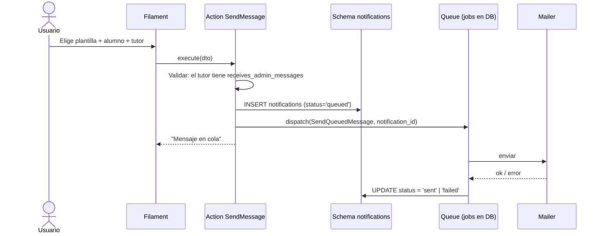

# Documentos, Consentimientos y Notificaciones

**Schemas:** `documents`, `notifications` · **Paquetes:** `cai/documents`, `cai/notifications`

---

## 1. `documents`

```sql
CREATE TABLE documents.documents (
    id             BIGSERIAL PRIMARY KEY,
    student_id     BIGINT REFERENCES students.students(id) ON DELETE CASCADE,
    family_account_id BIGINT REFERENCES students.family_accounts(id) ON DELETE CASCADE,
    documentable_type VARCHAR(80),      -- polimórfico: ClinicalNote, CarePlan, Enrollment...
    documentable_id   BIGINT,
    category       VARCHAR(40) NOT NULL,
    original_name  VARCHAR(255) NOT NULL,
    storage_path   VARCHAR(255) NOT NULL,   -- ruta relativa en storage/app/private
    mime_type      VARCHAR(120) NOT NULL,
    size_bytes     BIGINT NOT NULL,
    sha256         CHAR(64) NOT NULL,
    version        SMALLINT NOT NULL DEFAULT 1,
    supersedes_document_id BIGINT REFERENCES documents.documents(id) ON DELETE SET NULL,
    uploaded_by    BIGINT NOT NULL REFERENCES identity.users(id),
    uploaded_at    TIMESTAMPTZ NOT NULL DEFAULT NOW(),
    is_confidential BOOLEAN NOT NULL DEFAULT FALSE,
    valid_from     DATE,
    valid_until    DATE,
    created_at     TIMESTAMPTZ NOT NULL DEFAULT NOW(),
    updated_at     TIMESTAMPTZ NOT NULL DEFAULT NOW(),

    CONSTRAINT documents_size_check CHECK (size_bytes > 0),
    CONSTRAINT documents_category_check
        CHECK (category IN ('identity', 'consent', 'administrative',
                            'clinical', 'evaluation', 'referral',
                            'financial', 'incident', 'other')),
    CONSTRAINT documents_target_check
        CHECK (student_id IS NOT NULL
               OR family_account_id IS NOT NULL
               OR documentable_id IS NOT NULL)
);

CREATE INDEX documents_student_index     ON documents.documents (student_id, category);
CREATE INDEX documents_hash_index        ON documents.documents (sha256);
CREATE INDEX documents_documentable_idx  ON documents.documents (documentable_type, documentable_id);
```

**Categorías y su sensibilidad:**

| Categoría | Contenido | Acceso |
|---|---|---|
| `identity` | CI, partida de nacimiento, foto | Secretaría, tutor del alumno |
| `consent` | Formularios firmados | Secretaría, Dirección |
| `administrative` | Cartas, constancias | Secretaría |
| `clinical` | Evaluaciones, informes, informes técnicos | **Solo rol clínico** |
| `evaluation` | Evaluación inicial/periodic | Solo rol clínico |
| `referral` | Derivaciones | Solo rol clínico + Coordinación |
| `financial` | Comprobantes de pago | Finanzas, Dirección |
| `incident` | Parte de incidente | Dirección, responsable del plan |

**`is_confidential`** fuerza la verificación de rol clínico aunque la categoría no lo
haga (caso de un informe dentro de `administrative`).

---

## 2. `document_access_events`

```sql
CREATE TABLE documents.document_access_events (
    id          BIGSERIAL PRIMARY KEY,
    document_id BIGINT NOT NULL REFERENCES documents.documents(id) ON DELETE CASCADE,
    user_id     BIGINT NOT NULL REFERENCES identity.users(id),
    action      VARCHAR(30) NOT NULL,
    reason      TEXT,
    ip_address  VARCHAR(45),
    user_agent  VARCHAR(255),
    created_at  TIMESTAMPTZ NOT NULL DEFAULT NOW(),

    CONSTRAINT doc_access_action_check
        CHECK (action IN ('view_metadata', 'download', 'preview', 'print', 'delete_request'))
);

CREATE INDEX doc_access_document_index ON documents.document_access_events (document_id, created_at DESC);
CREATE INDEX doc_access_user_index    ON documents.document_access_events (user_id, created_at DESC);
```

**Toda descarga de un documento clínico exige `reason`.** El motivo queda en el registro
auditable.

---

## 3. `consents`

```sql
CREATE TABLE documents.consents (
    id            BIGSERIAL PRIMARY KEY,
    student_id    BIGINT NOT NULL REFERENCES students.students(id) ON DELETE CASCADE,
    consent_type  VARCHAR(40) NOT NULL,
    version       VARCHAR(20) NOT NULL,
    granted_by_guardian_id BIGINT REFERENCES students.guardians(id) ON DELETE SET NULL,
    granted_at    DATE NOT NULL,
    expires_at    DATE,
    is_revoked    BOOLEAN NOT NULL DEFAULT FALSE,
    revoked_at    TIMESTAMPTZ,
    document_id   BIGINT REFERENCES documents.documents(id) ON DELETE SET NULL,
    notes         TEXT,
    created_by    BIGINT REFERENCES identity.users(id),
    created_at    TIMESTAMPTZ NOT NULL DEFAULT NOW(),
    updated_at    TIMESTAMPTZ NOT NULL DEFAULT NOW(),

    CONSTRAINT consents_type_check
        CHECK (consent_type IN ('treatment', 'data_protection', 'photography',
                                'medical_info', 'third_party_sharing', 'other')),
    CONSTRAINT consents_version_check CHECK (length(version) > 0)
);

CREATE INDEX consents_student_index ON documents.consents (student_id, consent_type, is_revoked);
```

**Tipos de consentimiento:**

| Tipo | Para qué |
|---|---|
| `treatment` | Autorización para recibir atención |
| `data_protection` | Tratamiento de datos personales |
| `photography` | Uso de imágenes en redes o informes |
| `medical_info` | Compartir información con profesionales externos |
| `third_party_sharing` | Compartir con organismos externos |

**Regla:** un alumno **no puede recibir atención sin un consentimiento `treatment` vigente**
(RN-095). Se valida al programar sesiones.

> [!question] Definir
> ¿Quién firma si el alumno es mayor de edad? ¿Qué pasa con la separación de hecho? Ver
> P8 en [[01.07 Preguntas Abiertas y Decisiones Pendientes]].

---

## 4. `notifications` (schema `notifications`)

```sql
CREATE TABLE notifications.notifications (
    id          BIGSERIAL PRIMARY KEY,
    student_id  BIGINT REFERENCES students.students(id) ON DELETE CASCADE,
    guardian_id BIGINT REFERENCES students.guardians(id) ON DELETE SET NULL,
    channel     VARCHAR(20) NOT NULL,
    template_id BIGINT REFERENCES notifications.message_templates(id) ON DELETE SET NULL,
    subject     VARCHAR(200),
    body        TEXT NOT NULL,
    status      VARCHAR(20) NOT NULL DEFAULT 'queued',
    sent_at     TIMESTAMPTZ,
    failed_at   TIMESTAMPTZ,
    error       TEXT,
    related_type VARCHAR(80),
    related_id   BIGINT,
    created_by  BIGINT REFERENCES identity.users(id),
    created_at  TIMESTAMPTZ NOT NULL DEFAULT NOW(),

    CONSTRAINT notifications_channel_check
        CHECK (channel IN ('email', 'sms', 'whatsapp', 'internal')),
    CONSTRAINT notifications_status_check
        CHECK (status IN ('queued', 'sent', 'failed', 'cancelled'))
);

CREATE INDEX notifications_status_index ON notifications.notifications (status, created_at);
CREATE INDEX notifications_guardian_index ON notifications.notifications (guardian_id, created_at DESC);
```

**Canales:**
- `email` — con enlace al portal (etapa 2) o con el PDF adjunto.
- `sms` — recordatorios cortos. Requiere proveedor (etapa 2).
- `whatsapp` — **no implementado en el MVP** (requiere proveedor externo).
- `internal` — aviso interno en el panel (sin envío externo).

> [!important] Los documentos clínicos no se adjuntan a comunicaciones
> Un informe clínico **nunca** se envía por email a un tutor sin el consentimiento
> correspondiente. En el MVP, los avisos a familias son **administrativos**: cuotas,
> agenda, y recordatorios de documentos.

---

## 5. `message_templates`

```sql
CREATE TABLE notifications.message_templates (
    id          BIGSERIAL PRIMARY KEY,
    key         VARCHAR(80) NOT NULL UNIQUE,
    name        VARCHAR(150) NOT NULL,
    channel     VARCHAR(20) NOT NULL DEFAULT 'email',
    subject     VARCHAR(200),
    body        TEXT NOT NULL,
    variables   JSONB NOT NULL DEFAULT '[]'::jsonb,
    category    VARCHAR(40) NOT NULL DEFAULT 'administrative',
    is_active   BOOLEAN NOT NULL DEFAULT TRUE,
    created_at  TIMESTAMPTZ NOT NULL DEFAULT NOW(),
    updated_at  TIMESTAMPTZ NOT NULL DEFAULT NOW()
);
```

**Variables disponibles (sanitizadas, no HTML):**

| Variable | Contenido |
|---|---|
| `{{alumno_nombre}}` | Nombre del alumno |
| `{{alumno_codigo}}` | Código del alumno |
| `{{tutor_nombre}}` | Nombre del tutor |
| `{{servicio}}` | Nombre del servicio |
| {{periodo}} | Periodo facturado |
| {{monto}} | Importe formateado |
| {{saldo}} | Saldo de la cuenta |
| {{fecha_vencimiento}} | Fecha de vencimiento |
| {{centro_nombre}}` | Nombre del centro |
| {{enlace_portal}}` | Enlace al portal (etapa 2) |

**Regla:** las plantillas se renderizan con **escape HTML** por defecto. Nunca se
interpreta HTML del usuario.

**Plantillas iniciales:**

| Key | Uso |
|---|---|
| `charge_created` | Aviso de cargo generado |
| `payment_receipt` | Envío del recibo |
| `payment_reminder` | Recordatorio de cuota (etapa 2) |
| `session_reminder` | Recordatorio de sesión (etapa 2) |
| `document_request` | Pedido de documentación faltante |
| `absence_notice` | Aviso de inasistencia |

---

## 6. Flujo de envío



**Reglas:**
- El envío es **asíncrono** (cola). Un fallo del servidor de email **no** revierte la
  operación de negocio.
- Los listeners de jobs son **idempotentes**.
- Un fallo queda en `failed_jobs` y se puede reintentar desde el panel (RF-097).
- La plantilla renderizada se guarda en `body` para poder auditar qué se envió realmente.

---

## 7. Preferencias de comunicación

Se almacenan en `students.guardians` (flags) y en `identity.settings` para las
preferencias globales.

**Preferencias por tutor (propuesta de columnas en `guardians`):**

| Columna | Tipo | Default |
|---|---|---|
| `notify_email` | boolean | `true` |
| `notify_sms` | boolean | `false` |
| `notify_whatsapp` | boolean | `false` |
| `preferred_language` | varchar(10) | `'es'` |

**Regla:** un tutor que no tiene `receives_admin_messages = true` **no recibe** avisos
administrativos aunque se lo intente enviar a mano. La Action lo valida.

---

## 8. Privacidad en las notificaciones

| Regla | Implementación |
|---|---|
| No enviar datos clínicos por email | Solo plantillas de categoría `administrative` |
| No enviar el detalle de notas | Las plantillas no tienen variables clínicas |
| Un recibo es administrativo | Se puede enviar (contiene datos de la cuenta, no clínicos) |
| Verificación de destinatario | El email sale de la ficha del tutor, nunca de texto libre |
| Registro de todo lo enviado | Fila en `notifications` con el cuerpo real |
| Preferencias respetadas | Si `notify_email = false`, no se envía por email |

---

## 9. Pruebas obligatorias

| Test | Escenario |
|---|---|
| `it_requires_consent_before_attention` | Sin consentimiento `treatment` vigente, no se puede programar sesión |
| `it_requires_reason_to_download_confidential` | Descargar un documento clínico sin motivo → error |
| `it_audits_document_download` | La descarga queda registrada |
| `it_does_not_send_to_guardian_without_preference` | Tutor sin `receives_admin_messages` no recibe avisos |
| `it_never_includes_clinical_content_in_templates` | Ninguna plantilla tiene variables clínicas |
| `it_records_actual_sent_body` | La fila guardada contiene el cuerpo enviado |

---

## 10. Documentos relacionados

- [[02.07 Almacenamiento de Archivos Privados]]
- [[03.01 Identidad, Roles y Sesiones]]
- [[03.05 Planes de Atención y Notas Clínicas]]
- [[04.06 Consentimientos y Privacidad]]
