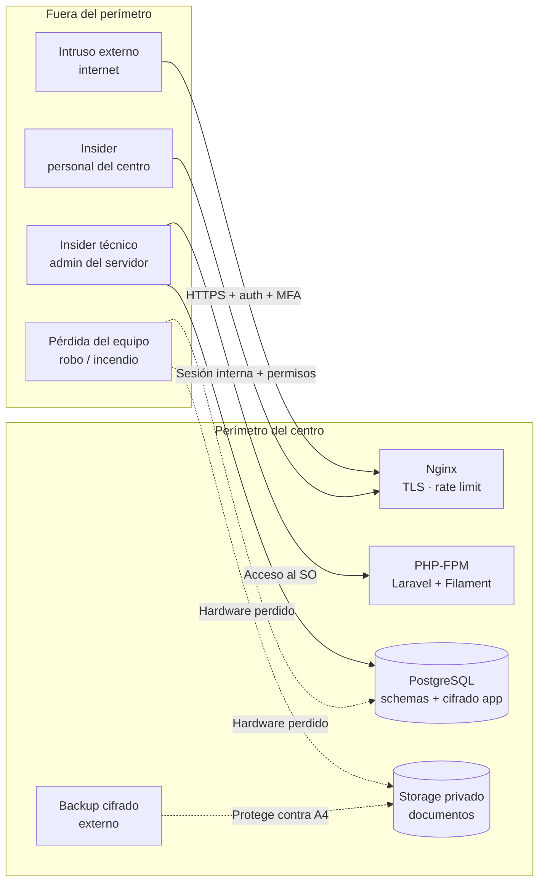
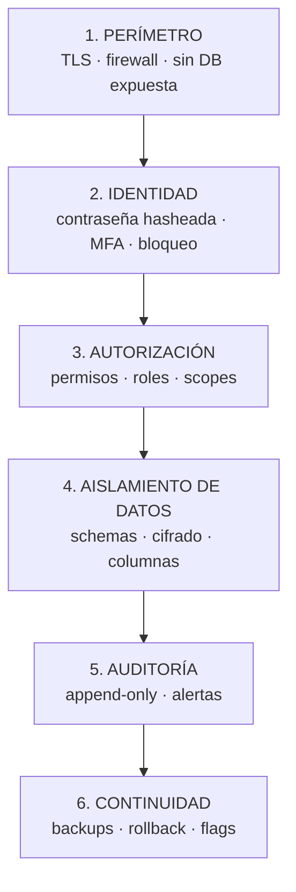
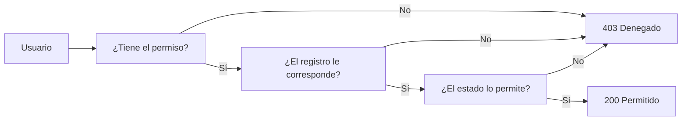

# Modelo de Seguridad

> [!important] Principio rector
> La seguridad del sistema CAI no depende de que "el usuario se porte bien". Depende de que
> **el sistema no le permita** hacer lo que no debe, y de que **todo lo que haga quede
> registrado**.

---

## 1. Qué se está protegiendo

| Activo | Criticidad | Dónde vive | Amenaza principal |
|---|---|---|---|
| Datos de menores (identidad, salud, contexto) | 🔴 Crítica | `students`, `care`, `documents` | Acceso indebido, filtración, exposición pública |
| Contenido clínico y terapéutico | 🔴 Crítica | `care.clinical_notes.content` (cifrado) | Lectura por personal no autorizado |
| Datos financieros de familias | 🟠 Alta | `billing` | Fraude interno, manipulación de saldos |
| Consentimientos y documentos legales | 🟠 Alta | `documents`, `documents.consents` | Falsificación, uso indebido |
| Credenciales de acceso | 🟠 Alta | `identity.users` | Robo de sesión, fuerza bruta |
| Disponibilidad del sistema | 🟡 Media | Servidor | Superficie de ataque, ransomware |
| Trazabilidad (auditoría) | 🟠 Alta | `identity.audit_events` | Borrado de evidencia |

> [!danger] El activo crítico es la combinación
> Un dato clínico suelto es el dato sensible. Un dato clínico **vinculado a un menor
> identificable** es el activo crítico. Por eso el sistema **nunca** separa la ficha del
> alumno de la nota clínica dentro de la misma respuesta: la nota clínica siempre está
> attached a un `student_id`, y el acceso a ella pasa por la ficha.

---

## 2. Superficie de ataque del sistema



**Controles en cada punto:**

| Punto | Controles |
|---|---|
| Nginx | TLS, límite de conexiones, límite de tasa de login, sin exposición de directorios, cabeceras de seguridad |
| Laravel | Sesión firmada, CSRF, bcrypt, MFA, Policies, auditoría, feature flags |
| PostgreSQL | `pg_hba.conf` local, schemas por módulo, cifrado en aplicación, sin acceso TCP externo |
| Storage | Ruta privada, permisos POSIX 750, nunca servido por HTTP |
| Backups | Cifrado con clave separada, copia externa, verificación mensual |

---

## 3. Capas de defensa



> [!tip] La philosophy
> Ninguna capa es suficiente sola. El atacante tiene que superar **todas** para llegar al
> dato clínico. Si una falla (por ejemplo, alguien comparte su contraseña), las demás
> siguen protegiendo: el usuario sin MFA no entra, el profesional sin asignación no ve la
> nota, la lectura queda auditada, y el módulo se puede apagar.

---

## 4. Amenazas y mitigaciones

### 4.1 Amenazas de usuario interno (la categoría más importante)

| # | Amenaza | Mitigación | Verificación |
|---|---|---|---|
| T-01 | Un profesional lee notas de alumnos no asignados | Policy con asignación vigente + filtro de scope en listados | Test automatizado + auditoría de lectura |
| T-02 | Recepción ve la ficha completa | Rol con permisos mínimos; sin permiso `students.students.view` | Test |
| T-03 | Administración técnica lee notas clínicas | El rol **no** tiene permiso `care.notes.view` | Test |
| T-04 | Finanzas ve información clínica | Módulo `billing` no tiene relación con `care`; sin permiso | Test |
| T-05 | Dirección consulta una nota sin motivo | Requiere grant excepcional con motivo + expiración | `security_events` |
| T-06 | Un administrador cambia un rol para tener más acceso | Cambio de rol auditado + revisión trimestral de roles privilegiados | `security_events` + checklist |
| T-07 | Un profesional edita una nota finalizada para "corregir" | Estado `finalized` inmutable; la corrección es una nota nueva | Test + DB check |
| T-08 | Un pago se anula sin justificación | `void_reason` obligatorio por `CHECK` en DB | Test |
| T-09 | Se borra historial para tapar un error | No hay `DELETE` en el código; soft delete + anulación | Revisión + test |

### 4.2 Amenazas técnicas

| # | Amenaza | Mitigación |
|---|---|---|
| T-10 | Fuerza bruta al login | Rate limiting + `failed_attempts` + `locked_until` + MFA en roles privilegiados |
| T-11 | Robo de sesión por cookie sin `secure` | Cookie `secure` + `http_only` + `same_site` + HTTPS obligatorio |
| T-12 | Inyección SQL | Consultas parametrizadas de Eloquent; el único SQL crudo son triggers del DBA, revisados |
| T-13 | XSS en el panel | Blade escapa por defecto; Livewire sanitiza; `Content-Security-Policy` en Nginx |
| T-14 | CSRF | Token CSRF en todos los formularios POST; SameSite=Lax |
| T-15 | Enumeración de usuarios | El login responde igual exista o no el email |
| T-16 | Exposición de `storage/app/private` | `serve => false`, `public/` solo con estáticos, Nginx con `location ~ /\. { deny all; }` |
| T-17 | Descarga de documentos por URL adivinada | Ruta autenticada + Policy + path desde BD + auditoría |
| T-18 | SQL injection en búsqueda global | Livewire/Eloquent con bindings |
| T-19 | Abuso de exportaciones (fuga masiva) | Exportaciones auditadas + requieren permiso `*.export` +.sin datos clínicos |
| T-20 | Ransomware / cifrado del servidor | Backups cifrados fuera del edificio + verify + versionado inmutable |

### 4.3 Amenazas de infraestructura

| # | Amenaza | Mitigación |
|---|---|---|
| T-21 | Servidor commitment con datos sin cifrar | Base de datos cifrada en disco (`pgcrypto` / LUKS) + cifrado en aplicación del contenido clínico |
| T-22 | Robo del equipo | Disco cifrado + backup externo cifrado con clave separada |
| T-23 | Incendio | Backup externo en otra ubicación + plan de recuperación probado |
| T-24 | Corte de energía | UPS + PostgreSQL con WAL archiving |
| T-25 | Servidor comprometido por root | SSH solo por clave, sin acceso root remoto, sudo registrado |
| T-26 | Filtración del backup | Cifrado del backup + clave en gestor de contraseñas, no junto al archivo |

---

## 5. Autenticación

| Aspecto | Configuración | Nota |
|---|---|---|
| Método | Correo + contraseña | El centro no tiene identidades corporativas |
| Hash | `bcrypt` con cost 12 | Alternativa: `argon2id` |
| MFA | Obligatorio para `direccion`, `admin_tecnico` | Opcional para el resto, recomendable |
| MFA métodos | TOTP (app autenticadora) | SMS **no** se usa (intercepción, costo, dependencia externa) |
| Bloqueo | 5 intentos / 15 min / IP+email | `failed_attempts` + `locked_until` |
| Duración de sesión | 8 h, con inactividad de 30 min | Turnos largos + datos sensibles |
| Renovación de sesión | Al login y al cambiar contraseña | Previene la fijación de sesión |
| Recuperación de contraseña | Email, token de un solo uso, 60 min | Sin preguntas de seguridad |
| Primer ingreso | Cambio de contraseña forzado | Los usuarios seed no tienen contraseña por defecto |

### 5.1 Reglas del código de autenticación

```php
// ✅ Correcto
public function credentials(Request $request): array
{
    $request->validate([
        'email' => ['required', 'email'],
        'password' => ['required', 'string'],
    ]);

    return $request->only(['email', 'password']);
}
```

**Reglas:**
1. El mensaje de error del login es **idéntico** en ambos casos: *"Las credenciales no son
   correctas."*
2. Nunca se registra la contraseña en logs.
3. El intento fallido se audita (`auth.login_failed`) **con el email** (para detectar
   ataques dirigidos) pero nunca con la contraseña.
4. El tiempo de respuesta de un login válido e inválido debe ser similar (evitar
   enumeración por tiempos).

---

## 6. Autorización

**Modelo de dos capas:** permisos (qué) + alcance (sobre qué registro). Ver
[[02.06 Modelo de Autorización y Permisos]] y [[04.03 Autorización por Registro]].



**Ejemplo real (profesional accessing a nota clínica):**

```php
public function view(User $user, ClinicalNote $note): bool
{
    if (! $user->hasPermissionTo('care.notes.view')) {
        return false; // Capa 1: permiso
    }

    if ($note->author_user_id === $user->id) {
        return true; // El autor siempre accede a lo suyo
    }

    if ($note->hasActiveGrantFor($user->id)) {
        return true; // Acceso excepcional granted y vigente
    }

    return $user->hasActiveClinicalAssignmentFor($note->student_id); // Capa 2: alcance
}
```

---

## 7. Cifrado

| Qué | Cómo | Dónde está la clave |
|---|---|---|
| Contraseñas | bcrypt cost 12 | No aplica (hash unidireccional) |
| Contenido clínico (`clinical_notes.content`) | `AES-256-GCM` vía cast `encrypted` de Laravel | `APP_KEY` |
| Documentos en disco | Cifrado del volumen (LUKS) + `storage/app/private` con permisos 750 | KMS del sistema / LUKS |
| Backups | `gpg` o `openssl enc -aes-256-cbc` | Gestor de contraseñas (separada) |
| Sesiones | Cookie firmada por Laravel (`APP_KEY`) | `APP_KEY` |
| HTTPS en tránsito | TLS 1.2+ con cifrado moderno | Certificado |

> [!danger] La clave de `APP_KEY` es el punto único de fallo
> Si se pierde `APP_KEY`:
> - Se pierden **todas** las notas clínicas (no se pueden descifrar).
> - Se invalidan todas las sesiones.
> - Se invalidan los tokens de recuperación de contraseña.
>
> **Debe respaldarse en un gestor de contraseñas, por separado del backup del servidor.**
> Ver [[06.07 Backups y Recuperación]].

**Rotación de `APP_KEY`:** no se hace en el MVP (rompe el descifrado). Si se necesita,
requiere re-cifrar todas las notas en una migración controlada. Está en el backlog de F9.

---

## 8. Auditoría

| Tipo | Qué registra | Dónde |
|---|---|---|
| `audit_events` | Toda operación sensible (escritura y lectura) | `identity.audit_events` |
| `security_events` | Eventos de seguridad (grants, cambios de rol, fallos, MFA) | `identity.security_events` |
| `document_access_events` | Accesos a documentos | `documents.document_access_events` |
| Logs de aplicación | Errores y eventos técnicos | `storage/logs/laravel.log` (rotado) |
| Logs de acceso web | Requests, IPs, códigos de estado | `storage/logs/nginx-access.log` (rotado) |

**Propiedades de la auditoría:**
- **Append-only**: sin `updated_at`, sin `deleted_at`, sin permisos de escritura en la UI.
- **En la misma transacción** que la operación auditada.
- **Incluye el actor**, la IP y el user agent.

Ver [[04.05 Auditoría de Datos Sensibles]].

---

## 9. Continuidad y respuesta

| Mecanismo | Alcance | Tiempo | Documento |
|---|---|---|---|
| Kill switch por módulo | Apagar una funcionalidad rota | Segundos | [[06.04 Feature Flags y Kill Switches]] |
| Rollback de código | Volver al release anterior | ~1 min | [[06.06 Procedimiento de Rollback]] |
| Restauración de `pg_dump` | Volver a un punto anterior de datos | 1–3 h | [[06.06 Procedimiento de Rollback]] |
| Restauración desde backup externo | Recuperación ante pérdida del servidor | 2–4 h | [[06.07 Backups y Recuperación]] |

Ver [[04.07 Checklist Legal y Respuesta a Incidentes]].

---

## 10. Lo que este modelo NO protege

Honestidad operativa — el modelo tiene límites conocidos:

| Límite | Mitigación parcial | Riesgo residual |
|---|---|---|
| Un usuario con MFA que comparte sus credenciales | Auditoría de acceso permite detectarlo por patrón | Alto si no se revisa la auditoría |
| El administrador del servidor (root) puede leer la base descifrada | Cifrado en aplicación protege el contenido clínico **solo si no tiene `APP_KEY`** | Alto: `root` en el servidor puede leer `.env` |
| Filtración por captura de pantalla o papel | Principios y formación | Alto: no hay control técnico |
| Insider que consulta muchos registros legítimos | Auditoría + alertas por volumen | Medio |
| Datos que el centro ya tenía en planillas sin protección | La migración mejora la situación a partir del go-live | Fuera del sistema |

> [!warning] Sobre el `root` del servidor
> El `root` del servidor del centro puede leer `.env` y, por lo tanto, descifrar el
> contenido clínico. **Esta es una limitación fundamental del cifrado en aplicación.**
> Mitigaciones: el acceso al servidor es físico y restringido a 2 personas; la clave está
> en un gestor de contraseñas (no en el disco del servidor, salvo `.env`); y el módulo
> `care` puede apagarse completamente si se sospecha un compromiso.

---

## 11. Checklist de seguridad por fase

| Fase | Verificación obligatoria |
|---|---|
| F2 | Test de bloqueo por intentos; test de enumeración de usuarios; MFA configurado |
| F3 | Test de aislamiento de familias en listados |
| F4 | Test de no-superposición; test de permisos de sesión |
| F5 | Test de cifrado en reposo; test de no-acceso entre profesionales; test de auditoría de lectura |
| F6 | Test de atomicidad del pago; test de over-allocation; test de void con motivo |
| F8 | Test de URL directa a documento; revisión de cabeceras de seguridad; escaneo de dependencias |
| F9 | Revisión de roles; simulacro de restore; revisión de grants vencidos |

---

## 12. Documentos relacionados

- [[02.06 Modelo de Autorización y Permisos]]
- [[04.02 Matriz de Permisos por Rol]]
- [[04.03 Autorización por Registro]]
- [[04.04 Datos Clínicos: Cifrado y Acceso]]
- [[04.05 Auditoría de Datos Sensibles]]
- [[04.07 Checklist Legal y Respuesta a Incidentes]]
- [[06.07 Backups y Recuperación]]
