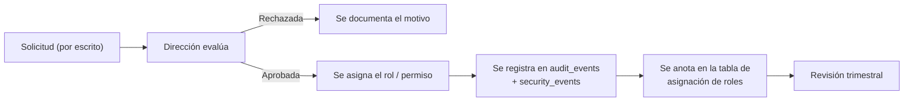

# Matriz de Permisos por Rol

> [!important] Cómo leer la matriz
> La matriz define **qué puerta abre cada rol**. **No** decide sobre qué registro concreto
> puede actuar eso: eso lo resuelven las Policies y los scopes (ver
> [[04.03 Autorización por Registro]]).
>
> `✓` = permiso concedido · `—` = sin permiso · `*` = permiso **condicionado** (requiere
> alcance verificable: asignación vigente, rol adicional, o grant).

---

## 1. Roles del sistema

| Código | Nombre | Área |
|---|---|---|
| `direccion` | Dirección | Supervisión |
| `coordinacion` | Coordinación | Coordinación clínica y agenda |
| `secretaria` | Secretaría | Administración |
| `profesional` | Profesional | Atención clínica |
| `finanzas` | Administración Financiera | Cobros |
| `recepcion` | Recepción | Atención al público |
| `admin_tecnico` | Administración Técnica | Soporte del sistema |

---

## 2. Matriz maestra

| Permiso | direccion | coordinacion | secretaria | profesional | finanzas | recepcion | admin_tecnico |
|---|:---:|:---:|:---:|:---:|:---:|:---:|:---:|
| **IDENTIDAD** | | | | | | | |
| `identity.users.view` | ✓ | ✓ | — | — | — | — | ✓ |
| `identity.users.manage` | ✓ | — | — | — | — | — | ✓ |
| `identity.roles.manage` | ✓ | — | — | — | — | — | — |
| `identity.permissions.view` | ✓ | — | — | — | — | — | ✓ |
| `identity.audit.view` | ✓ | ✓ | — | — | — | — | ✓ |
| `identity.security_events.view` | ✓ | — | — | — | — | — | ✓ |
| `identity.settings.manage` | ✓ | — | — | — | — | — | ✓ |
| `identity.flags.manage` | ✓ | — | — | — | — | — | ✓ |
| **ALUMNOS** | | | | | | | |
| `students.students.view` | ✓ | ✓ | ✓ | `*` | `*` | — | — |
| `students.students.create` | ✓ | ✓ | ✓ | — | — | — | — |
| `students.students.update` | ✓ | ✓ | ✓ | `*` | — | — | — |
| `students.students.deactivate` | ✓ | ✓ | — | — | — | — | — |
| `students.guardians.manage` | ✓ | ✓ | ✓ | — | — | `*` | — |
| `students.family_accounts.view` | ✓ | ✓ | ✓ | — | ✓ | — | — |
| `students.family_accounts.manage` | ✓ | ✓ | ✓ | — | — | — | — |
| `students.authorized_pickups.manage` | ✓ | ✓ | ✓ | — | — | ✓ | — |
| **SERVICIOS Y AGENDA** | | | | | | | |
| `scheduling.services.manage` | ✓ | ✓ | ✓ | — | — | — | — |
| `scheduling.services.view` | ✓ | ✓ | ✓ | ✓ | — | ✓ | — |
| `scheduling.professionals.manage` | ✓ | ✓ | ✓ | — | — | — | — |
| `scheduling.enrollments.manage` | ✓ | ✓ | ✓ | — | — | — | — |
| `scheduling.enrollments.view` | ✓ | ✓ | ✓ | `*` | — | — | — |
| `scheduling.groups.manage` | ✓ | ✓ | ✓ | — | — | — | — |
| `scheduling.sessions.view` | ✓ | ✓ | ✓ | `*` | — | ✓ | — |
| `scheduling.sessions.create` | ✓ | ✓ | ✓ | — | — | — | — |
| `scheduling.sessions.update` | ✓ | ✓ | ✓ | `*` | — | — | — |
| `scheduling.sessions.cancel` | ✓ | ✓ | ✓ | `*` | — | — | — |
| `scheduling.attendance.record` | ✓ | ✓ | — | `*` | — | — | — |
| `scheduling.attendance.correct` | ✓ | ✓ | — | `*` | — | — | — |
| **ÁREA CLÍNICA** | | | | | | | |
| `care.clinical.read` | — | `*` | — | `*` | — | — | — |
| `care.plans.view` | — | `*` | — | `*` | — | — | — |
| `care.plans.manage` | — | `*` | — | `*` | — | — | — |
| `care.goals.manage` | — | `*` | — | `*` | — | — | — |
| `care.notes.view` | — | `*` | — | `*` | — | — | — |
| `care.notes.create` | — | `*` | — | ✓ | — | — | — |
| `care.notes.finalize` | — | `*` | — | ✓ | — | — | — |
| `care.notes.supersede` | — | `*` | — | ✓ | — | — | — |
| `care.documents.view` | — | `*` | — | `*` | — | — | — |
| `care.documents.upload` | — | `*` | — | `*` | — | — | — |
| `care.grants.issue` | ✓ | `*` | — | — | — | — | — |
| `care.grants.revoke` | ✓ | `*` | — | — | — | — | — |
| **FINANZAS** | | | | | | | |
| `billing.charges.view` | ✓ | — | — | — | ✓ | — | — |
| `billing.charges.create` | ✓ | — | — | — | ✓ | — | — |
| `billing.charges.void` | ✓ | — | — | — | ✓ | — | — |
| `billing.charges.adjust` | ✓ | — | — | — | `*` | — | — |
| `billing.payments.view` | ✓ | — | — | — | ✓ | — | — |
| `billing.payments.create` | — | — | — | — | ✓ | — | — |
| `billing.payments.void` | ✓ | — | — | — | ✓ | — | — |
| `billing.allocations.manage` | — | — | — | — | ✓ | — | — |
| `billing.receipts.view` | ✓ | — | — | — | ✓ | — | — |
| `billing.receipts.void` | ✓ | — | — | — | ✓ | — | — |
| `billing.cash.open` | — | — | — | — | ✓ | — | — |
| `billing.cash.close` | — | — | — | — | ✓ | — | — |
| `billing.reports.view` | ✓ | — | — | — | ✓ | — | — |
| `billing.export` | ✓ | — | — | — | ✓ | — | — |
| **DOCUMENTOS** | | | | | | | |
| `documents.documents.view` | ✓ | ✓ | ✓ | `*` | `*` | — | — |
| `documents.documents.upload` | ✓ | ✓ | ✓ | `*` | — | — | — |
| `documents.documents.download` | ✓ | ✓ | ✓ | `*` | `*` | — | — |
| `documents.consents.manage` | ✓ | — | ✓ | — | — | — | — |
| `documents.consents.view` | ✓ | ✓ | ✓ | — | — | — | — |
| **NOTIFICACIONES** | | | | | | | |
| `notifications.messages.send` | ✓ | ✓ | ✓ | `*` | ✓ | — | — |
| `notifications.templates.manage` | ✓ | — | — | — | — | — | — |
| **REPORTES** | | | | | | | |
| `reporting.reports.view` | ✓ | ✓ | ✓ | — | ✓ | — | — |
| `reporting.reports.export` | ✓ | ✓ | ✓ | — | ✓ | — | — |
| `reporting.financial.view` | ✓ | — | — | — | ✓ | — | — |
| `reporting.clinical_summary.view` | ✓ | — | — | — | — | — | — |

---

## 3. Los permisos condicionados (`*`)

Cada `*` tiene una regla concreta que lo habilita:

| Permiso | Condición de habilitación | Verificación |
|---|---|---|
| `students.students.view` (profesional) | Tiene al menos una asignación profesional vigente | `professional_assignments` |
| `students.students.view` (finanzas) | Solo **modo mínimo**: código, nombre, tutor responsable. Sin historial, sin notas, sin documentos | Campo de vista reducido |
| `scheduling.sessions.view` (profesional) | Es responsable o asistente de la sesión, o tiene asignación vigente sobre alguno de los participantes | Scope de sesión |
| `scheduling.sessions.update` (profesional) | Es responsable de la sesión y la sesión no está `completed` | Policy de sesión |
| `scheduling.attendance.record` (profesional) | Es responsable de la sesión **o** asistente cuando el responsable no está | Policy de sesión |
| `care.clinical.read` (dirección) | **No se concede por rol.** Dirección accede por `grant` excepcional con motivo y expiración | `clinical_note_access_grants` |
| `care.clinical.read` (coordinación) | Solo si Dirección asigna explícitamente el rol clínico a la persona | Rol adicional + asignación |
| `care.notes.view` (profesional) | Autor de la nota, **o** grant vigente, **o** asignación profesional vigente al alumno | Policy de nota |
| `care.documents.view` (profesional) | El documento es del alumno asignado y es de categoría clínica | Policy de documento |
| `billing.charges.adjust` (finanzas) | Requiere autorización de Dirección registrada (campo `authorized_by`) | Acción de dominio |
| `documents.documents.view` (finanzas) | Solo documentos de categoría `financial` | Policy de categoría |
| `notifications.messages.send` (profesional) | Solo plantillas de categoría `administrative` y solo a tutores con `receives_admin_messages` | Acción de envío |

---

## 4. Las tres líneas rojas

> [!danger] Líneas que no se cruzan bajo ninguna circunstancia
>
> **Línea 1 — Administración Técnica NO ve datos clínicos.**
> El rol `admin_tecnico` **no tiene** `care.notes.view`, `care.clinical.read` ni
> `care.documents.view`. Mantener el sistema no requiere leer las notas de los niños.
>
> **Línea 2 — Finanzas NO ve datos clínicos.**
> El rol `finanzas` **no tiene** ningún permiso del módulo `care`. Tampoco ve documentos
> clínicos.
>
> **Línea 3 — Profesionales NO ven datos financieros.**
> El rol `profesional` **no tiene** ningún permiso del módulo `billing`. No ve cuotas, ni
> pagos, ni saldos de la familia.
>
> **Excepción:** un profesional de forma simultánea requiere autorización expresa de
> Dirección, queda auditada y se documenta en la tabla de asignación de roles.

---

## 5. Permisos sensibles (`is_sensitive = true`)

Estos permisos se marcan en `identity.permissions` y se revisan trimestralmente:

| Grupo | Permisos |
|---|---|
| Clínicos | `care.clinical.read`, `care.notes.view`, `care.notes.create`, `care.notes.finalize`, `care.documents.view`, `care.grants.issue` |
| Financieros | `billing.payments.create`, `billing.payments.void`, `billing.charges.adjust`, `billing.receipts.view`, `billing.reports.view`, `billing.export` |
| Administrativos | `identity.users.manage`, `identity.roles.manage`, `identity.flags.manage`, `students.family_accounts.manage` |

**Regla operativa:** ningún rol nuevo se crea sin que Dirección revise la lista de
permisos sensibles que otorga, y el resultado queda registrado en el acta de la reunión.

---

## 6. Combinaciones prohibidas

| Combinación | Por qué | Control |
|---|---|---|
| `profesional` + `finanzas` | Conflación de áreas de datos | Procedimiento + revisión de asignación de roles |
| `admin_tecnico` + `care.clinical.read` | Rompe la separación entre quien mantiene y quien ve | Procedimiento + revisión trimestral |
| `recepcion` + `students.students.view` | Excede el mínimo necesario | Procedimiento |

> [!note] Cómo se aplica el control
> No es un `CHECK` de base de datos (los roles son filas, no valores). El control es de
> **proceso**: la asignación de roles se hace desde la pantalla de administración técnica,
> y esa acción **queda auditada** (`user.role_changed` + `security_events`). La revisión
> trimestral es la que detecta y corrige.

---

## 7. Roles adicionales (casos poco frecuentes)

| Rol adicional | Cuándo se concede | Requisitos |
|---|---|---|
| `clinical_admin` | Dirección necesita ver indicadores clínicos agregados | Autorización de Dirección + registro en acta |
| `cashier` | Varias personas cobran en el mismo mostrador | Permisos limitados a `billing.payments.*` y `billing.cash.*` |
| `auditor` | Revisión externa de la operación | Solo lectura + auditoría habilitada |

**Regla:** un rol adicional se define **solo** si hay una necesidad concreta y documentada.
No se crean "por si acaso".

---

## 8. Procedimiento de alta/baja de permisos

**Baja de personal:** desactivar el usuario (`status = 'inactive'`) **y**:
1. Revocar las sesiones activas.
2. Revocar los grants de acceso excepcional pendientes.
3. Transferir la responsabilidad de los planes de atención donde era responsable.
4. Verificar las asignaciones profesionales activas.

---

## 9. Revisión periódica

| Frecuencia | Revisión | Responsable | Evidencia |
|---|---|---|---|
| Trimestral | Lista de usuarios por rol | Dirección | Acta firmada |
| Trimestral | Permisos sensibles activos | Dirección + Técnico | Reporte |
| Trimestral | Permisos huérfanos (nadie los tiene) | Técnico | Reporte |
| Mensual | Grants vencidos o activos | Técnico | Reporte |
| Mensual | Usuarios inactivos que aún pueden entrar | Técnico | Test |
| Inmediato | Alta o baja de personal | Dirección | Registro de roles |

Ver [[10.02 Calendario de Checklists]].

---

## 10. Documentos relacionados

- [[01.03 Actores y Roles del Centro]]
- [[02.06 Modelo de Autorización y Permisos]]
- [[04.01 Modelo de Seguridad]]
- [[04.03 Autorización por Registro]]
- [[04.05 Auditoría de Datos Sensibles]]
