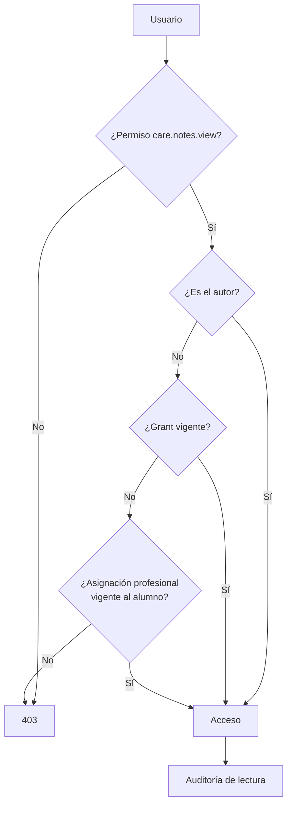
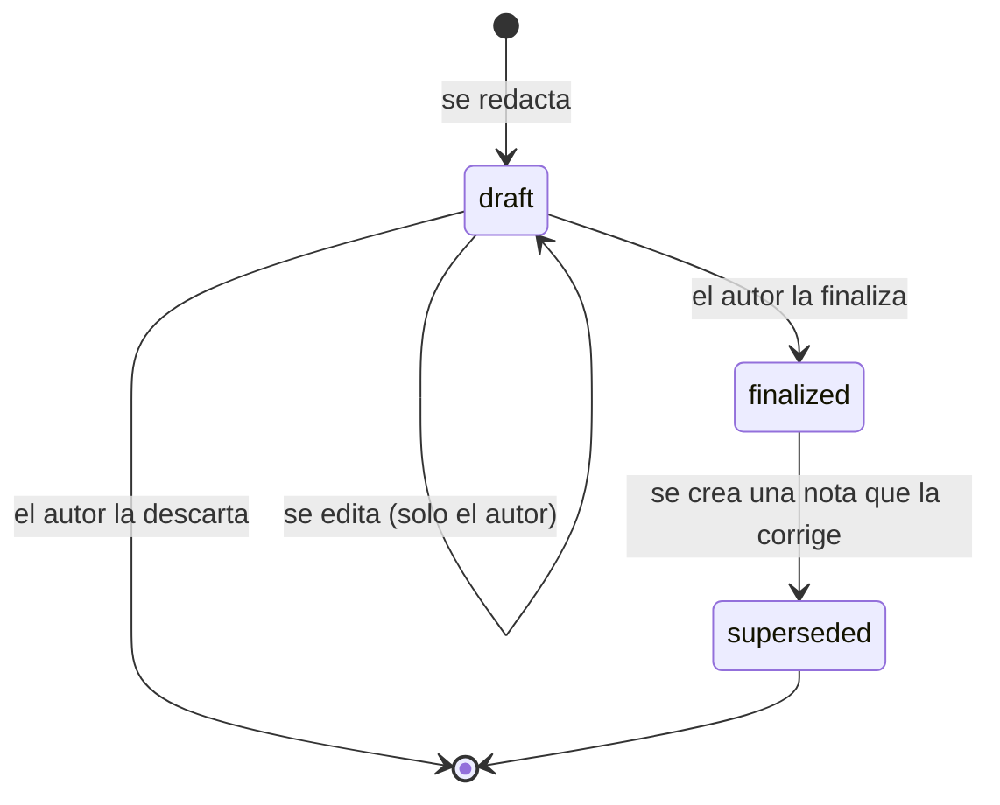

# Datos Clínicos: Cifrado y Acceso

> [!danger] El área de datos más sensible del sistema
> Las notas clínicas contienen información de salud de menores. Su compromiso legal,
> ético y reputacional es el mayor riesgo del proyecto. **Este documento define cómo se
> protegen.**

---

## 1. Qué se considera "dato clínico"

| Categoría | Ejemplos | Dónde vive | Cifrado |
|---|---|---|---|
| **Contenido narrativo** | Descripción de la sesión, observaciones, evolución | `care.clinical_notes.content` | ✅ **Sí** |
| Metadatos de la nota | Tipo, estado, fecha, autor | `care.clinical_notes` (otras columnas) | No |
| Resumen de listado | ≤ 300 caracteres, sin información sensible | `care.clinical_notes.summary` | No |
| Diagnóstico (clasificación) | "Trastorno del lenguaje" | `care.care_plans.diagnosis` | ⚠️ **A revisar** (P7) |
| Objetivos del plan | "Mejorar la inteligibilidad del habla" | `care.care_goals.title/description` | ⚠️ **A revisar** |
| Documentos clínicos | Evaluaciones, informes | `storage/app/private/students/{código}/clinicos/` | Volumen cifrado |
| Attendance operativo | Presente / ausente | `scheduling.attendance_records` | No |

> [!important] El criterio de cifrado
> Se cifra **el contenido que describe la atención**, no el **metadato que permite
> organizarla**. El metadato no cifrado es lo que permite filtrar por alumno, autor, tipo
> y fecha, generar reportes y aplicar scopes sin descifrar nada.

---

## 2. Implementación del cifrado

### 2.1 El cast

```php
namespace Cai\Care\Models;

use Illuminate\Database\Eloquent\Model;

final class ClinicalNote extends Model
{
    protected $connection = 'care';

    protected $table = 'clinical_notes';

    protected $fillable = [
        'student_id', 'author_user_id', 'session_id', 'care_plan_id',
        'note_type', 'status', 'content', 'summary',
        'supersedes_note_id', 'correction_reason', 'recorded_at', 'finalized_at',
    ];

    protected $casts = [
        'content'      => 'encrypted',           // ← AES-256-GCM
        'recorded_at'  => 'immutable_datetime',
        'finalized_at' => 'immutable_datetime',
    ];
}
```

### 2.2 Qué hace el cast

El cast `encrypted` de Laravel usa el cifrado autenticado **AES-256-GCM** con la
`APP_KEY`:

```
texto plano  →  base64( iv(12 bytes) ‖ tag(16 bytes) ‖ ciphertext )
```

| Propiedad | Valor | Por qué |
|---|---|---|
| Cifrado | AES-256-GCM | Estándar, con autenticación (detecta manipulación) |
| IV | 12 bytes aleatorios por operación | Evita que dos textos iguales den el mismo ciphertext |
| Tag | 16 bytes | Detecta alteración del ciphertext |
| Clave | Derivada de `APP_KEY` | Una sola clave para toda la app |
| Formato en DB | `TEXT` con base64 | ~33% más grande que el texto original |

### 2.3 Consecuencias operativas

| Consecuencia | Detalle |
|---|---|
| **No se puede buscar con SQL** | `WHERE content LIKE '%...%'` no funciona |
| **No se puede ordenar por contenido** | Irrelevante, no tiene sentido |
| **No se puede indexar** | Solo se indexan las columnas en claro |
| **El `ORDER BY` es por metadatos** | `recorded_at`, `created_at` |
| **El listado usa `summary`** | Columna en claro de ≤ 300 caracteres |
| **Cada escritura re-cifra** | Es correcto: el IV debe ser único |
| **No hay migración de texto en claro** | Si algún día existió contenido en claro, hay que cifrarlo en una migración controlada |

> [!danger] Error clásico
> Intentar "buscar en las notas" con `ILIKE`. **No funciona** y genera la sensación de
> que el cifrado está roto. En el MVP **la búsqueda de texto libre dentro de notas no
> existe**. Se resuelve con el campo `summary` y con filtros estructurados.

---

## 3. Modelo de acceso al área clínica

### 3.1 Capas



### 3.2 Quién puede ver el contenido de una nota

| Persona | Acceso | Condición |
|---|---|---|
| Autor de la nota | ✅ Siempre | — |
| Profesional asignado al alumno | ✅ | Asignación vigente |
| Responsable del plan de atención | ✅ | Figura en `care_plan_professionals` |
| Dirección | ⚠️ Solo con grant | Grant con motivo + expiración |
| Coordinación | ⚠️ Solo con rol clínico **y** alcance | Rol adicional asignado por Dirección |
| Administración Técnica | ❌ Nunca | No tiene el permiso |
| Finanzas | ❌ Nunca | No tiene el permiso |
| Secretaría | ❌ Nunca | No tiene el permiso |
| Recepción | ❌ Nunca | No tiene el permiso |
| Externo (familia) | ❌ Nunca | En el MVP no hay portal |

### 3.3 Grants de acceso excepcional

```sql
SELECT EXISTS (
    SELECT 1 FROM care.clinical_note_access_grants
    WHERE granted_to_user_id = :user
      AND (clinical_note_id = :note OR student_id = :student)
      AND revoked_at IS NULL
      AND expires_at > NOW()
);
```

**Reglas duras:**

| Regla | Valor |
|---|---|
| Motivo | Obligatorio, mínimo **20 caracteres** |
| Expiración | Obligatoria, máximo **30 días** por defecto |
| Revocación | En cualquier momento |
| Auditoría | `security_events` con severidad `warning` |
| Registro visible | Dirección puede listar todos los grants emitidos |

> [!tip] Por qué no un flag permanente
> Si Dirección necesita ver las notas de un alumno de forma permanente, la solución
> correcta es **reasignar** al profesional responsable o **dar el rol clínico** a la
> persona. Un flag permanente se convierte en una puerta trasera con llave.

---

## 4. Ciclo de vida de la nota



| Estado | Editable | Visible | Regla |
|---|---|---|---|
| `draft` | Solo el autor | Solo el autor | `finalized_at IS NULL` |
| `finalized` | ❌ Nadie | Según Policy | `finalized_at` obligatorio |
| `superseded` | ❌ Nadie | Según Policy | Tiene una nota que la corrige |

**Corrección de una nota finalizada:**

```php
// ❌ PROHIBIDO
$note->content = 'texto corregido';
$note->save();

// ✅ CORRECTO
$correction = ClinicalNote::create([
    'student_id'        => $note->student_id,
    'author_user_id'    => auth()->id(),
    'note_type'         => $note->note_type,
    'status'            => ClinicalNoteStatus::Finalized,
    'content'           => $nuevoContenido,
    'summary'           => $nuevoResumen,
    'supersedes_note_id'=> $note->id,
    'correction_reason' => 'Error en el registro de la sesión del 12/03',  // obligatorio
    'recorded_at'       => now(),
    'finalized_at'      => now(),
]);

$note->update(['status' => ClinicalNoteStatus::Superseded]);
```

**Ambas operaciones en una sola transacción.**

> [!note] Por qué no se permite editar
> El valor de una nota clínica está en su **inalterabilidad**. Si se puede editar, la
> nota deja de ser evidencia. Un registro inmutable con correcciones encadenadas permite
> reconstruir **exactamente** qué se dijo en cada momento.

---

## 5. Lo que NO sale del área clínica

| Regla | Implementación |
|---|---|
| Las notas no aparecen en la búsqueda global de Filament | Se excluyen los modelos `care` del `GlobalSearch` |
| Las notas no aparecen en exportaciones administrativas | Las exportaciones de `reporting` solo agregan |
| Las notas no se adjuntan a comunicaciones a familias | Las plantillas no tienen variables clínicas |
| Las notas no aparecen en el panel de Dirección | Solo agregados, y solo con P7 resuelto |
| Las notas no aparecen en el widget de Recepción | El widget solo muestra agenda y retiros |
| Las notas no se imprimen en listados de alumnos | La ficha muestra "historial de atención" con conteo, no contenido |

**Test que lo verifica:**

```php
it('no incluye notas clinicas en exportaciones administrativas', function () {
    $csv = app(StudentExportAction::class)->execute(['all' => true]);
    expect($csv->getContent())->not->toContain('mucuscopia');
});
```

---

## 6. Auditoría de lectura

**Toda lectura de una nota clínica deja registro:**

```php
// packages/care/src/Observers/ClinicalNoteObserver.php
public function retrieved(ClinicalNote $note): void
{
    if (! $note->wasRecentlyCreated) {
        Audit::record(
            action: 'clinical_note.viewed',
            entityType: ClinicalNote::class,
            entityId: $note->getKey(),
            studentId: $note->student_id,
            extra: ['note_type' => $note->note_type->value],
        );
    }
}
```

| Campo | Contenido |
|---|---|
| `action` | `clinical_note.viewed` |
| `actor_user_id` | Quién leyó |
| `student_id` | De quién |
| `ip_address`, `user_agent` | Contexto |
| `created_at` | Cuándo |

**Riesgo de ruido:** el observer `retrieved` se dispara también al cargar un modelo desde
una relación. Se mitiga con un flag de contexto: solo se audita cuando la carga proviene
de una acción **explícita de lectura** (la Policy lo marca). Ver
[[04.05 Auditoría de Datos Sensibles]].

**Alerta:** más de **50 lecturas de notas** de alumnos distintos por un mismo usuario en
una hora → evento `security_events` de severidad `warning`.

---

## 7. Plan de conservación (P4 — pendiente)

> [!question] Definir
> La duración de conservación de las notas clínicas **no está definida**. Depende de la
> normativa local y de la política del centro. Está en
> [[01.07 Preguntas Abiertas y Decisiones Pendientes]] (P4) y bloquea la F5 y la F9.

**Diseño preparado para resolverlo sin migración:**

| Pieza | Estado | Nota |
|---|---|---|
| Columna `recorded_at` | ✅ Existe | Permite filtrar por antigüedad |
| Tabla `care.retention_policies` | 📋 Planeada | Tabla de configuración, creada en F5 |
| Proceso de anonimización | 📋 Planeado | En F9, si Dirección lo requiere |
| Acción de borrado masivo | ❌ No implementada | Se implementa **solo** con la política definida |

**Regla hasta que P4 se resuelva:** **no se borra nada**. Las notas se conservan
íntegras. Esto es lo seguro.

---

## 8. Protección de la clave

| Aspecto | Regla |
|---|---|
| Dónde vive `APP_KEY` | Solo en `.env` del servidor, en un gestor de contraseñas, y en el gestor de contraseñas del centro |
| ¿En el backup del servidor? | ❌ No. Se respalda **separada**, en el gestor de contraseñas |
| Rotación | No en el MVP (rompe el descifrado). Requiere re-cifrado planificado |
|acceso al `.env` | Solo el usuario de servicio y el administrador técnico (con registro) |
| En desarrollo | Clave de desarrollo distinta, nunca la de producción |
| En los tests | Clave de test fija en `phpunit.xml`, sin valor real |

> [!danger] Si se pierde la `APP_KEY`, las notas clínicas se pierden
> No hay recuperación posible. Por eso el respaldo de la clave es **crítico** y debe estar
> verificado como el backup externo. Es el **único** backup que no puede fallar.

---

## 9. Pruebas obligatorias del área clínica

| Test | Qué verifica |
|---|---|
| `it_encrypts_content_at_rest` | El valor en la base no contiene el texto plano |
| `it_decrypts_content_through_model` | El modelo devuelve el texto correcto |
| `it_hides_notes_from_unassigned_professional` | Un profesional no asignado recibe 403 |
| `it_shows_notes_to_author` | El autor accede a su nota |
| `it_shows_notes_to_assigned_professional` | El profesional asignado accede |
| `it_denies_notes_to_admin_tecnico` | Administración técnica recibe 403 |
| `it_denies_notes_to_finanzas` | Finanzas recibe 403 |
| `it_denies_notes_to_secretaria` | Secretaría recibe 403 |
| `it_denies_notes_to_recepcion` | Recepción recibe 403 |
| `it_allows_access_with_valid_grant` | El grant vigente habilita |
| `it_denies_access_with_expired_grant` | El grant vencido no habilita |
| `it_denies_access_with_revoked_grant` | El grant revocado no habilita |
| `it_requires_reason_length_on_grant` | Motivo < 20 caracteres → error |
| `it_prevents_editing_finalized_note` | Editar una nota finalizada falla |
| `it_creates_correction_note_with_reason` | Corregir crea nota nueva con motivo |
| `it_marks_original_as_superseded` | La original queda `superseded` |
| `it_records_audit_on_note_read` | La lectura deja registro |
| `it_excludes_notes_from_global_search` | La búsqueda global no devuelve notas |
| `it_excludes_notes_from_exports` | Las exportaciones no incluyen notas |
| `it_does_not_expose_notes_in_listing_summaries` | El listado solo muestra `summary` |

---

## 10. Documentos relacionados

- [[03.05 Planes de Atención y Notas Clínicas]]
- [[04.01 Modelo de Seguridad]]
- [[04.03 Autorización por Registro]]
- [[04.05 Auditoría de Datos Sensibles]]
- [[04.06 Consentimientos y Privacidad]]
- [[ADR-0006 Cifrado de Notas Clínicas]]
