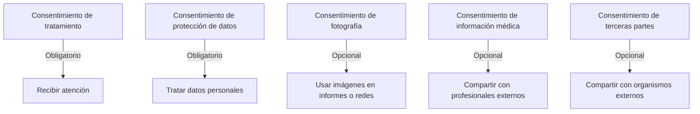

# Consentimientos y Privacidad

> [!warning] Estado
> Este documento describe el **diseño** del sistema. Los plazos legales concretos
> (**P4**) y la validación jurídica (**P8**) están pendientes. La sección §8 lista lo que
> debe confirmar la asesoría legal antes de la producción.

---

## 1. Principios de privacidad aplicados

| # | Principio | Cómo se aplica en el sistema |
|---|---|---|
| 1 | **Minimización** | Solo se recolectan los campos que el centro usa. Cada campo tiene propósito declarado. |
| 2 | **Finalidad** | Los consentimientos declaran para qué se usa cada tipo de dato. |
| 3 | **Transparencia** | Los tutores reciben información clara sobre el tratamiento de datos. |
| 4 | **Acceso** | El sistema permite saber quién accedió a qué, y cuándo. |
| 5 | **Rectificación** | La ficha del alumno es editable por el personal autorizado; el tutor puede solicitar corrección. |
| 6 | **Supresión** | Sujeto a la obligación de conservación (P4). No se borra historia clínica. |
| 7 | **Seguridad** | Cifrado, control de acceso, auditoría. |
| 8 | **Responsabilidad** | Cada acción sensible queda registrada con actor y motivo. |

---

## 2. Tipos de consentimiento



| Tipo | Obligatorio | Para qué | Quién lo firma |
|---|---|---|---|
| `treatment` | ✅ Sí | Autorizar la atención | Tutor responsable |
| `data_protection` | ✅ Sí | Autorizar el tratamiento de datos | Tutor responsable |
| `photography` | ❌ Opcional | Imágenes en informes, redes sociales | Tutor responsable |
| `medical_info` | ❌ Opcional | Compartir información con profesionales externos | Tutor responsable |
| `third_party_sharing` | ❌ Opcional | Compartir con organismos (escuelas,.screenings) | Tutor responsable |

**Regla operativa:** un alumno **no puede recibir atención** sin `treatment` vigente.
La validación ocurre al **programar una sesión**, no al crearla (para poder agendar
mientras se regulariza, con la alerta visible).

---

## 3. Modelo de datos

```sql
CREATE TABLE documents.consents (
    id            BIGSERIAL PRIMARY KEY,
    student_id    BIGINT NOT NULL REFERENCES students.students(id) ON DELETE CASCADE,
    consent_type  VARCHAR(40) NOT NULL,
    version       VARCHAR(20) NOT NULL,
    granted_by_guardian_id BIGINT REFERENCES students.guardians(id) ON DELETE SET NULL,
    granted_at    DATE NOT NULL,
    expires_at    DATE,
    is_revoked    BOOLEAN NOT NULL DEFAULT FALSE,
    revoked_at    TIMESTAMPTZ,
    document_id   BIGINT REFERENCES documents.documents(id) ON DELETE SET NULL,
    notes         TEXT,
    created_by    BIGINT REFERENCES identity.users(id),
    created_at    TIMESTAMPTZ NOT NULL DEFAULT NOW(),
    updated_at    TIMESTAMPTZ NOT NULL DEFAULT NOW()
);
```

**Elementos clave:**

| Campo | Significado |
|---|---|
| `version` | Versión del texto del consentimiento. Si el texto cambia, se crea un registro nuevo con nueva versión |
| `granted_by_guardian_id` | Quién firmó |
| `document_id` | Evidencia: el formulario firmado, escaneado y almacenado |
| `expires_at` | Consentimientos con vigencia (p. ej. yearly) |
| `is_revoked` | Revocación; **nunca** se borra el registro original |
| `notes` | Observaciones (p. ej. "firmó en acta de reunión") |

> [!important] `version` es obligatorio
> Sin versionar el texto, no se puede demostrar **qué** se firmó. Si el centro cambia la
> redacción del consentimiento, se crea una versión nueva. Los consentimientos anteriores
> se conservan.

---

## 4. Consulta de consentimiento vigente

```php
// packages/documents/src/Services/ConsentChecker.php
final class ConsentChecker
{
    public function hasValidTreatmentConsent(int $studentId): bool
    {
        return DB::connection('documents')
            ->table('consents')
            ->where('student_id', $studentId)
            ->where('consent_type', 'treatment')
            ->where('is_revoked', false)
            ->where(fn ($q) => $q->whereNull('expires_at')->orWhere('expires_at', '>=', today()))
            ->exists();
    }

    public function missingRequired(int $studentId): array
    {
        return collect(['treatment', 'data_protection'])
            ->reject(fn (string $type) => $this->hasConsent($studentId, $type))
            ->all();
    }
}
```

**Puntos de integración:**

| Momento | Comportamiento |
|---|---|
| Al crear una matrícula | Aviso: faltan consentimientos |
| Al programar una sesión | **Bloqueo** si falta `treatment` |
| Al generar un cargo | Aviso, no bloqueo (el cobro no depende del consentimiento) |
| En la ficha del alumno | Panel de consentimiento con estado y acción para registrar |

---

## 5.derechos de las familias

| Derecho | Cómo se satisface en el sistema | Responsable |
|---|---|---|
| **Acceso** (saber qué datos se tienen) | Ficha del alumno + historial de atención (agenda, documentos). En el MVP, lo entrega el personal; en etapa 2, portal | Secretaría |
| **Rectificación** | Edición de la ficha por personal autorizado; el tutor solicita por cualquier medio y Secretaría actualiza | Secretaría |
| **Supresión** | ⚠️ **Limitada por la obligación de conservación** (P4). Se puede marcar la cuenta como inactiva y detener tratamientos, pero el historial clínico se conserva | Dirección + Legal |
| **Oportunidad** (en caso de decisiones automatizadas) | ✅ El sistema **no toma decisiones automatizadas** sobre menores. Todas las decisiones clínicas y de cobro son humanas | Dirección |
| **Portabilidad** | Exportación de la ficha en PDF (F8) | Secretaría |
| **Revocación del consentimiento** | Marca `is_revoked = true` con fecha; se audita | Secretaría |

> [!danger] Supresión vs. conservación
> Si un tutor pide borrar los datos de su hijo, la respuesta **no** puede ser un simple
> "borramos todo". Hay una obligación de conservación del registro de atención (P4). La
> respuesta correcta es: **se suspende el tratamiento (alta del alumno, fin de los cobros,
> cierre de agenda), y se conserva el registro conforme a la política de conservación.**
> La redacción exacta de esa respuesta debe salir de la asesoría legal.

---

## 6. Comunicación con las familias

### 6.1 Regla de oro

> **Las comunicaciones a familias son administrativas. Nunca llevan contenido clínico.**

| Puede contain | No puede contain |
|---|---|
| Importe, vencimiento, saldo | Diagnóstico, notas, objetivos clínicos |
| Fecha y hora de la sesión | Evaluación, informe |
| Requerimiento de documentación | Detalle de la atención |
| Aviso de cancelación | Evolución del alumno |
| Recibo | Contenido de planes |

### 6.2 Templates y sanitización

```php
// packages/notifications/src/Services/TemplateRenderer.php
final class TemplateRenderer
{
    private const ALLOWED_VARIABLES = [
        'alumno_nombre', 'alumno_codigo', 'tutor_nombre', 'servicio',
        'periodo', 'monto', 'saldo', 'fecha_vencimiento', 'centro_nombre',
        'enlace_portal',
    ];

    public function render(string $template, array $data): string
    {
        // Solo se aceptan variables permitidas
        $data = array_intersect_key($data, array_flip(self::ALLOWED_VARIABLES));

        // Escape HTML por defecto: el texto del usuario nunca se interpreta
        return e(
            preg_replace_callback(
                '/\{\{(\w+)\}\}/',
                fn (array $m) => (string) ($data[$m[1]] ?? ''),
                $template
            )
        );
    }
}
```

**Regla:** una variable clínica en una plantilla es un **bug de seguridad**, y hay un test
que lo detecta:

```php
it('no contiene variables clinicas en las plantillas', function () {
    foreach (MessageTemplate::all() as $template) {
        $variables = array_column($template->variables, 'name');
        expect($variables)->not->toContain('diagnostico');
        expect($variables)->not->toContain('nota');
        expect($variables)->not->toContain('objetivo_clinico');
    }
});
```

### 6.3 Preferencia de comunicación

| Regla | Comportamiento |
|---|---|
| Solo se avisa a tutores con `receives_admin_messages = true` | Validado en la Action de envío |
| Se respeta el canal preferido | Si `notify_email = false`, no se manda email |
| El email sale de la ficha | Nunca de texto libre |
| Se registra lo enviado | Fila en `notifications` con el cuerpo real |
| El aviso de cuota **nunca** incluye detalles clínicos | Por diseño de plantilla |

---

## 7. Datos de terceros y entidad de datos

El sistema maneja datos de **adultos** (tutores, profesionales) y de **menores** (alumnos).
Las obligaciones no son idénticas.

| Categoría | Ejemplos | Consideración |
|---|---|---|
| Datos de menores | Alumnos: nombre, fecha de nacimiento, CI, dirección, assessments | **Máxima protección** |
| Datos de tutores | Nombre, CI, teléfono, email, ocupación | Protección estándar |
| Datos de profesionales | Nombre, especialidad, teléfono, email | Protección estándar + laboral |
| Datos de personal interno | Correo, hash de contraseña, MFA | Protección estándar |

> [!note] El CI es un dato sensible
> El número de cédula es un identificador que no se cambia. Se indexa para búsqueda pero
> **nunca se expone en listados** (se muestra parcialmente, p. ej. `1234567…`).

---

## 8. Lista de verificación legal (pendiente de confirmación)

> [!question] Definir
> Esta sección **debe** ser revisada por la asesoría legal del centro antes de la puesta en
> producción (F8). Los ítems marcados con ⚠️ dependen de P4 y P8.

| # | Punto | Estado |
|---|---|---|
| 1 | Base legal del tratamiento (consentimiento vs. obligación legal vs. interés legítimo) | ⚠️ Definir con Legal |
| 2 | Plazo de conservación de notas clínicas | ⚠️ **P4 — bloqueante** |
| 3 | Plazo de conservación de documentos administrativos | ⚠️ **P4** |
| 4 | Plazo de conservación de datos financieros | ⚠️ **P4** (puede tener plazo legal fijo) |
| 5 | Quién firma cuando el alumno es mayor de edad | ⚠️ **P8 — bloqueante** |
| 6 | Consentimiento de personas sin tutoría legal | ⚠️ Definir |
| 7 | Derechos de acceso, rectificación y supresión: procedimiento y plazos de respuesta | ⚠️ Definir |
| 8 | Notificación de incidentes de seguridad: a quién y en qué plazo | ⚠️ Definir |
| 9 | Transferencia a terceros (nube, proveedor de backup): contrato y garantías | ⚠️ Definir |
| 10 | Encargado del tratamiento (el centro) y sus subencargados | Definir |
| 11 | Registro de actividades de tratamiento | El sistema **es** el registro |
| 12 | Política de respaldo del titular de los datos | Definir |
| 13 | Uso de imágenes: consentimiento específico y retiro | Definir |
| 14 | Retención de video de seguridad (si el centro tiene cámaras) | Fuera del sistema |

---

## 9. Lo que el sistema hace automáticamente

| Control | Implementación |
|---|---|
| Registro de toda lectura de dato clínico | `audit_events` |
| Registro de toda descarga de documento | `document_access_events` |
| Bloqueo de acceso sin consentimiento para programmers | Validación en la Action |
| Minimización de datos visibles según rol | Permissions + scopes |
| No envío de datos clínicos a familias | Templates sin variables clínicas |
| Conservación del historial de consentimientos | Versionado + `is_revoked` |
| Cifrado del contenido clínico | Cast `encrypted` |

---

## 10. Documentos relacionados

- [[03.07 Documentos, Consentimientos y Notificaciones]]
- [[04.05 Auditoría de Datos Sensibles]]
- [[04.07 Checklist Legal y Respuesta a Incidentes]]
- [[01.07 Preguntas Abiertas y Decisiones Pendientes]]
- [[09.07 Importación de Datos Iniciales]]
