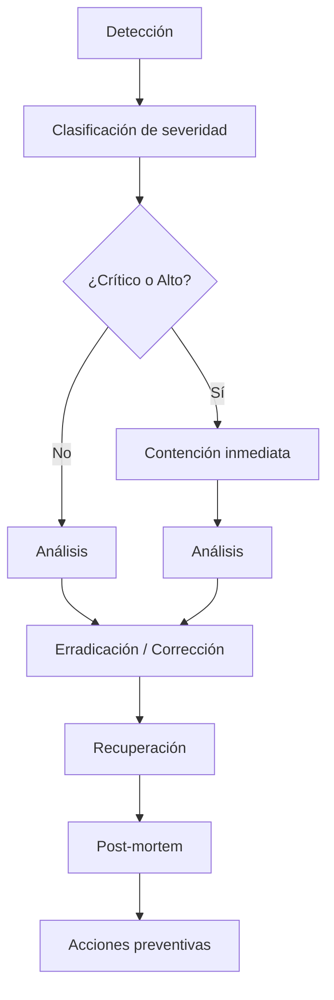

# Checklist Legal y Respuesta a Incidentes

Documento de dos partes:
- **Parte A:** qué debe revisarse antes de la producción (legal y de configuración).
- **Parte B:** qué hacer cuando algo sale mal (incidentes de seguridad y operación).

---

# PARTE A — Checklist previo a producción

## A.1. Legal y contractual

| # | Ítem | Responsable | Estado | Evidencia |
|---|---|---|---|---|
| 1 | Asesoría legal contratada y fecha de la revisión | Dirección | ⬜ | Contrato |
| 2 | Base legal del tratamiento de datos de menores | Legal | ⬜ | Informe |
| 3 | Plazos de conservación por tipo de dato (P4) | Legal | ⬜ | Política escrita |
| 4 | Reglas de firma de consentimientos (P8) | Legal | ⬜ | Informe |
| 5 | Procedimiento de atención de derechos del titular | Legal + Secretaría | ⬜ | Procedimiento |
| 6 | Política de privacidad para las familias (texto) | Legal | ⬜ | Documento firmado |
| 7 | Consentimientos informados listos para usar | Dirección + Legal | ⬜ | Formularios versionados |
| 8 | Cláusulas de tratamiento con proveedores (backup externo, correo) | Dirección | ⬜ | Contratos |
| 9 | Responsabilidad del sistema: agreements de roles internos | Dirección | ⬜ | Acta |

## A.2. Configuración técnica de seguridad

| # | Ítem | Verificación | Estado |
|---|---|---|---|
| 10 | HTTPS obligatorio, TLS 1.2+ | `curl -I https://...` | ⬜ |
| 11 | Redirección HTTP → HTTPS | Config de Nginx | ⬜ |
| 12 | Cabeceras de seguridad (`X-Frame-Options`, `CSP`, `nosniff`) | `curl -I` | ⬜ |
| 13 | PostgreSQL no accesible desde la red pública | `ss -ltnp \| grep 5432` | ⬜ |
| 14 | SSH con clave, sin contraseña por root | `sshd_config` | ⬜ |
| 15 | Firewall: solo puertos 22, 80, 443 | `ufw status` | ⬜ |
| 16 | `storage/app/private` con permisos 750 | `ls -ld` | ⬜ |
| 17 | `public/` sin archivos privados | `ls public/` | ⬜ |
| 18 | `APP_DEBUG=false` | `.env` | ⬜ |
| 19 | `APP_ENV=production` | `.env` | ⬜ |
| 20 | `APP_KEY` en el gestor de contraseñas, **fuera** del servidor | Verificación manual | ⬜ |
| 21 | MFA habilitado para `direccion` y `admin_tecnico` | Panel | ⬜ |
| 22 | Rate limiting del login activo | 5 intentos / 15 min | ⬜ |
| 23 | Contraseña mínima de 12 caracteres | Config | ⬜ |
| 24 | Sesión con `secure`, `http_only`, `same_site=lax` | Config | ⬜ |
| 25 | Usuario de la app **sin** `DELETE` sobre `audit_events` | `\du` en psql | ⬜ |
| 26 | Logs rotados (Nginx y Laravel) | Cron | ⬜ |
| 27 | Backup externo configurado y **verificado** | Restore de prueba | ⬜ |
| 28 | Clave de cifrado del backup en gestor de contraseñas | Verificación manual | ⬜ |

## A.3. Organizacional

| # | Ítem | Responsable | Estado |
|---|---|---|---|
| 29 | Roles asignados y registrados por escrito | Dirección | ⬜ |
| 30 | Usuarios creados con contraseñas individuales | Técnico | ⬜ |
| 31 | Nadie comparte credenciales (declaración firmada) | Dirección | ⬜ |
| 32 | `Backup Custodian` designado (no es el dev) | Dirección | ⬜ |
| 33 | Procedimiento de alta/baja de personal documentado | Dirección | ⬜ |
| 34 | Manuales por rol entregados y entendidos | Dirección | ⬜ |
| 35 | Plan de respuesta a incidentes probado (simulacro) | Técnico | ⬜ |
| 36 | Plan de recuperación probado (restore real) | Técnico | ⬜ |
| 37 | Contacto de emergencia (dirección, legal) documentado | Dirección | ⬜ |
| 38 | Pantalla con aviso de privacidad en la pantalla de login | Técnico | ⬜ |

---

# PARTE B — Respuesta a incidentes de seguridad

## B.1. Principio

> **Primero: contener. Después: entender. Al final: reportar.**
> El objetivo de las primeras horas es **evitar que el daño crezca**, no entenderlo.

## B.2. Clasificación de severidad

| Nivel | Definición | Ejemplos | Respuesta |
|---|---|---|---|
| 🔴 **Crítico** | Datos sensibles expuestos o acceso no autorizado confirmado | Dump de la base con notas clínicas; acceso indebido confirmado; `APP_KEY` filtrada | Inmediato, 24/7 |
| 🟠 **Alto** | Posible exposición sin confirmación | Credencial filtrada; backup no cifrado; usuario sospechoso | Mismo día |
| 🟡 **Medio** | Anomalía interna sin impacto en datos | Permiso mal asignado; grant vencido; crecimiento descontrolado del log | 48 h |
| 🟢 **Bajo** | Desviación menor | Documento subido con nombre incorrecto | Semana |

## B.3. Flujo de respuesta



### B.3.1 Contención

| Situación | Acción inmediata | Tiempo |
|---|---|---|
| Robo de credenciales de un usuario | Desactivar el usuario, revocar sesiones | 5 min |
| Acceso indebido a datos clínicos confirmado | Desactivar el usuario, **`module.care` = off** | 10 min |
| Filtración de `APP_KEY` | Rotar `APP_KEY` (rompe el descifrado → plan de re-cifrado), `module.care` = off | 15 min |
| Ransomware / cifrado del servidor | Aislar la red, **no** apagar (preservar memoria), activar plan de recuperación | 15 min |
| Backup no cifrado expuesto | Eliminar el archivo, regenerar cifrado | 30 min |
| Stations bug: malware en un equipo | Aislar el equipo, cambiar contraseñas de ese usuario | 30 min |
| Un profesional accediendo a muchos alumnos | Desactivar temporalmente, revisar auditoría | 1 h |

> [!danger] El kill switch como primera medida
> `module.care = off` es la medida de contención más rápida y más efectiva. **Apaga el
> acceso a los datos clínicos sin tocar la base ni perder información.** Ver
> [[06.04 Feature Flags y Kill Switches]].

### B.3.2 Análisis

| Pregunta | Fuente de respuesta |
|---|---|
| ¿Qué datos se expojeron? | `audit_events` + `document_access_events` |
| ¿Quién los accessing? | `actor_user_id`, `actor_role`, IP, user agent |
| ¿Cuándo? | `created_at` (con `TIMESTAMPTZ` y zona) |
| ¿Hay patrón? | Consultas de vigilancia (§6 de [[04.05 Auditoría de Datos Sensibles]]) |
| ¿Fue un error o un ataque? | Comparar el patrón con el rol y la carga de trabajo |

### B.3.3 Erradicación

| Vector | Acción |
|---|---|
| Credencial comprometida | Cambiar la contraseña, forzar reingreso, revisar sesiones |
| Permiso excesivo | Revocar el permiso, revisar el rol completo |
| Software desactualizado | Actualizar, revisar el advisory |
| Configuración insegura | Corregir, añadir un test que lo evite |
| Clave filtrada | Rotar + re-cifrar (F9) |

### B.3.4 Recuperación

- Restaurar el servicio (ver [[10.04 Recuperación ante Desastres]]).
- Si hubo pérdida de datos: restaurar desde backup y **reconciliar** con la auditoría para
  identificar qué falta.
- Si se expusieron datos: **no** se restaura el estado previo de los datos del atacante
  (eso sería reintroducir el problema). Se limpia el vector y se restaura lo perdido.

### B.3.5 Comunicación

| audiences | Cuándo | Contenido |
|---|---|---|
| Dirección | Inmediato (crítico/alto) | Qué pasó, qué datos, qué se hizo |
| Families afectadas | Según lo definido con Legal | Qué datos de qué personas y qué medidas |
| Autoridad competente | Según lo definido con Legal | según el protocolo legal |
| Equipo del centro | Después de la contención | Qué hacer y qué no hacer |

> [!danger] No se comunica nada antes de confirmar con Legal
> Reconocer un problema sin tener los hechos puede dañar el centro legalmente y
> perjudicar a las familias innecesariamente. El protocolo de comunicación lo define Legal (ítem 8
> del checklist A.1).

### B.3.6 Post-mortem

**Sin culpa, con aprendizaje.** En los primeros 5 días hábiles:

| # | Pregunta |
|---|---|
| 1 | ¿Qué pasó? (cronología) |
| 2 | ¿Cómo se detectó? |
| 3 | ¿Qué habilitó el incidente? (control faltante) |
| 4 | ¿Qué se amplificó el impacto? |
| 5 | ¿Qué_AND qué se mostró que funcionó? |
| 6 | ¿Qué acciones se toman? (cada una con responsable y fecha) |

El documento se guarda en `91 - Actas de Reunión` y las acciones se agregan al backlog.

---

## B.4. Guion rápido: "me parece que alguien entró"

```
1. NO tocar nada. NO borrar logs. NO reiniciar el servidor.

2. Anotar la hora exacta del indicio.

3. Acceder al panel como Dirección y:
   a. identity/audit_events → filtrar por las últimas 24 h, acción 'clinical_note.viewed'
   b. identity/security_events → filtrar por severidad warning/critical
   c. documents/document_access_events → últimas 24 h

4. Identificar el usuario sospechoso.

5. Si hay evidencia clara:
   → Desactivar el usuario (Administración Técnica)
   → Revocar sus sesiones
   → Si el acceso fue clínico y masivo → module.care = off

6. Preservar los logs: copiar storage/logs y los logs de Nginx a otra ubicación.

7. Avisar a Dirección.

8. No contactar al usuario familiar todavía.
```

---

## B.5. Contactos de emergencia

| Rol | Nombre | Teléfono | Alterno |
|---|---|---|---|
| Dirección | *a completar* | | |
| Administración Técnica | *a completar* | | |
| Asesoría legal | *a completar* | | |
| Proveedor de backup externo | *a completar* | | |
| Soporte del hosting (si aplica) | *a completar* | | |
| **Emergencia (911 /(Attribute))** | — | | |

> **Este bloque se completa antes de la producción (F8).** Un runbook sin contactos es un
> runbook inservible.

---

## B.6. Simulacros

| Simulacro | Frecuencia | Objetivo | Última |
|---|---|---|---|
| Restauración de backup | Trimestral | Verificar que el backup sirve | *pendiente* |
| Kill switch del módulo `care` | Semestral | Verificar que se apaga en < 1 min | *pendiente* |
| Recoveración completa del servidor | Anual | Verificar el RTO de 4 h | *pendiente* |
| Respuesta a credencial filtrada | Semestral | Verificar el tiempo de contención | *pendiente* |
| Revocación de grants | Mensual | Verificar que los vencidos no dan acceso | *pendiente* |
| Baja de un empleado (permisos) | Semestral | Verificar que se revocan los accesos | *pendiente* |

Ver [[10.02 Calendario de Checklists]].

---

## B.7. Documentos relacionados

- [[04.01 Modelo de Seguridad]]
- [[04.05 Auditoría de Datos Sensibles]]
- [[06.04 Feature Flags y Kill Switches]]
- [[06.06 Procedimiento de Rollback]]
- [[10.03 Gestión de Incidentes]]
- [[10.04 Recuperación ante Desastres]]
