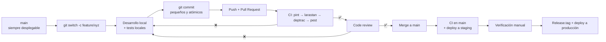
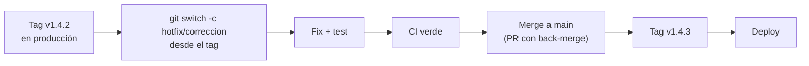

# Flujo de Trabajo

> [!important] Modelo elegido: **Trunk-based development**
> `main` siempre es desplegable. Las ramas son cortas (días, no semanas). No hay ramas
> `develop` ni `release` permanentes.

---

## 1. Por qué trunk-based

| Alternativa | Problema | Por qué no |
|---|---|---|
| Git Flow | Ramas `develop`/`release` de larga duración; merge conflictivo; conflictos tardíos | Con 1 dev part-time, el costo de mantener 3 ramas es mayor que el beneficio |
| Feature branch larga (una por sprint) | Divergencia, conflictos, code review tardío | Un PR de 2.000 líneas no se revisa bien |
| **Trunk-based** ✅ | `main` siempre verde; ramas de días; reviews frecuentes | — |

**Condición de éxito:** `main` debe estar siempre en estado desplegable. Eso obliga a que
las migraciones sean compatibles (expand–contract, ver [[06.03 Expand-Contract]]) y a que
los cambios grandes se dividan en PRs chicos.

---

## 2. El ciclo



**Tiempo objetivo del ciclo:** del inicio del trabajo al merge, **menos de 2 días**.

---

## 3. Estructura de ramas

| Rama | Vida | Quién la crea | Regla |
|---|---|---|---|
| `main` | Permanente | — | Siempre desplegable. **Protegida**: solo merge con CI verde |
| `feature/<módulo>-<qué>` | 1–3 días | Dev | Deriva de `main` actualizado |
| `fix/<qué>` | < 1 día | Dev | Deriva de `main` |
| `release/<tag>` | ❌ **No existe** | — | El release se crea desde `main` con un tag |
| `hotfix/<qué>` | Horas | Dev | Deriva del tag en producción, se mergea a `main` |

**Nomenclatura de ramas:**

```
feature/students-guardian-import
feature/billing-receipt-numbering
fix/scheduling-overlap-constraint
fix/care-note-encryption
chore/deptrac-config
docs/vault-structure
```

**Prefijos permitidos:** `feature/`, `fix/`, `chore/`, `docs/`, `refactor/`, `test/`.

---

## 4. Ramas cortas: la regla de los 400 líneas

| Tamaño del PR | Acción |
|---|---|
| < 400 líneas | Normal, se revisa en 15 min |
| 400–800 líneas | Se divide si es posible; si no, se justifica |
| > 800 líneas | **Se divide obligatoriamente** antes de mergear |

**Cómo se divide un trabajo grande (ejemplo: módulo de finanzas):**

```
1. feature/billing-schema-and-models      (sin UI)
2. feature/billing-charge-actions          (lógica de dominio)
3. feature/billing-payment-actions         (lógica de dominio)
4. feature/billing-receipts                (numeración + impresión)
5. feature/billing-filament-resources      (interfaz)
6. feature/billing-reports                 (consultas de solo lectura)
```

Cada uno es un PR revisable, testeable y **reversible por separado**.

---

## 5. Antes de abrir el PR

```bash
# 1. Actualizar desde main
git switch main && git pull --ff-only
git switch feature/mi-rama && git rebase main

# 2. Verificar que todo pasa en local
composer install
composer lint        # pint --test
composer analyse     # larastan
composer deptrac     # fronteras
composer test        # pest

# 3. Publicar
git push --force-with-lease
```

> [!tip] `rebase` vs `merge` en `main`
> En la rama de trabajo se usa **rebase** (historial lineal, commits limpios). En `main`
> se usa **merge** (conserva el contexto de que es un release). Es la convención
> estándar de trunk-based.

---

## 6. Code review

| Aspecto | Regla |
|---|---|
| Quién revisa | El propio dev (autorrevisión) **o** Dirección si es un cambio de reglas de negocio |
| Cuándo | Antes del merge |
| Qué se revisa | Checklist de [[05.04 Checklist de Pull Request]] |
| Tamaño máximo | 400 líneas |
| Tiempo objetivo | 24 h |
| Comments | Siempre en la línea concreta. Nada de "arreglado" sin commit |
| Aprobaciones | 1 aprobación (el dev) — el repo es de 1 dev |

**Autorrevisión (el dev revisando su propio código):**

Es legítima y es lo estándar con un solo desarrollador. El valor está en el **proceso
obligatorio**: la checklist se completa **explícitamente** en el cuerpo del PR, no de
memoria. Escribir "☐ Formato" y "☑ Formato" es lo que produce el beneficio real.

**La auto-revisión detecta:**
- Errores de lógica (releyendo con ojos frescos).
- Violaciones de la arquitectura (la checklist lo hace explícito).
- Deuda accidental (TODO sin contexto, código muerto).

**Lo que la auto-revisión NO detecta:**
- Errores de interpretación del requerimiento.
- Falta de un caso de uso.
- Problemas de UX.

Por eso: **los cambios de reglas de negocio los valida Dirección** antes del merge. No
como revisor técnico, sino como **dueño del proceso**.

---

## 7. Qué se hace en `main`

| Automático | Manual |
|---|---|
| Tests, lint, análisis estático, Deptrac | Verificación funcional en staging |
| Verificación de migraciones | Verificación del plan de release |
| | Decisión de tag y deploy |

---

## 8. Ambientes

| Ambiente | Propósito | Datos | Quién accede |
|---|---|---|---|
| **local** | Desarrollo | Datosfake generados por seeders | Dev |
| **staging** | Verificación pre-producción | Datos **anonimizados** de producción | Dev + Dirección |
| **producción** | Operación real | Datos reales | Personal del centro |

**Reglas:**

| Regla | Detalle |
|---|---|
| Staging tiene una **base propia** | Nunca apunta a la base de producción |
| Staging se reconstruye desde las migraciones | No se copia la base de producción |
| Los datos de staging son anonimizados | Se sustituyen nombres, CI, teléfonos y documentos |
| Producción no se usa para probar | Nunca. Un error en producción es un incidente |
| Las variables de entorno son distintas | `APP_KEY` diferente por ambiente |

> [!danger] Prohibido conectar el entorno local a la base de producción
> Un `DB_HOST` mal pegado en `.env` es la forma más común de destruir datos. La F8
> incluye un test de configuración que verifica que el `APP_ENV=production` tiene un
> `DB_DATABASE` con sufijo distinto al de staging.

---

## 9. Commits en `main`

| Tipo | Cuándo | Efecto |
|---|---|---|
| `feat:` | Nueva funcionalidad | `MINOR` |
| `fix:` | Corrección de bug | `PATCH` |
| `feat!:` / `BREAKING CHANGE:` | Cambio incompatible | `MAJOR` |
| `docs:` | Documentación | Sin efecto |
| `chore:` | Mantenimiento | Sin efecto |
| `refactor:` | Reestructuración sin cambio de comportamiento | Sin efecto |
| `test:` | Solo tests | Sin efecto |
| `perf:` | Mejora de rendimiento | Sin efecto |
| `build:` / `ci:` | Build y CI | Sin efecto |

Ver [[05.02 Commits, Ramas y Versionado SemVer]].

---

## 10. Ramas `hotfix`

Cuando hay un bug **en producción**:



**Reglas:**
- El `hotfix` **parte del tag en producción**, no de `main` (que puede tener cambios no
  liberados).
- El `hotfix` incluye **un test** que reproduzca el bug.
- Se mergea a `main` con un PR que además hace merge del tag (para que `main` contenga
  el fix).
- Se despliega como un release nuevo.

**Orden de merge en `main`:** `hotfix` primero, luego `main` → `hotfix` (para evitar
conflictos).

---

## 11. Relación con las fases del plan

| Fase | Trabajo en el flujo |
|---|---|
| F0 | Estructura base: CI, Deptrac, estructura de paquetes |
| F1 | Packages vacíos + contratos + arch tests |
| F2 | Primer flujo completo: PR → CI → review → merge |
| F3–F9 | Iteración sobre el flujo, con mejoras al checklist |

---

## 12. Documentos relacionados

- [[05.02 Commits, Ramas y Versionado SemVer]]
- [[05.03 Convenciones de Código]]
- [[05.04 Checklist de Pull Request]]
- [[05.05 Estrategia de Pruebas]]
- [[06.01 Estrategia de Versionado]]
- [[06.05 Release y Deploy]]
