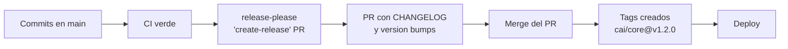

# Commits, Ramas y Versionado SemVer

---

## 1. Formato del mensaje de commit

```
<tipo>(<ámbito>): <descripción en imperativo>

<cuerpo opcional: POR QUÉ, no QUÉ>

<pie opcional: referencias>
```

### 1.1 Tipos

| Tipo | Uso | Efecto en la versión |
|---|---|---|
| `feat` | Nueva funcionalidad | `MINOR` |
| `fix` | Corrección de bug | `PATCH` |
| `feat!` | Nueva funcionalidad incompatible | `MAJOR` |
| `fix!` | Corrección incompatible | `MAJOR` |
| `docs` | Solo documentación | — |
| `style` | Formato (sin cambio de lógica) | — |
| `refactor` | Reestructuración sin cambio de comportamiento | — |
| `perf` | Mejora de rendimiento | — |
| `test` | Añade o corrige tests | — |
| `build` | Sistema de build, dependencias | — |
| `ci` | Configuración de CI | — |
| `chore` | Mantenimiento varios | — |
| `revert` | Revierte un commit anterior | `PATCH` |

### 1.2 Ámbitos

Los ámbitos son **los paquetes del monorepo**, para que `release-please` pueda bumpear cada
paquete por separado:

```
feat(students): agregar importación masiva de alumnos
fix(billing): corregir numeración de recibos con pagos concurrentes
feat(care)!: cambiar la firma de ClinicalNotePolicy::view
refactor(scheduling): extraer generador de sesiones recurrentes
docs(reporting): documentar el reporte de carga por profesional
chore(core): actualizar deptrac.yaml con el paquete notifications
```

### 1.3 Reglas del mensaje

| Regla | Detalle |
|---|---|
| Imperativo | "agregar", no "agregado" ni "agrega" |
| Minúsculas | Sin punto final |
| ≤ 72 caracteres en la primera línea | Legibilidad en `git log --oneline` |
| El cuerpo explica el **por qué** | El *qué* ya está en el diff |
| Referencias a issues | `Refs: #123` al final |
| Sin "WIP" en `main` | Si hay commits de trabajo, van en la rama, no en `main` |

### 1.4 Ejemplos buenos y malos

```bash
# ✅ Bueno
fix(billing): impedir sobreimputación de pagos concurrentes

Dos pagos simultáneos sobre el mismo cargo podían imputar más de lo debido
porque la lectura del saldo no era bloqueante. Ahora se usa SELECT ... FOR UPDATE
sobre los cargos implicados antes de calcular la imputación.

Refs: #142

# ❌ Mal
fix

# ❌ Mal
arreglo del bug en billing

# ❌ Mal
feat(billing): update payment allocation logic and receipt generation and
also fix the concurrency issue with charges and add better error messages
for the user when validation fails
```

---

## 2. Commits atómicos

> **Un commit = un cambio lógico. Si el mensaje necesita una "y", son dos commits.**

| ❌ Mal | ✅ Bien |
|---|---|
| `feat(billing): agregar pagos, recibos e impresión` | `feat(billing): registrar pagos con imputación` / `feat(billing): emitir recibos numerados` / `feat(billing): imprimir recibo` |
| `fix: cambiar el schema y el modelo` | `feat(billing): agregar columna amount_paid a charges` / `refactor(billing): actualizar el modelo Charge` |

**Por qué importa:**
- Permite `git revert` de un cambio concreto.
- Permite entender el historial sin leer el diff.
- Facilita el cherry-pick de un fix a otra rama.
- Hace que `release-please` genere un CHANGELOG legible.

---

## 3. Versionado SemVer

```
MAJOR.MINOR.PATCH
  │      │      └── Cambios que no alteran la API (fix, parche)
  │      └───────── Funcionalidad nueva compatible hacia atrás
  └──────────────── Cambios incompatibles
```

### 3.1 Qué es "incompatible" en este sistema

Un cambio es **MAJOR** si obliga a modificar código que **consume** este paquete:

| Ejemplo | Versión |
|---|---|
| Agregar un método opcional a un contrato | `MINOR` |
| Agregar un método **obligatorio** a un contrato | `MAJOR` |
| Cambiar el tipo de un parámetro | `MAJOR` |
| Agregar una columna con `nullable` | `MINOR` |
| Agregar una columna `NOT NULL` sin default | `MAJOR` |
| Cambiar el nombre de una tabla | `MAJOR` |
| Agregar un permiso nuevo | `MINOR` |
| Quitar un permiso | `MAJOR` |
| Cambiar el comportamiento de una Action | `MAJOR` si cambia el resultado esperado |
| Corregir un bug sin cambiar la API | `PATCH` |

### 3.2 Versionado por paquete

Cada paquete tiene su versión. **El sistema completo no tiene una versión única**, aunque
también se etiqueta el release general.

| Paquete |Cambio | Versión |
|---|---|---|
| `cai/students` | Nueva Acción `TransferStudentToAccount` | `1.1.0` |
| `cai/care` | La Policy exige `student_id` en el grant | `2.0.0` |
| `cai/billing` | Corregido el orden de las imputaciones | `1.0.1` |
| `cai/core` | Sin cambios | `1.0.0` |

**Regla:** si `cai/care` sube a `2.0.0`, los paquetes que dependen de él (`reporting`) deben
actualizarse a `2.0.0` (major) o declarar explícitamente que no les afecta.

---

## 4. `release-please`

### 4.1 Qué hace

`release-please` analiza los commits Conventional Commits desde el último tag y:

1. Decide la nueva versión de cada paquete.
2. Actualiza el `CHANGELOG.md`.
3. Crea el commit de release.
4. Crea el tag.
5. Publica la release en GitHub.

### 4.2 Configuración (monorepo)

```json
// release-please-config.json
{
  "$schema": "https://raw.githubusercontent.com/googleapis/release-please/main/schemas/config.json",
  "release-type": "simple",
  "bump-minor-pre-major": false,
  "bump-patch-for-minor-pre-major": false,
  "changelog-path": "CHANGELOG.md",
  "packages": {
    "packages/core": { "package-name": "cai/core", "changelog-path": "packages/core/CHANGELOG.md" },
    "packages/identity": { "package-name": "cai/identity", "changelog-path": "packages/identity/CHANGELOG.md" },
    "packages/students": { "package-name": "cai/students", "changelog-path": "packages/students/CHANGELOG.md" },
    "packages/scheduling": { "package-name": "cai/scheduling", "changelog-path": "packages/scheduling/CHANGELOG.md" },
    "packages/care": { "package-name": "cai/care", "changelog-path": "packages/care/CHANGELOG.md" },
    "packages/billing": { "package-name": "cai/billing", "changelog-path": "packages/billing/CHANGELOG.md" },
    "packages/documents": { "package-name": "cai/documents", "changelog-path": "packages/documents/CHANGELOG.md" },
    "packages/notifications": { "package-name": "cai/notifications", "changelog-path": "packages/notifications/CHANGELOG.md" },
    "packages/reporting": { "package-name": "cai/reporting", "changelog-path": "packages/reporting/CHANGELOG.md" }
  }
}
```

### 4.3 Manifiesto

```json
// .release-please-manifest.json
{
  ".": "1.0.0",
  "packages/core": "1.0.0",
  "packages/identity": "1.0.0"
}
```

### 4.4 Flujo



> [!tip] El PR de release es una revisión valiosa
> Antes de mergear el PR de release, se lee el CHANGELOG. Si dice algo que no se espera
> ("feat: corrige el cálculo de saldo"), se corrige el commit antes de mergear.

---

## 5. Tags

### 5.1 Formato

```
cai/core@v1.2.0
cai/students@v1.0.0
cai/billing@v2.1.0
```

Un tag **por paquete**. Un release de producción es el **conjunto** de tags vigentes.

### 5.2 Tag general del sistema (opcional)

```
sistema@v2026.10.1
```

Se usa para marcar el estado del sistema completo en una fecha. **No** reemplaza a los tags
por paquete.

### 5.3 Reglas

| Regla | Detalle |
|---|---|
| Los tags son **inmutables** | Nunca se reescribe un tag publicado |
| Los tags se crean **desde `main`** | Solo desde un merge |
| Un tag por paquete, en el commit que lo publica | |
| Annotated tags | `git tag -a` con mensaje |

---

## 6. El CHANGELOG

Formato automático (Kubernetes-like):

```markdown
# Changelog

## [1.2.0] - 2026-10-15

### Features
- **students:** agregar importación masiva de alumnos (#151)
- **students:** agregar transferencia entre cuentas familiares (#148)

### Bug Fixes
- **billing:** corregir sobreimputación en pagos concurrentes (#142)

### BREAKING CHANGES
- **care:** `ClinicalNotePolicy::view` ahora requiere el `student_id` de la nota
```

**Reglas para el mensaje de breaking change:**

```bash
feat(care)!: cambiar el alcance de la policy de notas clínicas

BREAKING CHANGE: ClinicalNotePolicy::view() ahora exige un `student_id` en la
firma. Los paquetes que implementen ClinicalNotePolicy deben actualizar.
```

---

## 7. Versionado del **esquema de base de datos**

El schema **no** tiene versión propia: se versiona con el **código** que la usa.

| Regla | Detalle |
|---|---|
| Cada migración tiene una fecha y un nombre | `2026_03_15_000100_billing_add_amount_paid_to_charges` |
| Las migraciones aplicadas son **inmutables** | Nunca se editan |
| El schema es compatible con el release anterior y el actual | Ver [[06.03 Expand-Contract]] |
| Los rollbacks de schema se hacen por **código**, no con `migrate:rollback` | Ver [[06.06 Procedimiento de Rollback]] |

---

## 8. Resumen operativo

| Quiero… | Comando / acción |
|---|---|
| Ver el estado | `git status` |
| Publicar mis commits | `git commit` + `git push` |
| Crear la rama del trabajo | `git switch -c feature/xyz` |
| Actualizar mi rama | `git rebase main` |
| Ver qué va a salir | `git log --oneline main..mi-rama` |
| Ver el CHANGELOG del paquete | `cat packages/<pkg>/CHANGELOG.md` |
| Ver los tags | `git tag -l 'cai/*'` |
| Generar el PR de release | Acción manual de `release-please` en GitHub |

---

## 9. Documentos relacionados

- [[05.01 Flujo de Trabajo]]
- [[05.04 Checklist de Pull Request]]
- [[06.01 Estrategia de Versionado]]
- [[06.02 Versionado de Esquema de BD]]
- [[06.03 Expand-Contract]]
- [[ADR-0004 Trunk-based con Tags SemVer]]
