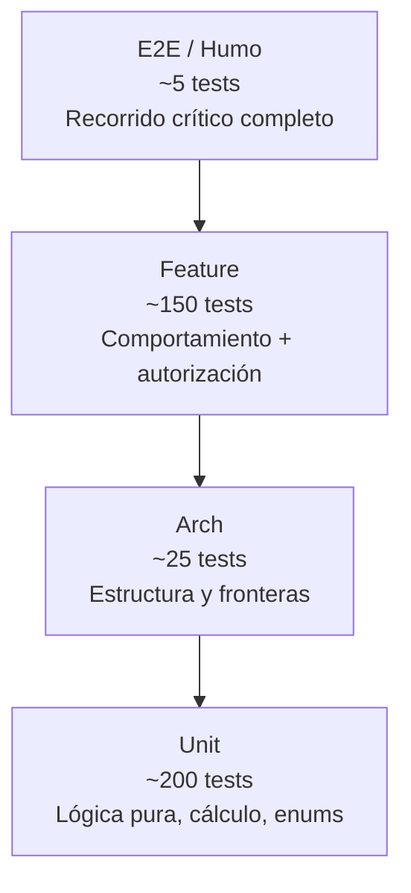

# Estrategia de Pruebas

> [!important] Objetivo
> Las pruebas no son para "cubrir código". Son para **proteger las reglas de negocio** y
> **las fronteras entre módulos**. Un test que verifica que un botón se pinta bien no
> vale nada. Un test que verifica que un profesional no puede leer la nota de otro alumno
> vale mucho.

---

## 1. Pirámide de pruebas del proyecto



| Nivel | Proportion | Velocidad | Qué cubre |
|---|---|---|---|
| **Unit** | ~55% | < 1 s | Cálculos, máquinas de estado, enums, formatters, value objects |
| **Arch** | ~10% | < 2 s | Reglas de estructura entre módulos y capas |
| **Feature** | ~30% | 1–5 s | Acciones de negocio, Policies, permisos, transacciones |
| **E2E / humo** | ~5% | 10–30 s | El camino crítico completo de cada módulo |

**Meta de cobertura:** ≥ 70% en los paquetes de negocio (`care`, `billing`, `scheduling`,
`students`). Los paquetes transversales (`core`, `identity`) también ≥ 70%. Los tests de
interfaz (Filament) tienen cobertura baja a propósito: se prueban las **Actions**, no los
formularios.

> [!note] La cobertura es un indicador, no un objetivo
> Un 95% con tests superficiales es peor que un 70% con tests que verifican reglas de
> negocio reales. El número se usa como **alarma de zonas sin probar**, no como
> métrica de logro.

---

## 2. Herramientas

| Herramienta | Uso | Versión |
|---|---|---|
| **Pest** | Framework de pruebas (Feature + Unit) | 3.x |
| **Pest Plugin Laravel** | Helpers de Laravel en tests | 3.x |
| **Arch tests** (Pest) | Verificación de estructura | incluido |
| **Larastan / PHPStan** | Análisis estático (nivel 5) | — |
| **Deptrac** | Fronteras entre módulos | 2.x |
| **Pint** | Formato | — |
| **Laravel Debugbar** | Consultas N+1 en local | — |

**Configuración de `phpunit.xml`:**

```xml
<?xml version="1.0" encoding="UTF-8"?>
<phpunit xmlns:xsi="http://www.w3.org/2001/XMLSchema-instance"
         xsi:noNamespaceSchemaLocation="vendor/phpunit/phpunit/phpunit.xsd"
         bootstrap="vendor/autoload.php"
         colors="true"
         failOnWarning="true"
         failOnRisky="true"
         beStrictAboutOutputDuringTests="true">
    <testsuites>
        <testsuite name="Unit">
            <directory>packages/*/tests/Unit</directory>
        </testsuite>
        <testsuite name="Arch">
            <directory>packages/*/tests/Arch</directory>
        </testsuite>
        <testsuite name="Feature">
            <directory>packages/*/tests/Feature</directory>
            <directory>tests/Feature</directory>
        </testsuite>
        <testsuite name="Smoke">
            <directory>tests/Smoke</directory>
        </testsuite>
    </testsuites>

    <php>
        <env name="APP_ENV" value="testing"/>
        <env name="DB_CONNECTION" value="pgsql"/>
        <env name="DB_DATABASE" value="cai_testing"/>
        <env name="APP_KEY" value="base64:VEhJU0lTQU5URVNURklDRV9UT1RVQUxURVNUVkFMVUVfVEVTVA=="/>
        <env name="CACHE_STORE" value="array"/>
        <env name="QUEUE_CONNECTION" value="sync"/>
        <env name="MAIL_MAILER" value="array"/>
        <env name="SESSION_DRIVER" value="array"/>
    </php>

    <source>
        <include>
            <directory>packages</directory>
            <directory>app</directory>
        </include>
    </source>
</phpunit>
```

> [!danger] La `APP_KEY` de testing
> Es un valor **fijo y público**, solo para tests. Nunca se usa en desarrollo ni en
> producción. Si alguien pega la `APP_KEY` real en `phpunit.xml`, se filtra a GitHub.

---

## 3. Tests unitarios

**Qué se prueba en unit:** lógica pura, sin base de datos.

```php
// packages/billing/tests/Unit/MoneyAllocatorTest.php
it('allocates a payment to charges in due date order', function () {
    $allocator = new MoneyAllocator();

    $allocation = $allocator->allocate(
        paymentAmount: 250_000,
        charges: [
            new ChargeBalance(id: 1, amount: 100_000, remaining: 100_000, dueDate: '2026-10-01'),
            new ChargeBalance(id: 2, amount: 200_000, remaining: 200_000, dueDate: '2026-09-01'),
        ],
    );

    expect($allocation->toArray())->toBe([
        ['charge_id' => 2, 'amount' => 200_000.00],
        ['charge_id' => 1, 'amount' => 50_000.00],
    ]);
});

it('keeps the surplus as credit when the payment exceeds the debt', function () {
    $allocator = new MoneyAllocator();

    $allocation = $allocator->allocate(
        paymentAmount: 300_000,
        charges: [new ChargeBalance(id: 1, amount: 100_000, remaining: 100_000, dueDate: '2026-10-01')],
    );

    expect($allocation->surplus)->toBe('200000.00');
});
```

**Reglas:**
- Sin base de datos, sin HTTP, sin sistema de archivos.
- Una aserción conceptual por test.
- Los nombres describen el comportamiento, no el método.

---

## 4. Tests de arquitectura (arch tests)

**Es la herramienta que hace real la modularidad.** Deptrac verifica el grafo de
dependencias; los arch tests verifican reglas que Deptrac no expresa.

```php
// packages/core/tests/Arch/ModuleBoundariesTest.php

it('does not use eloquent relations across modules', function () {
    expect('Cai\Billing\Models\Charge')->not->toUse('Cai\Students\Models\Student');
    expect('Cai\Care\Models\ClinicalNote')->not->toUse('Cai\Billing\Models\Payment');
});

it('does not use models from other modules directly', function () {
    $allowed = [
        'Cai\Billing'   => ['Cai\Core', 'Cai\Identity'],
        'Cai\Care'      => ['Cai\Core', 'Cai\Identity', 'Cai\Students', 'Cai\Scheduling'],
        'Cai\Students'  => ['Cai\Core', 'Cai\Identity'],
        'Cai\Scheduling'=> ['Cai\Core', 'Cai\Identity', 'Cai\Students'],
    ];

    foreach ($allowed as $module => $permitted) {
        expect($module)->not->toUse(
            array_values(array_filter(
                array_keys($allowed),
                fn (string $other) => $other !== $module && ! in_array($other, $permitted, true)
            ))
        );
    }
});

it('does not place business logic in filament classes', function () {
    // Las clases de Filament no pueden llamar a Eloquent directamente para escribir.
    expect('Cai\Billing\Filament')->not->toUse([
        'Illuminate\Support\Facades\DB',
    ]);
});

it('does not use raw queries outside of migrations', function () {
    expect('Cai\Core')
        ->not->toUse('Illuminate\Support\Facades\DB::raw');
});

it('keeps events free of eloquent models', function () {
    expect('Cai\Students\Events')->not->toUse('Illuminate\Database\Eloquent\Model');
});
```

**Catálogo de arch tests (mínimo obligatorio):**

| # | Regla verificada |
|---|---|
| A-01 | Ningún módulo importa modelos de otro módulo |
| A-02 | Ninguna relación Eloquent cruza módulos |
| A-03 | Los eventos no contienen modelos Eloquent |
| A-04 | Los eventos no contienen datos clínicos |
| A-05 | La lógica de negocio no está en Filament |
| A-06 | No hay `DB::raw` en el código de aplicación |
| A-07 | Los modelos están en `src/Models` de su paquete |
| A-08 | Cada `Contracts/` público tiene README o PHPDoc |
| A-09 | Ninguna clase de `care` es usada por `students`, `scheduling`, `documents`, `notifications` |
| A-10 | Las migraciones son inmutables (se verifica contra `main`) |

---

## 5. Tests de funcionalidad

**Cada Action de negocio tiene su test.** Esa es la regla.

```php
// packages/billing/tests/Feature/RegisterPaymentTest.php
it('registers a payment with allocation and receipt in a single transaction', function () {
    $charge = Charge::factory()->create(['amount' => 150_000, 'status' => 'pending']);

    $result = app(RegisterPayment::class)->execute(new RegisterPaymentData(
        familyAccountId: $charge->family_account_id,
        amount: '150000.00',
        method: PaymentMethod::Cash,
        paidAt: now(),
        allocations: [['charge_id' => $charge->id, 'amount' => '150000.00']],
    ));

    expect($result->payment)->not->toBeNull()
        ->and($result->receipt->receipt_number)->toStartWith('REC-')
        ->and($charge->fresh()->status)->toBe('paid');

    expect(AuditEvent::where('action', 'payment.registered')->count())->toBe(1);
});

it('rolls back everything if the receipt cannot be issued', function () {
    $charge = Charge::factory()->create(['amount' => 150_000]);

    // Se fuerza el fallo de la emisión del recibo
    app(ReceiptNumberGenerator::class)->shouldReceive('next')->andThrow(new \RuntimeException('boom'));

    expect(fn () => app(RegisterPayment::class)->execute(new RegisterPaymentData(
        familyAccountId: $charge->family_account_id,
        amount: '150000.00',
        method: PaymentMethod::Cash,
        paidAt: now(),
        allocations: [['charge_id' => $charge->id, 'amount' => '150000.00']],
    )))->toThrow(\RuntimeException::class);

    // Nada debe haber quedado a medias
    expect(Payment::count())->toBe(0)
        ->and(PaymentAllocation::count())->toBe(0)
        ->and(Receipt::count())->toBe(0);
});
```

**Categorías de tests de funcionalidad por módulo:**

| Módulo | Qué hay que probar sí o sí |
|---|---|
| `identity` | Login, bloqueo, MFA, cambio de rol, auditoría |
| `students` | Alta, código único, transferencia de cuenta, tutor principal único |
| `scheduling` | No-superposición, capacidad, asistencia, reprogramación |
| `care` | Borrador → finalizada, inmutabilidad, corrección, grants, cifrado, aislamiento entre profesionales |
| `billing` | Atomicidad, sobreimputación, concurrencia, numeración, anulación, saldo a favor |
| `documents` | Permisos de descarga, auditoría, consentimiento obligatorio |
| `notifications` | Preferencias, plantillas, no envío de datos clínicos |
| `reporting` | Que los reportes respetan permisos y no incluyen datos clínicos |

---

## 6. Tests de autorización

**Son los más importantes del sistema.** Un test por rama de cada Policy.

```php
// packages/care/tests/Feature/ClinicalNotePolicyTest.php
describe('ClinicalNotePolicy', function () {
    it('allows the author to view their own note', ...);
    it('allows the assigned professional to view the note', ...);
    it('denies a professional without a current assignment', ...);
    it('denies a user without the care.notes.view permission', ...);
    it('denies the technical administrator', ...);
    it('denies the finance administrator', ...);
    it('denies the receptionist', ...);
    it('allows access with an active grant', ...);
    it('denies access with an expired grant', ...);
});
```

**Test universal que debe existir en todos los módulos con datos sensibles:**

```php
it('denies access by default to a user without roles', function () {
    $user = User::factory()->create();

    expect($user->can('view', $clinicalNote))->toBeFalse();
    expect($user->can('view', $charge))->toBeFalse();
    expect($user->can('view', $student))->toBeFalse();
});
```

---

## 7. Tests de humo (E2E)

**5 escenarios**, uno por recorrido crítico. Se ejecutan contra la base de test.

| # | Escenario | Cubre |
|---|---|---|
| S-1 | Dar de alta un alumno, matricularlo, agendar una sesión, registrar asistencia | F3 + F4 |
| S-2 | Crear un plan de atención, redactar una nota, finalizarla, corregirla | F5 |
| S-3 | Generar un cargo, registrar un pago, imputar, emitir recibo | F6 |
| S-4 | Subir un documento, descargarlo, verificar auditoría | F7 |
| S-5 | Ver el panel de Dirección con los indicadores del período | F8 |

```php
// tests/Smoke/FullAttentionCycleTest.php
it('runs the complete attention cycle from enrollment to clinical note', function () {
    // 1. Alumno y familia
    $student = app(CreateStudent::class)->execute(new CreateStudentData(
        firstName: 'Ana', lastName: 'González', birthDate: '2018-05-14',
        familyAccountId: $familyAccount->id,
    ));

    // 2. Matrícula
    $enrollment = app(EnrollStudent::class)->execute(new EnrollStudentData(
        studentId: $student->id, serviceId: $service->id, startDate: today(),
    ));

    // 3. Sesión
    $session = app(ScheduleSession::class)->execute(new ScheduleSessionData(
        serviceId: $service->id, startsAt: now()->addHour(), endsAt: now()->addHours(2),
        participants: [$student->id],
    ));

    // 4. Asistencia
    app(RecordAttendance::class)->execute(new RecordAttendanceData(
        sessionId: $session->id,
        records: [['participant_student_id' => $student->id, 'status' => AttendanceStatus::Present]],
    ));

    // 5. Nota clínica
    $note = app(CreateClinicalNote::class)->execute(new CreateClinicalNoteData(
        studentId: $student->id, sessionId: $session->id,
        noteType: ClinicalNoteType::Session, content: 'Buena participación…',
    ));

    expect($note->student_id)->toBe($student->id);
});
```

---

## 8. Datos de prueba

### 8.1 Factories

Cada modelo tiene una factory. **No se hardcodean datos largos en los tests.**

```php
// packages/students/database/factories/StudentFactory.php
class StudentFactory extends Factory
{
    protected $model = Student::class;

    public function definition(): array
    {
        return [
            'student_code' => 'ALU-' . fake()->unique()->numerify('####'),
            'first_name'   => fake()->firstName(),
            'last_name'    => fake()->lastName(),
            'birth_date'   => fake()->dateTimeBetween('-12 years', '-3 years')->format('Y-m-d'),
            'status'       => StudentStatus::Active,
        ];
    }

    public function withdrawn(): static
    {
        return $this->state(fn () => ['status' => StudentStatus::Withdrawn]);
    }
}
```

### 8.2 Estados alternativos

Los estados de factory cubren los casos que los tests necesitan:

```php
Student::factory()->withdrawn();
FamilyAccount::factory()->withCredit();
Charge::factory()->overdue();
Charge::factory()->partiallyPaid();
ClinicalNote::factory()->draft();
ClinicalNote::factory()->finalized();
ClinicalNote::factory()->superseded();
Payment::factory()->voided();
User::factory()->withRole('direccion');
User::factory()->locked();
```

### 8.3 Datos sensibles en tests

| Regla | Detalle |
|---|---|
| `fake()` para nombres, no datos reales | — |
| Los CI de test son válidos pero ficticios | `12345678` |
| Los teléfonos son de la zona reservada | `+595 961 000000` |
| Los emails usan `example.test` | No `.com` reales |
| **Nunca** se copian datos reales al repo | Ni en factories, ni en seeds |

> [!danger] Datos reales en el repositorio
> Copiar alumnos reales a un archivo de seeds es una **violación de datos** y queda
> en el historial de Git para siempre. La importación real se hace **directamente sobre
> la base de destino**, desde el servidor, sin pasar por el repositorio. Ver
> [[09.07 Importación de Datos Iniciales]].

---

## 9. Determinismo

| Regla | Detalle |
|---|---|
| **Nunca** `sleep()` | Usar `travel()` / `freezeTime()` |
| Fechas fijas en los tests que dependen del período | `freezeTime('2026-03-15')` |
| Los factories no dependen de "hoy" | Fechas relativas al `now()` que se congela |
| El orden de ejecución no importa | Sin dependencias entre tests |
| Sin datos compartidos entre tests | Cada test crea lo suyo |
| La base se recrea por test | `RefreshDatabase` |

```php
// ✅
it('marks charges as overdue after the due date', function () {
    freezeTime('2026-03-15');

    $charge = Charge::factory()->create([
        'due_date' => '2026-03-01',
        'status'   => 'pending',
    ]);

    expect($charge->isOverdue())->toBeTrue();
});
```

---

## 10. Integración continua

```yaml
# .github/workflows/ci.yml
name: CI

on:
  push:
    branches: [main]
  pull_request:
    branches: [main]

jobs:
  quality:
    runs-on: ubuntu-latest

    services:
      postgres:
        image: postgres:16
        env:
          POSTGRES_USER: cai
          POSTGRES_PASSWORD: cai
          POSTGRES_DB: cai_testing
        ports: ['5432:5432']
        options: >-
          --health-cmd pg_isready
          --health-interval 10s
          --health-timeout 5s
          --health-retries 5

    steps:
      - uses: actions/checkout@v4

      - uses: shivammathur/setup-php@v2
        with:
          php-version: '8.3'
          extensions: bcmath, pdo_pgsql, mbstring, intl, sodium, zip
          coverage: none

      - name: Composer install
        run: composer install --no-interaction --prefer-dist

      - name: Crear schemas de los módulos
        run: php artisan cai:db:reset --env=testing

      - name: Verificar formato (Pint)
        run: vendor/bin/pint --test

      - name: Análisis estático (Larastan)
        run: vendor/bin/larastan analyse --memory-limit=1G

      - name: Fronteras entre módulos (Deptrac)
        run: vendor/bin/deptrac analyse --config-file=deptrac.yaml --no-progress

      - name: Arch tests
        run: vendor/bin/pest --testsuite=Arch

      - name: Tests
        run: vendor/bin/pest --coverage --min=70
```

**Reglas de la CI:**

| Regla | Detalle |
|---|---|
| Bloquea el merge | Toda falla impide el merge |
| `bcmath` está en `extensions` | Sin ella, los casts `decimal` fallan |
| El schema se crea con `cai:db:reset` | No `migrate:fresh` (que no borra schemas) |
| La cobertura mínima es 70% | Configurable por paquete en el futuro |
| Los tests de humo corren **solo en `main`** | No en cada PR (son los más lentos) |

---

## 11. Cobertura por paquete

| Paquete | Mínimo | Foco |
|---|---|---|
| `cai/core` | 70% | Utilidades compartidas |
| `cai/identity` | 75% | Autenticación y permisos |
| `cai/students` | 70% | Reglas de familia y tutor |
| `cai/scheduling` | 70% | No-superposición y asistencia |
| `cai/care` | 80% | Autorización y cifrado — el área más crítica |
| `cai/billing` | 85% | Atomicidad e integridad del dinero |
| `cai/documents` | 70% | Permisos de descarga |
| `cai/notifications` | 60% | Reglas de plantillas |
| `cai/reporting` | 60% | Consultas agregadas |

---

## 12. Cuándo NO escribir un test

| Situación | Qué hacer en su lugar |
|---|---|
| Testing del framework (Eloquent, Livewire) | No se testea |
| Detalles de la UI (colores,Positions) | Revisión visual manual |
| Performance micro-optimizaciones | Medición puntual |
| Código que va a desaparecer | No |

**Cada test debe responder:** *"¿qué regresión concreta previene?"* Si no hay respuesta,
no se escribe.

---

## 13. Documentos relacionados

- [[05.03 Convenciones de Código]]
- [[05.04 Checklist de Pull Request]]
- [[02.03 Reglas de Frontera entre Módulos]]
- [[04.03 Autorización por Registro]]
- [[04.04 Datos Clínicos: Cifrado y Acceso]]
