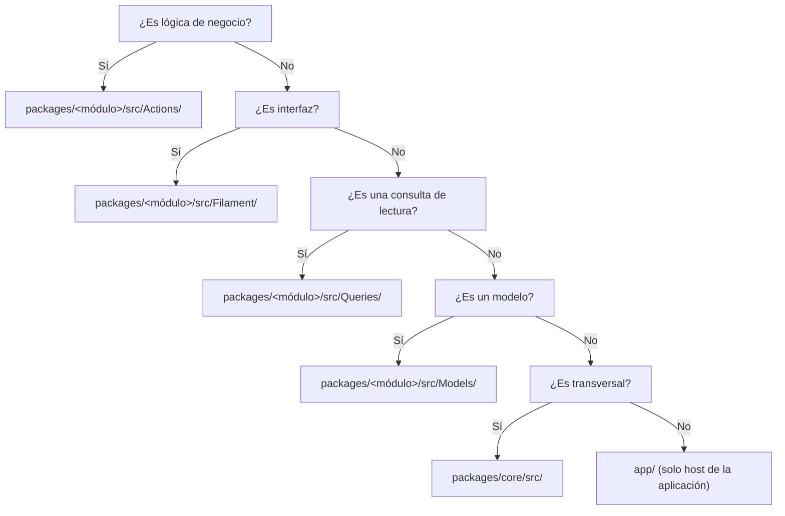

# Guía de Contribución

> [!important] A quién aplica
> Esta guía está pensada para **cualquier persona** que vaya a tocar el código: el
> desarrollador titular, un colaborador puntual, o el propio dev dentro de seis meses
> cuando ya no se acuerda de nada.

---

## 1. Antes de escribir código

### 1.1 Instalar el entorno

```bash
# Requisitos del servidor de desarrollo
php -v           # 8.3.x
composer -V     # 2.7.x
psql --version   # 16.x

# Extensiones PHP requeridas
php -m | grep -E 'bcmath|gd|pdo_pgsql|mbstring|intl|sodium|zip'
```

> [!danger] `bcmath` es obligatoria
> Sin `ext-bcmath`, los casts `decimal` de Laravel fallan y **todo el módulo financiero
> queda inutilizable**. Ver [[00.03 Stack, Versiones y Dependencias]].

### 1.2 Clonar y configurar

```bash
git clone git@github.com:<org>/sistema-cai.git
cd sistema-cai

composer install
cp .env.example .env
php artisan key:generate

# Crear la base y los schemas de los módulos
createdb cai_development
php artisan cai:db:reset --env=development

# Datos de prueba
php artisan db:seed --env=development
```

### 1.3 Verificar que todo funciona

```bash
composer lint        # Pint --test
composer analyse     # Larastan
composer deptrac     # Fronteras
composer test        # Pest
```

**Si los cuatro pasan, el entorno está bien.** Si alguno falla, resolverlo **antes** de
escribir una línea de código.

---

## 2. Antes de abrir un PR

```bash
git switch main && git pull --ff-only
git switch -c feature/mi-cambio
# ... trabajo ...
git add -A
git commit -m "feat(módulo): descripción del cambio"
git push -u origin feature/mi-cambio
```

Y responder **sí** a la checklist de [[05.04 Checklist de Pull Request]].

---

## 3. Dónde escribir cada cosa



### 3.1 Mapa de responsabilidades

| Ubicación | Qué va ahí | Qué NO va ahí |
|---|---|---|
| `packages/<m>/src/Models/` | Modelos Eloquent, casts, relaciones **dentro** del módulo | Relaciones a otros módulos |
| `packages/<m>/src/Actions/` | Casos de uso que **escriben** | Lógica de presentación |
| `packages/<m>/src/Queries/` | Casos de uso que **leen** (DTOs de salida) | Escrituras |
| `packages/<m>/src/Contracts/` | Interfaces públicas del paquete | Implementaciones concretas |
| `packages/<m>/src/Filament/` | Resources, Pages, Widgets | Lógica de negocio |
| `packages/<m>/src/Support/` | Value objects, enums, helpers del paquete | Código de otros paquetes |
| `packages/<m>/src/Events/` | Eventos de dominio (sin modelos) | Notificaciones directas |
| `packages/<m>/src/Listeners/` | Reacciones a eventos | Lógica de negocio |
| `packages/<m>/database/migrations/` | Migraciones del schema del módulo | Migraciones de otros schemas |
| `packages/<m>/tests/` | Tests del paquete | Fixtures compartidas sin control |
| `packages/<m>/routes/` | Rutas del paquete | Rutas del host |
| `app/` | Host: bootstrap, config, middleware transversal | Lógica de negocio |

### 3.2 Regla de oro de la ubicación

> **Si dudas dónde va el código, va en el paquete del módulo cuyo dominio cambia.**
> Si no cambia ningún dominio (es infraestructura), va en `packages/core` o en `app/`.

---

## 4. Cómo agregar un caso de uso nuevo

Ejemplo: una Action que registra un pago.

**Paso 1 — El contrato de entrada (DTO):**

```php
// packages/billing/src/Actions/RegisterPayment/RegisterPaymentData.php
declare(strict_types=1);

namespace Cai\Billing\Actions\RegisterPayment;

final readonly class RegisterPaymentData
{
    /**
     * @param list<array{charge_id: int, amount: string}>  $allocations
     */
    public function __construct(
        public int $familyAccountId,
        public string $amount,
        public string $method,
        public \DateTimeImmutable $paidAt,
        public array $allocations = [],
        public ?string $notes = null,
    ) {}
}
```

**Paso 2 — La Action:**

```php
// packages/billing/src/Actions/RegisterPayment/RegisterPayment.php
declare(strict_types=1);

namespace Cai\Billing\Actions\RegisterPayment;

use Cai\Billing\Exceptions\InvalidAllocationException;
use Cai\Core\Audit\Auditor;
use Cai\Core\Support\Money;

final class RegisterPayment
{
    public function __construct(private readonly Auditor $auditor) {}

    /**
     * @throws InvalidAllocationException
     */
    public function execute(RegisterPaymentData $data): RegisterPaymentResult
    {
        // Valida los importes antes de tocar la base.
        $amount = Money::parse($data->amount);

        if ($amount->isZero()) {
            throw new InvalidAllocationException('El importe del pago debe ser mayor a cero.');
        }

        // Una sola transacción: pago + imputaciones + recibo + auditoría.
        return DB::connection('billing')->transaction(function () use ($data, $amount): RegisterPaymentResult {
            // ... implementación ...

            $this->auditor->record('payment.registered', Payment::class, $payment->id, [
                'student_id' => null,
            ]);

            return $result;
        });
    }
}
```

**Paso 3 — La interfaz (Filament):**

```php
// packages/billing/src/Filament/Resources/PaymentResource/Pages/RegisterPayment.php
final class RegisterPayment extends Page
{
    protected function getHeaderActions(): array
    {
        return [
            Action::make('registrar')
                ->form([...])
                ->action(fn (array $data) => app(\Cai\Billing\Actions\RegisterPayment\RegisterPayment::class)
                    ->execute(RegisterPaymentData::from($data))),
        ];
    }
}
```

**Paso 4 — El test:**

```php
// packages/billing/tests/Feature/RegisterPaymentTest.php
it('registers a payment and allocates it to the oldest charge', function () {
    // ...
});
```

**Paso 5 — El contrato público (si otro paquete lo necesita):**

```php
// packages/billing/src/Contracts/PaymentRegistrar.php
declare(strict_types=1);

namespace Cai\Billing\Contracts;

interface PaymentRegistrar
{
    public function execute(RegisterPaymentData $data): RegisterPaymentResult;
}
```

---

## 5. Cómo agregar un módulo nuevo (raro)

Solo se hace en el MVP si aparece una necesidad real. Pasos:

1. Crear `packages/<nombre>/` con `composer.json` (tipo `library`, autoload PSR-4 `Cai\<Nombre>\`).
2. Crear `src/Models/`, `src/Actions/`, `src/Queries/`, `src/Contracts/`, `src/Filament/`.
3. Crear `database/migrations/` y registrar el schema en `config/database.php`.
4. Registrar el ServiceProvider en `config/app.php` (o `bootstrap/providers.php` en Laravel 11).
5. Añadir el módulo a `deptrac.yaml`.
6. Añadir el schema a los comandos `cai:db:reset` y `cai:migrate`.
7. Añadir la tabla de permisos del módulo en el seeder.
8. Documentar el módulo en `README.md` del paquete.
9. Escribir un ADR explicando por qué es un módulo y no parte de otro.

---

## 6. Reglas de oro resumidas

| # | Regla |
|---|---|
| 1 | La lógica de negocio vive en **Actions**, nunca en Filament |
| 2 | Los módulos se comunican por **contratos y eventos**, nunca por modelos |
| 3 | Cada lectura de lista aplica el **scope** del usuario |
| 4 | Cada escritura sensible deja **auditoría** |
| 5 | Los datos clínicos **nunca** salen del módulo `care` |
| 6 | Las migraciones aplicadas **nunca** se editan |
| 7 | Nada se borra: se anula, se marca, se supersede |
| 8 | Un PR > 800 líneas se divide |
| 9 | Cada bug lleva su test de regresión |
| 10 | El CHANGELOG lo genera la herramienta, no la persona |

---

## 7. Qué hacer cuando algo falla

### 7.1 Un test falla

```bash
vendor/bin/pest --filter=nombre_del_test
```

Revisar en este orden:
1. ¿El test es correcto? (a veces el test está mal).
2. ¿El código cambió de comportamiento a propósito? → Actualizar el test **y** documentarlo.
3. ¿Hay datos de otros tests? → Verificar aislamiento.

### 7.2 La CI falla pero en local pasa

| Causa probable | Verificación |
|---|---|
| Versión de PHP distinta | `php -v` |
| Extensión faltante (`bcmath`) | `php -m` |
| Orden de ejecución de tests | `composer test` en local completo |
| Zona horaria | `date_default_timezone_set` |
| Datos hardcodeados que dependen de "hoy" | `freezeTime` |
| Migraciones desalineadas | `cai:db:reset` local |

### 7.3 Deptrac falla

```bash
vendor/bin/deptrac analyse --config-file=deptrac.yaml
```

El mensaje dice exactamente qué dependencia se rompió. Opciones:
- Mover el código al paquete que corresponde.
- Declarar la dependencia en `deptrac.yaml` **con una justificación** en el ADR.
- Si es un error de Deptrac (falso positivo), usar `exceptions:` con motivo.

### 7.4 Un release salió mal

Ver [[06.06 Procedimiento de Rollback]]. **No** improvises en producción: usa el
procedimiento documentado.

---

## 8. Documentos relacionados

- [[05.01 Flujo de Trabajo]]
- [[05.02 Commits, Ramas y Versionado SemVer]]
- [[05.03 Convenciones de Código]]
- [[05.04 Checklist de Pull Request]]
- [[05.05 Estrategia de Pruebas]]
- [[02.02 Arquitectura Modular en Paquetes]]
- [[02.03 Reglas de Frontera entre Módulos]]
- [[06.06 Procedimiento de Rollback]]
