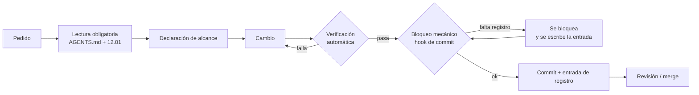

# Gobierno del Cambio

> [!info] Qué es este documento
> El **conjunto de reglas** que gobierna cómo se trabaja en el proyecto para
> que el desarrollo sea **controlado** (se sabe qué cambió y se puede
> deshacer), **escalable** (crecer sin romper la estructura) y **legible**
> (otra persona lo entiende sin que le expliquen).
>
> Las reglas se identifican con un código estable (`GC-nn`, `GE-nn`, `GL-nn`)
> para poder citarlas desde un commit, un ADR o una revisión.

---

## 1. Por qué hace falta un gobierno explícito

El proyecto tiene tres características que hacen que "trabajar con cuidado"
no sea suficiente:

| Característica | Consecuencia si no se gobierna |
|---|---|
| **Un solo desarrollador part-time** | Nadie está mirando. El control tiene que estar en el proceso y en las herramientas, no en la supervisión |
| **Agentes de IA que escriben y editan** | Un cambio grande y equivocado ocurre en segundos y sin intención maliciosa |
| **El sistema manejará datos de menores** | Un error no detectado tiene consecuencias que no se reparan con un `git revert` |

> [!important] La tesis del documento
> **La calidad de este proyecto no depende de quién lo programó, sino de lo que
> el sistema le impide hacer a quien lo programa.**
> Un proceso que exige disciplina se rompe el día que hay prisa. Un proceso que
> *bloquea* lo indebido se sostiene solo.

---

## 2. Las tres propiedades y cómo se miden

| Propiedad | Pregunta que responde | Indicador |
|---|---|---|
| **Controlado** | ¿Sé qué cambió, quién lo cambió y cómo se deshace? | Todo commit tiene entrada de registro; todo cambio es reversible |
| **Escalable** | ¿El proyecto crece sin que la estructura se degrade? | Los paquetes no se importan entre sí; los índices están al día; cada pieza nueva tiene dueño |
| **Legible** | ¿Alguien que no lo escribió lo entiende? | Los nombres dicen lo que son; las decisiones están escritas; las reglas están en un lugar |

> [!note] Las tres propiedades son la razón de ser de las reglas
> Una regla que no mejora ninguna de las tres, o que las empeora, no entra.
> Si una propuesta no se puede clasificar en una de las tres columnas, es
> ruido, y el ruido en un proceso es dívida.

---

## 3. Reglas de control

### 3.1 Trazabilidad

| ID | Regla | Por qué | Cómo se verifica |
|---|---|---|---|
| **GC-01** | **Todo cambio se registra.** Sin excepción, incluidos los typos | Un cambio no registrado es indistinguible de no haberlo hecho | El hook de commit bloquea si falta la entrada en [[12.02 Registro de Cambios]] |
| **GC-02** | **El registro dice el motivo, no el diff** | El diff ya está en Git; lo que no está es el porqué | Revisión de la columna "Motivo" |
| **GC-03** | **El modelo de IA se registra exacto** (`proveedor/modelo#variante`) | Distintos modelos fallan distinto; sin el identificador no se puede diagnosticar | Campo obligatorio en [[12.03 Bitácora de Sesiones con IA]] |
| **GC-04** | **Todo cambio se puede relacionar con un ID** (RF, RN, RNF, ADR, P, S) | Un cambio sin origen no se puede revisar ni auditar | Campo "Rastreo" obligatorio |
| **GC-05** | **La sesión se cierra explícitamente** | Una sesión abierta para siempre bloquea el trabajo sin avisar | Estado `Cerrada` en la bitácora |

### 3.2 No borrar

| ID | Regla | Por qué | Cómo se verifica |
|---|---|---|---|
| **GC-06** | **Nada se borra: se retira** (`deprecated` / `superseded` + redirección) | El histórico es el activo más valioso del proyecto | El hook detecta eliminaciones en el commit y exige justificación |
| **GC-07** | **El log y la bitácora son de solo agregar** | Reescribir el registro es falsificar el histórico | `REG`/`SES` nunca se editan; las correcciones se agregan |
| **GC-08** | **Un ADR aceptado no se edita: se sustituye** | El valor del ADR es el contexto histórico, incluido el error | §4 de [[Índice de ADRs]] |

### 3.3 Alcance y granularidad

| ID | Regla | Por qué | Cómo se verifica |
|---|---|---|---|
| **GC-09** | **Un cambio, un propósito.** Si la descripción necesita "y", se divide | Un cambio con dos propósitos no se puede revisar ni revertir por partes | Revisión del mensaje de commit |
| **GC-10** | **Se declara el alcance antes de empezar** | Evita los "ya que estaba ahí" que inflan el cambio | Campo "Archivos" en la entrada |
| **GC-11** | **Sin alcance creep.** Un agente no mejora lo que no se le pidió | El mejora no solicitada es el cambio no revisado | Comparar la entrada de registro con el pedido original |
| **GC-12** | **El alcance que crece, se vuelve a declarar** | Un cambio que se duplica a mitad de camino debe partirse | Diff contra la lista declarada |

### 3.4 Verificación

| ID | Regla | Por qué | Cómo se verifica |
|---|---|---|---|
| **GC-13** | **Ningún cambio se cierra sin verificación ejecutada** | "Se veía bien" no es verificación | Campo "Verificación" en la entrada; el hook exige el resultado |
| **GC-14** | **La verificación es automática y repetible** | Un control manual se aplica la primera vez y se olvida después | `bin/validate-vault.py` y las pruebas del paquete |
| **GC-15** | **Si la verificación falla, el cambio no entra** | Un cambio que rompe algo y avanza igual se propaga | El hook de commit bloquea |
| **GC-16** | **La verificación fallida se registra como fallida** | Ocultar un fallo es peor que el fallo | Estado `fallido` en la entrada |

### 3.5 Reversibilidad

| ID | Regla | Por qué | Cómo se verifica |
|---|---|---|---|
| **GC-17** | **Todo cambio se puede deshacer sin pérdida** | Un sistema que solo avanza no se puede corregir | Presencia de `git revert` viable + tag documental previo |
| **GC-18** | **Nada irreversible sin ADR y aprobación** | Las migraciones destructivas y la rotación de claves no tienen vuelta atrás | Severidad N4 en [[12.01 Política de Cambios y Trazabilidad]] |
| **GC-19** | **Nunca se reescribe historia publicada** | Los tags deben seguir apuntando a lo que dicen apuntar | `git push --force` denegado en `opencode.jsonc` |

### 3.6 Aprobación y decisión

| ID | Regla | Por qué | Cómo se verifica |
|---|---|---|---|
| **GC-20** | **La IA ejecuta, la persona decide** | Distinguir "hacer" de "decidir" es lo que hace recuperable un error | La matriz de [[12.01 Política de Cambios y Trazabilidad]] §5 |
| **GC-21** | **Todo cambio de decisión produce un ADR** | Una decisión no escrita se pierde en el chat | Entrada de tipo `decisión` en el índice de ADR |
| **GC-22** | **Los ADR pendientes se listan con lo que bloquean** | Para que Dirección sepa qué está esperando | §3 de [[Índice de ADRs]] |
| **GC-27** | **Migrar por etapas.** Siempre que se pueda, usar `expand -> migrate -> contract`. Nunca `rename/drop` directo | Permite desplegar y actualizar sin big-bang. Reduce riesgo a cero | Revisar migraciones en PR + seguir [[06.03 Expand-Contract]] |

### 3.7 Seguridad y privacidad

| ID | Regla | Por qué | Cómo se verifica |
|---|---|---|---|
| **GC-23** | **Ningún dato real de personas entra al repositorio** | El repositorio es el lugar con menos control de acceso | Revisión de datos de prueba: siempre ficticios |
| **GC-24** | **Ningún registro contiene datos personales ni clínicos** | El registro sale del entorno de desarrollo | Revisión de las entradas; regla de [[12.01 Política de Cambios y Trazabilidad]] §8 |
| **GC-25** | **Ninguna credencial se versiona** | Un `.env` en Git es una credencial filtrada para siempre | `.gitignore` + revisión de `git ls-files` |
| **GC-26** | **Las tres líneas rojas se verifican, no se confían** | La separación entre áreas clínicas, administrativas y financieras es la base del modelo de permisos | Pruebas de autorización en cada fase |

---

## 4. Reglas de escalabilidad

### 4.1 Estructura

| ID | Regla | Por qué | Cómo se verifica |
|---|---|---|---|
| **GE-01** | **Los límites entre módulos los impone la herramienta, no la disciplina** | Un acuerdo verbal sobre fronteras no sobrevive a la presión del calendario | Deptrac + pruebas de arquitectura en CI |
| **GE-02** | **Nada transversal vive en un paquete de dominio** | Si el transversal vive en un dominio, los demás dependen de él y el acoplamiento vuelve | `core` es el único contenedor de contratos compartidos |
| **GE-03** | **El número de paquetes no crece sin ADR** | Cada paquete es un proceso, un dueño y un contrato | [[ADR-0001 Monolito Modular en Paquetes]] |
| **GE-04** | **El fork permitido es mínimo y explícito** | Un "fork" que se usa para todo deja de ser un fork | Solo `students` e `identity`, y `ON DELETE RESTRICT` |
| **GE-05** | **Cada paquete tiene su propio esquema y su propio versionado** | Un esquema compartido es un monolito disfrazado de datos | [[ADR-0002 Schema por Módulo en PostgreSQL]] |

### 4.2 Navegación y documentación

| ID | Regla | Por qué | Cómo se verifica |
|---|---|---|---|
| **GE-06** | **Un documento sin índice no existe** | Con 100+ documentos, el índice es lo que hace legible la bóveda | [[12.04 Versionado de la Documentación]] §8.2 |
| **GE-07** | **Los índices se actualizan en el mismo commit** | Un índice viejo es peor que no tener índice: miente | El validador comprueba que todo documento está enlazado desde su índice |
| **GE-08** | **Cada carpeta tiene un punto de entrada** | Quien llega a una carpeta debe saber qué hay | El `Inicio.md` de cada área |
| **GE-09** | **El nombre del archivo dice qué es, sin contexto adicional** | El nombre es el primer índice que se lee | Convención `NN.MM Título` |

### 4.3 Proceso y capacidad

| ID | Regla | Por qué | Cómo se verifica |
|---|---|---|---|
| **GE-10** | **Cada pieza nueva tiene dueño y procedimiento de operación** | Un servicio sin dueño es una caída futura | Toda entrada del backlog de infraestructura trae su runbook |
| **GE-11** | **Menos piezas, mejor** | Cada dependencia es una cadena de mantenimiento con 1 dev part-time | [[ADR-0009 Sin Redis en el MVP]] como norma, no como excepción |
| **GE-12** | **Lo que se automatiza, se automatiza en el hook, no en la memoria** | Un control que depende de que alguien se acuerde no es un control | Los permisos y el hook de commit |
| **GE-13** | **El calendario se revisa al final de cada fase** | Un plan de 23 semanas sin revisión es una ficción | [[08.13 Calendario y Estimativas]] §7 |
| **GE-14** | **La deuda técnica se registra con criterio de aceptación** | "Refactorizar" no es un ítem | §4 de [[08.12 Backlog Maestro]] |

### 4.4 Datos

| ID | Regla | Por qué | Cómo se verifica |
|---|---|---|---|
| **GE-15** | **El saldo se calcula, nunca se guarda** | Un saldo guardado es un saldo que algún día miente | Suma agregada en subconsulta, nunca `LEFT JOIN` + `SUM` |
| **GE-16** | **Nada se borra en la base: se anula con motivo** | La trazabilidad financiera y clínica requiere el histórico | Columnas `anulado_at` + `motivo_anulacion` |
| **GE-17** | **El numerador de recibos es transaccional** | Un número duplicado es un problema legal | `UPDATE ... RETURNING` sobre `receipt_sequences` |
| **GE-18** | **Los datos clínicos se cifran en la columna, no en la aplicación** | Cifrar en la aplicación deja el texto claro en los logs | Cast `encrypted` de Eloquent |
| **GE-19** | **API pública aditiva.** Si se añade a un contrato, se hace opcional o con nuevo método. Nunca se cambia la firma existente. | Permite actualizar un paquete sin tener que tocar todos sus consumidores a la vez | Revisión de PR en `Contracts/` |
| **GE-20** | **Deprecación con antelación.** Toda API, evento o permiso que se vaya a retirar debe marcarse `@deprecated` y convivir **al menos 2 versiones menores** antes de pasar a `MAJOR` | Evita sorpresas. Cualquiera puede migrar con tiempo | CHANGELOG + `UPGRADE.md` |
| **GE-21** | **Ruta de migración obligatoria.** Todo cambio `MAJOR` debe llevar `UPGRADE.md` con pasos, ejemplos y checklist | Si no hay guía, la actualización se vuelve adivinanza | PR de release bloqueado si falta |

---

## 5. Reglas de legibilidad

### 5.1 Código

| ID | Regla | Por qué | Cómo se verifica |
|---|---|---|---|
| **GL-01** | **El nombre dice lo que es, en el idioma del dominio** | `charge` y `payment_allocation` se leen; `dataTable1` no | Revisión de código y de los nombres de tabla |
| **GL-02** | **Una unidad, una responsabilidad** | Un archivo que hace tres cosas no se puede probar | Límite blando de 300 líneas; clase de un propósito |
| **GL-03** | **El comentario explica el porqué, no el qué** | El qué ya está en el código | Revisión de comentarios |
| **GL-04** | **Las convenciones las impone la herramienta** | Pint, PHPStan y Deptrac en CI, no en la cabeza de alguien | CI en verde bloquea el merge |
| **GL-05** | **La lógica de dominio no vive en el controlador** | Un controlador con reglas de negocio es imposible de probar | Capas de [[02.04 Capas Internas de un Paquete]] |
| **GL-06** | **La consulta se lee como una frase** | Las consultas SQL largas incrustadas en el código se leen mejor como texto | Las consultas complejas viven en vistas o migraciones |

### 5.2 Documentación

| ID | Regla | Por qué | Cómo se verifica |
|---|---|---|---|
| **GL-07** | **Documentación en español, código e identificadores en inglés** | Dos idiomas, cada uno en su terreno | Revisión de código y de documentación |
| **GL-08** | **El frontmatter está completo en todos los documentos** | Es lo que permite buscar y filtrar en Obsidian | El validador lo comprueba |
| **GL-09** | **Los enlaces son wikilinks sin extensión** | Un enlace roto en un documento vale por diez links rotos | El validador cuenta enlaces rotos |
| **GL-10** | **Un documento se entiende solo** | Nadie va a buscar la respuesta en otro documento | La plantilla exige un resumen inicial |
| **GL-11** | **Los ejemplos son reales y ejecutables** | Un ejemplo que no funciona es peor que ningún ejemplo | El código de ejemplo se revisa |
| **GL-12** | **Sin caracteres extraños ni palabras en otro idioma** | Un documento con errores tipográficos pierde la confianza del lector | El validador y el escáner de idioma |

### 5.3 Base de datos

| ID | Regla | Por qué | Cómo se verifica |
|---|---|---|---|
| **GL-13** | **El nombre de la tabla dice qué es y en qué esquema vive** | `billing.charges` es más claro que `charges` | Convención de esquemas de [[02.05 Esquema de Base de Datos por Módulo]] |
| **GL-14** | **Las restricciones están en la base, no solo en el código** | La base es el único lugar donde la integridad no depende de la aplicación | `CHECK`, `NOT NULL`, `EXCLUDE`, claves foráneas |
| **GL-15** | **El importe se guarda exacto; el redondeo es de presentación** | Un importe redondeado en la base se propaga a todos los cálculos | `decimal` sin escalar y `Money::format()` al presentar |
| **GL-16** | **Cambios con ruptura van con guía.** `BREAKING CHANGE` en commit obliga a actualizar el `UPGRADE.md` del paquete | Si no hay guía, la actualización se vuelve adivinanza | Revisión de PR + [[06.09 Guía de Actualización]] |

---

## 6. Cómo se aplican las reglas

Una regla que no tiene mecanismo se convierte en una sugerencia. Estas reglas
tienen tres niveles de enforcement:

| Nivel | Mecanismo | Cubre |
|---|---|---|
| **Bloqueante** | Permisos `deny` de OpenCode, hook de pre-commit | Lo que no puede fallar: borrados, push a `main`, commits sin registro |
| **Automático** | `bin/validate-vault.py`, Deptrac, PHPStan, pruebas de arquitectura | Lo que se detecta solo: enlaces rotos, frontmatter incompleto, fronteras violadas |
| **Revisión** | Checklist de pull request, revisión humana de los ADR | Lo que requiere juicio: si el motivo es válido, si el ADR es el correcto |



### 6.1 La puerta de entrada

Todo agente —humano o IA— empieza por leer, en este orden:

1. `AGENTS.md` (raíz del repositorio) — las reglas no negociables.
2. [[12.01 Política de Cambios y Trazabilidad]] — qué se puede cambiar y cómo.
3. [[12.03 Bitácora de Sesiones con IA]] — si hay una sesión en curso sobre los mismos archivos.
4. El documento objetivo **y** los que él declara relacionados.
5. Los ADR que apliquen (empezando por [[Índice de ADRs]]).

> [!danger] Lo que no se puede hacer
> - **Borrar** un archivo o una entrada de registro.
> - **Editar** un ADR aceptado sin escribir uno nuevo que lo sustituya.
> - **Cerrar** un cambio sin entrada en [[12.02 Registro de Cambios]].
> - **Tocar** datos reales de alumnos, familias o profesionales.
> - **Hacer `push` a `main`** ni reescribir historia publicada.

---

## 7. Reglas que se propusieron y no se adoptaron

Las alternativas descartadas también son documentación. Estas se evaluaron y se
rechazaron:

| Propuesta | Por qué no se adoptó |
|---|---|
| **Una rama por documento** | Demasiado overhead para 1 dev part-time y sin revisión real |
| **Revisión por dos personas de cada cambio** | No hay dos personas disponibles |
| **Herramienta de Issues para el backlog** | El backlog tiene que vivir junto al proyecto y ser legible sin internet |
| **Wiki del proyecto como fuente de verdad** | La bóveda en el repositorio es versionada, reversible y auditable; una wiki no |
| **Étiquetas de versión por cada cambio** | El historial de tags se vuelve ilegible; los cortes se hacen por hito |
| **Un agente con permiso de escritura total** | Es exactamente lo que estas reglas evitan: la confianza ciega no escala |
| **Tests end-to-end como única barrera** | Son lentos y no cubren las fronteras entre módulos |
| **Formateo automático al commit** | Reescribe código sin que nadie lo revise; el formato se verifica, no se impone en silencio |
| **Reglas en el prompt en vez de en el repositorio** | El prompt es efímero; el archivo del repositorio viaja con el proyecto |
| **Borrar los documentos que "ya no sirven"** | El histórico es el activo; se retira, no se borra |

---

## 8. Métricas de control

Si las reglas no se miden, se deterioran en silencio. Estas cinco se revisan
al cierre de cada fase:

| Métrica | Meta | Cómo se mide |
|---|---|---|
| **Cambios sin entrada de registro** | 0 | El hook lo impide: el número real es 0 por construcción |
| **Enlaces rotos** | 0 | `bin/validate-vault.py` |
| **Documentos sin frontmatter completo** | 0 | `bin/validate-vault.py` |
| **ADR pendientes sin bloqueante declarado** | 0 | §3 de [[Índice de ADRs]] |
| **Paquetes con dependencias entre sí no declaradas** | 0 | Deptrac |

> [!tip] La primera métrica es la importante
> "Cambios sin entrada de registro = 0" no se mide: **se impide**. Ese es el
> objetivo de todo el documento. Las otras cuatro se miden porque son
> Properties del contenido, no del proceso.

---

## 9. Checklist antes de cerrar un cambio

```text
☐ Leí AGENTS.md y la política de cambios
☐ Declaré el alcance (qué archivos)
☐ Clasifiqué la severidad (N1–N4)
☐ Si es N3/N4: ADR o aprobación previa
☐ El cambio no borra nada
☐ La verificación pasó (comando + resultado)
☐ Escribí la entrada REG-… con motivo, archivos, rastreo y verificación
☐ Actualicé la bitácora de sesión con el modelo exacto
☐ Actualicé los índices (Inicio, ADR, este registro)
☐ El commit tiene mensaje convencional y cita los IDs
☐ Anoté lo que queda pendiente
```

---

## 10. Documentos relacionados

- [[12.01 Política de Cambios y Trazabilidad]] — la política que estas reglas operacionalizan
- [[12.02 Registro de Cambios]] — el registro que las reglas exigen
- [[12.03 Bitácora de Sesiones con IA]] — la atribución por sesión
- [[12.04 Versionado de la Documentación]] — los cortes de versión
- [[05.01 Flujo de Trabajo]] — el ciclo de trabajo
- [[05.02 Commits, Ramas y Versionado SemVer]] — formato de commit y tags
- [[05.03 Convenciones de Código]] — las convenciones que GL-01…GL-06 detallan
- [[05.04 Checklist de Pull Request]] — la revisión de los cambios de código
- [[02.03 Reglas de Frontera entre Módulos]] — las fronteras que GE-01…GE-05 protegen
- [[08.12 Backlog Maestro]] — dónde vive el trabajo pendiente
- [[ADR-0017 Registro y Trazabilidad de Cambios]] — la decisión de fondo
