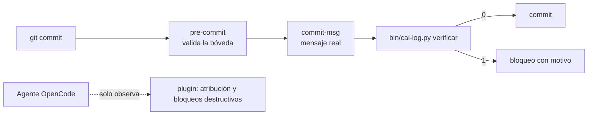

# Herramientas de Gobernanza

> [!info] Qué es este documento
> El **contrato** de las herramientas que hacen cumplir la gobernanza:
> qué hacen, qué reciben, qué escriben, qué códigos de salida devuelven y qué
> pruebas deben pasar. Se escribe **antes** de modificar el código para que la
> implementación tenga una especificación verificable ([[00.04 Plan Maestro de Implementación]]:
> nada de código sin documentación previa).
>
> **Estado:** `vigente`. T1, T2, T3 y T4 implementadas el 2026-10-22.
> Corrección editorial y endurecimiento del 2026-10-23: inventario de hooks,
> ejemplo de salida y push manual del operador.

| Campo | Valor |
|---|---|
| **Versión del contrato** | 0.6.0 (vigente; T4 implementada; push manual del operador desde el 2026-10-23) |
| **Alcance** | Herramientas del repositorio de documentación |
| **Autor** | Cesar Benitez · IA `opencode/big-pickle#default` |
| **Diagnóstico asociado** | [[05.08 Revision de Calidad de las Herramientas de Gobernanza]] |

---

## 1. Inventario

| Herramienta | Archivo | Rol | Entrada | Salida |
|---|---|---|---|---|
| Validador de la bóveda | `bin/validate-vault.py` | Verifica forma y enlaces | Carpeta de la bóveda | Informe y código 0/1/2 |
| Registrador | `bin/cai-log.py` | Agrega entradas a 12.02 y 12.03 | Subcomando y opciones | Texto y archivos modificados |
| Hook `pre-commit` | `bin/hooks/pre-commit` | Valida la bóveda antes del commit | Índice de Git | Código 0/1 |
| Hook `commit-msg` | `bin/hooks/commit-msg` | Bloquea commits sin `REG` válido | Archivo del mensaje | Código 0/1 |
| Instalador de hooks | `bin/install-hooks.sh` | Copia los hooks a `.git/hooks/` | — | Hooks ejecutables |
| Plugin de OpenCode | `.opencode/plugins/cai-log.ts` | Atribuye la sesión y bloquea comandos | Eventos del agente | Recordatorios, bloqueos, estado local |
| Permisos | `opencode.jsonc` | Niega o pregunta operaciones | Acción y recurso | `allow` / `ask` / `deny` |

---

## 2. Contrato común

### 2.1 Rutas canónicas

| Recurso | Ruta |
|---|---|
| Registro de cambios | `sistema cai/12 - Registro de Cambios/12.02 Registro de Cambios.md` |
| Bitácora de sesiones | `sistema cai/12 - Registro de Cambios/12.03 Bitácora de Sesiones con IA.md` |
| Entradas del registro | entre `<!-- REG-ENTRIES:START -->` y `<!-- REG-ENTRIES:END -->` |
| Entradas de sesiones | entre `<!-- SES-ENTRIES:START -->` y `<!-- SES-ENTRIES:END -->` |
| Índice del registro | `<!-- REG-INDEX:START -->`, dentro de `## 3. Índice de entradas`, antes de la tabla |
| Índice de sesiones | `<!-- SES-INDEX:START -->`, dentro de `## 4. Índice de sesiones`, antes de la tabla |

### 2.2 Reglas de escritura

| Regla | Detalle |
|---|---|
| **Solo agregar** | Ninguna operación puede modificar ni eliminar texto anterior a `START`. La inserción va inmediatamente después de `START` |
| **Sin escrituras del plugin** | El plugin no escribe en la bóveda. El único escritor es `bin/cai-log.py` (ADR-0018) |
| **Una escritura por operación** | El archivo se escribe completo una sola vez, de forma atómica (temporal en el mismo directorio y reemplazo). Nunca dos escrituras sucesivas del mismo archivo |
| **Marcador obligatorio** | Si el documento no tiene el marcador correspondiente, la operación falla con error. No se “adivina” la posición |
| **Codificación** | UTF-8 sin BOM, saltos de línea `\n` |
| **Tablas** | Todo valor de celda escapa `\|` como `\\|` y colapsa espacios |

### 2.3 Identificadores

| Tipo | Formato | Generación |
|---|---|---|
| Entrada de registro | `REG-AAAA-NNN` | Correlativo del año en curso, mirando encabezados e índice |
| Sesión | `SES-AAAA-NNN` | Correlativo del año en curso |
| Hallazgo de calidad | `HC-NN` | Manual, estable en [[05.08 Revision de Calidad de las Herramientas de Gobernanza]] |
| Caso de prueba | `T-NN` | Manual, estable en §9 |

**Regla:** el año del ID y el año de la fecha deben coincidir. Un ID de un año
anterior no se reutiliza ni se “rellena”. `--id` solo acepta el formato exacto
`REG-AAAA-NNN` o `SES-AAAA-NNN` (según el subcomando) con el año en curso; un
valor mal formado, de otro año o de otro prefijo falla antes de escribir.

### 2.4 Formato de fecha y hora

| Campo | Formato | Ejemplo |
|---|---|---|
| `updated` del frontmatter | `AAAA-MM-DD` | `2026-10-22` |
| Fecha y hora de una entrada | `AAAA-MM-DD HH:MM (−03)` | `2026-10-22 22:10 (−03)` |
| Marca técnica de sesión | ISO 8601 con offset | `2026-10-22T22:02:46-03:00` |

**Regla:** una sola fuente de tiempo. La hora que se escribe es la local del
equipo, con su offset. No se suman ni restan horas a mano: si el equipo está en
`−03`, la hora local ya lo incluye.

### 2.5 Modelo de IA

| Forma | Válida | Observación |
|---|---|---|
| `proveedor/modelo#variante` | Sí | Forma canónica |
| `proveedor/modelo` | Sí | Solo si no hay variante |
| `modelo` | No | Sin proveedor la atribución es incompleta |

**Precedencia:** la variante puede venir de `--variante`, de `CAI_VARIANTE` o
del `#` de `--modelo`/`CAI_MODELO`. Si llegan dos y no coinciden, la operación
**falla** con un mensaje que explica cuál usar: no se adivina la atribución
(T2, HC-12).

---

## 3. `validate-vault.py`

### 3.1 Interfaz

| Opción | Efecto | Defecto |
|---|---|---|
| `--vault RUTA` | Carpeta a validar | `sistema cai` |
| `--quiet` | Oculta los avisos | Desactivado |
| `--json` | Salida legible por máquina | Desactivado |

### 3.2 Comprobaciones

| Regla | Severidad | Qué detecta |
|---|---|---|
| `frontmatter` | error | Bloque ausente; campo obligatorio vacío; `title` distinto del nombre sin prefijo; `status` fuera del catálogo (ADR incluidos); `updated` sin formato |
| `wikilinks` | error | Destino que no corresponde a ningún documento; se ignoran los bloques de código |
| `tablas` | error | Fila separadora ausente; filas con distinto número de celdas; los pipes escapados no cuentan |
| `caracteres` | error | Cirílico, kana, CJK, hangul y ancho completo |
| `idioma` | aviso | Palabras inglesas sospechosas fuera de comillas |
| `indices` | aviso | Documento no referenciado desde ningún índice |

### 3.3 Códigos de salida

| Código | Significado |
|---|---|
| `0` | Sin errores (puede haber avisos) |
| `1` | Hay al menos un error |
| `2` | Error de uso o carpeta inexistente |

### 3.4 Salida JSON

```json
{
  "documentos": 108,
  "wikilinks": 1482,
  "errores": 0,
  "avisos": 0,
  "problemas": []
}
```

Ejemplo con la bóveda al 2026-10-23; los conteos cambian con cada documento.

Cada elemento de `problemas` tiene `archivo`, `linea`, `regla`, `mensaje` y
`severidad`.

### 3.5 Límites conocidos

| Límite | Efecto | Estado |
|---|---|---|
| El frontmatter se parsea con una regla simple | No interpreta bloques multilínea ni comentarios YAML | Aceptado: la bóveda usa un subconjunto |
| El índice de nombres usa alias sin prefijo | Si dos documentos comparten alias, gana el primero en silencio | Aceptado: no hay alias duplicados en la bóveda |
| El índice de referencias recorre los textos otra vez | Costo duplicado, sin releer el disco | Aceptado: el segundo recorrido es lineal y barato |
| La limpieza de bloques se repite por comprobación | Tres recorridos por documento | **Corregido en T2**: una limpieza por documento (HC-08) |

---

## 4. `cai-log.py`

### 4.1 Subcomando `cambio`

| Opción | Obligatoria | Regla |
|---|---|---|
| `--tipo` | Sí | Uno de los nueve tipos de 12.02 §2 |
| `--severidad` | Sí | `N1`–`N4` |
| `--motivo` | Sí | Mínimo 10 palabras; explica el porqué |
| `--archivos` | Sí | Rutas separadas por coma; el alcance se declara antes |
| `--rastreo` | Si `N3`/`N4` | ADR, RF, RN, P o S |
| `--verificacion` | No | Comando y resultado; si falta, `pendiente` |
| `--autor` | No | Por defecto `CAI_OPERADOR` |
| `--sesion` | No | Debe existir en 12.03; por defecto `CAI_SESION` |
| `--modelo`, `--variante` | Sí o `CAI_MODELO` | Forma canónica |
| `--estado` | No | `aplicado` por defecto |
| `--id` | No | Solo para recuperar un hueco; formato `REG-AAAA-NNN` con el año en curso |
| `--seco` | No | Ejecuta todas las comprobaciones y muestra el resultado; solo omite la escritura |

### 4.2 Subcomando `sesion`

| Opción | Obligatoria | Regla |
|---|---|---|
| `--operador` | Sí | Persona concreta |
| `--objetivo` | Sí | Qué se intentó hacer |
| `--area` | Sí | Carpeta de la bóveda |
| `--modelo`, `--variante` | Sí o `CAI_MODELO` | Forma canónica |
| `--agente` | No | `build` por defecto |
| `--herramienta` | No | `CAI_HERRAMIENTA`, `OpenCode` por defecto |
| `--resultado` | No | `completado`, `parcial` o `fallido` |
| `--entradas` | No | IDs `REG` generados |
| `--seco` | No | Igual que en `cambio` |

`verificar` es el tercer subcomando y es de **solo lectura**: comprueba un mensaje
de commit y no escribe nada. Su contrato está en §8.

### 4.3 Variables de entorno

| Variable | Uso |
|---|---|
| `CAI_MODELO` | `proveedor/modelo#variante` cuando no se pasa `--modelo` |
| `CAI_VARIANTE` | Variante cuando no viene en `CAI_MODELO` |
| `CAI_OPERADOR` | Autor por defecto |
| `CAI_SESION` | Sesión por defecto para enlazar entradas |
| `CAI_HERRAMIENTA` | Nombre del harness |

### 4.4 Efectos

| Operación | Escribe | Además |
|---|---|---|
| `cambio` | Entrada después de `REG-ENTRIES:START` | Fila nueva bajo `REG-INDEX:START`; `updated` del documento |
| `sesion` | Entrada después de `SES-ENTRIES:START` | Fila nueva bajo `SES-INDEX:START`; `updated` del documento |

Ambas ediciones se arman en memoria y el documento se escribe **una sola vez**
con temporal y reemplazo atómico (T2, HC-06). Si el reemplazo falla, el archivo
original queda intacto y no aparecen temporales sueltos.

### 4.5 Comprobaciones antes de escribir

```text
☐ Tipo, severidad, estado y resultado dentro del catálogo
☐ Motivo con al menos 10 palabras
☐ N3/N4 con rastreo declarado
☐ Modelo con proveedor
☐ Autor y operador declarados
☐ ID pedido con formato y año correctos
☐ ID calculado que no exista ya
☐ Sesión citada que exista en 12.03
☐ Marcadores de entradas e índice presentes en el documento destino
```

Si cualquiera falla, **no se escribe nada** y el código de salida es `1`. El
modo `--seco` recorre esta misma lista: no hay comprobaciones que solo ocurran
en la ejecución real.

### 4.6 Límites conocidos

T2, T3 y T4 cerraron los límites del contrato: la escritura es única y atómica
(HC-06), el correlativo mira encabezados y filas con `re.MULTILINE` (HC-22), el
índice se ancla en un marcador y no en el título de la sección (HC-17), `--id`
valida formato y año (HC-18), `--seco` ejecuta todas las comprobaciones (HC-18),
el CI es el de este repositorio (HC-10) y la documentación de uso solo menciona
comandos que existen (HC-13). No quedan límites conocidos.

---

## 5. Hooks de Git

### 5.1 Estado actual

| Hook | Comprueba | Entrada |
|---|---|---|
| `pre-commit` | Que la bóveda valide cuando el commit la toca | Índice de Git |
| `commit-msg` | Cita de `REG`, existencia como encabezado y justificación de borrados | `$1`: archivo del mensaje real |

`bin/install-hooks.sh` copia todo archivo de `bin/hooks/` a `.git/hooks/` y le da
permiso de ejecución. No hay desinstalador.

> [!note] Lo que cambió en T1
> Hasta el 2026-10-22, `pre-commit` leía `COMMIT_EDITMSG` y validaba el mensaje
> del commit **anterior** (HC-02). La verificación se movió a `commit-msg` y la
> lógica a `bin/cai-log.py verificar` (HC-03).

### 5.2 Contrato vigente

| Hook | Responsabilidad |
|---|---|
| `pre-commit` | Validar la bóveda y verificar que exista el validador (falla cerrado) |
| `commit-msg` | Invocar `verificar` con el mensaje real |
| `post-commit` | Nada. El cierre de sesión es explícito |

**Regla:** la verificación del mensaje **nunca** se hace en `pre-commit`.

### 5.3 Escape

No se documenta ni se sugiere `--no-verify` en los mensajes de error. Si se usa,
queda en el historial de shell y en la revisión; el mensaje del bloqueo no debe
enseñar a eludirlo.

---

## 6. Plugin de OpenCode

### 6.1 Responsabilidades

| Permitido | Prohibido |
|---|---|
| Recordar el orden de lectura una vez por sesión | Escribir en la bóveda, en cualquier momento |
| Registrar modelo, agente y archivos tocados en `.cai/sessions/` | Verificar la política por su cuenta |
| Bloquear comandos destructivos | Interpretar el texto de un comando para decidir si hay un commit |
| — | Cerrar sesiones o insertar entradas en el registro |

La superficie del plugin está tipada con una interfaz estructural del SDK (sin
`any`) y la memoria de sesiones está acotada a 100 entradas: al superar el
límite se descarta la sesión más antigua (HC-19).

### 6.2 Marcadores heredados

Hasta T1 el plugin cerraba la sesión en 12.03 y usaba `<!-- SES-<sessionID> -->`
para no hacerlo dos veces. Ya no escribe: el marcador solo puede aparecer en
entradas escritas por esa versión anterior y se conserva como rastro. No
reemplaza al ID `SES-AAAA-NNN` ni se muestra en la lectura normal del documento.

### 6.3 Dependencia de API

El plugin usa la API de plugins de OpenCode, marcada como alpha. Por eso la
atribución **no puede depender solo de él**: el registro manual con
`bin/cai-log.py` es el camino de respaldo ([[ADR-0017 Registro y Trazabilidad de Cambios]] §4.2).

---

## 7. Permisos de OpenCode

| Acción | Recurso | Efecto | Motivo |
|---|---|---|---|
| `shell` | `rm`, `unlink`, `shred`, `trash`, `git clean`, `find … -delete` | `deny` | Nada se borra |
| `shell` | `git reset --hard`, `git filter-branch` | `deny` | La historia no se reescribe |
| `shell` | `git push` (cualquier rama, incluido `--force`) | `deny` | El push lo hace el operador manualmente; la IA no publica |
| `shell` | `git commit`, `git tag` | `ask` | Confirmación humana |
| `edit` | `11 - Decisiones ADR/`, `12 - Registro de Cambios/` | `ask` | Documentos inmutables o de solo agregar |
| `read` | `*.env`, `*.key`, `*.pem`, `*.p12` | `ask` | Secretos |
| `external_directory` | `*` | `ask` | Fuera del proyecto |

**Regla:** los permisos son una barrera independiente del hook. La política de
trazabilidad vive en un solo comando (ADR-0018); los permisos no la duplican.

---

## 8. Contrato de verificación

### 8.1 Un solo comando

Implementado en T1. Es de solo lectura y lo invoca el hook `commit-msg`.

```bash
bin/cai-log.py verificar --mensaje ARCHIVO [--json]
```

| Entrada | Comprobación | Salida |
|---|---|---|
| Mensaje | Cita al menos un `REG-AAAA-NNN` | Error si no cita |
| Mensaje | Cada ID citado existe como encabezado en 12.02 | Error con el ID faltante |
| Índice de Git | Cada archivo eliminado aparece en la entrada citada | Error con la lista |
| Índice de Git | La entrada citada justifica el retiro | Error si no lo justifica |

La validación de la bóveda no forma parte de `verificar`: la hace
`pre-commit` con `bin/validate-vault.py`.

| Código | Significado |
|---|---|
| `0` | Todo cumple |
| `1` | Hay una violación de política |
| `2` | Error de uso (archivo inexistente, marcador ausente) |

### 8.2 Quién lo invoca



**Invariante:** un cambio de regla se hace en un solo archivo. Si una regla no
está en `verificar`, no existe.

---

## 9. Matriz de pruebas

Cada caso debe existir como prueba automatizada antes de cerrar T1–T4 de
[[05.08 Revision de Calidad de las Herramientas de Gobernanza]] §6.

> [!success] Estado al 2026-10-22
> Toda la matriz está automatizada en `bin/tests/` (59 casos) y el CI la ejecuta
> junto con el validador y `mypy`.

### 9.1 Validador

| ID | Entrada | Resultado esperado |
|---|---|---|
| T-01 | Bóveda sana | Código 0; 0 errores |
| T-02 | Documento sin frontmatter | Error en línea 1 |
| T-03 | `title` distinto del nombre sin prefijo | Error |
| T-04 | `status` fuera del catálogo; ADR con estado de ADR | Error / sin error |
| T-05 | `updated` mal formado | Error |
| T-06 | Wikilink roto, enlace con alias y con ancla; enlace dentro de bloque de código | Error / error / sin error |
| T-07 | Tabla sin separador; fila con celdas distintas; pipe escapado | Error / error / sin error |
| T-08 | Carácter CJK; palabra inglesa fuera de comillas; dentro de comillas | Error / aviso / sin aviso |
| T-09 | `--json` | Claves y conteos correctos |
| T-10 | `--vault` inexistente | Código 2 |

### 9.2 Registrador

| ID | Entrada | Resultado esperado |
|---|---|---|
| T-11 | Cambio válido | Entrada después de `START`; fila en el índice; **bytes anteriores intactos** |
| T-12 | ID ya existente | Código 1; archivo sin cambios |
| T-13 | N3 sin rastreo | Código 1; archivo sin cambios |
| T-14 | Motivo con 9 palabras | Código 1 |
| T-15 | Modelo sin proveedor; `#variante` frente a `--variante` | Código 1 / error de discrepancia |
| T-16 | Sesión inexistente | Código 1; archivo sin cambios |
| T-17 | `--seco` con marcador ausente | Código 1 (no debe aprobar) |
| T-18 | Fallo simulado en la escritura | El archivo queda íntegro o con la entrada y su fila, nunca a medias |
| T-23 | Correlativo con entradas e índice ya existentes (varias líneas) | Propone el siguiente número real, no `001` |

### 9.3 Hooks

| ID | Entrada | Resultado esperado |
|---|---|---|
| T-19 | `commit-msg` con mensaje real y `REG` válido / inexistente / ausente | Pasa / bloquea / bloquea |
| T-20 | Commit que elimina un archivo sin justificación | Bloquea |
| T-21 | Inserción sobre un bloque con 3 entradas | 4 entradas; las 3 anteriores intactas byte a byte |
| T-22 | El plugin se activa con el texto `git commit` en un comando que no commitea este repositorio | No escribe nada; su fuente no interpreta commits (inspección estática) |

---

## 10. Operación

| Tarea | Comando | Cuándo |
|---|---|---|
| Instalar hooks | `bin/install-hooks.sh` | Una vez por clon |
| Validar la bóveda | `bin/validate-vault.py` | Antes de cada commit |
| Ejecutar las pruebas | `python3 -m unittest discover -s bin/tests` | Antes de cada commit |
| Integración continua | `.github/workflows/ci.yml` | En cada `push` y pull request |
| Registrar un cambio | `bin/cai-log.py cambio …` | Antes del commit |
| Registrar una sesión | `bin/cai-log.py sesion …` | Al abrir o cerrar una sesión |
| Verificar un mensaje | `bin/cai-log.py verificar --mensaje ARCHIVO` | Desde `commit-msg` |
| Diagnóstico del plugin | Revisar `.cai/sessions/*.json` | Cuando falte atribución |

---

## 11. Reglas de cambio de estas herramientas

| Cambio | Severidad | Requisito |
|---|---|---|
| Corregir un mensaje, un tipo o una errata | N1 | Entrada `REG` y verificación |
| Agregar un caso de prueba o una comprobación no bloqueante | N2 | Entrada `REG`; pruebas verdes |
| Cambiar qué bloquea un commit o qué se escribe en el registro | N3 | ADR o aprobación previa; pruebas de la matriz |
| Cambiar la ubicación del registro o el formato de los IDs | N3 | ADR; migración de entradas existentes |
| Tocar datos reales o credenciales | N4 | Prohibido |

**Compatibilidad:** las entradas existentes no se migran ni se reescriben. Un
cambio de formato se aplica solo a entradas nuevas y se documenta en este
contrato con su fecha.

---

## 12. Documentos relacionados

- [[05.08 Revision de Calidad de las Herramientas de Gobernanza]] — diagnóstico y plan
- [[05.07 Gobierno del Cambio]] — reglas GC, GE y GL
- [[12.01 Política de Cambios y Trazabilidad]] — severidad y aprobación
- [[12.02 Registro de Cambios]] — destino de las entradas
- [[12.03 Bitácora de Sesiones con IA]] — destino de las sesiones
- [[ADR-0017 Registro y Trazabilidad de Cambios]] — decisión vigente
- [[ADR-0018 Verificación de Trazabilidad en un Punto]] — decisión aceptada e implementada en T1
- [[08.12 Backlog Maestro]] — ítems de corrección
