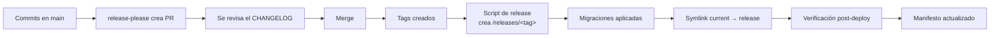

# Estrategia de Versionado

> [!important] La promesa
> **"Puedo volver a una versión anterior del sistema sin que se rompa."**
> Este es el requisito que más condiciona el diseño. Todo lo que sigue existe para
> cumplirla.

---

## 1. Las tres capas de versión

| Capa | Qué versiona | Mecanismo | Visible para |
|---|---|---|---|
| **Paquetes** | El código de cada módulo | SemVer por paquete (`cai/care@v1.2.0`) | El equipo |
| **Esquema** | La estructura de la base | Indirecto: el esquema vive en el código | El equipo |
| **Sistema** | El conjunto desplegado | Tag `sistema@vYYYY.MM.P` + manifiesto de releases | Dirección y operación |

**Regla:** el sistema **no** tiene una versión única de la que dependa todo. Cada paquete
es dueño de su versión. El "release del sistema" es un **manifiesto** que dice qué versión
de cada paquete está desplegada.

---

## 2. Versionado por paquete

### 2.1 Por qué por paquete y no global

| Alternativa | Problema |
|---|---|
| Versión global única (`v1.0.0` de todo) | Un fix de una línea en `care` obliga a versionar `billing`, `students` y los demás. El CHANGELOG se vuelve ruido. |
| **Versión por paquete** ✅ | Cada módulo evoluciona a su ritmo. Los cambios se ven en el módulo que los causa. |

### 2.2 Reglas

| Regla | Detalle |
|---|---|
| Cada paquete tiene su `CHANGELOG.md` | Generado por `release-please` |
| Los tags son `cai/<paquete>@v<semver>` | Un tag por paquete |
| Los tags son inmutables | Nunca se reescribe ni se borra un tag publicado |
| Los tags se crean desde `main` | Solo después de un merge |
| Las dependencias entre paquetes usan rangos | `^1.0` en el `composer.json` de los paquetes |
| Un `MAJOR` de un paquete obliga a revisar los dependientes | Revisión semántica en el PR |

### 2.3 Ejemplo de manifiesto de release

```json
// storage/app/releases/current.json (generado por el script de release)
{
  "release": "sistema@v2026.10.1",
  "deployed_at": "2026-10-22T14:05:00-03:00",
  "git_commit": "a1b2c3d",
  "packages": {
    "cai/core": "1.4.0",
    "cai/identity": "1.2.1",
    "cai/students": "1.0.0",
    "cai/scheduling": "1.1.0",
    "cai/care": "2.0.3",
    "cai/billing": "1.3.0",
    "cai/documents": "1.0.2",
    "cai/notifications": "1.1.0",
    "cai/reporting": "1.0.1"
  },
  "migrations": [
    "2026_10_18_120000_billing_add_index_on_charges_due_date"
  ]
}
```

Este archivo es lo que permite saber **exactamente** qué hay desplegado y compararlo con
el release anterior durante un rollback.

---

## 3. SemVer aplicado al dominio

### 3.1 Criterio de incompatibilidad

Un cambio es **MAJOR** si obliga a cambiar código **fuera** del paquete:

| Cambio | SemVer |
|---|---|
| Nueva Action | MINOR |
| Nueva columna `nullable` | MINOR |
| Nuevo permiso | MINOR |
| Nuevo método en un contrato (con valor por defecto) | MINOR |
| **Método obligatorio en un contrato existente** | **MAJOR** |
| Columna `NOT NULL` sin default | MAJOR |
| Renombrar tabla o columna | MAJOR |
| Quitar un permiso | MAJOR |
| Cambiar el tipo de una columna | MAJOR |
| Cambiar el resultado esperado de una Action | MAJOR |
| Corrección de bug sin cambio de API | PATCH |
| Refactor interno sin cambio observable | PATCH |

### 3.2 La regla de los contratos

> **Un contrato es API pública. Cambiarlo es un MAJOR.**
> Por eso, cuando se necesita un dato nuevo en un contrato, se **agrega un método
> opcional** o se **agrega un método nuevo**, nunca se modifica la firma del existente.

```php
// ❌ Rompe a todos los implementadores
interface StudentDirectory
{
    public function find(int $id): ?Student;
    public function findByCode(string $code): ?Student;   // ← se agrega
}

// ✅ Compatible
interface StudentDirectory
{
    public function find(int $id): ?Student;
}
```

Cuando se necesita ampliar un contrato en el MVP:

```php
interface StudentDirectory
{
    public function find(int $id): ?Student;

    /**
     * @since 1.1.0
     */
    public function findByCode(string $code): ?Student;
}
```

El `since` documenta desde cuándo existe. Los implementadores que no lo agreguen
funcionan hasta que se marque el contrato como MAJOR.

---

## 4. Versionado del esquema

El esquema **no tiene versión propia.** Se versiona con el código.

| Regla | Detalle |
|---|---|
| El esquema aplicado es el de las migraciones del código desplegado | — |
| Las migraciones aplicadas son inmutables | Nunca se editan |
| Las migraciones tienen nombre con fecha | Orden lexicográfico = orden de aplicación |
| El esquema siempre es compatible con el release anterior | Ver [[06.03 Expand-Contract]] |
| `migrate:rollback` **no** se usa en producción | Ver [[06.06 Procedimiento de Rollback]] |

Ver [[06.02 Versionado de Esquema de BD]].

---

## 5. Ciclo de vida de un release



**Reglas:**

| Regla | Detalle |
|---|---|
| Un release = un commit en `main` + un conjunto de tags | — |
| El release se crea desde `main` | Nunca desde una rama |
| El release se despliega con el script, no a mano | Ver [[06.05 Release y Deploy]] |
| Las migraciones se aplican **antes** de cambiar el symlink | Ver [[06.03 Expand-Contract]] |
| El release anterior **permanece en disco** | Es lo que permite el rollback rápido |

---

## 6. Qué cambia de versión en cada release

| Tipo de cambio | Paquete afectado | SemVer |
|---|---|---|
| Corrección de bug en la imputación de pagos | `cai/billing` | PATCH |
| Nuevo campo en la ficha del alumno | `cai/students` | MINOR |
| Nueva acción de transferencia de cuenta | `cai/students` | MINOR |
| Cambio de firma de un contrato | El paquete del contrato | MAJOR |
| Corrección de documentación | — | — |
| Actualización de dependencia (patch) | El paquete que la usa | PATCH |
| Actualización de Laravel (minor) | Todos los afectados | MINOR |
| Actualización de Laravel (major) | Todos los afectados | MAJOR + pruebas |

---

## 7. Compatibilidad entre versiones

La regla que hace posible el rollback:

> **El release N-1 debe seguir funcionando con el esquema de N.**

Esto implica:

| Práctica | Ejemplo |
|---|---|
| Nunca eliminar columnas en el mismo release que deja de usarlas | Primero el código, luego la columna |
| Nunca renombrar columnas en un solo paso | Agregar la nueva → migrar → eliminar la vieja |
| Los cambios de enum se agregan antes de usarse | `status` acepta el valor viejo y el nuevo |
| Los valores por defecto se mantienen durante la transición | — |
| Los endpoints/acciones que cambian de contrato se mantienen una versión | Deprecated, no eliminado |

Ver [[06.03 Expand-Contract]].

---

## 8. Deprecaciones

Cuando una API debe cambiar:

| Fase | Qué se hace | Duración |
|---|---|---|
| 1. **Introducir** | Se agrega la API nueva. La vieja sigue funcionando y emite `deprecation` | 1 release |
| 2. **Migrar** | Todos los consumidores usan la API nueva | 1 release |
| 3. **Eliminar** | Se elimina la API vieja. Es un MAJOR | — |

**Nunca se elimina nada sin al menos 2 releases de aviso.**

---

## 9. Versionado de la configuración

| Elemento | ¿Versionado? | Cómo |
|---|---|---|
| Configuración de la app (`config/*.php`) | Sí, con el código | Cada release es una versión |
| Variables de entorno | No | Se documentan; los cambios son operativos |
| Feature flags | Sí | Ver [[06.04 Feature Flags y Kill Switches]] |
| Permisos y roles (seeds) | Sí | El seed es idempotente y versionado con el código |
| Settings en base | No | Cambios auditados, con `updated_by` |
| Plantillas de mensajes | Sí | Tabla `documents.message_templates` con `version` |

**Regla de los seeds idempotentes:** un seed se puede ejecutar N veces sin duplicar nada.
Los permisos se identifican por nombre, no por ID.

---

## 10. Comandos de referencia

```bash
# Ver la versión actual de cada paquete
composer show cai/* --format=json | jq '.[].versions[0]'

# Ver los tags
git tag -l 'cai/*' --sort=-v:refname | head -20

# Ver el release desplegado
cat storage/app/releases/current.json | jq

# Ver el release anterior
ls -la releases/

# Comparar el release actual con el anterior
diff <(jq .packages storage/app/releases/current.json) \
     <(jq .packages storage/app/releases/$(ls releases/ | head -2 | tail -1)/manifest.json)
```

---

## 11. Documentos relacionados

- [[05.02 Commits, Ramas y Versionado SemVer]]
- [[06.02 Versionado de Esquema de BD]]
- [[06.03 Expand-Contract]]
- [[06.04 Feature Flags y Kill Switches]]
- [[06.05 Release y Deploy]]
- [[06.06 Procedimiento de Rollback]]
- [[ADR-0004 Trunk-based con Tags SemVer]]
