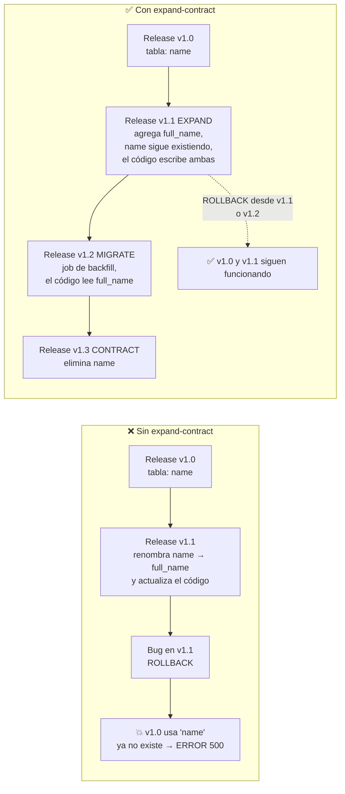

# Expand-Contract

> [!important] La invariante
> **La versión anterior del código siempre funciona con el esquema actual.**
>
> Sin esta invariante, el rollback de código es imposible: si se despliega un release que
> eliminó una columna y luego hay que volver atrás, el release anterior revienta.

---

## 1. El problema que resuelve



---

## 2. Las tres fases

| Fase | Qué se hace | Duración | Reversible |
|---|---|---|---|
| **Expand** | Se agrega lo nuevo. Lo viejo **sigue existiendo**. | 1 release | ✅ Total |
| **Migrate** | Se rellenan los datos y se cambia el código para usar lo nuevo. | 1 release | ✅ (el código anterior sigue usando lo viejo) |
| **Contract** | Se elimina lo viejo. | 1 release | ❌ Irreversible |

> [!danger] La fase Contract **rompe** la invariante
> Por eso, la eliminación de algo en la fase Contract es **irreversible**: volver atrás
> a un release anterior a la Contract no funciona. Por eso la Contract se hace **solo**
> cuando se tiene **mucha certeza** de que no habrá que volver atrás, y **nunca** en el
> mismo release que una funcionalidad nueva importante.

---

## 3. Regla del "número de releases"

> **Entre la Expand y la Contract hay al menos 2 releases.**

| Release | Contenido |
|---|---|
| `v1.1` | **Expand**: se agrega la columna nueva. El código escribe en la vieja y en la nueva. |
| `v1.2` | **Migrate**: job de backfill. El código lee de la nueva. La vieja sigue escribiéndose. |
| `v1.3` | **Contract**: se elimina la columna vieja. |

**Tiempo mínimo entre Expand y Contract:** 2 releases (pueden ser semanas si hay uso real
del sistema entre medio).

---

## 4. Ejemplo completo: renombrar una columna

### Release v1.1 — EXPAND

```php
// 2026_05_10_090000_students_add_full_name_to_students
public function up(): void
{
    Schema::connection('students')->table('students', function (Blueprint $table): void {
        $table->string('full_name')->nullable()->after('last_name');
    });
}
```

```php
// El modelo escribe en AMBAS columnas
protected function fullName(): Attribute
{
    return Attribute::make(
        get: fn () => $this->full_name ?? trim($this->first_name . ' ' . $this->last_name),
        set: function (string $value): void {
            $this->attributes['full_name'] = $value;
            // La columna vieja sigue manteniéndose
            [$this->attributes['first_name'], $this->attributes['last_name']] = explode(' ', $value, 2);
        },
    );
}
```

**Estado del esquema:**

```
id | first_name | last_name | full_name
---+------------+-----------+-----------
1  | Ana        | González  | Ana González
```

**Rollback a v1.0:** ✅ funciona. `full_name` es nullable y el código viejo no la usa.

---

### Release v1.2 — MIGRATE

```php
// 2026_06_15_100000_billing_backfill_charges_paid_amount  (es un job, no migración)
```

```php
// El modelo ahora lee de la columna nueva, pero sigue escribiendo en la vieja
protected function fullName(): Attribute
{
    return Attribute::make(
        get: fn () => $this->full_name ?? trim($this->first_name . ' ' . $this->last_name),
        set: function (string $value): void {
            $this->attributes['full_name'] = $value;
            [$this->attributes['first_name'], $this->attributes['last_name']] = explode(' ', $value, 2);
        },
    );
}
```

**El job de backfill** rellena `full_name` para los registros existentes:

```php
DB::connection('students')->table('students')
    ->whereNull('full_name')
    ->chunkById(200, function ($students): void {
        foreach ($students as $student) {
            DB::connection('students')->table('students')
                ->where('id', $student->id)
                ->update(['full_name' => trim($student->first_name . ' ' . $student->last_name)]);
        }
    });
```

**Rollback a v1.1:** ✅ funciona. Sigue escribiendo en ambas.

---

### Release v1.3 — CONTRACT

```php
// 2026_08_01_090000_students_drop_first_name_and_last_name_from_students
public function up(): void
{
    Schema::connection('students')->table('students', function (Blueprint $table): void {
        $table->dropColumn(['first_name', 'last_name']);
    });
}
```

**Antes de aplicar esta migración:**
- [ ] El release v1.2 lleva **al menos 2 releases** en producción.
- [ ] No hay ningún reporte, exportación ni integración que use `first_name`.
- [ ] El rollback a v1.1 **no** es necesario. Si lo fuera, esta migración se pospone.

---

## 5. Catálogo de cambios y su estrategia

| Cambio | Estrategia | Releases |
|---|---|---|
| Agregar columna | Expand directo | 1 |
| Renombrar columna | Expand + Migrate + Contract | 3 |
| Cambiar tipo de columna | Expand + Migrate + Contract | 3 |
| Eliminar columna | Migrate (dejar de usar) + Contract | 2 |
| Agregar valor a un enum | Expand (`ALTER TYPE ... ADD VALUE`) | 1 |
| Quitar valor de un enum | Migrate (dejar de usar) + Contract (`DROP VALUE` en tx separada) | 2 |
| Agregar campo obligatorio a un contrato | Deprecación + versión nueva del contrato | 2+ |
| Cambiar una tabla a otra | Migrate (copia en job) + Contract | 2 |
| Agregar índice | Directo (`CONCURRENTLY`) | 1 |
| Agregar FK | Directo, validando datos antes | 1 |
| Agregar `CHECK` | Directo, validando datos antes | 1 |

### 5.1 Agregar y quitar valores de enum

```sql
-- PostgreSQL 12+: se puede quitar un valor de un enum
ALTER TYPE students.student_status RENAME VALUE 'suspended' TO 'paused';
```

> [!warning] `ALTER TYPE ... ADD VALUE` no puede ejecutarse dentro de un bloque transaccional
> En PostgreSQL < 12, `ADD VALUE` no se puede rodar dentro de una transacción. Desde
> PostgreSQL 12 se puede, **pero el valor nuevo no se puede usar en la misma
> transacción**. La migración debe:
>
> ```php
> public function up(): void
> {
>     DB::statement("ALTER TYPE students.student_status ADD VALUE 'paused'");
> }
> ```
>
> Y el código que **usa** el valor nuevo se despliega en el release **siguiente**.

---

## 6. Reglas para cambios de comportamiento

Un cambio de lógica también necesita la protección del rollback.

### 6.1 El patrón de la "doble escritura"

```php
// ❌ ANTES: el código escribía solo en la columna vieja
$student->update(['name' => $newName]);

// ✅ DESPUÉS: escribe en ambas; la lectura prioriza la nueva
$student->update([
    'name' => $newName,
    'full_name' => $newName,
]);
```

### 6.2 El patrón del "feature flag para el comportamiento"

Cuando el cambio es de **lógica**, no de estructura:

```php
// El comportamiento nuevo está detrás de un flag
if (Feature::enabled('billing.use_new_allocation_algorithm')) {
    $this->allocateWithNewAlgorithm($payment);
} else {
    $this->allocateWithLegacyAlgorithm($payment);
}
```

El flag se enciende en el release N+1, después de verificar en staging y en producción que
el resultado es correcto. Si hay problemas, se apaga el flag y se vuelve al comportamiento
anterior **sin necesidad de desplegar**.

Ver [[06.04 Feature Flags y Kill Switches]].

---

## 7. Checklist de apply de una migración en producción

```bash
# 1. Verificar el estado
php artisan migrate:status

# 2. Backup ANTES de migrar (pg_dump de los schemas afectados)
./scripts/backup.sh --schemas billing,care

# 3. Aplicar en modo "dry run" (muestra el SQL sin ejecutar)
php artisan migrate --pretend

# 4. Revisar el SQL generado
php artisan migrate --pretend | tee /tmp/migration-preview.sql

# 5. Aplicar
php artisan migrate --force

# 6. Verificar
php artisan migrate:status
php artisan cai:migrate:verify

# 7. Si algo falló, NO hacer migrate:rollback.
#    Restaurar el backup (ver 06.06)
```

> [!danger] `migrate:rollback` en producción
> **Prohibido.** Un `rollback` de una migración que ya corrió en producción puede
> perder datos que se escribieron con el código nuevo. La única forma de revertir datos
> es **restaurar el backup**. Ver [[06.06 Procedimiento de Rollback]].

---

## 8. Verificación automática de la invariante

En la CI, antes de mergear, se verifica que **todas** las migraciones pendientes son
compatibles hacia atrás. Esto se puede hacer con una herramienta externa o con un test
que revisa las migraciones nuevas contra una lista de patrones prohibidos.

```php
// tests/Feature/MigrationCompatibilityTest.php
it('does not drop or rename columns in the same release as their replacement is used', function () {
    // Regla: una migración no puede hacer dropColumn ni renameColumn
    $offending = [];

    foreach (Migrator::getMigrations() as $file) {
        $content = file_get_contents($file->getPath());

        if (str_contains($content, '->dropColumn(')
            || str_contains($content, '->renameColumn(')) {
            $offending[] = $file->getFilename();
        }
    }

    expect($offending)->toBeEmpty();
});
```

> Esta regla es una heurística. La revisión manual en el PR (checklist de
> [[05.04 Checklist de Pull Request]]) es la que realmente protege la invariante.

---

## 9. Documentos relacionados

- [[06.02 Versionado de Esquema de BD]]
- [[06.04 Feature Flags y Kill Switches]]
- [[06.05 Release y Deploy]]
- [[06.06 Procedimiento de Rollback]]
- [[05.04 Checklist de Pull Request]]
- [[ADR-0003 Expand-Contract y Feature Flags]]
