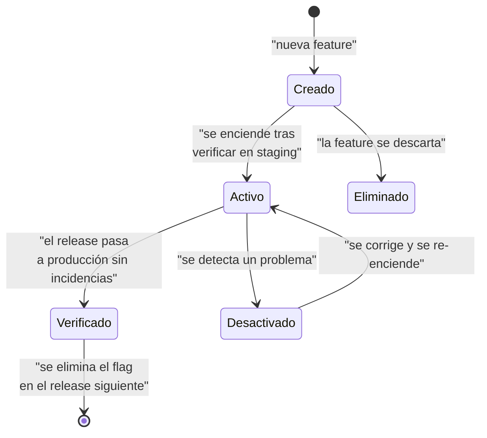

# Feature Flags y Kill Switches

> [!important] La diferencia
> Un **feature flag** apaga una funcionalidad **nueva** que todavía no se ha estabilizado.
> Un **kill switch** apaga una funcionalidad **existente** que está causando daño.
>
> El kill switch es la herramienta de contención más rápida del sistema: **se apaga en
> menos de 10 segundos** sin tocar código, sin desplegar y sin tocar la base.

---

## 1. Catálogo de flags

| Flag | Tipo | Por defecto | Qué controla |
|---|---|---|---|
| `module.care` | **Kill switch** | `on` | Todo el módulo clínico (notas, planes, objetivos) |
| `module.billing` | **Kill switch** | `on` | Todo el módulo financiero (cargos, pagos, recibos) |
| `module.documents` | **Kill switch** | `on` | Subida y descarga de documentos |
| `module.notifications` | **Kill switch** | `on` | Envío de mensajes a familias |
| `module.reporting` | **Kill switch** | `on` | Módulos de reportes |
| `care.grants.issue` | Función | `on` | Emisión de accesos excepcionales a datos clínicos |
| `care.notes.finalize` | Función | `on` | Finalización de notas clínicas |
| `billing.payments.create` | Función | `on` | Registro de pagos |
| `billing.cash.open` | Función | `on` | Apertura de caja |
| `billing.export` | Función | `on` | Exportación de datos financieros |
| `students.bulk_import` | Función | `off` | Importación masiva de alumnos |
| `students.bulk_import.dry_run` | Función | `on` | Modo simulación de la importación |
| `reporting.clinical_summary` | Función | `off` | Resumen clínico en el panel de Dirección |
| `portal.families` | Función | `off` | Portal familiar (etapa 2) |
| `feature.<nombre>` | Función | `off` | Reservado para features nuevas |

> [!danger] Los kill switches por módulo existen por una razón
> Si se detecta un acceso indebido a datos clínicos, la respuesta más rápida es
> **`module.care = off`**: se apaga todo el acceso a la información clínica en 10 segundos,
> sin perder datos y sin necesidad de un release. Ver [[04.07 Checklist Legal y Respuesta a Incidentes]].

---

## 2. Almacenamiento

Los flags viven en la base de datos, en el schema `identity`, tabla `feature_flags`.

```sql
CREATE TABLE identity.feature_flags (
    id           BIGSERIAL PRIMARY KEY,
    key          VARCHAR(80) NOT NULL UNIQUE,
    type         VARCHAR(20) NOT NULL DEFAULT 'feature'
                 CHECK (type IN ('feature', 'kill_switch')),
    is_enabled   BOOLEAN NOT NULL DEFAULT FALSE,
    description  TEXT,
    enabled_by   BIGINT REFERENCES identity.users(id),
    enabled_at   TIMESTAMPTZ,
    updated_at   TIMESTAMPTZ NOT NULL DEFAULT NOW()
);
```

**¿Por qué en la base y no en un archivo?**

| Opción | Consecuencia |
|---|---|
| Archivo `.env` | Requiere deploy o `sed` remoto para cambiarlo. Demasiado lento para un kill switch |
| **Base de datos** ✅ | Se cambia desde la pantalla, se audita, se cachea |
| Config de Laravel | Igual que `.env`, requiere deploy |
| Redis | No se usa Redis (ADR-0009) |

**Cache:** los flags se cachean en `cache` (base de datos o archivo) durante **60
segundos**. Esto evita consultar la base en cada request, sin que el apagado tarde más de
un minuto en aplicarse.

> [!note] El kill switch debe ser más rápido
> Con caché de 60 s, apagar `module.care` surte efecto en **menos de 60 segundos**. Es
> aceptable para una contención. Si se necesitara más rapidez, el cache TTL del flag se
> puede bajar a 10 segundos.

---

## 3. Uso en el código

### 3.1 Verificación

```php
// packages/core/src/Support/Feature.php
declare(strict_types=1);

namespace Cai\Core\Support;

final class Feature
{
    public static function enabled(string $key): bool
    {
        return FeatureFlagStore::isEnabled($key);
    }

    public static function disabled(string $key): bool
    {
        return ! self::enabled($key);
    }
}
```

### 3.2 Kill switch de módulo

```php
// packages/core/src/Support/ModuleGuard.php
declare(strict_types=1);

namespace Cai\Core\Support;

use Illuminate\Support\Facades\Auth;
use Illuminate\Support\Facades\Route;

final class ModuleGuard
{
    public static function boot(): void
    {
        // Las rutas de cada módulo se registran solo si el módulo está activo.
        Route::middleware('module.active:care')->group(function (): void {
            // ...
        });
    }
}
```

```php
// packages/core/src/Http/Middleware/EnsureModuleIsActive.php
declare(strict_types=1);

namespace Cai\Core\Http\Middleware;

use Closure;
use Illuminate\Http\Request;
use Symfony\Component\HttpFoundation\Response;

final class EnsureModuleIsActive
{
    public function handle(Request $request, Closure $next, string $module): Response
    {
        if (Feature::disabled("module.{$module}")) {
            abort(503, "El módulo {$module} está temporalmente deshabilitado.");
        }

        return $next($request);
    }
}
```

**Efecto de `module.care = off`:**

| Qué pasa | Qué sigue funcionando |
|---|---|
| Las rutas de `care` devuelven 503 | Toda la agenda, los alumnos, los pagos |
| Los Resources de `care` desaparecen del menú | Los reportes no clínicos |
| Los jobs de `care` no se despachan | El registro de asistencia |
| **Los datos NO se tocan** | **El historial clínico sigue intacto** |

> [!important] Apagar no es borrar
> El kill switch **no borra datos**. Es una medida de contención, no una medida
> destructiva. Los datos clínicos se pueden volver a exponer cuando se resuelva el
> problema.

### 3.3 Feature flag de una función

```php
// packages/care/src/Actions/CreateClinicalNote.php
if (Feature::disabled('care.notes.create')) {
    throw new FeatureDisabledException('La creación de notas está deshabilitada temporalmente.');
}
```

### 3.4 Bandera en la interfaz

```php
// packages/billing/src/Filament/Resources/ChargeResource.php
public static function getNavigationBadge(): ?string
{
    if (Feature::disabled('module.billing')) {
        return 'OFF';
    }

    return null;
}
```

Y en la UI, un aviso visible:

```php
->headerActions([
    Action::make('aviso')
        ->visible(fn () => Feature::disabled('billing.payments.create'))
        ->label('⚠ Los registros de pago están deshabilitados temporalmente')
        ->color('warning')
        ->disabled(),
])
```

---

## 4. Panel de administración de flags

Pantalla de Administración Técnica:

```
┌──────────────────────────────────────────────────────────────┐
│ Feature Flags y Kill Switches                               │
├──────────────────────────────────────────────────────────────┤
│ ⬤ module.care            ON    Kill switch   [ Desactivar ]  │
│ ⬤ module.billing         ON    Kill switch   [ Desactivar ]  │
│ ⬤ module.documents       ON    Kill switch   [ Desactivar ]  │
│ ⬤ module.notifications   ON    Kill switch   [ Desactivar ]  │
│ ⬤ module.reporting       ON    Kill switch   [ Desactivar ]  │
│ ⬤ care.grants.issue      ON    Función       [ Desactivar ]  │
│ ⬤ billing.payments.create ON   Función       [ Desactivar ]  │
│ ○ students.bulk_import   OFF   Función       [ Activar    ]  │
│ ○ portal.families        OFF   Función       [ Activar    ]  │
├──────────────────────────────────────────────────────────────┤
│ [ Guardar cambios ]                                          │
└──────────────────────────────────────────────────────────────┘
```

**Controles de la pantalla:**

| Control | Regla |
|---|---|
| Activar/desactivar un **kill switch** | Requiere motivo. Se registra en `security_events` |
| Activar/desactivar una **función** | Sin motivo. Se registra en `audit_events` |
| Cambiar un kill switch de un módulo crítico | Requiere confirmación doble (escribir el nombre del módulo) |
| Mostrar el estado actual | Visible para Dirección y Administración Técnica |

---

## 5. Auditoría

| Acción | Registro | Severidad |
|---|---|---|
| Kill switch activado | `audit_events` (`flag.enabled`) + `security_events` (`flag.changed`) | `warning` |
| Kill switch desactivado | `audit_events` (`flag.disabled`) + `security_events` (`flag.changed`) | `warning` |
| Feature activada | `audit_events` (`flag.enabled`) | `info` |
| Feature desactivada | `audit_events` (`flag.disabled`) | `info` |
| Motivo del cambio | Columna `reason` en `security_events` | — |

```sql
SELECT created_at, user_id, reason
FROM identity.security_events
WHERE event_type = 'flag.changed'
ORDER BY created_at DESC
LIMIT 20;
```

> [!warning] Motivo obligatorio para kill switches
> Si alguien apaga `module.care` sin motivo, no se puede distinguir un simulacro de una
> contención real. El motivo es obligatorio y queda registrado.

---

## 6. Ciclo de vida de un flag



**Regla de higiene:**

> **Un flag que ya está `on` en producción y es estable se elimina del código.**
> Un flag permanente se convierte en deuda: nadie se acuerda de por qué existe.

**Plazo máximo:** 3 releases. Si en 3 releases el flag no se ha eliminado, se revisa en la
reunión de Dirección.

---

## 7. Kill switch por módulo: guía rápida

### 7.1 Apagar el módulo clínico

```bash
# Opción 1: desde la UI (Administración Técnica)
#   → Configuración → Feature Flags → module.care → Desactivar → Motivo

# Opción 2: por consola
php artisan cai:flag:disable module.care --reason="Acceso indebido sospechoso" \
    --user=<user_id>
```

```php
// packages/core/src/Console/Commands/DisableFeatureFlag.php
final class DisableFeatureFlag extends Command
{
    protected $signature = 'cai:flag:disable {key} 
                            {--reason= : Motivo (obligatorio para kill switches)}
                            {--user= : ID del usuario que ejecuta la acción}';

    public function handle(): int
    {
        $key = $this->argument('key');
        $flag = FeatureFlag::where('key', $key)->first();

        if ($flag === null) {
            $this->components->error("El flag {$key} no existe.");
            return self::FAILURE;
        }

        if ($flag->type === 'kill_switch' && blank($this->option('reason'))) {
            $this->components->error('El motivo es obligatorio para desactiva un kill switch.');
            return self::FAILURE;
        }

        $flag->update([
            'is_enabled' => false,
            'enabled_by' => $this->option('user') ?? Auth::id(),
            'enabled_at' => now(),
        ]);

        FeatureFlagStore::flush();

        $this->components->info("Flag {$key} desactivado.");

        return self::SUCCESS;
    }
}
```

**Verificación del apagado:**

```bash
curl -I https://cai.centro.local/panel/care/plans   # Debe devolver 503
```

### 7.2 Reactivar

```bash
php artisan cai:flag:enable module.care --user=<user_id>
```

> [!important] Antes de reactivar
> Verificar que la causa del apagado **está resuelta**. Reactivar sin resolver solo
> reintroduce el problema.

---

## 8. Flags y el rollback

Los flags son el **nivel 1** de los 4 niveles de rollback:

| Nivel | Mecanismo | Tiempo | Reversibilidad |
|---|---|---|---|
| 1 | **Kill switch / feature flag** | < 1 min | Total (los datos no se tocan) |
| 2 | Symlink al release anterior | ~1 min | Total |
| 3 | Restaurar `pg_dump` pre-release | 1–3 h | **Pierde los datos posteriores al dump** |
| 4 | Restaurar del backup externo cifrado | 2–4 h | **Pierde todos los datos posteriores** |

Ver [[06.06 Procedimiento de Rollback]].

---

## 9. Tests de flags

```php
// packages/core/tests/Feature/FeatureFlagTest.php
it('returns 503 when the module is disabled', function () {
    FeatureFlag::create([
        'key' => 'module.care',
        'type' => 'kill_switch',
        'is_enabled' => false,
    ]);

    $this->actingAs(User::factory()->withRole('direccion')->create())
        ->get('/panel/care/plans')
        ->assertStatus(503);
});

it('requires a reason when disabling a kill switch', function () {
    $this->artisan('cai:flag:disable', ['key' => 'module.care'])
        ->assertFailed();
});

it('keeps the data intact when a module is disabled', function () {
    $note = ClinicalNote::factory()->finalized()->create();

    FeatureFlag::create(['key' => 'module.care', 'type' => 'kill_switch', 'is_enabled' => false]);

    expect(ClinicalNote::withoutGlobalScopes()->find($note->id))->not->toBeNull();
});
```

---

## 10. Checklist de flags

- [ ] ¿El flag está definido en el catálogo de §1?
- [ ] ¿Es `kill_switch` o `feature`? (los kill switches exigen motivo)
- [ ] ¿El valor por defecto es el correcto?
- [ ] ¿El flag está cacheado con TTL razonable?
- [ ] ¿Apagar el módulo **no borra datos**?
- [ ] ¿El cambio queda auditado?
- [ ] ¿Hay un test que verifica el comportamiento con el flag apagado?
- [ ] ¿El flag se elimina en el release siguiente a su estabilización?

---

## 11. Documentos relacionados

- [[06.03 Expand-Contract]]
- [[06.06 Procedimiento de Rollback]]
- [[04.01 Modelo de Seguridad]]
- [[04.07 Checklist Legal y Respuesta a Incidentes]]
- [[ADR-0003 Expand-Contract y Feature Flags]]
