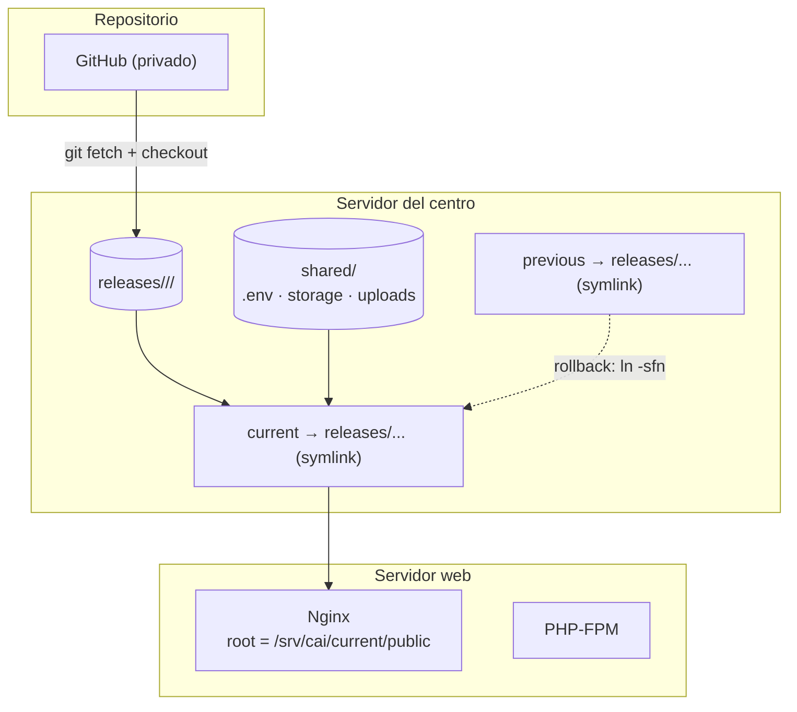
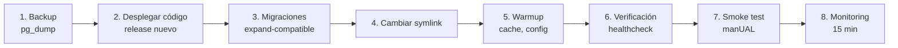
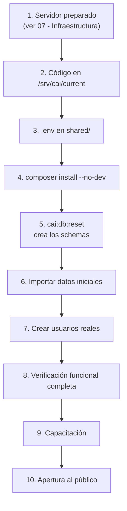

# Release y Deploy

> [!important] Principio
> El deploy se hace con **un comando**. Todo lo demás (backup, migraciones, symlink,
> verificación) ocurre dentro de ese comando, en orden, y con manejo de errores.
> Un deploy manual paso a paso es un deploy que algún día se hará mal.

---

## 1. Arquitectura de despliegue



### 1.1 Estructura de directorios

```text
/srv/cai/
├── current -> releases/2026.10.1/            # symlink al release activo
├── previous -> releases/2026.10.0/            # symlink al release anterior
├── releases/
│   ├── 2026.09.3/
│   ├── 2026.10.0/
│   └── 2026.10.1/
│       ├── core/identity/students/scheduling/care/billing/documents/notifications/reporting/
│       ├── app/
│       ├── config/
│       ├── database/
│       ├── public/
│       ├── resources/
│       ├── routes/
│       ├── vendor/
│       ├── artisan
│       ├── composer.json
│       ├── composer.lock
│       └── manifest.json                      # manifiesto del release
├── shared/
│   ├── .env                                   # Variables de entorno (única copia)
│   ├── storage/
│   │   ├── app/private/                       # Documentos (fuera del release)
│   │   ├── framework/cache/
│   │   ├── framework/sessions/
│   │   ├── framework/views/
│   │   └── logs/
│   └── uploads/                               # (alternativa a storage/app/private)
└── backups/
    ├── local/                                 # pg_dump diarios
    └── external/                              # copias ya cifradas y enviadas
```

**Reglas:**

| Regla | Detalle |
|---|---|
| Cada release es **autocontenido** | Tiene su propio `vendor/` y su propio código |
| `shared/` se comparte entre releases | `.env`, `storage/`, documentos |
| `current` es un symlink | Cambiar el symlink despliega |
| `previous` apunta al release anterior | Rollback en 1 comando |
| Los releases antiguos se conservan | Mínimo 5 |
| El release **nunca** se borra en caliente | Solo se purgan los que no son `current` ni `previous` y tienen más de 30 días |

---

## 2. El script de release

```bash
#!/usr/bin/env bash
# scripts/release.sh
set -Eeuo pipefail

APP_ROOT=/srv/cai
RELEASE_ID="$(date +%Y.%m.%d)-$(git -C "${APP_ROOT}/current" rev-parse --short HEAD)"
RELEASE_DIR="${APP_ROOT}/releases/${RELEASE_ID}"

log()  { printf '\033[0;36m[%s]\033[0m %s\n' "$(date +%H:%M:%S)" "$*"; }
fail() { printf '\033[0;31m[%s] ERROR: %s\033[0m\n' "$(date +%H:%M:%S)" "$*" >&2; exit 1; }

trap 'fail "Fallo en la línea $LINENO. Revisar ${RELEASE_DIR}"' ERR

log "1/8 Preparando el release ${RELEASE_ID}"
mkdir -p "${RELEASE_DIR}"

log "2/8 Obteniendo el código"
cd "${APP_ROOT}/current"
git fetch --all --tags --prune
git checkout --detach "$(git rev-list -n 1 HEAD)"
# En un repositorio de trabajo, se copia el árbol en vez de hacer checkout:
#   rsync -a --delete --exclude '.git' "${APP_ROOT}/current/" "${RELEASE_DIR}/"
rsync -a --exclude '.git' --exclude 'storage' --exclude '.env' "${APP_ROOT}/current/" "${RELEASE_DIR}/"

log "3/8 Instalando dependencias"
cd "${RELEASE_DIR}"
COMPOSER_MIRROR_PATH_REPOS=1 composer install \
    --no-dev --no-interaction --prefer-dist --optimize-autoloader --no-scripts

log "4/8 Preparando los enlaces compartidos"
ln -sfn "${APP_ROOT}/shared/.env"            "${RELEASE_DIR}/.env"
rm -rf "${RELEASE_DIR}/storage"
ln -sfn "${APP_ROOT}/shared/storage"         "${RELEASE_DIR}/storage"
mkdir -p "${APP_ROOT}/shared/storage/framework/{cache/data,sessions,views}" \
         "${APP_ROOT}/shared/storage/logs" \
         "${APP_ROOT}/shared/storage/app/private"
chmod -R 775 "${APP_ROOT}/shared/storage"
chmod -R 750 "${APP_ROOT}/shared/storage/app/private"

log "5/8 Generando el manifiesto"
php "${RELEASE_DIR}/artisan" cai:manifest:generate \
    --release="${RELEASE_ID}" --path="${RELEASE_DIR}" \
    || fail "No se pudo generar el manifiesto"

log "6/8 Ejecutando las migraciones"
php "${RELEASE_DIR}/artisan" migrate --force \
    || fail "Fallaron las migraciones. El release anterior sigue activo."

log "7/8 Cambiando el symlink"
ln -sfn "${RELEASE_DIR}" "${APP_ROOT}/current.new"
mv -Tf "${APP_ROOT}/current.new" "${APP_ROOT}/current"

log "8/8 Verificando"
php "${RELEASE_DIR}/artisan" cai:healthcheck --strict \
    || fail "Falló la verificación. Haciendo rollback automático."
php "${RELEASE_DIR}/artisan" optimize:clear

log "✅ Release ${RELEASE_ID} desplegado correctamente"
```

> [!important] `COMPOSER_MIRROR_PATH_REPOS=1`
> Esta variable hace que Composer **copie** los paquetes del monorepo en lugar de
> referenciarlos por ruta. Sin ella, cada release dependería de `packages/` en un lugar
> fijo y el release no sería autocontenido.

---

## 3. Orden del despliegue

El orden importa. Cada paso asume que el anterior terminó bien.



### 3.1 Healthcheck

```php
// packages/core/src/Console/Commands/HealthCheck.php
final class HealthCheck extends Command
{
    protected $signature = 'cai:healthcheck {--strict : Falla si algún chequeo no crítico falla}';

    public function handle(): int
    {
        $checks = [
            'base_de_datos'      => fn () => DB::select('SELECT 1') !== [],
            'migraciones'        => fn () => $this->pendingMigrations() === 0,
            'storage_escribible' => fn () => Storage::disk('local')->put('healthcheck.tmp', 'ok'),
            'app_key_presente'   => fn () => config('app.key') !== null && config('app.key') !== '',
            'permisos_cargados'  => fn () => Permission::count() > 0,
            'modulos_activos'    => fn () => $this->activeModules(),
        ];

        $failed = [];

        foreach ($checks as $name => $check) {
            try {
                $ok = $check();
                $this->components->twoColumnDetail($name, $ok ? '<fg=green>OK</>' : '<fg=yellow>WARN</>');
                if (! $ok) { $failed[] = $name; }
            } catch (\Throwable $e) {
                $this->components->twoColumnDetail($name, '<fg=red>ERROR</>');
                $failed[] = $name;
            }
        }

        if ($failed !== []) {
            $this->components->error('Fallaron: ' . implode(', ', $failed));
            return self::FAILURE;
        }

        return self::SUCCESS;
    }
}
```

### 3.2 Verificación manual (2 minutos)

Después de cada deploy, el dev (o Dirección, en los releases de riesgo) verifica:

| # | Verificación | Cómo |
|---|---|---|
| 1 | El panel carga | `https://cai.centro.local/panel` |
| 2 | Se puede iniciar sesión | Un usuario de prueba |
| 3 | La agenda del día se ve | Vista de agenda |
| 4 | Un alumno se abre | Ficha de un alumno |
| 5 | Un cobro se ve | Listado de cargos |
| 6 | Los logs no tienen errores nuevos | `tail -50 storage/logs/laravel.log` |

---

## 4. Despliegue de la primera vez (go-live)

La puesta en marcha inicial es distinta del flujo incremental.



**Detalle de los pasos 6 a 8:**

| Paso | Comando / acción | Verificación |
|---|---|---|
| 6. Importar datos | `php artisan cai:import:students --file=...` | Conteo de alumnos coincide con el planilla |
| 7. Usuarios reales | `php artisan cai:user:create --email=... --role=...` | Cada persona entra y cambia su contraseña |
| 8. Verificación | Checklist de [[10.01 Runbook Operativo]] | Todo verde |

> [!danger] El go-live es un día de operación real, no una instalación técnica
> La primera vez que se usa el sistema **para atender**, hay personal presente para
> resolver cualquier problema en el momento. Ver [[09.01 Manual de Dirección]].

---

## 5. Releases de riesgo

Un release se considera de **alto riesgo** si:

- Toca el módulo `care` (datos clínicos).
- Toca el módulo `billing` (integridad del dinero).
- Incluye una migración que modifica datos existentes.
- Incluye un cambio de permisos.
- Es el primer release después de un período largo sin releases.

**Protocolo para releases de alto riesgo:**

| # | Paso | Responsable |
|---|---|---|
| 1 | Backup verificado antes de empezar | Técnico |
| 2 | Desplegar en **staging** primero y verificar | Técnico |
| 3 | Ventana de mantenimiento anunciada (si aplica) | Dirección |
| 4 | Desplegar en producción con personal presente | Técnico + Dirección |
| 5 | Verificación manual completa | Técnico |
| 6 | Monitoreo intensivo 30 min | Técnico |
| 7 | Confirmación de Dirección | Dirección |

---

## 6. Despliegue sin downtime

El sistema **tolera downtime de minutos**, porque es un centro de atención con ~300
alumnos y no una plataforma 24/7. Aun así:

| Estrategia | Detalle |
|---|---|
| **Ventana de mantenimiento** | 5–15 min, anunciada por correo, para releases con migración pesada |
| **Sin ventana** | Releases de bajo riesgo: el symlink cambia en 1 segundo |
| **Recarga de PHP-FPM** | `reload` en vez de `restart`: no corta las requests en curso |

```bash
# Recarga suave de PHP-FPM (no corta las peticiones en curso)
sudo systemctl reload php8.3-fpm
```

> [!note] Por qué se tolera downtime
> El centro atiende en horario laboral. Un corte de 10 minutos un martes a las 11:00 es
> aceptable; la complejidad de un deploy sin downtime **no** se justifica para un sistema
> de esta escala con 1 dev part-time.

---

## 7. Programación de los deploys

| Regla | Detalle |
|---|---|
| **Nunca en horario de atención** | Martes a viernes: no entre 08:00 y 18:00 |
| **Preferido**: lunes por la mañana | El personal está y hay tiempo para revertir |
| **Nunca** el viernes a la tarde | Si sale mal, el fin de semana no hay soporte |
| **Nunca** en fechas críticas | Inicio de clases, Evaluaciones, cierre de mes financiero |
| **Frecuencia** | Máximo 1 release por semana; mínimo 1 cada 2 semanas |

---

## 8. Checklist de deploy

- [ ] La CI está verde en `main`
- [ ] El CHANGELOG del release se revisó
- [ ] Se verificó que no hay migraciones destructivas
- [ ] Backup tomado y **verificado**
- [ ] El release se desplegó en staging y se probó
- [ ] `cai:migrate --pretend` revisado
- [ ] Ventana de mantenimiento comunicada (si aplica)
- [ ] `scripts/release.sh` ejecutado
- [ ] Healthcheck OK
- [ ] Verificación manual de 6 puntos OK
- [ ] Logs sin errores nuevos
- [ ] `current` apunta al release nuevo
- [ ] `previous` apunta al release anterior
- [ ] Se documentó el release en el registro de releases

---

## 9. Registro de releases

```bash
# Ver los últimos releases
ls -lt /srv/cai/releases/

# Ver el manifiesto del release activo
cat /srv/cai/current/manifest.json | jq

# Ver los releases desplegados con su fecha
for d in /srv/cai/releases/*/; do
  printf "%s  %s\n" "$(jq -r .deployed_at "$d/manifest.json" 2>/dev/null)" "$(basename $d)"
done | sort -r
```

El manifiesto de cada release queda en disco **dentro del release**, de modo que el
histórico es verificable.

---

## 10. Documentos relacionados

- [[06.06 Procedimiento de Rollback]]
- [[06.07 Backups y Recuperación]]
- [[07.03 Instalación del Sistema]]
- [[07.04 Configuración de Entornos]]
- [[10.01 Runbook Operativo]]
- [[ADR-0005 Release por Symlink]]
