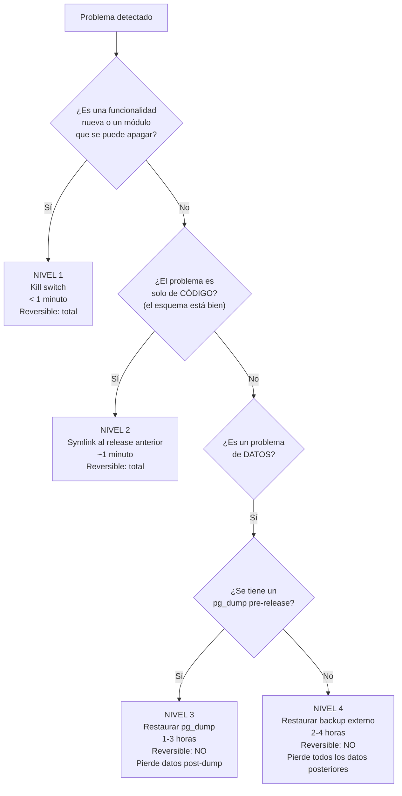
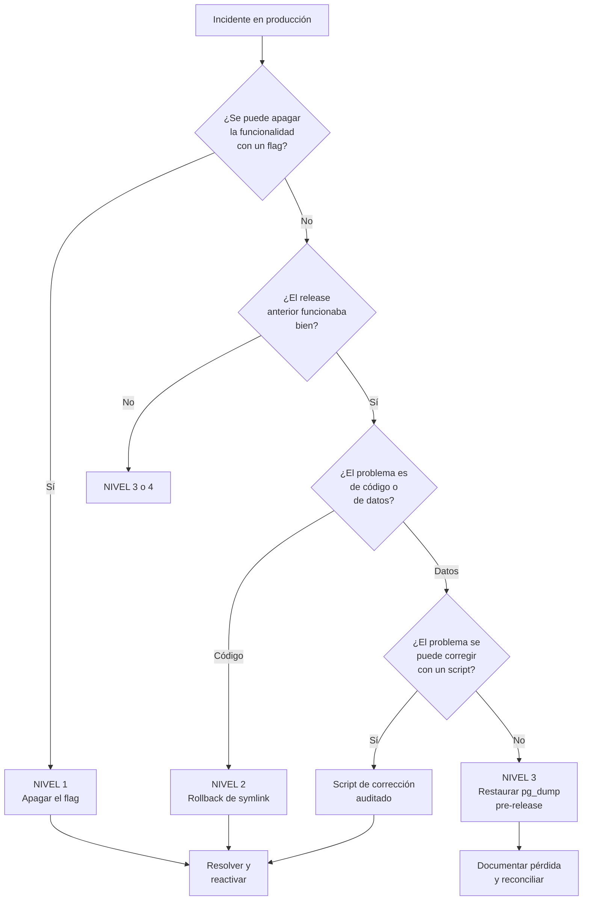

# Procedimiento de Rollback

> [!danger] La regla más importante de este documento
> **En producción NUNCA se ejecuta `migrate:rollback`.**
>
> Un rollback de migración puede perder datos escritos con el código nuevo. Los datos
> solo se restauran desde un `pg_dump` o desde un backup.

---

## 1. Los cuatro niveles



| Nivel | Mecanismo | Tiempo | Reversible | Pierde datos |
|---|---|---|---|---|
| **1** | Kill switch / feature flag | < 1 min | ✅ Sí | No |
| **2** | Symlink al release anterior | ~1 min | ✅ Sí | No |
| **3** | Restaurar `pg_dump` pre-release | 1–3 h | ❌ No | Sí (los posteriores al dump) |
| **4** | Restaurar backup externo cifrado | 2–4 h | ❌ No | Sí (todos los posteriores) |

> [!important] El 90% de los casos se resuelven con los niveles 1 y 2
> Los niveles 3 y 4 son para desastres. Cada vez que se llega a ellos, hay que hacer un
> **post-mortem** y preguntarse por qué no se resolvió antes.

---

## 2. Nivel 1 — Kill switch

**Cuándo usarlo:**

- Se detectó un acceso indebido a datos clínicos.
- Una funcionalidad nueva causa errores a usuarios.
- Un módulo específico se comporta mal.

**Procedimiento:**

```bash
# 1. Apagar el módulo (o la función)
php artisan cai:flag:disable module.care --reason="Acceso indebido en investigación" --user=<id>

# 2. Verificar que el apagado surtió efecto (puede tardar hasta 60 s por el caché)
curl -I https://cai.centro.local/panel/care/plans
# Esperado: HTTP 503

# 3. Verificar que el resto del sistema sigue funcionando
curl -I https://cai.centro.local/panel/students
# Esperado: HTTP 200
```

**Qué pasa y qué no:**

| Aspecto | Efecto |
|---|---|
| Los datos clínicos | **Intactos**. No se borra nada |
| La agenda, los alumnos, los pagos | **Siguen funcionando** |
| Las rutas del módulo | Devuelven 503 |
| Los jobs del módulo | No se despachan |
| La auditoría | Registra el cambio |

**Para reactivarlo:**

```bash
# Solo después de resolver la causa
php artisan cai:flag:enable module.care --user=<id>
```

Ver [[06.04 Feature Flags y Kill Switches]].

---

## 3. Nivel 2 — Rollback de código

**Cuándo usarlo:**

- Un bug afecta a un módulo que no se puede apagar.
- Un bug afecta a **todos** los módulos.
- El código nuevo tiene un error grave y el release anterior era correcto.

**Precondición:** el esquema actual es compatible con el release anterior. Eso es lo que
garantiza expand–contract (ver [[06.03 Expand-Contract]]).

### 3.1 Procedimiento

```bash
#!/usr/bin/env bash
# scripts/rollback.sh

set -Eeuo pipefail
APP_ROOT=/srv/cai

log() { printf '\033[0;33m[%s] %s\033[0m\n' "$(date +%H:%M:%S)" "$*"; }

CURRENT="$(readlink -f "${APP_ROOT}/current")"
TARGET="$(readlink -f "${APP_ROOT}/previous")"

if [ "${CURRENT}" = "${TARGET}" ]; then
    echo "No hay release anterior al que volver." >&2
    exit 1
fi

log "Release actual:  $(basename "${CURRENT}")"
log "Rollback a:      $(basename "${TARGET}")"

# 1. Verificar que el release anterior está completo
test -f "${TARGET}/artisan" || { echo "El release anterior está incompleto." >&2; exit 1; }
test -d "${TARGET}/vendor" || { echo "Falta vendor/ en el release anterior." >&2; exit 1; }

# 2. Poner el release anterior en maintenance
ln -sfn "${TARGET}" "${APP_ROOT}/maintenance"

# 3. Cambiar el symlink (atómico)
ln -sfn "${TARGET}" "${APP_ROOT}/current.new"
mv -Tf "${APP_ROOT}/current.new" "${APP_ROOT}/current"

# 4. Limpiar cachés
php "${APP_ROOT}/current/artisan" optimize:clear

# 5. Recargar PHP-FPM
sudo systemctl reload php8.3-fpm

# 6. Verificar
php "${APP_ROOT}/current/artisan" cai:healthcheck --strict

log "✅ Rollback completado a $(basename "${TARGET}")"
```

### 3.2 Verificación

```bash
# El symlink cambió
readlink -f /srv/cai/current

# El manifiesto muestra la versión anterior
cat /srv/cai/current/manifest.json | jq '.packages'

# La app responde
curl -s -o /dev/null -w '%{http_code}\n' https://cai.centro.local/panel
```

### 3.3 Qué NO se revierte

| Elemento | ¿Se revierte? | Por qué |
|---|---|---|
| El código PHP | ✅ Sí | Es el symlink |
| Las migraciones aplicadas | ❌ No | El esquema es compatible hacia atrás |
| Los feature flags | ❌ No | Se manejan aparte |
| Los datos escritos con el código nuevo | ❌ No | **Pueden tener un formato incompatible** |

> [!warning] El riesgo real del nivel 2
> Si el release nuevo escribió datos en un formato que el código viejo no entiende
> (por ejemplo, un campo JSON con una estructura nueva), el rollback de código **no
> basta**. Por eso las migraciones son expand–contract y los cambios de formato de
> datos se median con flags.

**Regla para cambios de formato de datos:**

> Un cambio que altera el **formato** de un dato existente debe:
> 1. Escribir en el formato nuevo **y** en el viejo (doble escritura).
> 2. Estar detrás de un feature flag.
> 3. Nunca eliminar el formato viejo en el mismo release.

---

## 4. Nivel 3 — Restauración de `pg_dump` pre-release

**Cuándo usarlo:**

- El bug **escribió datos incorrectos** en la base.
- Una migración cambió los datos de forma incorrecta.
- El rollback de código no resuelve el problema.

**⚠️ Advertencia fundamental:**

> Restaurar un dump **borra todos los datos escritos después del dump**. Si el dump es de
> las 08:00 y el deploy fue a las 10:00, se pierden 2 horas de operación real: notas
> clínicas, pagos, asistencias. **Ese costo es aceptable solo si los datos dañados son
> peores que los datos perdidos.**

### 4.1 Procedimiento

```bash
#!/usr/bin/env bash
# scripts/restore-from-dump.sh <ruta_del_dump>

set -Eeuo pipefail
APP_ROOT=/srv/cai
DUMP="$1"

test -f "${DUMP}" || { echo "No existe el dump: ${DUMP}" >&2; exit 1; }

echo "⚠️  ESTA OPERACIÓN BORRA LOS DATOS POSTERIORES AL DUMP."
echo "    Dump: ${DUMP} ($(du -h "${DUMP}" | cut -f1))"
read -p "    ¿Escriba CONFIRMAR para continuar: " ok
[ "${ok}" = "CONFIRMAR" ] || exit 1

# 1. Modo mantenimiento
touch "${APP_ROOT}/shared/storage/app/down"

# 2. Recrear los schemas
for schema in identity students scheduling care billing documents notifications reporting; do
    psql -d cai -c "DROP SCHEMA IF EXISTS ${schema} CASCADE"
    psql -d cai -c "CREATE SCHEMA ${schema}"
done

# 3. Restaurar
gunzip -c "${DUMP}" | psql -d cai -v ON_ERROR_STOP=1

# 4. Verificar
php "${APP_ROOT}/current/artisan" migrate:status
php "${APP_ROOT}/current/artisan" cai:healthcheck --strict

# 5. Salir de mantenimiento
rm -f "${APP_ROOT}/shared/storage/app/down"

echo "✅ Restauración completada. Los datos posteriores al dump se perdieron."
```

### 4.2 Reconciliación posterior

Después de restaurar, hay que **reconstruir** lo que se perdió:

| Dato perdido | Cómo se reconstruye |
|---|---|
| Notas clínicas | No se puede. **Se pierden.** Hay que avisar al responsable del plan |
| Pagos | Se reconstruye con los recibos en papel (si se guardaron) |
| Asistencias | Se reconstruye desde las planillas de la sesión |
| Cargos | Se regeneran por el job de facturación mensual |
| Auditoría | Se pierde el tramo post-dump |

> [!danger] Documentar la pérdida
> Todo rollback de nivel 3 o 4 genera un **registro de pérdida de datos** que se
> comunica a Dirección y, si aplica, a las familias afectadas.

---

## 5. Nivel 4 — Recuperación desde backup externo

**Cuándo usarlo:**

- El servidor se perdió (incendio, robo, fallo de hardware).
- El disco se corrompió.
- No hay ningún dump local utilizable.

Ver [[06.07 Backups y Recuperación]] y [[10.04 Recuperación ante Desastres]].

**RTO objetivo:** 4 horas. **RPO objetivo:** 24 horas (backup diario externo).

---

## 6. Árbol de decisión



---

## 7. Después de un rollback (obligatorio)

| # | Acción | Responsable |
|---|---|---|
| 1 | Registrar el incidente (qué, cuándo, causa) | Técnico |
| 2 | Comunicar a Dirección | Técnico |
| 3 | Verificar que el sistema está estable | Técnico |
| 4 | Documentar los datos perdidos (si hubo) | Técnico + Dirección |
| 5 | Identificar la causa raíz | Técnico |
| 6 | Crear el test de regresión | Técnico |
| 7 | Agregar la acción preventiva al backlog | Técnico |
| 8 | Actualizar este documento si el procedimiento falló | Técnico |

**Post-mortem en 5 días hábiles** (ver [[10.03 Gestión de Incidentes]]).

---

## 8. Kit de rollback

Todo lo necesario en un solo lugar, listo para usar:

```text
/srv/cai/scripts/
├── release.sh              # Desplegar
├── rollback.sh             # Nivel 2: rollback de código
├── restore-from-dump.sh    # Nivel 3: restaurar pg_dump
├── backup.sh               # Crear backup
├── healthcheck.sh          # Verificación rápida por consola
└── cai:flag:disable        # Nivel 1 (comando artisan)
```

**Comandos de emergencia memorizables:**

```bash
# 1. Apagar el módulo clínico
php /srv/cai/current/artisan cai:flag:disable module.care --reason="emergencia" --user=1

# 2. Rollback de código
/srv/cai/scripts/rollback.sh

# 3. Ver qué está desplegado
cat /srv/cai/current/manifest.json | jq

# 4. Logs
tail -100 /srv/cai/shared/storage/logs/laravel.log
tail -100 /var/log/nginx/access.log
```

---

## 9. Documentos relacionados

- [[06.04 Feature Flags y Kill Switches]]
- [[06.05 Release y Deploy]]
- [[06.07 Backups y Recuperación]]
- [[10.03 Gestión de Incidentes]]
- [[10.04 Recuperación ante Desastres]]
- [[04.07 Checklist Legal y Respuesta a Incidentes]]
