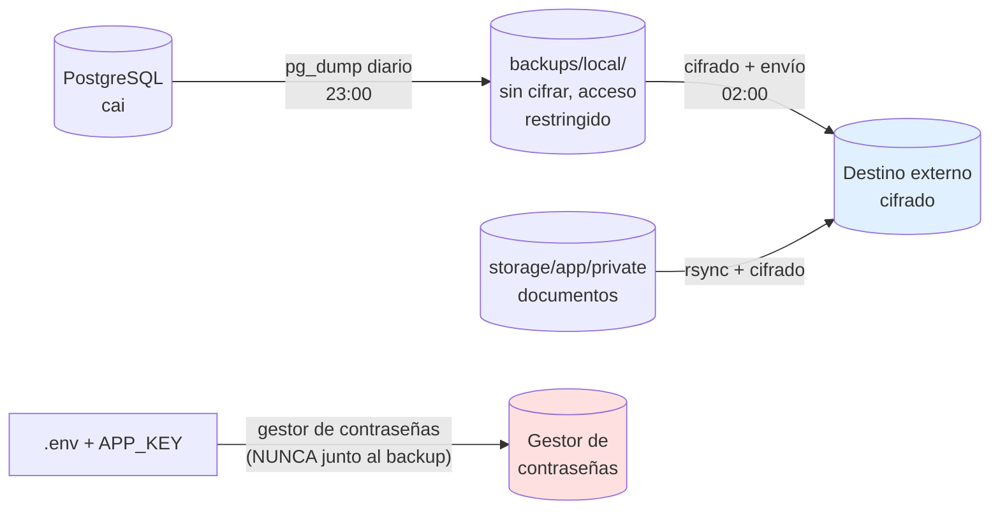

# Backups y Recuperación

> [!danger] El principio innegociable
> **Un backup que no se ha restaurado una vez, no es un backup. Es una suposición.**
>
> La verificación de restauración es tan importante como la creación del backup, y es la
> que más se posterga. La regla del proyecto: **se verifica mensualmente, de verdad**.

---

## 1. Estrategia de backups



| Nivel | Qué | Cuándo | Dónde | Cifrado | Retención |
|---|---|---|---|---|---|
| **L0 — Diario local** | Dump de la base | Todos los días 23:00 | `/srv/cai/backups/local/` | ❌ No (disco local) | 7 días |
| **L1 — Semanal** | Dump + documentos | Domingo 23:00 | `/srv/cai/backups/local/` | ❌ No | 4 semanas |
| **L2 — Externo** | Dump + documentos cifrados | Diario 02:00 | **Fuera del edificio** | ✅ Sí | 30 días |
| **L3 — Externo mensual** | Ídem | Mensual | **Otra ubicación** | ✅ Sí | 12 meses |
| **L4 — Claves** | `APP_KEY`, claves de cifrado | Al cambiar | Gestor de contraseñas | — | Permanente |

> [!danger] `APP_KEY` **nunca** va con el backup
> Si el backup está cifrado con una clave que está en el mismo lugar, el cifrado no
> aporta nada. La `APP_KEY` se guarda **solo** en el gestor de contraseñas del centro, en
> un lugar distinto al del backup. **Separación física de la clave.**

---

## 2. Los cuatro niveles de backup

### 2.1 L0 — Diario local

```bash
#!/usr/bin/env bash
# scripts/backup.sh
set -Eeuo pipefail

APP_ROOT=/srv/cai
BACKUP_DIR="${APP_ROOT}/backups/local"
STAMP="$(date +%Y%m%d_%H%M%S)"
DAY_OF_WEEK="$(date +%u)"

mkdir -p "${BACKUP_DIR}"
umask 077   # Solo el dueño puede leer

log() { printf '[%s] %s\n' "$(date +%H:%M:%S)" "$*"; }

log "Backup de la base de datos"
pg_dump -d cai --format=custom --compress=9 --no-owner \
    --file="${BACKUP_DIR}/cai_${STAMP}.dump"

log "Backup de los documentos"
tar -czf "${BACKUP_DIR}/documents_${STAMP}.tar.gz" \
    -C "${APP_ROOT}/shared/storage/app" private/

# Copia del esquema (para reconstruir sin datos)
pg_dump -d cai --schema-only --no-owner \
    --file="${BACKUP_DIR}/schema_${STAMP}.sql"

log "Verificando la integridad del dump"
if ! pg_restore --list "${BACKUP_DIR}/cai_${STAMP}.dump" > /dev/null; then
    log "❌ ERROR: el dump está corrupto"
    exit 1
fi

# Backups semanales (lunes)
if [ "${DAY_OF_WEEK}" = "1" ]; then
    cp "${BACKUP_DIR}/cai_${STAMP}.dump" "${BACKUP_DIR}/weekly_cai_${STAMP}.dump"
    cp "${BACKUP_DIR}/documents_${STAMP}.tar.gz" "${BACKUP_DIR}/weekly_documents_${STAMP}.tar.gz"
fi

# Limpieza: 7 días de diarios, 4 semanas de semanales
find "${BACKUP_DIR}" -maxdepth 1 -name 'cai_*.dump' -mtime +7 -delete
find "${BACKUP_DIR}" -maxdepth 1 -name 'documents_*.tar.gz' -mtime +7 -delete
find "${BACKUP_DIR}" -maxdepth 1 -name 'schema_*.sql' -mtime +7 -delete
find "${BACKUP_DIR}" -maxdepth 1 -name 'weekly_*' -mtime +28 -delete

log "✅ Backup completado: ${BACKUP_DIR}/cai_${STAMP}.dump"
```

### 2.2 L2 — Externo cifrado

```bash
#!/usr/bin/env bash
# scripts/backup-external.sh
set -Eeuo pipefail

APP_ROOT=/srv/cai
BACKUP_DIR="${APP_ROOT}/backups/local"
STAMP="$(date +%Y%m%d)"
DEST="${CAI_BACKUP_DESTINATION:-/mnt/backup-usb}"
KEY_FILE="${HOME}/.cai/backup.key"

umask 077

# El dump más reciente
LATEST="$(ls -t "${BACKUP_DIR}"/cai_*.dump | head -1)"
LATEST_DOCS="$(ls -t "${BACKUP_DIR}"/documents_*.tar.gz | head -1)"

log "Cifrando y enviando a ${DEST}"

# Cifrado con AES-256
openssl enc -aes-256-cbc -pbkdf2 -iter 200000 -salt \
    -in "${LATEST}" -out "${DEST}/cai_${STAMP}.dump.enc" \
    -pass "file:${KEY_FILE}"

openssl enc -aes-256-cbc -pbkdf2 -iter 200000 -salt \
    -in "${LATEST_DOCS}" -out "${DEST}/documents_${STAMP}.tar.gz.enc" \
    -pass "file:${KEY_FILE}"

# Checksum para verificar la integridad del transporte
sha256sum "${DEST}/cai_${STAMP}.dump.enc" > "${DEST}/cai_${STAMP}.dump.enc.sha256"
sha256sum "${DEST}/documents_${STAMP}.tar.gz.enc" > "${DEST}/documents_${STAMP}.tar.gz.enc.sha256"

log "Enviando al destino remoto (si aplica)"
# rsync -az --remove-source-files "${DEST}/" "${CAI_BACKUP_REMOTE}:/backups/cai/"

log "✅ Backup externo completado"
```

> [!warning] La clave del backup
> `~/.cai/backup.key` está en el servidor, pero **la copia de la clave está en el gestor de
> contraseñas**. Si el servidor se pierde, la clave se recupera del gestor. Si el gestor
> se pierde, se pierden los backups. **Por eso el gestor de contraseñas tiene su propio
> respaldo.**

---

## 3. Dumps separados por schema

> [!danger] Gotcha G2 — un dump único mezcla datos clínicos y financieros
> `pg_dump` sin `-n` incluye **todos** los schemas. Eso significa que:
> - El backup contiene notas clínicas cifradas **y** datos financieros en claro.
> - Para restaurar solo el módulo financiero, hay que restaurar todo.
> - Un backup que se filtra expone ambos mundos.
>
> **Solución:** dumps separados por schema.

```bash
# Dump solo de los schemas no clínicos (para una restauración parcial o para compartir)
pg_dump -d cai -n billing -n students -n identity --format=custom --file=cai_no_clinico.dump

# Dump solo del schema clínico (con cifrado reforzado, menos acceso)
pg_dump -d cai -n care --format=custom --file=cai_clinico.dump
```

**Política de dumps:**

| Schema | Dump separado | Quién puede acceder al archivo |
|---|---|---|
| `identity` | ✅ | Técnico, Dirección |
| `students` | ✅ | Técnico, Dirección, Secretaría |
| `scheduling` | ✅ | Técnico, Dirección |
| `care` | ✅ **Aparte** | Técnico, Dirección. **Nunca** se envía a terceros sin cifrado adicional |
| `billing` | ✅ | Técnico, Dirección, Finanzas |
| `documents` | ✅ (con los archivos) | Técnico, Dirección |
| `notifications` | ✅ | Técnico |
| `reporting` | ✅ | Técnico, Dirección |

---

## 4. Procedimiento de restauración

### 4.1 Restaurar un dump completo

```bash
# 1. Modo mantenimiento
touch /srv/cai/shared/storage/app/down

# 2. Recrear los schemas
for schema in identity students scheduling care billing documents notifications reporting; do
    psql -d cai -c "DROP SCHEMA IF EXISTS ${schema} CASCADE"
    psql -d cai -c "CREATE SCHEMA ${schema}"
done

# 3. Restaurar
pg_restore -d cai --no-owner --clean --if-exists /srv/cai/backups/local/cai_20261021_230000.dump

# 4. Verificar
php /srv/cai/current/artisan migrate:status
php /srv/cai/current/artisan cai:healthcheck --strict

# 5. Salir de mantenimiento
rm -f /srv/cai/shared/storage/app/down
```

### 4.2 Restaurar un schema individual

```bash
# Restaurar solo el módulo financiero
psql -d cai -c "DROP SCHEMA IF EXISTS billing CASCADE"
psql -d cai -c "CREATE SCHEMA billing"
pg_restore -d cai --no-owner /srv/cai/backups/local/billing_20261021.dump
```

### 4.3 Restaurar desde el backup externo

```bash
# 1. Copiar el backup cifrado al servidor
cp /mnt/backup-usb/cai_20261021.dump.enc /tmp/

# 2. Verificar el checksum
sha256sum -c /mnt/backup-usb/cai_20261021.dump.enc.sha256

# 3. Descifrar (la clave está en el gestor de contraseñas)
openssl enc -d -aes-256-cbc -pbkdf2 -iter 200000 \
    -in /tmp/cai_20261021.dump.enc -out /tmp/cai_20261021.dump \
    -pass "file:${HOME}/.cai/backup.key"

# 4. Verificar la integridad
pg_restore --list /tmp/cai_20261021.dump > /dev/null && echo "Dump OK"

# 5. Restaurar (ver 4.1)
```

---

## 5. Verificación de restauración (el paso que todos saltan)

> [!danger] Regla del proyecto
> **Se verifica una restauración completa al menos una vez por mes**, en un entorno
> separado, y **una vez por trimestre** se simula una pérdida total del servidor.

### 5.1 Verificación mensual

```bash
#!/usr/bin/env bash
# scripts/verify-backup.sh
set -Eeuo pipefail

BACKUP_DIR=/srv/cai/backups/local
TEST_DB=cai_restore_test

LATEST="$(ls -t "${BACKUP_DIR}"/cai_*.dump | head -1)"
echo "Verificando: ${LATEST}"

# 1. Recrear una base de prueba
dropdb --if-exists "${TEST_DB}"
createdb "${TEST_DB}"

# 2. Restaurar
if ! pg_restore -d "${TEST_DB}" --no-owner "${LATEST}" 2>/tmp/restore_errors.log; then
    echo "❌ La restauración falló:"
    cat /tmp/restore_errors.log
    exit 1
fi

# 3. Verificar el contenido
TABLES=$(psql -d "${TEST_DB}" -tAc "SELECT count(*) FROM information_schema.tables
    WHERE table_schema NOT IN ('pg_catalog','information_schema')")
STUDENTS=$(psql -d "${TEST_DB}" -tAc "SELECT count(*) FROM students.students")
NOTES=$(psql -d "${TEST_DB}" -tAc "SELECT count(*) FROM care.clinical_notes")

echo "Tablas: ${TABLES}, Alumnos: ${STUDENTS}, Notas: ${NOTES}"

if [ "${TABLES}" -lt 50 ]; then
    echo "❌ Sospechoso: pocas tablas. El backup puede estar incompleto."
    exit 1
fi

# 4. Limpiar
dropdb "${TEST_DB}"

echo "✅ Backup verificado: ${LATEST}"
```

**Criterios de aceptación:**

| # | Criterio |
|---|---|
| 1 | El `pg_restore` termina sin errores |
| 2 | El número de tablas es el esperado (> 50) |
| 3 | Hay alumnos, notas clínicas y cargos en la base restaurada |
| 4 | Las notas clínicas se **descifran correctamente** (se abre una en la app de prueba) |
| 5 | La base de prueba se elimina al terminar |

> [!important] El criterio 4 es el crítico
> Un backup que restaura la base pero donde las notas clínicas no se pueden descifrar
> (porque el `APP_KEY` cambió o no se restauró) es **un backup inútil** para el área más
> crítica del sistema.

### 5.2 Simulacro trimestral de pérdida total

| Paso | Acción | Tiempo |
|---|---|---|
| 1 | Clonar el servidor en una VM o equipo auxiliar | 30 min |
| 2 | Instalar el sistema desde cero siguiendo [[07.03 Instalación del Sistema]] | 60 min |
| 3 | Restaurar el backup externo cifrado | 30 min |
| 4 | Verificar que la app funciona | 30 min |
| 5 | Documentar el tiempo real y las dificultades | 30 min |
| **Total** | | **~3 h** |

---

## 6. Datos que NO están en el backup

| Dato | Dónde está | Consecuencia |
|---|---|---|
| `APP_KEY` | Gestor de contraseñas | Sin ella, las notas clínicas no se descifran |
| Clave de cifrado del backup | Gestor de contraseñas | Sin ella, el backup externo no se abre |
| Configuración de Nginx | Manual / repositorio de infraestructura | Se reconfigura |
| Logs de aplicación | Solo en disco | Se pierden |
| Documentos subidos después del último backup | — | Se pierden |

---

## 7. Cron del servidor

```cron
# /etc/cron.d/cai-backups
SHELL=/bin/bash
PATH=/usr/local/sbin:/usr/local/bin:/sbin:/bin:/usr/sbin:/usr/bin

# Backup local diario a las 23:00
0 23 * * *   root /srv/cai/scripts/backup.sh >> /var/log/cai-backup.log 2>&1

# Backup externo cifrado a las 02:00
0 2 * * *    root /srv/cai/scripts/backup-external.sh >> /var/log/cai-backup.log 2>&1

# Verificación de salud del sistema cada 5 minutos
*/5 * * * *  root /srv/cai/scripts/healthcheck.sh >> /var/log/cai-healthcheck.log 2>&1

# Limpieza de releases antiguos (los que no son current ni previous y tienen > 30 días)
15 4 * * 0   root /srv/cai/scripts/prune-releases.sh >> /var/log/cai-prune.log 2>&1

# Revocación de grants vencidos (job de Laravel)
30 4 * * *   root cd /srv/cai/current && php artisan schedule:run >> /var/log/cai-schedule.log 2>&1
```

> [!warning] Los backups son locales a un disco
> Si el servidor se pierde, los backups locales se pierden con él. **Por eso el backup
> externo es obligatorio, no opcional.** El destino externo está pendiente de definir
> (ver [[01.07 Preguntas Abiertas y Decisiones Pendientes]], P14).

---

## 8. Monitoreo de los backups

| Señal | Dónde | Acción si falla |
|---|---|---|
| El log de backup termina con error | `/var/log/cai-backup.log` | Revisar manualmente |
| No hay dump nuevo en 26 horas | Verificación de archivo | Ejecutar el backup a mano e investigar |
| El archivo externo no existe | Verificación de archivo | Reintentar |
| El checksum no coincide | Verificación de transporte | Rehacer el backup |
| La verificación mensual falló | Log del script | **Escalar a Dirección** |

```bash
# Verificación en el healthcheck diario
LATEST=$(find /srv/cai/backups/local -name 'cai_*.dump' -mtime -1 | head -1)
if [ -z "${LATEST}" ]; then
    echo "ALERTA: no hay backup de la base en las últimas 24 h"
    # Notificar a Dirección
fi
```

---

## 9. Checklist mensual de backups

- [ ] Se ejecutó el backup diario todos los días (revisar el log)
- [ ] Se ejecutó la **verificación de restauración** (`verify-backup.sh`)
- [ ] La base de prueba tenía los conteos esperados
- [ ] **Una nota clínica se pudo descifrar** en la base restaurada
- [ ] El backup externo está presente en el destino y con checksum válido
- [ ] El destino externo es accesible y hay espacio
- [ ] Se revisó el tamaño del backup (crece de forma razonable)
- [ ] La clave de cifrado sigue accesible desde el gestor de contraseñas
- [ ] Se documentó el resultado en el acta

---

## 10. Documentos relacionados

- [[06.06 Procedimiento de Rollback]]
- [[10.04 Recuperación ante Desastres]]
- [[07.05 Configuración de PostgreSQL]]
- [[01.07 Preguntas Abiertas y Decisiones Pendientes]]
- [[ADR-0010 Backups Externos Cifrados]]
