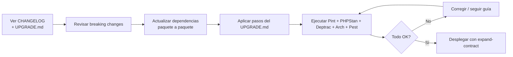

# Guía de Actualización

> [!important] Principio
> **Actualizar con seguridad, no reescribir todo de golpe.**
> El objetivo es poder subir de versión sin sorpresas, paso a paso, con ruta clara.

---

## 1. Filosofía: Evolutivo, no revolucionario

| Idea | Aplicación |
|---|---|
| **Añadir antes que romper** | Si puedo añadir un método nuevo al contrato, lo hago. No cambio la firma del existente. |
| **Compatibilidad por defecto** | El código nuevo convive con el viejo durante un tiempo razonable. |
| **Migrar por etapas** | Mejor 3 despliegues pequeños y seguros, que 1 despliegue grande e inseguro. |
| **Todo con aviso** | Si algo va a desaparecer, se marca `@deprecated` con la versión en la que se retirará. |
| **Despliegue reversible** | Si algo falla al actualizar, debe poder volver atrás con el procedimiento de rollback. |

---

## 2. Cuándo requiere guía de actualización

| Tipo de cambio | ¿Requiere `UPGRADE.md`? | Notas |
|---|---|---|
| **PATCH** (`x.y.Z`) | No | Correcciones, sin impacto. |
| **MINOR** (`x.Y.z`) | Opcional | Solo si hay pasos manuales poco evidentes. |
| **MAJOR** (`X.y.z`) | **Sí, obligatorio** | Siempre. Debe ir en `packages/<paquete>/UPGRADE.md` o en el `UPGRADE.md` general. |
| **Cambio en contrato cross-módulo** | **Sí** | Aunque sea menor, si obliga a actualizar otro paquete hay que avisarlo. |
| **Cambio en evento con payload incompatible** | **Sí** | Ver [[02.08 Eventos de Dominio]] §5. |

---

## 3. Estrategia por tipo de cambio

### 3.1 Contratos (`Contracts/`)

**Regla:** *aditivo, nunca destructivo*.

```php
<?php

declare(strict_types=1);

namespace Cai\Students\Contracts;

interface StudentDirectory
{
    public function find(int $id): ?StudentSummary;

    /**
     * @since 1.4.0
     */
    public function findByCode(string $code): ?StudentSummary;

    /**
     * @deprecated since 1.4.0, will be removed in 2.0.0. Use findByCode() instead.
     * @see self::findByCode()
     */
    public function getByLegacyCode(string $code): ?StudentSummary;
}
```

**Pasos:**

1. **Añadir** el nuevo método / nueva interfaz
2. **Deprecar** el antiguo con `@deprecated` + referencia al nuevo
3. **Migrar** consumidores uno a uno
4. **Retirar** solo en `MAJOR` con guía de actualización

### 3.2 Base de datos

Seguir **siempre** `expand -> migrate -> contract`.

| Fase | Acción | Ejemplo |
|---|---|---|
| **EXPAND** | Añadir columna/tabla nueva. Código viejo sigue funcionando. | Añadir `email_verified_at` nullable |
| **MIGRATE** | Rellenar datos, actualizar código para usar lo nuevo. Ambos conviven. | Backfill + cambiar lecturas/escrituras |
| **CONTRACT** | Eliminar lo antiguo. Solo cuando **todo** el código deje de usarlo. | Quitar columna vieja tras despliegue estable |

> [!warning] Nunca
> `ALTER TABLE ... DROP COLUMN`, `RENAME TABLE`, `RENAME COLUMN` o cambiar tipo en el **mismo** despliegue que elimina el uso.

### 3.3 Eventos de dominio

- **Payload compatible**: Añadir campos opcionales → `MINOR`
- **Payload incompatible**: Crear `EventoV2`, mantener `EventoV1` activo → desplegar consumidores → retirar `EventoV1` en `MAJOR`
- **Siempre** `ShouldDispatchAfterCommit`
- **Sin datos clínicos** en eventos ajenos a `care`

Ver [[02.08 Eventos de Dominio]] para el detalle.

### 3.4 Permisos y roles

| Cambio | Versión | Acción |
|---|---|---|
| **Añadir permiso nuevo** | `MINOR` | Añadir al seed idempotente. No romper nada existente. |
| **Renombrar permiso** | `MAJOR` | Crear nuevo, mapear, migrar roles, deprecar viejo, retirar tras migración. |
| **Quitar permiso** | `MAJOR` | Verificar que ningún Policy/Resource lo use antes de retirar. |

### 3.5 Feature Flags

Usar para separar **desplegar** de **activar**.

```php
// Ejemplo: activar funcionalidad nueva sin forzar migración masiva
if (Feature::active('billing.improved-allocation')) {
    return app(NewAllocator::class)->allocate($payment);
}

return app(LegacyAllocator::class)->allocate($payment);
```

**Reglas:**

- Crear flag antes de escribir código nuevo
- Mantener **ambos caminos** mientras se migra
- Limpiar flag + camino legacy en el `MAJOR` correspondiente
- Flags temporales, **no permanentes**

---

## 4. Estructura del `UPGRADE.md`

Cada paquete con cambio `MAJOR` debe tener `packages/<paquete>/UPGRADE.md` con esta estructura:

```markdown
# Upgrade guide: cai/<paquete> vX.Y.Z -> v(X+1).0.0

## Resumen
Breve explicación del motivo del cambio.

## Requisitos
Qué versión mínima de otros paquetes se necesita.

## Pasos obligatorios
1. ...
2. ...

## Código a actualizar
Ejemplos con "antes/después".

## Checklist
- [ ] He actualizado imports
- [ ] He migrado llamadas al contrato
- [ ] He actualizado tests
- [ ] He revisado eventos
- [ ] He aplicado migraciones en orden correcto

## Notas
Advertencias, gotchas o cosas a tener en cuenta.

## Rollback
Cómo volver si algo falla.
```

Si el cambio afecta a **varios paquetes**, se crea/actualiza `UPGRADE.md` a nivel raíz con el resumen general.

---

## 5. Flujo al actualizar



---

## 6. Checklist para quien publica un `MAJOR`

- [ ] **Deprecado antes**: Todo lo que se retira lleva `@deprecated` desde al menos 2 `MINOR`
- [ ] **Adición primero**: Se añadió alternativa compatible antes de romper
- [ ] **UPGRADE.md creado/actualizado** con pasos claros y ejemplos
- [ ] **CHANGELOG** con sección `BREAKING CHANGES` bien explicada
- [ ] **Migraciones expand-contract** correctas
- [ ] **Eventos versionados** si aplica
- [ ] **Arch tests pasan** (incluidas fronteras)
- [ ] **Deptrac pasa** sin relajar reglas
- [ ] **Plan de rollback** considerado
- [ ] **Comunicado claro** en el PR de release

---

## 7. Checklist para quien actualiza

- [ ] **Leo** `CHANGELOG.md` y `UPGRADE.md` del paquete
- [ ] **Busco** usos de APIs marcadas `@deprecated` (`grep` rápido)
- [ ] **Actualizo** imports/llamadas siguiendo la guía
- [ ] **Ejecuto** tests localmente
- [ ] **Aplico** migraciones en el orden indicado
- [ ] **Verifico** con `bin/validate-vault.php` si toco documentación
- [ ] **Despliego** con cuidado, teniendo el release anterior listo para rollback

---

## 8. Documentos relacionados

- [[06.01 Estrategia de Versionado]]
- [[05.02 Commits, Ramas y Versionado SemVer]]
- [[06.03 Expand-Contract]]
- [[06.06 Procedimiento de Rollback]]
- [[06.07 Backups y Recuperación]]
- [[02.03 Reglas de Frontera entre Módulos]]
- [[02.08 Eventos de Dominio]]
- [[05.07 Gobierno del Cambio]]
- [[ADR-0004 Trunk-based con Tags SemVer]]
