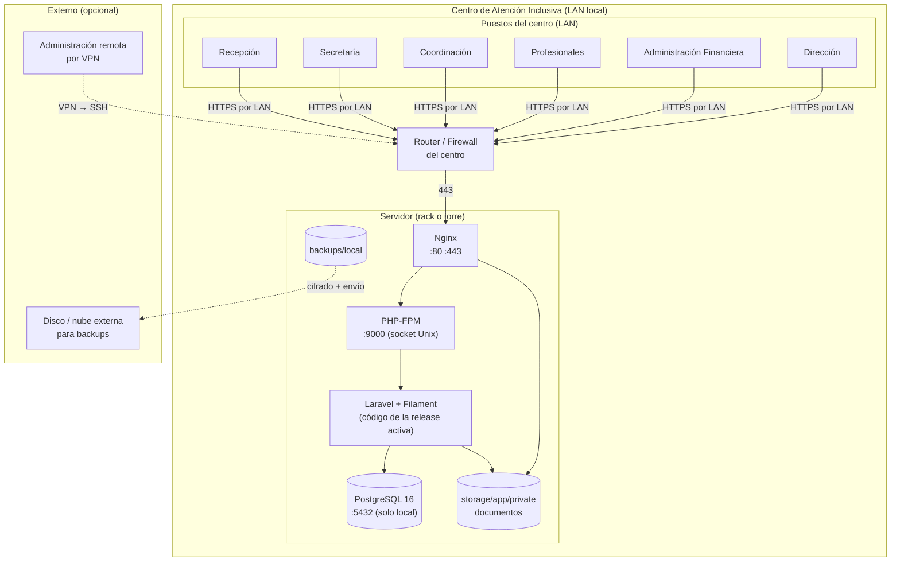
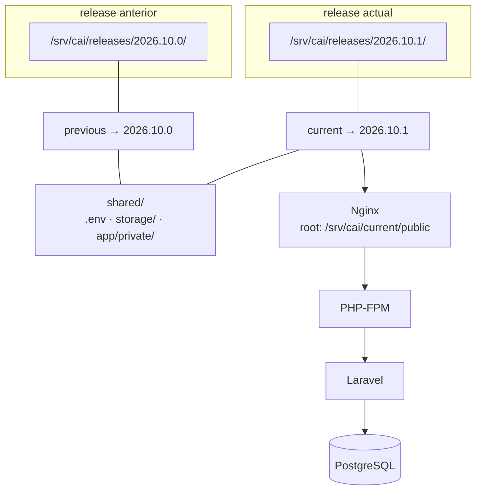

# Arquitectura del Servidor del Centro

> [!important] La decisión de fondo
> El sistema vive **en un servidor propio, dentro del centro**. No hay dependencia de
> internet para operar: si se corta la conexión, el centro sigue atendiendo.
>
> Esto tiene un costo (hay que mantener el equipo) y una ventaja enorme (control total de
> los datos de menores, sin terceros en el medio, sin costos de nube crecientes).

---

## 1. Vista general



---

## 2. Componentes del servidor

| Componente | Versión | Puerto | Rol |
|---|---|---|---|
| **Sistema operativo** | Ubuntu Server 24.04 LTS | — | Base del sistema |
| **Nginx** | 1.24+ | 80, 443 | Servidor web, TLS, proxy a PHP-FPM |
| **PHP-FPM** | 8.3 | socket Unix | Ejecuta la aplicación |
| **PostgreSQL** | 16 | 5432 (solo local) | Base de datos |
| **Composer** | 2.7 | — | Gestión de dependencias (solo en deploy) |
| **Git** | 2.43 | — | Obtención del código (solo en deploy) |
| **Certbot** | — | — | Emisión/renovación de certificados |
| **Rsync** | — | — | Copias de documentos y backups |
| **OpenSSL** | — | — | Cifrado de backups |
| **UFW** | — | — | Firewall |
| **fail2ban** | — | — | Protección contra fuerza bruta |

**No se usa:**

| Componente | Motivo |
|---|---|
| Redis | No hay necesidad a esta escala (ADR-0009). El caché va a la base de datos o a archivo |
| Docker / Docker Compose | Un solo servidor, un solo servicio. Docker agrega complejidad operativa sin beneficio |
| Apache | Nginx es más liviano y suficiente |
| Node.js / Next.js | Fuera del MVP. El portal familiar es etapa 2 |
| Sentry / servicios SaaS | El servidor es local; el monitoreo es interno |

---

## 3. Procesos y puertos

| Proceso | Puerto | Expuesto a | Gestión |
|---|---|---|---|
| `nginx` | 80, 443 | Red local (opcionalmente internet) | `systemctl` |
| `php8.3-fpm` | socket Unix | Solo Nginx | `systemctl` |
| `postgresql` | 5432 | **Solo localhost** | `systemctl` |
| `sshd` | 22 | Solo por VPN o red local | `systemctl` |
| `cron` | — | — | `systemctl` + `/etc/cron.d/` |
| `certbot` | — | — | Timer de systemd |

```bash
# Verificación de los puertos abiertos
sudo ss -ltnp
```

**Resultado esperado:**

```
LISTEN  0  511  0.0.0.0:80        0.0.0.0:*  users:(("nginx",pid=1,fd=6))
LISTEN  0  511  0.0.0.0:443       0.0.0.0:*  users:(("nginx",pid=1,fd=7))
LISTEN  0  128  127.0.0.1:5432    0.0.0.0:*  users:(("postgres",pid=900,fd=7))
LISTEN  0  128  0.0.0.0:22        0.0.0.0:*  users:(("sshd",pid=800,fd=3))
```

> [!danger] PostgreSQL nunca escucha en `0.0.0.0`
> En `postgresql.conf`: `listen_addresses = 'localhost'`. Y en `pg_hba.conf`, la única
> entrada de red es `host all all 127.0.0.1/32 scram-sha-256`.

---

## 4. Almacenamiento

| Ruta | Contenido | Permisos | Backup |
|---|---|---|---|
| `/srv/cai/releases/` | Releases del código | 755 | No (se re-descargan) |
| `/srv/cai/current` | Symlink al release activo | 777 (symlink) | No |
| `/srv/cai/shared/.env` | Configuración | **600** | **No** (está en el gestor de contraseñas) |
| `/srv/cai/shared/storage/` | Logs, caché, sesiones | 775 | Parcial |
| `/srv/cai/shared/storage/app/private/` | **Documentos** | **750** | ✅ Sí |
| `/srv/cai/backups/local/` | Dumps y archivos | **700** | → Externo cifrado |
| `/var/log/nginx/` | Logs de acceso y error | 640 | No (rotación 90 días) |
| `/var/log/cai-*.log` | Logs de los scripts | 640 | No |

**El único directorio con datos sensibles en claro en disco es `storage/app/private`.**
Por eso el disco del servidor debe estar cifrado (ver §6).

---

## 5. Usuarios del sistema

| Usuario | Propósito | Acceso SSH | Shell |
|---|---|---|---|
| `cai` | Dueño del código y los releases | ✅ Con clave | `bash` |
| `postgres` | Base de datos | ❌ | `bash` (solo local) |
| `www-data` | Ejecuta PHP-FPM | ❌ | `/usr/sbin/nologin` |
| `deploy` | Cuenta de despliegue (opcional) | ✅ Con clave, **limitado a un comando** | `bash` |

**Regla:** el día a día se usa `cai`. El `root` se usa solo para instalar paquetes y
configurar el sistema. No hay login de root por SSH:

```bash
# /etc/ssh/sshd_config
PermitRootLogin no
PasswordAuthentication no
PubkeyAuthentication yes
AllowUsers cai
```

---

## 6. Cifrado del disco

> [!important] Por qué
> El servidor está en el centro. Si el equipo se roba, el disco tiene:
> - La base de datos con datos financieros en claro.
> - Los documentos subidos (evaluaciones, informes).
> - Los logs.
>
> Con el disco cifrado (LUKS), sin la clave de arranque, no se lee nada.

| Aspecto | Decisión |
|---|---|
| Cifrado | LUKS2 con AES-256-XTS |
| ¿Se hace en el MVP? | ⚠️ **Depende del hardware** (ver [[01.07 Preguntas Abiertas y Decisiones Pendientes]], P16) |
| Alternativa si no hay LUKS | Cifrado del **volumen de datos** con `cryptsetup` en un disco aparte |
| Clave de LUKS | En la TPM si el hardware la soporta, si no, en un gestor de contraseñas |
| Swap | **Cifrado o desactivado** (`swapoff -a`) |

> [!note] Prioridad
> La prioridad real es: **el contenido clínico está cifrado en la aplicación** (AES-256-GCM
> por nota), que es independiente del cifrado del disco. El cifrado del disco protege
> los documentos y los datos financieros, que en el MVP no están cifrados a nivel de
> columna.

---

## 7. Bandeja (rack) y energía

| Elemento | Recomendación | Motivo |
|---|---|---|
| **UPS** | Sí, mínimo 600 VA | Corta la energía sin corromper la base. Ver P18 |
| **Rack** | Opcional | Un rack de 9U con ventilación |
| **Regleta con UPS** | Sí | El servidor + el switch + el router |
| **Tierra física** | Verificar | Instalación eléctrica del centro |
| **Ventilación** | Verificar | Una torre en un escritorio cerrado se sobrecalienta |

**Configuración de PostgreSQL para corte de energía:**

```ini
# postgresql.conf
fsync = on                    # Nunca desactivar
synchronous_commit = on        # Commit durability
wal_level = replica
max_wal_size = 2GB
checkpoint_timeout = 15min
```

---

## 8. Conectividad a internet

| Escenario | Comportamiento del sistema |
|---|---|
| **Sin internet** | ✅ El sistema funciona completo. Es la razón del diseño on-premise |
| **Con internet** | El sistema sigue funcionando. Solo se usan servicios externos opcionales (email) |
| **Internet intermitente** | No afecta al sistema. El email de las familias puede retrasarse (ver §9) |

**Servicios que sí necesitan internet:**

| Servicio | Para qué | Qué pasa si no hay internet |
|---|---|---|
| **SMTP saliente** | Avisos a las familias | Los mensajes quedan en cola y se envían al reconectar |
| **Let's Encrypt** (certbot) | Renovación del certificado TLS | El certificado actual sigue válido 90 días. Hay que renewear con internet |
| **Administración remota** | Soporte | Se trabaja por teléfono o presencialmente |
| **Backup externo** | Copia fuera del edificio | Los backups locales siguen; el externo se reanuda |

> [!important] El sistema no depende de internet
> Esta es una decisión de diseño, no una casualidad. La prioridad es que el centro pueda
> atender un martes cualquiera aunque el proveedor de internet esté caído.

---

## 9. Correo saliente

El envío de emails usa SMTP. Opciones:

| Opción | Costo | Configuración | Recomendación |
|---|---|---|---|
| **SMTP del ISP del centro** | Incluido |986 | ✅ **Primera opción** |
| Servicio transaccional (Mailgun, SendGrid…) | US$ 15–50/mes | API | Solo si el ISP limita el envío |
| `msmtp` local → relay | Incluido | Media | Alternativa |

```ini
# .env
MAIL_MAILER=smtp
MAIL_HOST=smtp.isp.com
MAIL_PORT=587
MAIL_USERNAME=cai@centro.local
MAIL_PASSWORD=***            # en el gestor de contraseñas
MAIL_ENCRYPTION=tls
MAIL_FROM_ADDRESS="Centro de Atención Inclusiva <cai@centro.local>"
```

**Restricción importante:** el sistema **no envía emails a las familias con contenido
clínico**. Ver [[04.06 Consentimientos y Privacidad]].

---

## 10. Diagrama de despliegue



**Cambiar de release = cambiar el symlink.** Ver [[06.05 Release y Deploy]].

---

## 11. Estimación de recursos con 300 alumnos

| Recurso | Consumo estimado | Justificación |
|---|---|---|
| **CPU** | ~1 núcleo en uso normal | 300 alumnos, ~30 usuarios concurrentes máximo |
| **RAM** | ~2 GB | PostgreSQL (~1 GB) + PHP-FPM (4 workers × 128 MB) + sistema (~400 MB) |
| **Disco** | ~100 GB SSD | Base ~5 GB + backups ~20 GB + documentos ~30 GB + releases ~5 GB + logs ~10 GB |
| **Ancho de banda** | ~1 Mbps sostenidos | Uso interno; el tráfico es mínimo |
| **Uptime** | 99% | El centro puede operar unos minutos sin sistema |

Ver [[07.02 Requisitos de Hardware y Software]].

---

## 12. Documentos relacionados

- [[07.02 Requisitos de Hardware y Software]]
- [[07.03 Instalación del Sistema]]
- [[07.04 Configuración de Entornos]]
- [[07.05 Configuración de PostgreSQL]]
- [[07.06 Red, HTTPS y VPN]]
- [[07.07 Monitoreo y Mantenimiento]]
- [[06.05 Release y Deploy]]
- [[10.04 Recuperación ante Desastres]]
