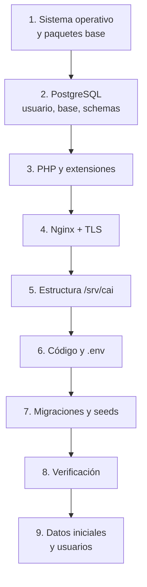

# Instalación del Sistema

> [!important] Alcance
> Este documento cubre la **instalación en el servidor del centro** (producción) y, en
> apéndice, la instalación para desarrollo local. Asume un Ubuntu Server 24.04 LTS ya
> instalado y con acceso `sudo`.

---

## 1. Panorama de la instalación



**Tiempo estimado:** 3–4 horas para la instalación completa, más 2 horas para la carga de
datos iniciales y la capacitación.

---

## 2. Paso 1 — Sistema operativo y paquetes base

```bash
# Actualizar
sudo apt update && sudo apt upgrade -y

# Zona horaria y locale
sudo timedatectl set-timezone America/Asuncion
sudo locale-gen es_PY.UTF-8
sudo update-locale LANG=es_PY.UTF-8 LC_ALL=es_PY.UTF-8

# Crear el usuario de servicio
sudo adduser --disabled-password --gecos "Sistema CAI" cai
sudo usermod -aG sudo cai

# Directorios base
sudo mkdir -p /srv/cai/{releases,shared,backups/local,scripts}
sudo mkdir -p /srv/cai/shared/storage/{app/private,framework/{cache/data,sessions,views},logs}
sudo chown -R cai:cai /srv/cai
sudo chmod 750 /srv/cai/shared/storage/app/private
```

---

## 3. Paso 2 — PostgreSQL

```bash
sudo apt install -y postgresql-16 postgresql-client-16

# Crear el rol de la aplicación
sudo -u postgres psql <<'SQL'
CREATE ROLE cai WITH LOGIN PASSWORD 'CAMBIAR_ESTA_CLAVE';
ALTER ROLE cai SET search_path TO public;
SQL

# Crear la base
sudo -u postgres createdb -O cai cai

# Configuración
sudo nano /etc/postgresql/16/main/postgresql.conf
```

```ini
# /etc/postgresql/16/main/postgresql.conf
listen_addresses = 'localhost'
port = 5432
max_connections = 100
shared_buffers = 512MB
effective_cache_size = 2GB
work_mem = 16MB
maintenance_work_mem = 128MB

# Durabilidad (importante para el UPS)
fsync = on
synchronous_commit = on
full_page_writes = on

# WAL (necesario para PITR y para backups consistentes)
wal_level = replica
archive_mode = on
archive_command = 'test ! -f /srv/cai/backups/wal/%f && cp %p /srv/cai/backups/wal/%f'
max_wal_size = 2GB
min_wal_size = 128MB
checkpoint_timeout = 15min
checkpoint_completion_target = 0.9

# Locale
lc_messages = 'es_PY.UTF-8'
lc_monetary = 'es_PY.UTF-8'
lc_numeric = 'es_PY.UTF-8'
lc_time = 'es_PY.UTF-8'
default_text_search_config = 'pg_catalog.spanish'
```

```bash
# pg_hba.conf — solo local
sudo nano /etc/postgresql/16/main/pg_hba.conf
```

```ini
# TYPE  DATABASE  USER  ADDRESS         METHOD
local   all       all                   peer
host    all       all   127.0.0.1/32    scram-sha-256
host    all       all   ::1/128         scram-sha-256
# host all all 0.0.0.0/0 scram-sha-256   ← NUNCA
```

```bash
sudo mkdir -p /srv/cai/backups/wal
sudo chown postgres:postgres /srv/cai/backups/wal
sudo systemctl restart postgresql
sudo systemctl enable postgresql

# Verificar
sudo -u postgres psql -c "SELECT version();"
```

---

## 4. Paso 3 — PHP

```bash
sudo apt install -y \
    php8.3-fpm php8.3-cli php8.3-common \
    php8.3-pgsql php8.3-mbstring php8.3-xml php8.3-intl \
    php8.3-zip php8.3-curl php8.3-bcmath php8.3-gd \
    php8.3-sodium

# Verificar bcmath (CRÍTICO)
php -m | grep bcmath || echo "❌ FALTA bcmath"

# Configuración de PHP-FPM
sudo nano /etc/php/8.3/fpm/php.ini
```

```ini
; /etc/php/8.3/fpm/php.ini
memory_limit = 512M
upload_max_filesize = 20M
post_max_size = 24M
max_execution_time = 120
max_input_vars = 3000
date.timezone = America/Asuncion
expose_php = Off
session.cookie_httponly = 1
session.cookie_secure = 1
session.cookie_samesite = Lax
session.use_strict_mode = 1
session.gc_maxlifetime = 28800
```

```ini
; /etc/php/8.3/fpm/pool.d/cai.conf
[cai]
user = www-data
group = www-data
listen = /run/php/php8.3-fpm-cai.sock
listen.owner = www-data
listen.group = www-data
listen.mode = 0660

pm = dynamic
pm.max_children = 12
pm.start_servers = 3
pm.min_spare_servers = 2
pm.max_spare_servers = 5
pm.max_requests = 500

php_admin_value[error_log] = /srv/cai/shared/storage/logs/php-fpm.log
php_admin_flag[log_errors] = on
php_admin_value[display_errors] = off
```

```bash
sudo mkdir -p /run/php
sudo systemctl restart php8.3-fpm
sudo systemctl enable php8.3-fpm
```

---

## 5. Paso 4 — Nginx y TLS

### 5.1 Configuración del sitio

```nginx
# /etc/nginx/sites-available/cai
server {
    listen 80;
    listen [::]:80;
    server_name cai.centro.local;

    # Para la emisión del certificado (Let's Encrypt)
    location /.well-known/acme-challenge/ {
        root /var/www/html;
    }

    location / {
        return 301 https://$host$request_uri;
    }
}

server {
    listen 443 ssl http2;
    listen [::]:443 ssl http2;
    server_name cai.centro.local;

    root /srv/cai/current/public;
    index index.php;

    ssl_certificate     /etc/letsencrypt/live/cai.centro.local/fullchain.pem;
    ssl_certificate_key /etc/letsencrypt/live/cai.centro.local/privkey.pem;
    ssl_protocols       TLSv1.2 TLSv1.3;
    ssl_prefer_server_ciphers off;
    ssl_ciphers         ECDHE-ECDSA-AES128-GCM-SHA256:ECDHE-RSA-AES128-GCM-SHA256:ECDHE-ECDSA-AES256-GCM-SHA384:ECDHE-RSA-AES256-GCM-SHA384;
    ssl_session_cache   shared:SSL:10m;
    ssl_session_timeout 1d;
    ssl_stapling on;
    ssl_stapling_verify on;

    add_header Strict-Transport-Security "max-age=31536000; includeSubDomains" always;
    add_header X-Content-Type-Options "nosniff" always;
    add_header X-Frame-Options "SAMEORIGIN" always;
    add_header Referrer-Policy "strict-origin-when-cross-origin" always;
    add_header Permissions-Policy "geolocation=(), microphone=(), camera=()" always;
    add_header Content-Security-Policy "default-src 'self'; script-src 'self' 'unsafe-inline'; style-src 'self' 'unsafe-inline'; img-src 'self' data: blob:; font-src 'self' data:; connect-src 'self'; frame-ancestors 'self';" always;

    client_max_body_size 24M;

    access_log /var/log/nginx/cai-access.log;
    error_log  /var/log/nginx/cai-error.log;

    # Archivos ocultos y la raíz
    location ~ /\. { deny all; }
    location = /favicon.ico { access_log off; log_not_found off; }
    location = /robots.txt { access_log off; log_not_found off; }

    # Documentos privados: NUNCA servidos por Nginx
    location ^~ /storage/ { internal; }

    location / {
        try_files $uri $uri/ /index.php?$query_string;
    }

    location ~ \.php$ {
        fastcgi_pass unix:/run/php/php8.3-fpm-cai.sock;
        fastcgi_index index.php;
        fastcgi_param SCRIPT_FILENAME $realpath_root$fastcgi_script_name;
        fastcgi_param DOCUMENT_ROOT $realpath_root;
        include fastcgi_params;
        fastcgi_hide_header X-Powered-By;
        fastcgi_read_timeout 120;
    }

    # Las rutas de API / webhooks (etapa 2)
    location ~ ^/api/ {
        try_files $uri /index.php?$query_string;
    }

    # Archivos estáticos con caché
    location ~* \.(css|js|jpg|jpeg|png|gif|svg|ico|woff2?|ttf|eot)$ {
        expires 30d;
        add_header Cache-Control "public, immutable";
        access_log off;
    }
}
```

```bash
sudo ln -s /etc/nginx/sites-available/cai /etc/nginx/sites-enabled/cai
sudo rm -f /etc/nginx/sites-enabled/default
sudo nginx -t && sudo systemctl reload nginx
```

### 5.2 Certificado TLS

**Opción A — IP pública con Let's Encrypt (requiere DNS público):**

```bash
sudo certbot --nginx -d cai.centro.example
sudo systemctl enable certbot.timer
```

**Opción B — Certificado interno autofirmado (sin DNS público):**

```bash
# Requiere openssl
sudo mkdir -p /etc/cai/certs
sudo openssl req -x509 -nodes -days 825 -newkey rsa:2048 \
    -keyout /etc/cai/certs/cai.key \
    -out /etc/cai/certs/cai.crt \
    -subj "/C=PY/O=Centro de Atencion Inclusiva/CN=cai.centro.local"
```

Los puestos del centro instalan el certificado raíz una vez (o el certificado se añade a
los almacenes de confianza).

> [!note] Decisión pendiente
> El dominio, la IP pública y la política de acceso desde fuera están pendientes
> (ver [[01.07 Preguntas Abiertas y Decisiones Pendientes]], P11, P17, P18).

---

## 6. Paso 5 — Estructura del directorio de la aplicación

```bash
cd /srv/cai

# Clonar el repositorio (privado)
sudo -u cai git clone git@github.com:<org>/sistema-cai.git releases/bootstrap
cd releases/bootstrap

# Instalar dependencias
COMPOSER_MIRROR_PATH_REPOS=1 composer install --no-dev --optimize-autoloader

# Generar el .env
cp .env.example shared/.env
chmod 600 shared/.env

# Estructura del primer release
cd /srv/cai
mv releases/bootstrap releases/$(date +%Y.%m.%d)-bootstrap
ln -sfn /srv/cai/releases/$(date +%Y.%m.%d)-bootstrap current
```

> [!note] El `.env` vive en `shared/`
> Cada release tiene su propio código, pero **el `.env` es único y compartido**. Es lo que
> permite cambiar de release sin reconfigurar. Ver [[07.04 Configuración de Entornos]].

---

## 7. Paso 6 — Configuración del `.env`

```bash
sudo -u cai nano /srv/cai/shared/.env
```

```ini
APP_NAME="Centro de Atención Inclusiva"
APP_ENV=production
APP_KEY=base64:GENERAR_CON_PHP_ARTISAN_KEY_GENERATE
APP_DEBUG=false
APP_URL=https://cai.centro.local
APP_TIMEZONE=America/Asuncion
APP_LOCALE=es
APP_FALLBACK_LOCALE=en
APP_FAKER_LOCALE=es_PY

LOG_CHANNEL=stack
LOG_LEVEL=warning
LOG_STACK=single

DB_CONNECTION=pgsql
DB_HOST=127.0.0.1
DB_PORT=5432
DB_DATABASE=cai
DB_USERNAME=cai
DB_PASSWORD=CAMBIAR_ESTA_CLAVE

SESSION_DRIVER=file
SESSION_LIFETIME=480
SESSION_ENCRYPT=false
SESSION_SECURE_COOKIE=true
SESSION_SAME_SITE=lax

CACHE_STORE=database
QUEUE_CONNECTION=database

FILESYSTEM_DISK=local
PRIVATE_DISK=private

MAIL_MAILER=smtp
MAIL_HOST=smtp.isp.com
MAIL_PORT=587
MAIL_USERNAME=cai@centro.local
MAIL_PASSWORD=CAMBIAR_ESTA_CLAVE
MAIL_ENCRYPTION=tls
MAIL_FROM_ADDRESS="Centro de Atención Inclusiva <cai@centro.local>"

# Coefficients
BCRYPT_ROUNDS=12

# El centro
CAI_CENTRO_NOMBRE="Centro de Atención Inclusiva"
CAI_CENTRO_CI=12345678
CAI_CENTRO_DIRECCION="Av. Ejemplo 1234, Asunción"
CAI_CENTRO_TELEFONO="+595 21 123456"

# Killer switch inicial (por seguridad, apagado hasta verificar)
CAI_MODULE_CARE_ENABLED=true
```

```bash
# Generar la APP_KEY
cd /srv/cai/current
sudo -u cai php artisan key:generate --show
# Copiar el valor al gestor de contraseñas Y al .env
```

> [!danger] La `APP_KEY` se guarda en el gestor de contraseñas, no solo en el `.env`
> Si se pierde, **todas las notas clínicas son irrecuperables**. Ver
> [[04.04 Datos Clínicos: Cifrado y Acceso]].

---

## 8. Paso 7 — Base de datos y migraciones

```bash
cd /srv/cai/current

# Crear los schemas y ejecutar las migraciones
sudo -u cai php artisan cai:db:reset --env=production --force

# Permisos, roles y datos iniciales del sistema
sudo -u cai php artisan db:seed --env=production --class=Database\\Seeders\\SystemSeeder

# Limpiar cachés
sudo -u cai php artisan optimize:clear
sudo -u cai php artisan config:cache
sudo -u cai php artisan route:cache
sudo -u cai php artisan view:cache
```

> [!danger] `cai:db:reset` en producción
> Solo se usa en la **instalación inicial**. Después de eso, en producción solo
> `php artisan migrate`. El comando bloquea su ejecución en producción salvo que se pase
> `--force` **y** la variable `CAI_ALLOW_DESTRUCTIVE_RESET=1`.

---

## 9. Paso 8 — Verificación

```bash
cd /srv/cai/current

# Healthcheck
sudo -u cai php artisan cai:healthcheck --strict

# Desde fuera
curl -I https://cai.centro.local/panel
# Esperado: HTTP 200 o 302 (redirección al login)

# Verificar que PostgreSQL no está expuesto
sudo ss -ltnp | grep 5432
# Esperado: 127.0.0.1:5432 (NO 0.0.0.0:5432)

# Verificar los permisos de los archivos
ls -la /srv/cai/shared/.env                    # Esperado: -rw------- (600)
ls -ld /srv/cai/shared/storage/app/private     # Esperado: drwxr-x--- (750)
```

---

## 10. Paso 9 — Datos iniciales y usuarios

```bash
# Crear el primer usuario de Dirección
sudo -u cai php artisan cai:user:create \
    --email=direccion@centro.local \
    --name="Dirección" \
    --role=direccion

# Importar los alumnos (ver 09.07 Importación de Datos Iniciales)
sudo -u cai php artisan cai:import:students --file=/tmp/alumnos.csv --dry-run
sudo -u cai php artisan cai:import:students --file=/tmp/alumnos.csv

# Crear los servicios del centro
sudo -u cai php artisan cai:services:seed
```

---

## 11. Firewall

```bash
sudo ufw default deny incoming
sudo ufw default allow outgoing
sudo ufw allow 22/tcp comment 'SSH (preferible por VPN)'
sudo ufw allow 80/tcp comment 'HTTP (redirección a HTTPS)'
sudo ufw allow 443/tcp comment 'HTTPS'
sudo ufw enable
sudo ufw status verbose
```

---

## 12. Apéndice — Instalación para desarrollo local

```bash
# 1. Dependencias del sistema (Debian/Ubuntu)
sudo apt install php8.3-cli php8.3-pgsql php8.3-mbstring php8.3-xml \
                 php8.3-intl php8.3-zip php8.3-curl php8.3-bcmath \
                 php8.3-gd php8.3-sqlite3 composer git postgresql-16

# 2. Base de datos local
sudo -u postgres createdb -O "$(whoami)" cai_development
sudo -u postgres createdb -O "$(whoami)" cai_testing

# 3. Clonar e instalar
git clone git@github.com:<org>/sistema-cai.git
cd sistema-cai
composer install

# 4. Configurar
cp .env.example .env
php artisan key:generate
# Ajustar DB_DATABASE=cai_development y DB_USERNAME=<tu usuario>

# 5. Crear los schemas y las migraciones
php artisan cai:db:reset --env=development

# 6. Datos de prueba
php artisan db:seed --env=development

# 7. Servidor de desarrollo
php artisan serve
```

**Comandos útiles del día a día:**

```bash
php artisan test                              # Tests
vendor/bin/pest --testsuite=Arch              # Solo arch tests
vendor/bin/pint                              # Formato
vendor/bin/larastan analyse                  # Análisis estático
vendor/bin/deptrac analyse                   # Fronteras
php artisan tinker                           # Consola REPL
```

---

## 13. Checklist de instalación

- [ ] Sistema operativo actualizado
- [ ] Zona horaria y locale correctos
- [ ] Usuario `cai` creado, sin root por SSH
- [ ] PostgreSQL instalado y configurado (`listen_addresses = localhost`)
- [ ] `pg_hba.conf` sin entradas abiertas a `0.0.0.0/0`
- [ ] PHP 8.3 con **bcmath**, **gd**, pdo_pgsql, mbstring, intl
- [ ] Nginx configurado con TLS y cabeceras de seguridad
- [ ] Estructura `/srv/cai` creada con los permisos correctos
- [ ] `.env` en `shared/` con permisos 600
- [ ] `APP_KEY` guardada en el gestor de contraseñas
- [ ] Migraciones ejecutadas
- [ ] Seeds del sistema ejecutados
- [ ] Healthcheck OK
- [ ] UFW habilitado
- [ ] Primer usuario de Dirección creado
- [ ] Backups configurados en cron (ver [[06.07 Backups y Recuperación]])
- [ ] Monitoreo configurado (ver [[07.07 Monitoreo y Mantenimiento]])

---

## 14. Documentos relacionados

- [[07.02 Requisitos de Hardware y Software]]
- [[07.04 Configuración de Entornos]]
- [[07.05 Configuración de PostgreSQL]]
- [[07.06 Red, HTTPS y VPN]]
- [[06.05 Release y Deploy]]
- [[09.07 Importación de Datos Iniciales]]
