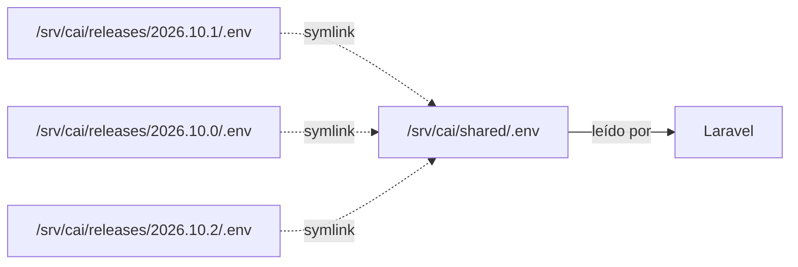

# Configuración de Entornos

---

## 1. Los cuatro ambientes

| Ambiente | `APP_ENV` | Base de datos | Datos | Quién accede |
|---|---|---|---|---|
| **local** | `local` | `cai_development` | Ficticios (seeds) | Dev |
| **testing** | `testing` | `cai_testing` | Ficticios | CI |
| **staging** | `staging` | `cai_staging` | **Anonimizados** de producción | Dev + Dirección |
| **producción** | `production` | `cai` | Reales | Personal del centro |

---

## 2. Tabla comparativa de configuración

| Variable | local | testing | staging | producción |
|---|---|---|---|---|
| `APP_ENV` | `local` | `testing` | `staging` | `production` |
| `APP_DEBUG` | `true` | `false` | `false` | `false` |
| `APP_URL` | `http://localhost:8000` | `http://localhost:8000` | `https://cai.staging...` | `https://cai.centro.local` |
| `APP_KEY` |(propia) | (fija en `phpunit.xml`) | (propia) | (propia, **crítica**) |
| `DB_DATABASE` | `cai_development` | `cai_testing` | `cai_staging` | `cai` |
| `DB_USERNAME` | local | local | `cai` | `cai` |
| `CACHE_STORE` | `file` | `array` | `database` | `database` |
| `QUEUE_CONNECTION` | `sync` | `sync` | `database` | `database` |
| `SESSION_DRIVER` | `file` | `array` | `database` | `file` |
| `MAIL_MAILER` | `log` | `array` | `log` | `smtp` |
| `BCRYPT_ROUNDS` | 4 (rápido) | 4 | 12 | 12 |
| `TELESCOPE_ENABLED` | `false` | `false` | `false` | `false` |
| Logs | `stack` | `null` | `daily` | `stack` |

> [!danger] La fila que más importa
> **`APP_DEBUG=false` y `APP_ENV=production` en el servidor real.**
> Con `APP_DEBUG=true` en producción, cualquier error muestra la pila de llamadas, las
> variables de entorno (incluida la `APP_KEY`) y las consultas SQL. **Es una fuga de
> datos completa.**

**Test de configuración (en la CI y en el healthcheck):**

```php
// packages/core/tests/Feature/ProductionConfigTest.php
it('does not expose debug mode in production', function () {
    if (app()->environment('production')) {
        expect(config('app.debug'))->toBeFalse();
        expect(config('app.env'))->toBe('production');
    }
});

it('does not share the database between environments', function () {
    expect(config('database.connections.pgsql.database'))
        ->not->toBe('cai')
        ->unless(app()->environment('production'));
});
```

---

## 3. Gestión de los `.env`

### 3.1 El modelo: un `.env` por ambiente

```text
.senv.local          # Se sube al repositorio (plantilla)
.senv.staging       # NO se sube
.senv.production    # NO se sube; vive en shared/ del servidor
```

| Archivo | ¿En el repositorio? | ¿Dónde? |
|---|---|---|
| `.env.example` | ✅ Sí | En todos lados, plantilla |
| `.env.local` | ❌ No | Solo en la máquina del dev |
| `.env.staging` | ❌ No | En el servidor de staging |
| `.env` (producción) | ❌ No | `/srv/cai/shared/.env` |

```gitignore
.env
.env.*
!.env.example
```

### 3.2 El `.env` de producción vive en `shared/`



**Por qué en `shared/`:** cada release es autocontenido en código, pero la configuración
es única. Al cambiar el symlink `current`, la nueva release hereda la configuración sin
que haya que copiarla.

### 3.3 Permisos

```bash
chmod 600 /srv/cai/shared/.env
chown cai:www-data /srv/cai/shared/.env
```

> [!warning] `www-data` necesita leerlo
> PHP-FPM corre como `www-data`. El grupo `www-data` da permiso de lectura, pero **no** de
> escritura. Nadie más del sistema puede leerlo.

---

## 4. Variables de entorno del proyecto

### 4.1 Núcleo de Laravel

| Variable | Producción | Nota |
|---|---|---|
| `APP_KEY` | **Generada, guardada en el gestor de contraseñas** | No se regenera nunca sin plan |
| `APP_DEBUG` | `false` | |
| `APP_URL` | `https://cai.centro.local` | Se usa en los enlaces de las notificaciones |
| `APP_TIMEZONE` | `America/Asuncion` | |
| `LOG_LEVEL` | `warning` | `debug` solo en local |

### 4.2 Base de datos

| Variable | Valor | Nota |
|---|---|---|
| `DB_CONNECTION` | `pgsql` | |
| `DB_HOST` | `127.0.0.1` | **Nunca** el nombre del host |
| `DB_PORT` | `5432` | |
| `DB_DATABASE` | `cai` | **Nunca** el mismo nombre que staging |
| `DB_USERNAME` | `cai` | Rol con permisos limitados |
| `DB_PASSWORD` | En el gestor de contraseñas | |

### 4.3 Sesiones, caché y colas

| Variable | Producción | Por qué |
|---|---|---|
| `SESSION_DRIVER` | `file` | Las sesiones en `/srv/cai/shared/storage/framework/sessions` sobreviven al cambio de release |
| `CACHE_STORE` | `database` | El caché se invalida con `cache:clear` sin tocar archivos |
| `QUEUE_CONNECTION` | `database` | Los jobs (envío de emails, expiración de grants) no se pierden si el servidor se reinicia |
| `BROADCAST_CONNECTION` | `null` | No se usa |

> [!note] ¿Por qué no Redis?
> Decisión documentada en [[ADR-0009 Sin Redis en el MVP]]. El caché y las colas en la base
> de datos son suficientes para 300 alumnos y 30 usuarios concurrentes, y eliminan una
> dependencia operativa.

### 4.4 Correo

| Variable | Nota |
|---|---|
| `MAIL_MAILER` | `smtp` |
| `MAIL_HOST` | SMTP del ISP del centro |
| `MAIL_PORT` | 587 con STARTTLS |
| `MAIL_USERNAME` / `MAIL_PASSWORD` | En el gestor de contraseñas |
| `MAIL_FROM_ADDRESS` | `Centro de Atención Inclusiva <cai@centro.local>` |

> [!important] El remitente
> Las notificaciones a las familias salen de una dirección del centro, **nunca** de un
> dominio de terceros. Y el contenido **nunca** incluye información clínica.

### 4.5 Variables del centro

| Variable | Uso |
|---|---|
| `CAI_CENTRO_NOMBRE` | Encabezado de documentos, recibos y notificaciones |
| `CAI_CENTRO_CI` | Identificación fiscal en los recibos |
| `CAI_CENTRO_DIRECCION` | Pie de los documentos |
| `CAI_CENTRO_TELEFONO` | Contacto en las notificaciones |
| `CAI_CENTRO_EMAIL` | Remitente |
| `CAI_CENTRO_UBICACION` | Google Maps (opcional) |

### 4.6 Variables de seguridad

| Variable | Uso |
|---|---|
| `CAI_MFA_ENFORCED_ROLES` | `direccion,admin_tecnico` |
| `CAI_LOGIN_MAX_ATTEMPTS` | `5` |
| `CAI_LOGIN_LOCKOUT_MINUTES` | `15` |
| `CAI_SESSION_LIFETIME` | `480` (8 h) |
| `CAI_CLINICAL_GRANT_MAX_DAYS` | `30` |
| `CAI_ALLOW_DESTRUCTIVE_RESET` | Vacío en producción. Requerido para `cai:db:reset` |

### 4.7 Variable de desarrollo

| Variable | Uso |
|---|---|
| `TELESCOPE_ENABLED` | `false` siempre (Telescope no va a producción) |
| `DB_CONNECTION=sqlite` | Solo para pruebas rápidas de un paquete |

---

## 5. Configuración por ambiente en `config/`

```php
// config/cai.php
return [
    'centro' => [
        'nombre'     => env('CAI_CENTRO_NOMBRE', 'Centro de Atención Inclusiva'),
        'ci'         => env('CAI_CENTRO_CI'),
        'direccion'  => env('CAI_CENTRO_DIRECCION'),
        'telefono'   => env('CAI_CENTRO_TELEFONO'),
        'email'      => env('CAI_CENTRO_EMAIL'),
    ],

    'seguridad' => [
        'mfa_enforced_roles'   => array_filter(
            explode(',', env('CAI_MFA_ENFORCED_ROLES', 'direccion,admin_tecnico'))
        ),
        'login_max_attempts'   => (int) env('CAI_LOGIN_MAX_ATTEMPTS', 5),
        'login_lockout_minutes'=> (int) env('CAI_LOGIN_LOCKOUT_MINUTES', 15),
        'session_lifetime'     => (int) env('CAI_SESSION_LIFETIME', 480),
        'clinical_grant_max_days' => (int) env('CAI_CLINICAL_GRANT_MAX_DAYS', 30),
    ],

    'modulos' => [
        'care'        => env('CAI_MODULE_CARE_ENABLED', true),
        'billing'     => env('CAI_MODULE_BILLING_ENABLED', true),
        'documents'   => env('CAI_MODULE_DOCUMENTS_ENABLED', true),
        'notifications'=> env('CAI_MODULE_NOTIFICATIONS_ENABLED', true),
        'reporting'   => env('CAI_MODULE_REPORTING_ENABLED', true),
    ],
];
```

> [!note] Los flags de módulo viven en la base, no en el `.env`
> Los valores del `.env` son el **valor inicial** al crear los flags. El estado real se
> guarda en `identity.feature_flags`, que es lo que permite apagarlos sin desplegar. Ver
> [[06.04 Feature Flags y Kill Switches]].

---

## 6. Cachés de configuración

```bash
# Después de cambiar el .env o cualquier config/*.php
cd /srv/cai/current
php artisan optimize:clear      # todo
php artisan config:cache         # configuración
php artisan route:cache          # rutas
php artisan view:cache           # vistas
php artisan event:cache          # eventos

# Verificar que se cachearon
php artisan about
```

> [!danger] `config:cache` y `env()`
> Cuando la configuración está cacheada, `env()` **solo** funciona dentro de los archivos
> de `config/`. Usar `env()` directamente en el código **no devuelve nada** en producción.
> **Regla del proyecto: `env()` solo se usa dentro de `config/`.**

---

## 7. Staging

### 7.1 Para qué sirve

| Escenario | ¿Staging ayuda? |
|---|---|
| Probar un release nuevo antes de producción | ✅ Sí |
| Reproducir un bug de producción con datos anonimizados | ✅ Sí |
| Verificar migraciones con datos realistas | ✅ Sí |
| Entrenar al personal sin riesgo | ✅ Sí |
| Probar la configuración de producción exacta | ✅ Sí |

### 7.2 Cómo se construye

```bash
# 1. Restaurar el backup de producción en la base de staging
pg_restore -d cai_staging --no-owner /srv/cai/backups/local/cai_YYYYMMDD.dump

# 2. Anonimizar los datos
php artisan cai:anonymize --all

# 3. Aplicar las migraciones pendientes
php artisan migrate --force

# 4. Regenerar los usuarios de prueba
php artisan cai:users:seed-demo
```

### 7.3 Anonimización

```php
// packages/core/src/Console/Commands/AnonymizeData.php
final class AnonymizeData extends Command
{
    protected $signature = 'cai:anonymize {--all : Anonimizar todos los schemas}';

    public function handle(): int
    {
        // Alumnos: nombres, CI, teléfonos, direcciones, emails
        DB::connection('students')->table('students')->orderBy('id')
            ->chunkById(200, function ($students): void {
                foreach ($students as $student) {
                    DB::connection('students')->table('students')
                        ->where('id', $student->id)
                        ->update([
                            'first_name'  => 'Alumno' . $student->id,
                            'last_name'   => 'Prueba',
                            'document_id' => 'TEST' . str_pad((string) $student->id, 6, '0', STR_PAD_LEFT),
                            'birth_date'  => '2015-01-01',
                            'address'     => 'Dirección de prueba',
                        ]);
                }
            });

        // Tutores
        // ...

        // Documentos: se eliminan los archivos, se conservan los metadatos
        // ...

        // NOTAS CLÍNICAS: se conservan (son necesarias para probar),
        // pero se reemplazan el contenido por texto genérico.
        DB::connection('care')->table('clinical_notes')->orderBy('id')
            ->chunkById(200, function ($notes): void {
                foreach ($notes as $note) {
                    DB::connection('care')->table('clinical_notes')
                        ->where('id', $note->id)
                        ->update([
                            'content' => encrypt('Contenido clínico anonimizado para pruebas.'),
                            'summary' => 'Resumen anonimizado.',
                        ]);
                }
            });

        $this->components->info('Anonimización completada.');

        return self::SUCCESS;
    }
}
```

> [!danger] Verificación de la anonimización
> Antes de publicar una base de staging, **siempre** verificar:
> ```bash
> php artisan cai:anonymize --verify
> ```
> El comando busca nombres, CI, teléfonos y emails reales en todas las tablas y falla si
> encuentra alguno. Si encuentra algo, **no** se publica la base.

---

## 8. Procedimiento para cambiar una variable en producción

```bash
#!/usr/bin/env bash
# scripts/change-env.sh
set -Eeuo pipefail

KEY="$1"
VALUE="$2"

if [ -z "${KEY}" ]; then
    echo "Uso: change-env.sh CLAVE VALOR" >&2
    exit 1
fi

ENV_FILE=/srv/cai/shared/.env
BACKUP="${ENV_FILE}.bak.$(date +%Y%m%d_%H%M%S)"

echo "Respaldando ${ENV_FILE} → ${BACKUP}"
cp -p "${ENV_FILE}" "${BACKUP}"

if grep -q "^${KEY}=" "${ENV_FILE}"; then
    sed -i "s|^${KEY}=.*|${KEY}=${VALUE}|" "${ENV_FILE}"
else
    echo "${KEY}=${VALUE}" >> "${ENV_FILE}"
fi

chmod 600 "${ENV_FILE}"

echo "Limpiando cachés de configuración"
cd /srv/cai/current
php artisan optimize:clear
php artisan config:cache

echo "Verificando"
php artisan cai:healthcheck --strict

echo "✅ ${KEY} actualizada. Respaldo en ${BACKUP}"
```

**Uso:**

```bash
/srv/cai/scripts/change-env.sh CAI_CENTRO_TELEFONO "+595 21 999888"
```

> [!important] El valor nuevo también va al gestor de contraseñas
> La fuente de verdad son **dos**: el `.env` del servidor (para que funcione) y el gestor
> de contraseñas (para poder reconstruirlo). Si divergen, el sistema funciona pero la
> documentación miente.

---

## 9. Checklist de configuración

- [ ] `APP_ENV=production` en el servidor
- [ ] `APP_DEBUG=false` en el servidor
- [ ] `APP_KEY` en el gestor de contraseñas
- [ ] `.env` con permisos 600, propiedad de `cai:www-data`
- [ ] `DB_DATABASE` distinto del de staging
- [ ] `.env` **no** está en el repositorio
- [ ] `php artisan config:cache` ejecutado tras el último cambio
- [ ] `env()` solo se usa dentro de `config/`
- [ ] Las variables de staging y producción difieren en lo crítico
- [ ] La base de staging está anonimizada y verificada
- [ ] El healthcheck pasa

---

## 10. Documentos relacionados

- [[07.03 Instalación del Sistema]]
- [[07.05 Configuración de PostgreSQL]]
- [[06.05 Release y Deploy]]
- [[04.04 Datos Clínicos: Cifrado y Acceso]]
- [[ADR-0009 Sin Redis en el MVP]]
