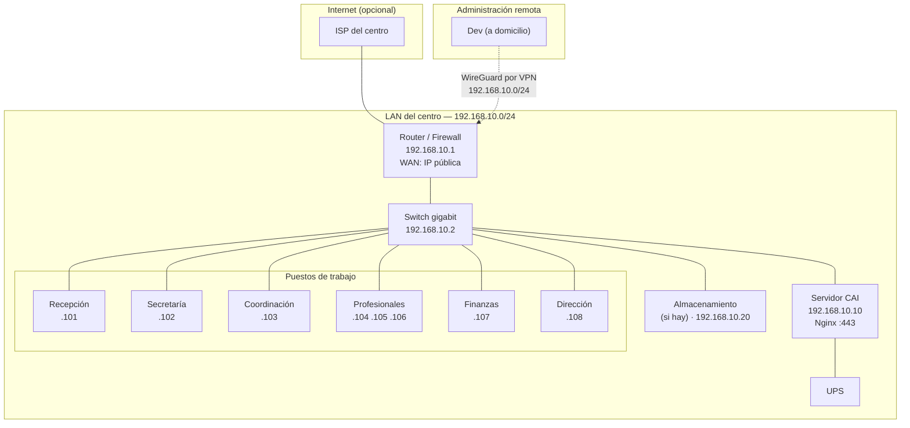

# Red, HTTPS y VPN

> [!important] Objetivo de la red
> El sistema se usa **desde dentro del centro**. El acceso desde fuera es **una
> excepción controlada**, no el estado normal. Todo lo que se diseñe tiene que
> garantizar que el sistema siga siendo usable **si se cae internet**.

---

## 1. Topología de red



---

## 2. Segmentación

| Segmento | Rango | Puertos permitidos | Equipos |
|---|---|---|---|
| **Servidores** | `192.168.10.0/28` | 80, 443 desde la LAN; 22 solo desde VPN | Servidor, NAS |
| **Estaciones de trabajo** | `192.168.10.32/27` | 443 al servidor | Los 6 puestos |
| **Administración (VPN)** | `192.168.10.100/28` | SSH al servidor | Dev por WireGuard |
| **Invitados (Wi-Fi)** | `192.168.50.0/24` | Solo internet | Visitantes, dispositivos personales |

> [!danger] Los dispositivos personales NO deben estar en la misma red
> Si un celular del personal o un invitado se conecta a la red del centro, queda en la
> misma LAN que el servidor. La segmentación por Wi-Fi de invitados es obligatoria.

---

## 3. Asignación de direcciones

| Regla | Detalle |
|---|---|
| Direcciones **fijas** (no DHCP) para el servidor y los puestos clave | Evita que el servidor cambie de IP |
| El DHCP reserva las direcciones de los puestos | Menos cables, misma consistencia |
| El servidor: `192.168.10.10` | |
| Documentar la asignación en la bóveda | [[07.01 Arquitectura del Servidor del Centro]] |

---

## 4. HTTPS

### 4.1 Requisitos del certificado

| Aspecto | Requisito |
|---|---|
| Protocolo | TLS 1.2 mínimo, TLS 1.3 preferido |
| Cifrados | Solo suites modernos (ECDHE con AES-GCM) |
| HSTS | `max-age=31536000; includeSubDomains` |
| Renovación | Automática (certbot timer) |
| Certificados de autoridad | Let's Encrypt (con DNS público) o CA interna |

> [!note] Por qué HTTPS también en la LAN
> Los datos clínicos y financieros viajan entre el navegador y el servidor. En una LAN
> conmutada el tráfico es visible para quien esté en el mismo segmento. **HTTPS es
> obligatorio incluso en la red interna.**

### 4.2 Verificación del TLS

```bash
# Verificar la configuración
openssl s_client -connect 192.168.10.10:443 -servername cai.centro.local </dev/null 2>&1 \
    | grep -E "Protocol|Cipher|Verify"

# Verificar el HSTS y las cabeceras
curl -sI https://cai.centro.local | grep -iE "strict-transport|x-content-type|x-frame|content-security"

# Verificar la cadena de certificados
echo | openssl s_client -connect cai.centro.local:443 -showcerts 2>/dev/null \
    | openssl x509 -noout -dates -subject
```

**Resultado esperado:**

```
Protocol  : TLSv1.3
Cipher    : TLS_AES_256_GCM_SHA384
Verify return code: 0 (ok)
```

---

## 5. VPN para la administración remota

### 5.1 Por qué VPN y no exponer SSH

| Opción | Consecuencia |
|---|---|
| SSH abierto a internet | Intentos de fuerza bruta permanentes. Mesmo con fail2ban, es una superficie de ataque |
| **VPN (WireGuard)** ✅ | El puerto SSH no está abierto al mundo. Solo se entra con una clave válida |
| Bastion en la nube | Costo y complejidad innecesaria |

### 5.2 Configuración de WireGuard

**En el router o en un servidor WireGuard dedicado:**

```ini
# /etc/wireguard/wg0.conf
[Interface]
Address = 192.168.10.100/28
ListenPort = 51820
PrivateKey = <CLAVE_PRIVADA_DEL_SERVIDOR>
SaveConfig = false

[Peer]
# Dev
PublicKey = <CLAVE_PUBLICA_DEL_DEV>
AllowedIPs = 192.168.10.100/32
```

**En el equipo del dev:**

```ini
# /etc/wireguard/wg0.conf
[Interface]
Address = 192.168.10.101/32
PrivateKey = <CLAVE_PRIVADA_DEL_DEV>
DNS = 192.168.10.1

[Peer]
PublicKey = <CLAVE_PUBLICA_DEL_SERVIDOR>
Endpoint = <IP_PUBLICA_O_DDNS>:51820
AllowedIPs = 192.168.10.0/24
PersistentKeepalive = 25
```

### 5.3 Reglas de la VPN

| Regla | Detalle |
|---|---|
| Solo el dev (o un técnico autorizado) tiene perfil | Una persona, una clave |
| La clave del dev se puede revocar en 1 minuto | Cambiar la clave pública en `wg0.conf` |
| `AllowedIPs` limitado a la red del centro | El dev no enruta todo el tráfico de internet por la VPN |
| La VPN **no** da acceso a la base de datos directamente | El dev entra por SSH y usa `psql` desde el servidor |
| El acceso por VPN se audita | Los logs de `sshd` registran el acceso |

### 5.4 Acceso SSH restringido

```bash
# /etc/ssh/sshd_config
PermitRootLogin no
PasswordAuthentication no
PubkeyAuthentication yes
AllowUsers cai

# Restringir por IP si la VPN tiene un rango fijo
# Match Address 192.168.10.100/28
#   AllowUsers cai
```

---

## 6. Firewall

### 6.1 Reglas del servidor

```bash
# Con UFW
sudo ufw default deny incoming
sudo ufw default allow outgoing

sudo ufw allow 22/tcp comment 'SSH (solo por VPN o LAN)'
sudo ufw allow 443/tcp comment 'HTTPS'
sudo ufw allow from 192.168.10.0/24 to any port 80 proto tcp comment 'HTTP redirección (LAN)'

sudo ufw enable
```

### 6.2 Reglas en el router

| Regla | Origen | Destino | Puerto | Motivo |
|---|---|---|---|---|
| 1 | LAN | Servidor | 443 | Uso normal |
| 2 | VPN | Servidor | 22 | Administración remota |
| 3 | WAN | Router | 51820/UDP | WireGuard |
| 4 | WAN | Router | 80/443 | Solo si hay acceso público (ver §7) |
| 5 | Invitados | Servidor | **ninguno** | Aislamiento |
| 6 | Invitados | Router | 80/443 | Internet |

---

## 7. Acceso desde fuera del centro

### 7.1 Decisión

> [!question] Pendiente de decisión
> ¿El sistema debe ser accesible desde fuera del centro? **No está decidido.**
> Está en [[01.07 Preguntas Abiertas y Decisiones Pendientes]] (P11, P17, P18).

### 7.2 Las tres opciones

| Opción | Descripción | Ventajas | Desventajas |
|---|---|---|---|
| **A. Solo LAN** ✅ | El sistema solo se usa dentro del centro | Máxima simplicidad, mínima superficie de ataque | Dirección no puede consultar desde casa |
| **B. VPN** | Acceso externo por WireGuard | Seguro, sin exponer el sistema | Requiere configurar el VPN en cada dispositivo |
| **C. Público con HTTPS** | Dominio + Let's Encrypt | Cómodo de usar | Expone el login a internet (con rate limiting y MFA) |

**Recomendación para el MVP:** **A + B**. La opción C se evalúa en la etapa 2, cuando
exista el portal familiar (que **sí** necesita ser público).

### 7.3 Si se elige la opción C

| Medida | Configuración |
|---|---|
| Dominio | `cai.centro.example` con DNS |
| IP pública | Fija o DDNS (Dynamic DNS) |
| Certificado | Let's Encrypt con `certbot` |
| Rate limiting | Nginx: 10 intentos de login / minuto por IP |
| MFA | Obligatorio para `direccion` y `admin_tecnico` |
| Fail2ban | Bloquea IPs con muchos fallos |
| WAF | Opcional (ModSecurity), añade complejidad |

```nginx
# Rate limiting en Nginx
limit_req_zone $binary_remote_addr zone=login_limit:10m rate=10r/m;

server {
    # ...
    location = /panel/login {
        limit_req zone=login_limit burst=5 nodelay;
        try_files $uri /index.php?$query_string;
    }
}
```

---

## 8. Wi-Fi del centro

| Regla | Detalle |
|---|---|
| WPA2-AES o WPA3 | Nunca WEP ni WPA abierto |
| Contraseña del Wi-Fi | Cambiada trimestralmente, en un cartel junto al router |
| SSID del centro | Distinto del de invitados |
| Red de invitados | Aislada (`client isolation` + sin acceso a la LAN) |
| Filtrado por MAC | Opcional, para los puestos de trabajo fijos |
| Evitar el port forwarding | Nunca |
| Desactivar WPS | Es una vulnerabilidad conocida |

---

## 9. Servidor DNS local

El router del centro provee DNS. Consideraciones:

| Tema | Decisión |
|---|---|
| ¿Servidor DNS propio? | No en el MVP. El router basta |
| ¿DNS público en las consultas? | Sí, para resolver correos externos |
| Screenshot de los DNS configurados | En la documentación de infraestructura |

---

## 10. Comprobación periódica de la red

```bash
#!/usr/bin/env bash
# scripts/check-network.sh

echo "=== COMPROBACIÓN DE RED ==="

# El servidor responde
ping -c 3 -W 2 192.168.10.10 > /dev/null && echo "✅ Servidor responde" || echo "❌ Servidor NO responde"

# El puerto HTTPS está abierto
nc -z 192.168.10.10 443 && echo "✅ HTTPS abierto" || echo "❌ HTTPS cerrado"

# La base de datos NO está expuesta
if nc -z -w 2 192.168.10.10 5432 2>/dev/null; then
    echo "❌ PostgreSQL está accesible desde la LAN (debería estar solo en localhost)"
else
    echo "✅ PostgreSQL no está expuesto"
fi

# El certificado es válido
echo | openssl s_client -connect 192.168.10.10:443 2>/dev/null \
    | openssl x509 -noout -checkend 2592000 \
    && echo "✅ El certificado vence en más de 30 días" \
    || echo "⚠️  El certificado vence en menos de 30 días"

# El reloj está sincronizado
timedatectl show -p NTPSynchronized --value | grep -q yes \
    && echo "✅ Hora sincronizada" \
    || echo "⚠️  Hora no sincronizada"
```

> [!important] El reloj del servidor
> PostgreSQL depende de un reloj correcto (WAL, `TIMESTAMPTZ`, expiración de grants,
> auditoría). Si el reloj se desvía, la auditoría pierde valor como evidencia.

---

## 11. Documentos relacionados

- [[07.01 Arquitectura del Servidor del Centro]]
- [[07.02 Requisitos de Hardware y Software]]
- [[04.01 Modelo de Seguridad]]
- [[04.07 Checklist Legal y Respuesta a Incidentes]]
- [[01.07 Preguntas Abiertas y Decisiones Pendientes]]
