# Relevamiento del Servidor del Centro

> [!info] Qué es este documento y por qué existe
> Antes de instalar, migrar o dar soporte al servidor que ya está en el centro hay que
> saber **qué hay**: hardware, software, almacenamiento, red, cuentas, respaldos y qué
> categorías de datos aloja. Este documento define el procedimiento, los límites y la
> evidencia.
>
> **No autoriza nada por sí solo.** La intervención concreta se autoriza con la
> [[Plantilla - Solicitud de Autorización de Intervención en Servidor]] firmada por
> Dirección. Sin firma, no se toca el equipo.

---

## 1. Objetivo

| # | Resultado buscado |
|---|---|
| 1 | Inventariar el hardware real del servidor, sin modificarlo |
| 2 | Registrar el software, las versiones y el estado de actualización |
| 3 | Medir almacenamiento, uso y estado de los discos |
| 4 | Documentar la red, los puertos y los respaldos existentes |
| 5 | Mapear los datos **por categoría y volumen**, nunca por contenido |
| 6 | Producir un informe con hallazgos, riesgos y recomendaciones priorizadas |
| 7 | Dejar evidencia verificable y una cadena de custodia clara |

---

## 2. Alcance

### 2.1 Incluido

- Relevamiento físico del equipo: marca, modelo, número de serie, estado exterior.
- Relevamiento lógico de solo lectura: sistema operativo, servicios, paquetes,
  usuarios, red, almacenamiento y respaldos.
- Conteo y dimensionamiento de datos por categoría: identificatorios, clínicos,
  financieros, documentos y credenciales.
- Registro fotográfico de etiquetas y del estado físico, **sin pantallas con datos**.
- Acta de inicio, bitácora de acciones y acta de cierre.

### 2.2 Excluido

| No se hace | Por qué |
|---|---|
| Reparar, actualizar o reinstalar | Es una intervención distinta; requiere otra autorización |
| Cambiar configuración, usuarios o contraseñas | El relevamiento es de solo lectura |
| Copiar datos personales, clínicos o financieros | Principio de minimización; el informe no los necesita |
| Leer el contenido de notas, fichas o historias clínicas | El dato clínico no sale del área clínica |
| Montar discos en modo escritura, ejecutar `fsck` o `chkdsk /f` | Puede modificar el disco |
| Conectarse a internet desde el servidor | No es necesario y amplía la superficie de riesgo |
| Publicar el informe o la evidencia | Confidencialidad del centro |

> [!danger] El límite que no se negocia
> Si el equipo está en producción y el relevamiento puede afectar el servicio, se
> coordina una ventana fuera del horario de atención. Ante cualquier duda, se detiene
> la intervención y se consulta a Dirección. Ver §10.

---

## 3. Principios de la intervención

| Regla | Detalle |
|---|---|
| **RV-01 · Solo lectura por defecto** | Todo comando debe ser de consulta. Si un comando puede escribir, no se ejecuta |
| **RV-02 · Sin copia de datos** | No se copian bases, carpetas de documentos ni archivos con datos personales |
| **RV-03 · Sin instalación de software** | No se instala nada en el servidor; si falta una herramienta, se anota y se busca alternativa de solo lectura |
| **RV-04 · Ventana autorizada** | La fecha, la hora y la duración están en la solicitud firmada |
| **RV-05 · Acompañamiento** | Hay una persona designada por Dirección que presencia la intervención |
| **RV-06 · Registro de cada acción** | Toda acción queda en la bitácora, con hora, comando y resultado |
| **RV-07 · Evidencia cifrada** | Las fotos y los archivos de evidencia se guardan cifrados y con hash |
| **RV-08 · El informe no lleva datos personales** | Solo agregados, conteos y categorías |

> [!important] Por qué el principio de solo lectura es el centro del procedimiento
> El objetivo es **conocer**, no corregir. Un relevamiento que cambia algo deja de ser
> un relevamiento y se convierte en una intervención sin autorización. La regla protege
> al centro, al operador y a los datos de los menores.

---

## 4. Roles

| Rol | Quién | Responsabilidad |
|---|---|---|
| **Responsable técnico** | La persona que ejecuta | Prepara, ejecuta, registra y redacta el informe |
| **Acompañante designado** | Dirección o quien Dirección designe | Presencia la intervención y firma el acta de cierre |
| **Custodio de evidencia** | Responsable técnico + acompañante | Guarda la evidencia cifrada y el manifiesto de hashes |
| **Dirección** | Máxima autoridad del centro | Autoriza la intervención y recibe el informe |

> [!note] Regla de dos personas
> Ninguna persona entra sola al servidor durante el relevamiento. Si el acompañante no
> está, la intervención no empieza. Es la misma lógica de la cadena de custodia: la
> evidencia vale porque alguien más puede atestiguar cómo se obtuvo.

---

## 5. Fases del relevamiento

```mermaid
flowchart LR
  A["0. Autorización<br/>firmada"] --> B["1. Preparación<br/>checklist y evidencia"]
  B --> C["2. Acta de inicio<br/>y fotos del equipo"]
  C --> D["3. Levantamiento<br/>hardware y software"]
  D --> E["4. Red, cuentas<br/>y respaldos"]
  E --> F["5. Mapa de datos<br/>por categoría"]
  F --> G["6. Acta de cierre<br/>y custodia"]
  G --> H["7. Informe<br/>y recomendaciones"]
  H --> I["8. Entrega a Dirección<br/>y archivo"]
```



| Fase | Qué se hace | Evidencia |
|---|---|---|
| **0. Autorización** | Se completa y firma la solicitud; se confirma la ventana | Solicitud firmada |
| **1. Preparación** | Se revisa el checklist, se prepara el medio cifrado y las plantillas | Checklist marcado |
| **2. Acta de inicio** | Se identifica el equipo, se fotografían etiquetas y se registra el estado | Acta + fotos |
| **3. Levantamiento** | Se ejecutan solo comandos de consulta de §7 | Bitácora + salidas |
| **4. Red y accesos** | Se registran interfaces, puertos, usuarios y respaldos | Bitácora |
| **5. Mapa de datos** | Se cuentan registros y se miden tamaños; **no se lee el contenido** | Ficha 7 |
| **6. Acta de cierre** | Se declara qué se hizo, qué no y en qué estado queda el equipo | Acta + hashes |
| **7. Informe** | Se redacta con la plantilla y se revisa antes de entregar | Informe |
| **8. Entrega** | Se entrega a Dirección y se archiva la evidencia | Acuse de recibo |

---

## 6. Qué se levanta y qué se registra

| Bloque | Dato | Cómo se obtiene | Qué se registra | Qué **no** se registra |
|---|---|---|---|---|
| **Hardware** | Marca, modelo, serial, CPU, RAM, discos, fuente, UPS | Etiquetas, `dmidecode`, `lscpu`, `free`, `lsblk` | Valores y estado | Nada sensible |
| **Software** | Sistema operativo, versión, kernel, servicios, paquetes | `cat /etc/os-release`, `systemctl`, `dpkg -l` | Versiones y estado de parcheo | Claves de licencia |
| **Almacenamiento** | Discos, particiones, uso, SMART, cifrado | `lsblk`, `df`, `smartctl -a` | Capacidad, uso, salud | Contenido de archivos |
| **Red** | Interfaces, IP, gateway, DNS, puertos, firewall | `ip`, `ss`, `ufw status` | Configuración y puertos abiertos | Tráfico ni paquetes |
| **Cuentas** | Usuarios, roles, shell, SSH, MFA | `getent passwd`, `sudo -l`, `lastlog` | Existencia y privilegios | Contraseñas ni hashes |
| **Respaldos** | Destino, frecuencia, retención, cifrado, prueba | Revisión de cron, carpetas y documentación | Política y estado | Contenido de los respaldos |
| **Datos** | Sistemas, carpetas, bases, categorías, volumen | `du`, conteos, `information_schema` | Categoría, cantidad, tamaño, sensibilidad | Ningún valor personal |

> [!warning] Contar no es leer
> Para el mapa de datos alcanza con `COUNT(*)`, `pg_database_size()` y `du -sh`.
> Un `SELECT *` sobre una tabla de alumnos o de notas clínicas **no** es un
> relevamiento: es una fuga de datos en potencia.

---

## 7. Comandos de solo lectura

> [!danger] Antes de ejecutar
> Estos comandos son de consulta, pero algunos requieren `sudo` o instalar una
> herramienta. **No se instala nada** (RV-03). Si `smartctl` o `dmidecode` no están
> disponibles, se anota como limitación del relevamiento y se sigue con lo que haya.

### 7.1 Linux

| Bloque | Comando | Qué devuelve |
|---|---|---|
| Sistema | `hostnamectl` · `uname -a` · `cat /etc/os-release` | Equipo y versión del sistema |
| CPU y RAM | `lscpu` · `free -h` | Núcleos, arquitectura, memoria |
| Placa y BIOS | `sudo dmidecode -t system -t baseboard -t processor -t memory` | Fabricante, modelo, serial, módulos |
| Discos | `lsblk -o NAME,SIZE,TYPE,FSTYPE,MOUNTPOINT` · `df -hT` | Discos, particiones y uso |
| Salud del disco | `sudo smartctl -a /dev/sdX` | Estado SMART (si está disponible) |
| Red | `ip -brief address` · `ip route` · `ss -ltnp` | Interfaces, rutas y puertos |
| Firewall | `sudo ufw status verbose` | Reglas activas |
| Servicios | `systemctl list-units --type=service --state=running` | Servicios en ejecución |
| Paquetes | `dpkg -l` · `apt list --installed` | Software instalado |
| Usuarios | `getent passwd` · `sudo -l -U <usuario>` · `lastlog` | Cuentas y privilegios |
| Tareas | `crontab -l` · `ls -la /etc/cron.*` | Tareas programadas |
| PostgreSQL | `sudo -u postgres psql -l` | Bases y tamaños |
| PostgreSQL | `SELECT datname, pg_size_pretty(pg_database_size(datname)) FROM pg_database;` | Tamaño por base |
| PostgreSQL | `SELECT table_schema, table_name FROM information_schema.tables WHERE table_schema NOT IN ('pg_catalog','information_schema');` | Nombres de tablas, sin contenido |
| Respaldos | `ls -lah <ruta>` · `du -sh <ruta>` · `find <ruta> -type f -printf '%TY-%Tm-%Td %s %p\n'` | Inventario de respaldos |
| Huellas | `sha256sum <archivo>` | Hash para el manifiesto |

### 7.2 Windows Server

| Bloque | Comando (PowerShell) | Qué devuelve |
|---|---|---|
| Sistema | `Get-ComputerInfo` | Equipo, versión y memoria |
| Hardware | `Get-CimInstance Win32_ComputerSystem` · `Win32_BIOS` · `Win32_Processor` · `Win32_PhysicalMemory` | Fabricante, modelo, serial, CPU, RAM |
| Discos | `Get-Disk` · `Get-Volume` · `Get-PhysicalDisk` | Discos, volúmenes y salud |
| Red | `Get-NetIPConfiguration` · `Get-NetTCPConnection -State Listen` · `Get-NetFirewallProfile` | IP, puertos y firewall |
| Servicios | `Get-Service` · `Get-Process` | Servicios y procesos |
| Usuarios | `Get-LocalUser` · `Get-LocalGroupMember Administrators` | Cuentas y privilegios |
| Tareas | `Get-ScheduledTask` | Tareas programadas |
| Software | `Get-ItemProperty 'HKLM:\Software\Microsoft\Windows\CurrentVersion\Uninstall\*'` | Programas instalados |
| Roles | `Get-WindowsFeature` | Roles y características |
| Eventos | `Get-WinEvent -MaxEvents 100` | Metadatos de eventos recientes |

> [!warning] Comandos prohibidos aunque parezcan de diagnóstico
> `chkdsk /f`, `chkdsk /r`, `sfc /scannow`, `Optimize-Volume`, `fsck` en modo escritura,
> `mount` sin `-o ro`, cualquier `apt upgrade`, `systemctl restart` o cambio de
> contraseña. Diagnostican, pero **modifican**.

---

## 8. Manejo de datos sensibles

| Categoría | Ejemplos | Qué se puede registrar | Qué no se registra |
|---|---|---|---|
| **Identificatorios** | Nombres, documentos, contactos, domicilios | Cantidad de registros, tamaño, sistema | Ningún valor |
| **Clínicos** | Notas, diagnósticos, planes de atención | Cantidad, tamaño, si está cifrado | Contenido, ni siquiera un extracto |
| **Financieros** | Cuentas, pagos, recibos, deudas | Cantidad, tamaño, sistema | Importes individuales |
| **Documentos** | PDFs, imágenes, evaluaciones | Cantidad, tamaño, extensión | Contenido |
| **Credenciales** | Claves, tokens, certificados | Existencia y ubicación | El valor, aunque esté a la vista |

> [!danger] Si aparece una credencial en texto plano
> No se copia, no se fotografía y no se escribe en el informe. Se anota **dónde está**
> y se recomienda rotarla. La contraseña en sí no sale del servidor.

### 8.1 Regla de muestras

Si hace falta una muestra para explicar un formato, se usa un registro **ficticio** o
un agregado. Nunca un registro real, ni siquiera "un caso al azar". El informe se lee
fuera del centro y no puede contener datos de menores.

---

## 9. Evidencia y cadena de custodia

### 9.1 Estructura de la evidencia

```text
EVIDENCIA/
└── AAAA-MM-DD/
    ├── acta-inicio.pdf
    ├── acta-cierre.pdf
    ├── fotos/
    │   ├── equipo-etiqueta.jpg
    │   └── estado-fisico.jpg
    ├── comandos/
    │   ├── hardware.txt
    │   ├── software.txt
    │   └── red.txt
    └── hashes.sha256
```

### 9.2 Reglas

| Regla | Detalle |
|---|---|
| **Medio cifrado** | La evidencia vive en un medio cifrado (LUKS o BitLocker), nunca en un pendrive sin cifrar |
| **Hash manifiesto** | Cada archivo se hashea con SHA-256 y se firma el manifiesto |
| **Sin nube ni correo personal** | La evidencia no se sube a servicios externos ni se envía a cuentas personales |
| **Fotos sin pantallas** | Se fotografían etiquetas y estado físico; nunca una pantalla con datos |
| **Dos firmas** | El acta de inicio y la de cierre las firman el responsable técnico y el acompañante |
| **Retención** | La evidencia se conserva hasta que Dirección apruebe el informe; después se archiva o se destruye con constancia |

> [!note] Qué protege la cadena de custodia
> No protege al operador de una acusación: protege al centro de un dato sin origen.
> Si mañana alguien pregunta de dónde salió un número del informe, el manifiesto y el
> acta dicen exactamente qué se ejecutó, cuándo y quién lo vio.

---

## 10. Criterios de aborto

La intervención se detiene de inmediato si ocurre cualquiera de estas situaciones:

| # | Situación | Qué se hace |
|---|---|---|
| A-01 | No está la autorización firmada o falta el acompañante | No se empieza |
| A-02 | El equipo está en producción y el comando puede afectar el servicio | Se pospone a la ventana autorizada |
| A-03 | Aparece un error de disco, un ruido anormal o un olor a quemado | Se apaga según el procedimiento del centro y se avisa a Dirección |
| A-04 | Un comando empieza a escribir o pide confirmación de cambios | Se cancela y se registra |
| A-05 | Se expone un dato personal en pantalla | Se detiene la captura, no se fotografía y se registra el incidente |
| A-06 | El acompañante pide detener la intervención | Se detiene sin discutir |

> [!important] Detenerse también es un resultado
> Un acta de cierre que dice "se detuvo por A-04" es un relevamiento honesto. Un
> informe que oculta la interrupción no sirve para tomar decisiones.

---

## 11. Entregables

| # | Entregable | Plantilla | Quién lo recibe |
|---|---|---|---|
| E-01 | Solicitud de autorización firmada | [[Plantilla - Solicitud de Autorización de Intervención en Servidor]] | Dirección |
| E-02 | Inventario completo | [[Plantilla - Inventario de Servidor]] | Responsable técnico |
| E-03 | Acta de inicio y acta de cierre | Incluidas en la plantilla de inventario | Dirección |
| E-04 | Informe de relevamiento | [[Plantilla - Informe de Relevamiento de Servidor]] | Dirección |
| E-05 | Evidencia cifrada + manifiesto de hashes | §9 | Custodio |
| E-06 | Recomendaciones priorizadas | §11 del informe | Dirección |

---

## 12. Preguntas que el relevamiento debe responder

| Pregunta | Dónde se responde |
|---|---|
| ¿Qué hardware hay y en qué estado está? | Fichas 1 y 2 del inventario |
| ¿El equipo soporta el sistema CAI o hay que reemplazarlo? | Comparación con [[07.02 Requisitos de Hardware y Software]] |
| ¿Hay UPS y está probado? | Ficha 1 (P16 de [[01.07 Preguntas Abiertas y Decisiones Pendientes]]) |
| ¿Qué datos aloja y de qué categoría? | Ficha 7 del inventario |
| ¿Los respaldos existen y se probaron? | Ficha 6 y [[06.07 Backups y Recuperación]] |
| ¿Hay credenciales en texto plano? | Ficha 5, sin copiar el valor |
| ¿Qué riesgos hay que resolver antes de migrar? | §10 del informe |

---

## 13. Lo que este documento no autoriza

- No autoriza a instalar, actualizar ni reparar el servidor.
- No autoriza a copiar datos ni a sacar el equipo del centro.
- No autoriza a acceder a contenido clínico.
- No autoriza a publicar el informe.
- No sustituye la autorización firmada de Dirección.

---

## 14. Documentos relacionados

- [[07.01 Arquitectura del Servidor del Centro]] — qué se espera encontrar
- [[07.02 Requisitos de Hardware y Software]] — contra qué se compara el hallazgo
- [[07.06 Red, HTTPS y VPN]] — configuración de red de referencia
- [[07.07 Monitoreo y Mantenimiento]] — qué se monitorea después
- [[10.01 Runbook Operativo]] — cómo se opera el servidor
- [[10.03 Gestión de Incidentes]] — qué hacer si algo sale mal
- [[04.01 Modelo de Seguridad]] — el marco de confidencialidad
- [[06.07 Backups y Recuperación]] — qué se espera de un respaldo
- [[Plantilla - Solicitud de Autorización de Intervención en Servidor]]
- [[Plantilla - Inventario de Servidor]]
- [[Plantilla - Informe de Relevamiento de Servidor]]
