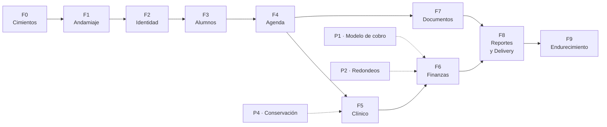
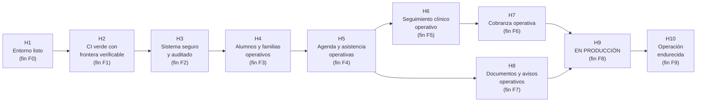

# Hoja de Ruta

> [!important] Mapa de navegación
> Este documento es el **índice** del plan de trabajo. Cada fase tiene su documento con
> detalle: tareas, entregables, gate de salida, riesgos y qué se pospone.

---

## 1. Las diez fases

| Fase | Nombre | Schema(s) | Semanas | Bloqueada por |
|---|---|---|---|---|
| **F0** | Cimientos del Entorno | — | 1 | — |
| **F1** | Andamiaje Técnico y Frontera Modular | — | 2 | F0 |
| **F2** | Identidad, Permisos y Auditoría | `identity` | 2 | F1 |
| **F3** | Alumnos, Tutores y Cuentas Familiares | `students` | 3 | F2 |
| **F4** | Servicios, Profesionales y Agenda | `scheduling` | 3 | F3 |
| **F5** | Seguimiento Clínico | `care` | 2 | F4 |
| **F6** | Finanzas Familiares | `billing` | 3 | F5 |
| **F7** | Documentos y Comunicaciones | `documents`, `notifications` | 2 | F4 |
| **F8** | Reportes y Puesta en Producción | `reporting` | 3 | F6, F7 |
| **F9** | Endurecimiento y Operación Continua | — | 2 | F8 |

**Total estimado:** ~23 semanas con 8 h/semana (~5 meses). ~13 semanas con 15 h/semana.

---

## 2. Grafo de dependencias

> [!warning] F7 puede adelantarse a F6
> `documents` y `notifications` **no dependen** de `billing`. Si hay capacidad, F7 se
> puede desarrollar en paralelo con F6. Es la única oportunidad de paralelismo real.

---

## 3. Resumen por fase

| Fase | Objetivo en una frase | Gate de salida |
|---|---|---|
| **[[08.02 F0 Cimientos del Entorno]]** | Eliminar bloqueos técnicos y fijar las decisiones de versión | Repo privado creado, `main` protegida, ADRs escritos, `bcmath` instalado |
| **[[08.03 F1 Andamiaje Técnico y Frontera Modular]]** | Que la CI sea verde con el esqueleto de módulos y la frontera verificable | CI verde; un PR que viola Deptrac **falla** la CI |
| **[[08.04 F2 Identidad Permisos y Auditoría]]** | La base de la seguridad: quién entra, qué puede ver, qué queda registrado | Un usuario sin permiso **no** accede por URL directa (test que lo demuestra) |
| **[[08.05 F3 Alumnos Tutores y Cuentas Familiares]]** | La ficha del alumno y el modelo de familia compartida | Dos hermanos con fichas separadas en la misma cuenta; un tercero autorizado a retirar |
| **[[08.06 F4 Servicios Profesionales y Agenda]]** | Sesiones individuales y grupales con asistencia | La BD **rechaza** una superposición de horario del mismo profesional |
| **[[08.07 F5 Seguimiento Clínico]]** | El área de datos sensibles, protegida y auditable | Un profesional no ve notas de alumnos no asignados; el admin técnico tampoco |
| **[[08.08 F6 Finanzas Familiares]]** | Consistencia del dinero | Dos pagos concurrentes no producen saldo negativo ni doble imputación |
| **[[08.09 F7 Documentos y Comunicaciones]]** | Almacenamiento privado y avisos a las familias | Un documento no es accesible por URL directa sin sesión y permiso |
| **[[08.10 F8 Reportes y Puesta en Producción]]** | Indicadores y operación real | El centro opera, consulta informes y **restaura desde una copia probada** |
| **[[08.11 F9 Endurecimiento y Operación Continua]]** | Operación continua con riesgo controlado | Simulacro de restore ejecutado y cronometrado |

---

## 4. Fases y documentos

| Documento | Fase | Contenido |
|---|---|---|
| [[08.02 F0 Cimientos del Entorno]] | F0 | Tareas previas, decisiones de versión, entregables |
| [[08.03 F1 Andamiaje Técnico y Frontera Modular]] | F1 | Monorepo, paquetes, Deptrac, CI, arch tests |
| [[08.04 F2 Identidad Permisos y Auditoría]] | F2 | Users, roles, permisos, auditoría, policies base |
| [[08.05 F3 Alumnos Tutores y Cuentas Familiares]] | F3 | Ficha del alumno, tutores, cuentas familiares, importador |
| [[08.06 F4 Servicios Profesionales y Agenda]] | F4 | Servicios, profesionales, matrículas, grupos, sesiones, asistencia |
| [[08.07 F5 Seguimiento Clínico]] | F5 | Planes de atención, objetivos, notas cifradas, grants |
| [[08.08 F6 Finanzas Familiares]] | F6 | Planes de tarifa, cargos, pagos, imputaciones, recibos, caja |
| [[08.09 F7 Documentos y Comunicaciones]] | F7 | Documentos privados, consentimientos, plantillas, cola |
| [[08.10 F8 Reportes y Puesta en Producción]] | F8 | Reportes, widgets, release, deploy, migración de datos |
| [[08.11 F9 Endurecimiento y Operación Continua]] | F9 | PITR, MFA, rate limiting, CSP, operación |
| [[08.12 Backlog Maestro]] | — | Todo lo que no entra en el MVP, priorizado |
| [[08.13 Calendario y Estimativas]] | — | Cronograma, hitos, recursos, supuestos |

---

## 5. Reglas de avance entre fases

| Regla | Detalle |
|---|---|
| **No se avanza sin pasar el gate** | El gate de la fase N es condición para empezar la N+1 |
| **El gate es verificable** | Cada gate tiene un test o una comprobación concreta. "Está listo" no es un gate |
| **Lo que no entra, se documenta** | Lo pospuesto pasa al [[08.12 Backlog Maestro]] |
| **Replanificar al cierre** | Al final de cada fase se revisa el calendario con datos reales |
| **Lo bloqueado se escala** | Si una decisión de Dirección bloquea, se escala en 48 h, no se improvisa |
| **Un PR = un paso** | Cada tarea del plan es un PR revisable |

---

## 6. Hitos del proyecto

| Hito | Fecha estimada | Significado |
|---|---|---|
| H1 | Semana 1 | El entorno puede escribir código |
| H2 | Semana 3 | La modularidad es verificable, no nominal |
| H3 | Semana 5 | Se puede crear un usuario y saber qué hizo |
| H4 | Semana 8 | Se puede dar de alta un alumno con su familia |
| H5 | Semana 11 | Se puede agendar y registrar asistencia |
| H6 | Semana 13 | Se puede registrar y consultar el seguimiento clínico |
| H7 | Semana 16 | Se puede cobrar |
| H8 | Semana 18 | Se pueden subir documentos y avisar a familias |
| **H9** | **Semana 21** | **El centro usa el sistema para operar** |
| H10 | Semana 23 | Operación con riesgo controlado y probada |

---

## 7. Riesgos que pueden alterar el calendario

| Riesgo | Impacto | Mitigación |
|---|---|---|
| **P1 · Modelo de cobro sin definir** | Bloquea F6 (2–3 semanas) | Definir antes de empezar F6. Hay una opción por defecto documentada |
| **P2 · Redondeos sin definir** | Bloquea F6 | Decisión rápida con Dirección (1 reunión) |
| **P4 · Conservación de datos sin definir** | Bloquea F5 y F9 | Se puede avanzar con "no se borra nada" |
| **La planilla actual está en mal estado** | Alarga F3 | Importador con reporte de rechazos; limpieza previa |
| **El centro no valida a tiempo** | Alarga todo | Calendario de validación fijo en cada fase |
| **El dev se enferma o se ausenta** | Alarga todo | Documentación completa + ADRs + runbook |
| **Cambio de requisitos de Dirección a mitad de camino** | Retrocede fases | Un ADR por cambio estructural; lo demás, backlog |
| **El servidor no está listo** | Bloquea F8 | Prepararlo en paralelo desde F0 |

---

## 8. Qué se necesita del centro en cada fase

| Fase | Aporta el centro |
|---|---|
| F0 | Nada (es técnica) |
| F1 | Nada (es técnica) |
| F2 | Definir quién tiene qué rol. Validar la matriz de permisos |
| F3 | La planilla de alumnos actual. Definir el modelo de familia |
| F4 | La lista de servicios, profesionales y horarios reales |
| F5 | El formato de las notas y planes que se usan hoy |
| F6 | Las reglas de cobro, tarifas, redondeos y recibos actuales |
| F7 | Los textos de los consentimientos y las plantillas de aviso actuales |
| F8 | Los indicadores que Dirección quiere ver |
| F9 | Las respuestas a las preguntas abiertas |

> [!important] La validación es el cuello de botella real
> El calendario lo marca la **validación con el centro**, no la programación. Cada fase
> termina con una sesión de 60–90 minutos de revisión con las personas del centro que van
> a usar esa parte.

---

## 9. Documentos relacionados

- [[00.04 Plan Maestro de Implementación]]
- [[08.12 Backlog Maestro]]
- [[08.13 Calendario y Estimativas]]
- [[01.02 Alcance del MVP]]
- [[01.07 Preguntas Abiertas y Decisiones Pendientes]]
- [[Índice de ADRs]]
