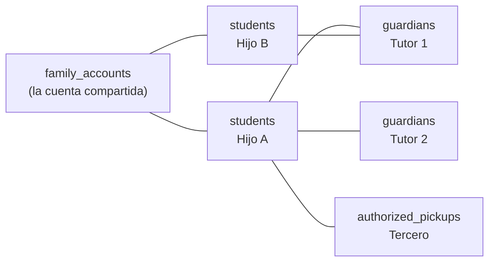

# F3 — Alumnos, Tutores y Cuentas Familiares

> [!info] Objetivo
> **La ficha del alumno y el modelo de familia.** Esta fase establece el concepto
> central del sistema de negocio: una cuenta familiar compartida entre hermanos, con
> fichas clínicas separadas.

---

## 1. Duración

| Dedicación | Duración |
|---|---|
| 8 h/semana | ~3 semanas |
| 15 h/semana | ~1.5 semanas |

---

## 2. Tareas

### 2.1 Migraciones de `students`

```text
students.students
students.guardians
students.student_guardians
students.family_accounts
students.family_account_members
students.authorized_pickups
```

**Decisiones clave:**

| Tabla | Decisión |
|---|---|
| `students` | `student_code` estable y legible, generado con secuencia + checksum |
| `student_guardians` | Tabla pivote con atributos (`relationship`, `is_primary`, `can_pickup`, `receives_admin_messages`) |
| `family_accounts` | `code` único, `status`, `credit_balance` **calculado** (no columna) |
| `family_account_members` | Historial de pertenencia: `joined_at`, `left_at`, `reason` |
| `authorized_pickups` | Terceros autorizados a retirar, con documento y vigencia |

### 2.2 El código de alumno

```php
// packages/students/src/Support/StudentCodeGenerator.php
declare(strict_types=1);

namespace Cai\Students\Support;

final class StudentCodeGenerator
{
    /**
     * Genera un código estable: ALU-AAAA-NNNN
     * AAAA = año de ingreso, NNNN = correlativo con checksum.
     */
    public function generate(int $year, ?string $preferred = null): string
    {
        if ($preferred !== null && $this->isValid($preferred)) {
            return $preferred;
        }

        $sequence = StudentCodeSequence::query()
            ->where('year', $year)
            ->lockForUpdate()
            ->first();

        if ($sequence === null) {
            $sequence = StudentCodeSequence::create(['year' => $year, 'current' => 0]);
        }

        $sequence->increment('current');
        $sequence->save();

        return sprintf('ALU-%04d-%04d', $year, $sequence->current);
    }

    private function isValid(string $code): bool
    {
        return (bool) preg_match('/^ALU-\d{4}-\d{4}$/', $code);
    }
}
```

> [!note] Por qué el código es legible
> El centro usa códigos de alumno en las planillas, en las listas de asistencia y en las
> carpetas. Un código legible (`ALU-2026-0042`) **reduce los errores humanos** frente a
> un UUID. Y es único y verificable.

### 2.3 Modelo de familia compartida



**Reglas:**

| Regla | Detalle |
|---|---|
| Un alumno pertenece a **una** cuenta familiar activa | `family_account_members` con `left_at IS NULL` |
| Un tutor puede atender a varios alumnos | Tabla pivote `student_guardians` |
| Un tutor tiene **un** tutor principal por alumno | `CHECK` con `partial unique index` |
| El traspaso entre cuentas deja historial | `family_account_members.left_at` se llena; no se borra la fila |
| Los hermanos tienen **fichas separadas** | Cada uno tiene su propia historia clínica |

```sql
-- Un solo tutor principal por alumno
CREATE UNIQUE INDEX students_student_guardians_primary_unique
    ON students.student_guardians (student_id)
    WHERE is_primary = TRUE;
```

### 2.4 Contracts

```php
// packages/students/src/Contracts/StudentDirectory.php
declare(strict_types=1);

namespace Cai\Students\Contracts;

interface StudentDirectory
{
    public function find(int $id): ?StudentSummary;

    /**
     * @since 1.0.0
     */
    public function findByCode(string $code): ?StudentSummary;

    /**
     * @return list<StudentSummary>
     */
    public function findByDocument(string $documentId): array;
}
```

```php
// packages/students/src/Contracts/StudentSummary.php
declare(strict_types=1);

namespace Cai\Students\Contracts;

final readonly class StudentSummary
{
    public function __construct(
        public int $id,
        public string $code,
        public string $firstName,
        public string $lastName,
        public \DateTimeImmutable $birthDate,
        public StudentStatus $status,
        public ?int $familyAccountId,
        public ?string $primaryGuardianName,
    ) {}

    public function fullName(): string
    {
        return trim("{$this->firstName} {$this->lastName}");
    }

    public function age(): int
    {
        return (int) $this->birthDate->diff(now())->y;
    }
}
```

> [!important] Los contratos devuelven DTOs, no modelos
> Así, un módulo consumidor **nunca** puede alcanzar los atributos privados del modelo
> ni disparar eventos de Eloquent ajenos. Es la frontera real.

### 2.5 Filament: recursos

| Resource | Notas |
|---|---|
| `StudentResource` | Ficha con pestañas: Datos, Tutores, Matrículas, Sesiones, Atención, Documentos, Cobranza |
| `GuardianResource` | Con sus alumnos asociados |
| `FamilyAccountResource` | Estado de cuenta, hermanos, historial de pertenencia |
| `AuthorizedPickupResource` | Terceros autorizados |

**El selector de alumnos en cualquier formulario aplica el scope:**

```php
// packages/students/src/Filament/Resources/StudentResource/Pages/ListStudents.php
protected function getTableQuery(): Builder
{
    return Student::query()
        ->visibleTo(auth()->user())   // ← el scope
        ->with(['guardians', 'familyAccount']);
}
```

### 2.6 El importador de la planilla actual

**Es el entregable más delicado de F3**, porque toca datos reales.

```bash
# Modo simulación (por defecto)
php artisan cai:import:students --file=/tmp/alumnos.csv --dry-run

# Reporte de rechazos
php artisan cai:import:students --file=/tmp/alumnos.csv --dry-run --report=/tmp/rechazos.csv
```

**Formato del CSV:**

```csv
codigo,nombre,apellido,fecha_nacimiento,documento,direccion,telefono,email_tutor,nombre_tutor,apellido_tutor,documento_tutor,email_tutor_2,nombre_tutor_2,apellido_tutor_2,documento_tutor_2,grupo
ALU-2024-0001,Ana,González,2018-05-14,1234567,Av. Siempre Viva 742,0981-123456,direccion@ejemplo.test,María,González,9876543,direccion2@ejemplo.test,Carlos,González,9876543,Grupo A
```

**Reporte de rechazos — cada fila rechazada tiene un motivo:**

| Motivo | Ejemplo |
|---|---|
| `missing_required_field` | Falta la fecha de nacimiento |
| `invalid_date` | `14/05/2018` en lugar de `2018-05-14` |
| `duplicate_document` | El documento ya existe |
| `duplicate_code` | El código ya existe |
| `invalid_email` | `maria@` |
| `guardian_without_student` | Tiene tutor pero no alumno |
| `future_birth_date` | Fecha de nacimiento futura |

```php
// packages/students/src/Actions/ImportStudents.php
final class ImportStudents
{
    /**
     * @return ImportResult
     */
    public function execute(ImportStudentsData $data): ImportResult
    {
        $accepted = 0;
        $rejected = [];
        $rows = $this->reader->read($data->filePath);

        foreach ($rows as $rowNumber => $row) {
            $validation = $this->validator->validate($row);

            if ($validation->fails()) {
                $rejected[] = [
                    'row'    => $rowNumber,
                    'code'   => $row['codigo'] ?? null,
                    'reason' => $validation->firstError(),
                ];

                continue;
            }

            if ($data->dryRun) {
                $accepted++;
                continue;
            }

            $this->importer->importRow($validation->validated(), $rowNumber);
            $accepted++;
        }

        return new ImportResult($accepted, $rejected, $data->dryRun);
    }
}
```

> [!danger] Reglas del importador
> 1. **Nunca pisa producción.** Se importa primero en staging y se valida.
> 2. **Nunca hay datos reales en el repositorio.** El CSV vive en el servidor, en `/tmp`, y se borra después.
> 3. **El modo `--dry-run` es el default** en la práctica: siempre se corre primero.
> 4. **Cada importación queda auditada** (`students.imported` con el conteo).
> 5. **Un alumno con el mismo documento no se duplica**: se actualiza o se rechaza, según el flag `--update`.

### 2.7 Tests

```php
it('allows a family to have multiple children with separate records', function () {
    $family = FamilyAccount::factory()->create();

    $hijoA = Student::factory()->create(['family_account_id' => $family->id]);
    $hijoB = Student::factory()->create(['family_account_id' => $family->id]);

    expect($family->students)->toHaveCount(2)
        ->and($hijoA->id)->not->toBe($hijoB->id);
});

it('allows only one primary guardian per student', function () {
    $student = Student::factory()->create();

    Guardian::factory()->create([
        'student_id' => $student->id,
        'is_primary' => true,
    ]);

    expect(fn () => Guardian::factory()->create([
        'student_id' => $student->id,
        'is_primary' => true,
    ]))->toThrow(QueryException::class);
});

it('keeps the history of family account membership', function () {
    $student = Student::factory()->create();

    $student->familyAccountMemberships()->update([
        'left_at' => now(),
        'left_reason' => 'Cambio de cuenta por mudanza',
    ]);

    expect($student->familyAccountMemberships()->count())->toBe(1);
});
```

---

## 3. Entregables

| # | Entregable | Verificable |
|---|---|---|
| E-01 | 6 tablas de `students` migradas | `cai:db:reset` |
| E-02 | Generación de `student_code` | Test de unicidad y formato |
| E-03 | `StudentDirectory` + DTOs | Contrato publicado |
| E-04 | 4 Resources de Filament | Panel navegable |
| E-05 | Importador con `--dry-run` y reporte de rechazos | Test con CSV de prueba |
| E-06 | Historial de pertenencia a cuenta familiar | Test |
| E-07 | Tutor principal único por alumno | Constraint + test |
| E-08 | Scope de visibilidad aplicado a listados y selectores | Test |

---

## 4. Gate de salida

> [!success] Condición para pasar a F4
> - [ ] Dos hermanos en la **misma** cuenta familiar con **fichas separadas**
> - [ ] Un tercero autorizado a retirar con documento cargado
> - [ ] El importador procesa la planilla real en `--dry-run` y el reporte de rechazos es razonable
> - [ ] Un alumno puede tener N tutores, y solo uno principal
> - [ ] El historial de pertenencia a cuenta familiar se conserva
> - [ ] Los listados de alumnos respetan el scope del usuario

---

## 5. Riesgos

| Riesgo | Mitigación |
|---|---|
| La planilla actual está en muy mal estado | El importador con reporte de rechazos; se limpia antes de la importación final |
| La noción de "familia" del centro no coincide con el modelo | Sesión de validación con Dirección antes de cerrar la fase |
| Se importan datos reales al repositorio | Regla estricta: el CSV nunca entra al repo. Test que verifica que `.csv` está en `.gitignore` |
| El importador pisa datos por error | `--dry-run` por defecto; el importador real **solo actualiza** con `--update` explícito |

---

## 6. Qué se pospone

| Se pospone a | Qué |
|---|---|
| F4 | Matrículas (requiere servicios) |
| F5 | Historial clínico en la ficha |
| F6 | Estado de cuenta en la familia |
| F8 | Importación final de datos reales |

---

## 7. Documentos relacionados

- [[08.01 Hoja de Ruta]]
- [[03.02 Alumnos, Tutores y Cuentas Familiares]]
- [[09.07 Importación de Datos Iniciales]]
- [[ADR-0007 Cuentas Familiares Compartidas]]
