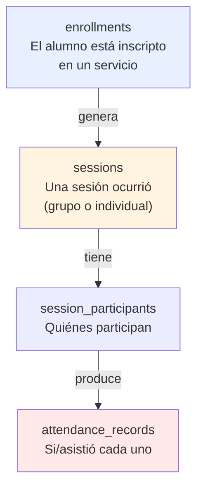

# F4 — Servicios, Profesionales y Agenda

> [!info] Objetivo
> **Sesiones individuales y grupales con asistencia.** La distinción central de esta
> fase: **inscripción ≠ sesión ≠ asistencia**.

---

## 1. Duración

| Dedicación | Duración |
|---|---|
| 8 h/semana | ~3 semanas |
| 15 h/semana | ~1.5 semanas |

---

## 2. Tareas

### 2.1 Migraciones de `scheduling`

```text
scheduling.services
scheduling.service_categories
scheduling.professionals
scheduling.professional_specialties
scheduling.enrollments
scheduling.enrollment_pause_requests
scheduling.groups
scheduling.group_members
scheduling.weekly_schedules
scheduling.sessions
scheduling.session_participants
scheduling.session_professionals
scheduling.attendance_records
scheduling.session_cancellations
scheduling.session_reschedules
```

### 2.2 La regla de no-superposición

> [!danger] La mejor garantía es la base de datos
> Una validación en PHP es una **optimización**. La garantía real de que un profesional
> no tiene dos sesiones superpuestas es una **restricción en PostgreSQL**.

```sql
ALTER TABLE scheduling.sessions
    ADD CONSTRAINT sessions_no_overlap
    EXCLUDE USING gist (
        professional_id WITH =,
        tstzrange(starts_at, ends_at, '[)') WITH &&
    )
    WHERE (status IN ('scheduled', 'in_progress'));
```

> [!warning] Gotcha G4 — `EXCLUDE` no aplica sobre tablas con FK a otra
> PostgreSQL no permite `EXCLUDE` con columnas que sean parte de una clave foránea. La
> solución adoptada es **desnormalizar** `starts_at` y `ends_at` en
> `scheduling.session_professionals`, sincronizadas por trigger:
>
> ```sql
> CREATE OR REPLACE FUNCTION scheduling.sync_session_times()
> RETURNS TRIGGER AS $$
> BEGIN
>     NEW.starts_at := (SELECT starts_at FROM scheduling.sessions WHERE id = NEW.session_id);
>     NEW.ends_at   := (SELECT ends_at   FROM scheduling.sessions WHERE id = NEW.session_id);
>     RETURN NEW;
> END;
> $$ LANGUAGE plpgsql;
>
> CREATE TRIGGER sync_session_times_trigger
>     BEFORE INSERT OR UPDATE ON scheduling.session_professionals
>     FOR EACH ROW EXECUTE FUNCTION scheduling.sync_session_times();
> ```
>
> El trigger también actualiza las filas existentes cuando cambia la sesión:
>
> ```sql
> CREATE OR REPLACE FUNCTION scheduling.update_session_times()
> RETURNS TRIGGER AS $$
> BEGIN
>     UPDATE scheduling.session_professionals
>     SET starts_at = NEW.starts_at, ends_at = NEW.ends_at
>     WHERE session_id = NEW.id;
>     RETURN NEW;
> END;
> $$ LANGUAGE plpgsql;
>
> CREATE TRIGGER update_session_times_trigger
>     AFTER UPDATE OF starts_at, ends_at ON scheduling.sessions
>     FOR EACH ROW EXECUTE FUNCTION scheduling.update_session_times();
> ```

### 2.3 La distinción: inscripción ≠ sesión ≠ asistencia



**Regla fundamental:**

> Una sesión grupal = **1** registro en `sessions` + **N** en `session_participants` +
> **N** en `attendance_records`.

```php
// packages/scheduling/src/Actions/ScheduleSession.php
final class ScheduleSession
{
    public function execute(ScheduleSessionData $data): Session
    {
        return DB::connection('scheduling')->transaction(function () use ($data): Session {
            $session = Session::create([
                'service_id'   => $data->serviceId,
                'group_id'     => $data->groupId,
                'starts_at'    => $data->startsAt,
                'ends_at'      => $data->endsAt,
                'status'       => SessionStatus::Scheduled,
                'created_by'   => Auth::id(),
            ]);

            foreach ($data->participants as $studentId) {
                $session->participants()->create([
                    'participant_student_id' => $studentId,
                    'enrollment_id'          => $data->enrollments[$studentId] ?? null,
                ]);
            }

            foreach ($data->professionals as $professional) {
                $session->professionals()->create([
                    'professional_id' => $professional['id'],
                    'assignment_role' => $professional['role'],   // responsible | assistant
                ]);
            }

            return $session;
        });
    }
}
```

### 2.4 Generación de sesiones desde horarios recurrentes

```php
// packages/scheduling/src/Actions/GenerateRecurringSessions.php
final class GenerateRecurringSessions
{
    /**
     * Genera las sesiones de las próximas N semanas a partir de los horarios
     * semanales, evitando duplicar las ya existentes.
     */
    public function execute(GenerateRecurringSessionsData $data): int
    {
        $created = 0;
        $existing = Session::query()
            ->whereBetween('starts_at', [$data->from, $data->to])
            ->pluck('starts_at')
            ->map(fn ($d) => $d->format('Y-m-d H:i'))
            ->flip();

        foreach (WeeklySchedule::query()->active()->get() as $schedule) {
            $cursor = $data->from->copy();

            while ($cursor->lessThan($data->to)) {
                if ($schedule->occursOn($cursor)) {
                    $startsAt = $cursor->copy()->setTimeFrom($schedule->start_time);

                    if (! $existing->has($startsAt->format('Y-m-d H:i'))) {
                        $this->createSessionFor($schedule, $startsAt);
                        $created++;
                    }
                }

                $cursor->addDay();
            }
        }

        return $created;
    }
}
```

> [!important] El job es idempotente
> Si se ejecuta dos veces en la misma ventana, no duplica sesiones. Esto permite correrlo
> a diario sin riesgo.

```cron
# /etc/cron.d/cai-schedule  o como job programado de Laravel
0 2 * * * cd /srv/cai/current && php artisan cai:sessions:generate --weeks=4
```

### 2.5 Registro de asistencia

```php
// packages/scheduling/src/Actions/RecordAttendance.php
final class RecordAttendance
{
    public function execute(RecordAttendanceData $data): AttendanceSummary
    {
        return DB::connection('scheduling')->transaction(function () use ($data): AttendanceSummary {
            $session = Session::with('participants')->findOrFail($data->sessionId);

            foreach ($data->records as $record) {
                $participant = $session->participants
                    ->firstWhere('participant_student_id', $record['participant_student_id']);

                if ($participant === null) {
                    throw new ParticipantNotFoundException(
                        "El alumno {$record['participant_student_id']} no participa de la sesión."
                    );
                }

                AttendanceRecord::updateOrCreate(
                    [
                        'session_id'             => $session->id,
                        'participant_student_id' => $record['participant_student_id'],
                    ],
                    [
                        'status'       => $record['status'],
                        'justification'=> $record['justification'] ?? null,
                        'recorded_by'  => Auth::id(),
                        'recorded_at'  => now(),
                    ],
                );
            }

            return new AttendanceSummary($session->id, count($data->records));
        });
    }
}
```

**Estados de asistencia:**

| Estado | Significado | Requiere justificación |
|---|---|---|
| `present` | Asistió | No |
| `absent` | No asistió | No (salvo que el centro lo exija) |
| `late` | Asistió tarde | No |
| `justified` | Ausencia justificada | ✅ Sí |
| `excused` | Ausencia autorizada por el centro | ✅ Sí |

### 2.6 Cancelación y reprogramación

> [!important] Nada se borra
> Una sesión cancelada **conserva** su registro con `status = 'cancelled'` y un motivo. Una
> sesión reprogramada crea una **sesión nueva** enlazada a la original.

```php
// packages/scheduling/src/Actions/RescheduleSession.php
final class RescheduleSession
{
    public function execute(RescheduleSessionData $data): Session
    {
        return DB::connection('scheduling')->transaction(function () use ($data): Session {
            $original = Session::findOrFail($data->sessionId);

            $new = Session::create([
                'service_id'         => $original->service_id,
                'group_id'           => $original->group_id,
                'starts_at'          => $data->newStartsAt,
                'ends_at'            => $data->newEndsAt,
                'status'             => SessionStatus::Scheduled,
                'rescheduled_from_id'=> $original->id,
                'created_by'         => Auth::id(),
            ]);

            // Los participantes y profesionales se replican
            $original->participants()->each(
                fn ($p) => $new->participants()->create($p->only([
                    'participant_student_id', 'enrollment_id',
                ]))
            );

            $original->update([
                'status'         => SessionStatus::Rescheduled,
                'rescheduled_to_id' => $new->id,
            ]);

            return $new;
        });
    }
}
```

### 2.7 Filament: recursos

| Resource | Notas |
|---|---|
| `ServiceResource` | Con sus categorías |
| `ProfessionalResource` | Con especialidades y horarios |
| `EnrollmentResource` | Inscripciones de alumnos en servicios |
| `GroupResource` | Grupos y sus miembros |
| `SessionResource` | Listado, filtros por fecha, profesional, grupo |
| `SessionCalendarPage` | Vista de calendario (FullCalendar) |
| `AttendanceResource` | Registro de asistencia por sesión |

**La vista de calendario es el corazón operativo:**

```php
// packages/scheduling/src/Filament/Pages/SessionCalendar.php
protected function getEvents(): array
{
    return Session::query()
        ->visibleTo(auth()->user())
        ->with(['service', 'professionals', 'group'])
        ->whereBetween('starts_at', [now()->startOfWeek(), now()->endOfWeek()])
        ->get()
        ->map(fn (Session $session) => [
            'id'    => $session->id,
            'title' => $session->service->name . ' — ' . $session->group?->name,
            'start' => $session->starts_at->toISOString(),
            'end'   => $session->ends_at->toISOString(),
            'color' => $this->colorFor($session),
        ])
        ->all();
}
```

### 2.8 Tests

```php
it('creates one session record and multiple attendance records for a group session', function () {
    $session = app(ScheduleSession::class)->execute(new ScheduleSessionData(
        serviceId: $service->id,
        groupId: $group->id,
        startsAt: now()->addHour(),
        endsAt: now()->addHours(2),
        participants: [$alumno1->id, $alumno2->id, $alumno3->id],
    ));

    expect(Session::count())->toBe(1)
        ->and($session->participants()->count())->toBe(3);

    app(RecordAttendance::class)->execute(new RecordAttendanceData(
        sessionId: $session->id,
        records: [
            ['participant_student_id' => $alumno1->id, 'status' => 'present'],
            ['participant_student_id' => $alumno2->id, 'status' => 'absent'],
            ['participant_student_id' => $alumno3->id, 'status' => 'present'],
        ],
    ));

    expect(AttendanceRecord::count())->toBe(3);
});

it('rejects overlapping sessions for the same professional', function () {
    app(ScheduleSession::class)->execute(new ScheduleSessionData(
        serviceId: $service->id,
        startsAt: now()->setTime(10, 0),
        endsAt: now()->setTime(11, 0),
        participants: [$alumno->id],
        professionals: [['id' => $profesional->id, 'role' => 'responsible']],
    ));

    expect(fn () => app(ScheduleSession::class)->execute(new ScheduleSessionData(
        serviceId: $service->id,
        startsAt: now()->setTime(10, 30),
        endsAt: now()->setTime(11, 30),
        participants: [$otroAlumno->id],
        professionals: [['id' => $profesional->id, 'role' => 'responsible']],
    )))->toThrow(QueryException::class);
});

it('keeps the original session when rescheduling', function () {
    $original = ...;

    $new = app(RescheduleSession::class)->execute(new RescheduleSessionData(
        sessionId: $original->id,
        newStartsAt: now()->addDay()->setTime(10, 0),
        newEndsAt: now()->addDay()->setTime(11, 0),
        reason: 'El profesional se reportó enfermo',
    ));

    expect($original->fresh()->status)->toBe('rescheduled')
        ->and($original->fresh()->rescheduled_to_id)->toBe($new->id)
        ->and(Session::count())->toBe(2);
});
```

---

## 3. Entregables

| # | Entregable | Verificable |
|---|---|---|
| E-01 | 15 tablas de `scheduling` migradas | `cai:db:reset` |
| E-02 | Restricción de no-superposición activa | Test que la BD **rechaza** el solapamiento |
| E-03 | Triggers de sincronización de horarios | Test |
| E-04 | Generación de sesiones recurrentes (idempotente) | Test de doble ejecución |
| E-05 | Registro de asistencia por participante | Test |
| E-06 | Cancelación y reprogramación sin borrado | Test |
| E-07 | 7 Resources de Filament + calendario | Panel navegable |
| E-08 | `SessionPolicy` con scope | Test |

---

## 4. Gate de salida

> [!success] Condición para pasar a F5
> - [ ] Una sesión grupal tiene **1** registro de sesión y **N** de asistencia
> - [ ] La base de datos **rechaza** una superposición de horario del mismo profesional
> - [ ] La reprogramación conserva la sesión original y crea una nueva enlazada
> - [ ] El generador de sesiones recurrentes es idempotente
> - [ ] Un profesional solo ve las sesiones de las que es responsable o asistente
> - [ ] La asistencia se puede registrar y corregir (queda auditada)

---

## 5. Riesgos

| Riesgo | Mitigación |
|---|---|
| La restricción `EXCLUDE` genera falsos positivos | Se prueba con datos reales en staging antes de F8 |
| El trigger de sincronización no cubre todos los casos | Test que mueve una sesión y verifica que la restricción sigue funcionando |
| El centro tiene horarios más complejos de lo previsto | Sesión de validación con Coordinación antes del gate |
| La agenda se vuelve lenta con muchos registros | Paginación, índices por fecha, y vistas filtradas |

---

## 6. Qué se pospone

| Se pospone a | Qué |
|---|---|
| F5 | Planes de atención enlazados a los alumnos |
| F6 | Cobro por sesión (esperando P1) |
| F7 | Avisos automáticos de cita |
| F8 | Panel de ocupación de profesionales |

---

## 7. Documentos relacionados

- [[08.01 Hoja de Ruta]]
- [[03.03 Servicios, Profesionales y Matrículas]]
- [[03.04 Grupos, Sesiones y Asistencia]]
- [[03.08 Catálogo de Enumeraciones e Integridad]]
