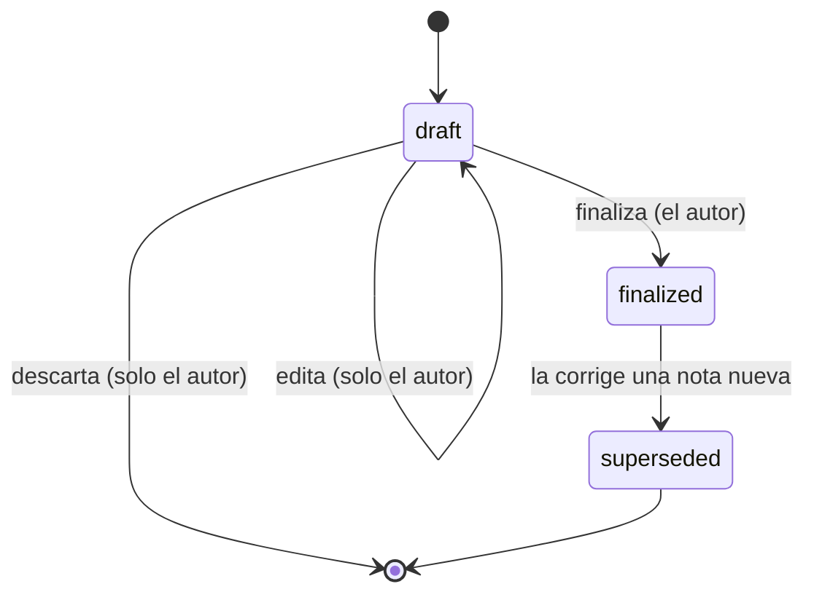

# F5 — Seguimiento Clínico

> [!danger] La fase más delicada
> Esta fase maneja **información de salud de menores**. Es la que tiene los requisitos de
> seguridad más estrictos y la que **no admite atajos**. Si el tiempo aprieta, se recorta
> el alcance de F4 o F6, **nunca** la seguridad de F5.

---

## 1. Duración

| Dedicación | Duración |
|---|---|
| 8 h/semana | ~2 semanas |
| 15 h/semana | ~1 semana |

> [!warning] Bloqueo parcial
> **P4** (plazo de conservación de las notas clínicas) está abierto. La fase **puede
> avanzar**: se implementa con la regla más conservadora ("no se borra nada") y el plazo
> concreto se define después. Ver [[04.04 Datos Clínicos: Cifrado y Acceso]] §7.

---

## 2. Tareas

### 2.1 Migraciones de `care`

```text
care.care_plans
care.care_plan_professionals
care.care_goals
care.care_goal_progress_entries
care.clinical_notes
care.clinical_note_access_grants
care.retention_policies
```

### 2.2 El cifrado del contenido

```php
// packages/care/src/Models/ClinicalNote.php
final class ClinicalNote extends Model
{
    protected $connection = 'care';

    protected $table = 'clinical_notes';

    protected $fillable = [
        'student_id', 'author_user_id', 'session_id', 'care_plan_id',
        'note_type', 'status', 'content', 'summary',
        'supersedes_note_id', 'correction_reason',
        'recorded_at', 'finalized_at',
    ];

    protected $casts = [
        'content'      => 'encrypted',           // AES-256-GCM
        'recorded_at'  => 'immutable_datetime',
        'finalized_at' => 'immutable_datetime',
    ];
}
```

**Test que verifica el cifrado en reposo:**

```php
it('encrypts the clinical note content at rest', function () {
    $note = ClinicalNote::factory()->create([
        'content' => 'Contenido ultra sensible sobre el alumno.',
    ]);

    // Se lee el valor crudo de la base de datos
    $raw = DB::connection('care')->table('clinical_notes')
        ->where('id', $note->id)
        ->value('content');

    expect($raw)->not->toContain('ultra sensible')
        ->and($note->fresh()->content)->toBe('Contenido ultra sensible sobre el alumno.');
});
```

### 2.3 El ciclo de vida de la nota



```php
// packages/care/src/Actions/FinalizeClinicalNote.php
final class FinalizeClinicalNote
{
    public function execute(FinalizeClinicalNoteData $data): ClinicalNote
    {
        return DB::connection('care')->transaction(function () use ($data): ClinicalNote {
            $note = ClinicalNote::findOrFail($data->noteId);

            if ($note->status !== ClinicalNoteStatus::Draft) {
                throw new NoteAlreadyFinalizedException(
                    'La nota ya fue finalizada. Para corregirla, se crea una nota nueva.'
                );
            }

            if ($note->author_user_id !== Auth::id()) {
                throw new NotNoteAuthorException('Solo el autor puede finalizar la nota.');
            }

            $note->update([
                'status'       => ClinicalNoteStatus::Finalized,
                'finalized_at' => now(),
            ]);

            Audit::record('clinical_note.finalized', ClinicalNote::class, $note->id, [
                'student_id' => $note->student_id,
            ]);

            return $note->fresh();
        });
    }
}
```

### 2.4 La corrección: nota nueva, no edición

```php
// packages/care/src/Actions/SupersedeClinicalNote.php
final class SupersedeClinicalNote
{
    public function execute(SupersedeClinicalNoteData $data): ClinicalNote
    {
        return DB::connection('care')->transaction(function () use ($data): ClinicalNote {
            $original = ClinicalNote::findOrFail($data->noteId);

            if ($original->status === ClinicalNoteStatus::Draft) {
                throw new NotFinalizedException('Una nota en borrador se edita, no se corrige.');
            }

            if (mb_strlen($data->correctionReason) < 20) {
                throw new ReasonTooShortException('El motivo de la corrección debe tener al menos 20 caracteres.');
            }

            $correction = ClinicalNote::create([
                'student_id'        => $original->student_id,
                'author_user_id'    => Auth::id(),
                'session_id'        => $original->session_id,
                'care_plan_id'      => $original->care_plan_id,
                'note_type'         => $original->note_type,
                'status'            => ClinicalNoteStatus::Finalized,
                'content'           => $data->newContent,
                'summary'           => $data->newSummary,
                'supersedes_note_id'=> $original->id,
                'correction_reason' => $data->correctionReason,
                'recorded_at'       => now(),
                'finalized_at'      => now(),
            ]);

            $original->update(['status' => ClinicalNoteStatus::Superseded]);

            Audit::record('clinical_note.superseded', ClinicalNote::class, $original->id, [
                'student_id' => $original->student_id,
                'context'    => ['correction_note_id' => $correction->id],
            ]);

            return $correction;
        });
    }
}
```

### 2.5 `ClinicalNotePolicy` completa

```php
// packages/care/src/Policies/ClinicalNotePolicy.php
final class ClinicalNotePolicy
{
    public function viewAny(User $user): bool
    {
        return $user->hasPermissionTo('care.notes.view');
    }

    public function view(User $user, ClinicalNote $note): bool
    {
        if (! $user->hasPermissionTo('care.notes.view')) {
            return false;
        }

        // El autor siempre accede a lo suyo
        if ($note->author_user_id === $user->id) {
            return true;
        }

        // Acceso excepcional concedido y vigente
        if ($note->hasActiveGrantFor($user->id)) {
            return true;
        }

        // Alcance: asignación profesional vigente
        return $user->hasActiveClinicalAssignmentFor($note->student_id);
    }

    public function create(User $user): bool
    {
        return $user->hasPermissionTo('care.notes.create')
            && $user->hasActiveProfessionalProfile();
    }

    public function update(User $user, ClinicalNote $note): bool
    {
        return $note->status === ClinicalNoteStatus::Draft
            && $note->author_user_id === $user->id
            && $user->hasPermissionTo('care.notes.create');
    }

    public function delete(User $user, ClinicalNote $note): bool
    {
        return false;
    }
}
```

### 2.6 Grants de acceso excepcional

```php
// packages/care/src/Actions/IssueClinicalNoteGrant.php
final class IssueClinicalNoteGrant
{
    public function execute(IssueClinicalNoteGrantData $data): ClinicalNoteAccessGrant
    {
        if (mb_strlen($data->reason) < 20) {
            throw new ReasonTooShortException(
                'El motivo del acceso excepcional debe tener al menos 20 caracteres.'
            );
        }

        $maxDays = config('cai.seguridad.clinical_grant_max_days', 30);

        $grant = ClinicalNoteAccessGrant::create([
            'granted_to_user_id' => $data->userId,
            'student_id'         => $data->studentId,
            'clinical_note_id'   => $data->clinicalNoteId,
            'reason'             => $data->reason,
            'granted_by_user_id' => Auth::id(),
            'granted_at'         => now(),
            'expires_at'         => now()->addDays(min($data->days ?? 7, $maxDays)),
        ]);

        SecurityEvent::create([
            'event_type'   => 'grant.issued',
            'severity'     => 'warning',
            'user_id'      => $data->userId,
            'student_id'   => $data->studentId,
            'resource_type'=> ClinicalNote::class,
            'reason'       => $data->reason,
        ]);

        return $grant;
    }
}
```

**Job de expiración:**

```php
// packages/care/src/Jobs/ExpireClinicalNoteGrants.php
final class ExpireClinicalNoteGrants implements ShouldQueue
{
    public function handle(): void
    {
        $grants = ClinicalNoteAccessGrant::query()
            ->whereNull('revoked_at')
            ->where('expires_at', '<', now())
            ->get();

        foreach ($grants as $grant) {
            $grant->update(['revoked_at' => now(), 'revocation_reason' => 'Expiración automática']);

            SecurityEvent::create([
                'event_type' => 'grant.expired',
                'severity'   => 'info',
                'user_id'    => $grant->granted_to_user_id,
                'student_id' => $grant->student_id,
            ]);
        }
    }
}
```

### 2.7 Auditoría de lectura

```php
// packages/care/src/Observers/ClinicalNoteObserver.php
final class ClinicalNoteObserver
{
    public function retrieved(ClinicalNote $note): void
    {
        // Solo se audita la lectura explícita, no la carga desde una relación
        if (! ClinicalNote::$auditingReads) {
            return;
        }

        if (! $note->wasRecentlyCreated) {
            Audit::record('clinical_note.viewed', ClinicalNote::class, $note->getKey(), [
                'student_id' => $note->student_id,
                'context'    => ['note_type' => $note->note_type->value],
            ]);
        }
    }
}
```

### 2.8 Filament: recursos con filtro de alcance

| Resource | Notas |
|---|---|
| `CarePlanResource` | Con sus profesionales y objetivos |
| `CareGoalResource` | Objetivos con su progreso |
| `ClinicalNoteResource` | **El más sensible**: scope por asignación, sin edición de finalizadas |
| `ClinicalNoteAccessGrantResource` | Solo Dirección y Coordinación |

**El listado de notas solo muestra el `summary`, nunca el contenido en la tabla:**

```php
// packages/care/src/Filament/Resources/ClinicalNoteResource.php
public static function table(Table $table): Table
{
    return $table
        ->columns([
            Tables\Columns\TextColumn::make('student.name')->label('Alumno')->searchable(),
            Tables\Columns\TextColumn::make('note_type')->label('Tipo')->badge(),
            Tables\Columns\TextColumn::make('recorded_at')->label('Fecha')->sortable(),
            Tables\Columns\TextColumn::make('status')->label('Estado')->badge(),
            Tables\Columns\TextColumn::make('summary')
                ->label('Resumen')
                ->limit(80)
                ->wrap(),
        ])
        // NO se incluye la columna 'content'
    ;
}
```

### 2.9 La prohibición de fugas

```php
it('does not include clinical notes in administrative exports', function () {
    ClinicalNote::factory()->finalized()->create([
        'content' => 'Observación clínica muy específica sobre el alumno.',
    ]);

    $csv = app(StudentExportAction::class)->execute(['all' => true]);

    expect($csv->getContent())->not->toContain('Observación clínica muy específica');
});

it('excludes clinical notes from global search', function () {
    // Filament GlobalSearch no incluye modelos de care
    expect(GlobalSearch::get()->getResults())
        ->not->toContain(ClinicalNote::class);
});

it('denies clinical notes to the technical administrator', function () {
    $user = User::factory()->withRole('admin_tecnico')->create();
    $note = ClinicalNote::factory()->finalized()->create();

    expect($user->can('view', $note))->toBeFalse();
});

it('denies clinical notes to the finance administrator', function () {
    $user = User::factory()->withRole('finanzas')->create();
    $note = ClinicalNote::factory()->finalized()->create();

    expect($user->can('view', $note))->toBeFalse();
});

it('allows access with an active grant', function () {
    $note = ClinicalNote::factory()->finalized()->create();

    ClinicalNoteAccessGrant::create([
        'granted_to_user_id' => $user->id,
        'student_id'         => $note->student_id,
        'reason'             => 'Solicitud de Dirección para informe de avance',
        'granted_at'         => now(),
        'expires_at'         => now()->addDays(7),
    ]);

    expect($user->can('view', $note))->toBeTrue();
});

it('denies access with an expired grant', function () {
    $note = ClinicalNote::factory()->finalized()->create();

    ClinicalNoteAccessGrant::create([
        'granted_to_user_id' => $user->id,
        'student_id'         => $note->student_id,
        'reason'             => 'Solicitud de Dirección para informe de avance',
        'granted_at'         => now()->subDays(10),
        'expires_at'         => now()->subDay(),
    ]);

    expect($user->can('view', $note))->toBeFalse();
});
```

---

## 3. Entregables

| # | Entregable | Verificable |
|---|---|---|
| E-01 | 7 tablas de `care` migradas | `cai:db:reset` |
| E-02 | Contenido cifrado en reposo | Test que lee el valor crudo |
| E-03 | Ciclo borrador → finalizada → superseded | 3 tests |
| E-04 | `ClinicalNotePolicy` completa | Test por rama |
| E-05 | Grants con motivo ≥ 20 chars, expiración y revocación | Tests |
| E-06 | Job de expiración de grants | Test con `travel()` |
| E-07 | 4 Resources con scope | Test de aislamiento entre profesionales |
| E-08 | Auditoría de lectura | Test que verifica la entrada |
| E-09 | Pruebas de no-fuga (exportaciones, búsqueda, roles) | 5 tests |
| E-10 | Tabla `care.retention_policies` creada (para P4) | Migración |

---

## 4. Gate de salida

> [!success] Condición para pasar a F6
> - [ ] Un profesional **no** ve notas de alumnos no asignados
> - [ ] El administrador técnico **tampoco** ve notas
> - [ ] Finanzas y Secretaría **tampoco**
> - [ ] Toda lectura sensible queda auditada
> - [ ] El contenido está cifrado en reposo y se descifra correctamente
> - [ ] Una nota finalizada **no** se puede editar; la corrección crea una nota nueva con motivo
> - [ ] Un grant con motivo corto **no** se puede emitir
> - [ ] Un grant vencido **no** da acceso
> - [ ] Las notas **no** aparecen en exportaciones ni en la búsqueda global

---

## 5. Riesgos

| Riesgo | Mitigación |
|---|---|
| Un profesional accede a notas de otro por un selector sin filtrar | Test específico de selectores con scope |
| El contenido cifrado no se puede buscar | Aceptado: se usa `summary` y filtros estructurados. Documentado |
| Se filtra una nota en una exportación | Test de no-fuga + revisión en el checklist de PR |
| P4 sin resolver | Se implementa con "no se borra nada". La tabla de políticas queda lista |
| El hash de notas ocupa más espacio (base64) | ~33% más. Irrelevante a esta escala |

---

## 6. Qué se pospone

| Se pospone a | Qué |
|---|---|
| F6 | Los objetivos del plan por servicio (depende de los servicios) |
| F8 | Dashboard de indicadores clínicos agregados (depende de P7) |
| F9 | Proceso de anonimización por retención |
| F8 | Exportación de la ficha clínica completa en PDF |

---

## 7. Documentos relacionados

- [[08.01 Hoja de Ruta]]
- [[03.05 Planes de Atención y Notas Clínicas]]
- [[04.03 Autorización por Registro]]
- [[04.04 Datos Clínicos: Cifrado y Acceso]]
- [[ADR-0006 Cifrado de Notas Clínicas]]
