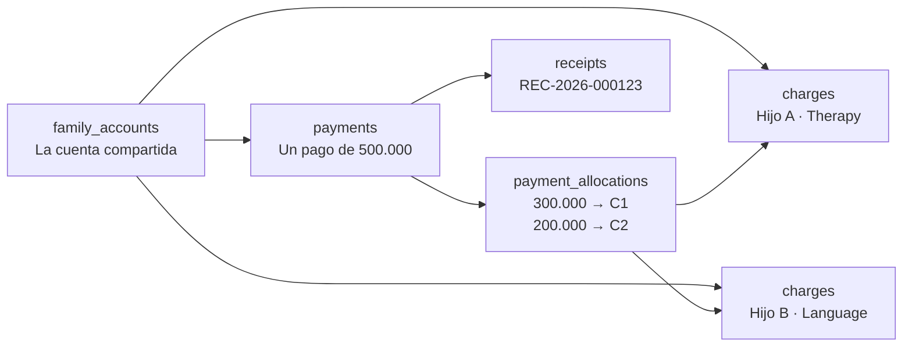

# F6 — Finanzas Familiares

> [!warning] Fase bloqueada por decisiones de Dirección
> Esta fase **no puede arrancar** hasta que Dirección responda:
> - **P1** — ¿El cobro es fijo mensual o por unidad de sesión?
> - **P2** — ¿Cómo se redondean los Guaraníes (a los 100, 500, 1000 más cercanos)?
>
> Mientras tanto se puede avanzar con la parte que no depende: la estructura de tablas,
> la cuenta familiar, el modelo de imputación y la emisión de recibos. Ver
> [[01.07 Preguntas Abiertas y Decisiones Pendientes]].

---

## 1. Duración

| Dedicación | Duración |
|---|---|
| 8 h/semana | ~3 semanas |
| 15 h/semana | ~1.5 semanas |

---

## 2. Decisiones de negocio que hay que cerrar

### 2.1 P1 — Modelo de cobro

| Opción | Descripción | Ventajas | Desventajas |
|---|---|---|---|
| **A. Cuota fija mensual** | Un monto por servicio, se cobre el día 1 | Simple, predecible, sin sorpresas para la familia | No refleja la asistencia real; hay que definir el ajuste por ausencias |
| **B. Por unidad de sesión** | Se cobra cada sesión efectivamente dictada | Justo con el uso, refleja la asistencia | Requiere definir qué pasa con cancelaciones y reprogramaciones; el saldo fluctúa |
| **C. Cuota fija con ajuste** | Cuota base + notas de crédito por ausencias | Combina previsibilidad con justicia | Más complejo de explicar a las familias |

> [!important] Recomendación técnica (no es una decisión del dev)
> **C, con un tope de notas de crédito.** Es la opción que más se parece a lo que la
> gente espera ("pago todos los meses, y si mi hijo no asiste me descuentan"), pero
> necesita que Dirección defina el tope y el porcentaje. **Si Dirección no define nada,
> se implementa A** (cuota fija sin ajustes) porque es la más simple de explicar, de
> auditar y de revertir.

**Datos necesarios de Dirección:**

| # | Pregunta | Por qué importa |
|---|---|---|
| 1 | ¿El monto depende del servicio, del grupo o del profesional? | Define la estructura de `charges` |
| 2 | ¿Cuántas sesiones tiene un mes "completo"? | Define la base del cálculo por unidad |
| 3 | ¿Las ausencias justificadas se descuentan? | Define el flujo de notas de crédito |
| 4 | ¿Hay un tope de descuentos por mes? | Evita que la familia debe saldo a favor ilimitado |
| 5 | ¿El pago anticipado genera saldo a favor o descuento? | Afecta al modelo de `payment_allocations` |
| 6 | ¿Se cobra a las familias que deben, o se bloquea el servicio? | Decisión de negocio que la app debe aplicarlo |

### 2.2 P2 — Redondeos

| Opción | Ejemplo | Ventaja | Desventaja |
|---|---|---|---|
| **A. Sin redondeo** | 37.500,00 | Exacto | Genera importes no redondos |
| **B. Redondeo a los 100 más cercanos** | 37.500 → 37.500 | Limpio | Puede haber diferencia de 1–2 Gs. por operación |
| **C. Redondeo a los 1.000 más cercanos** | 37.500 → 38.000 | Muy limpio | Diferencias mayores |
| **D. Redondeo al final, no por ítem** | Se suma todo y se redondea una vez | Coherente | Puede no coincidir con lo que dice la factura |

**Regla técnica:** el redondeo se aplica **al calcular**, nunca al almacenar. Se guarda el
valor exacto y se redondea en la capa de presentación (`Money::format()`), con un
`rounding_mode` configurable por ambiente. La regla debe ser la misma en todos los
lugares que muestran importes.

---

## 3. Tareas

### 3.1 Migraciones de `billing`

```text
billing.billing_plans
billing.billing_plan_items
billing.charges
billing.charge_adjustments
billing.payments
billing.payment_allocations
billing.receipts
billing.receipt_sequences
billing.cash_sessions
billing.cash_movements
billing.family_account_balances   -- vista materializada o tabla de saldos por periodo
```

**Decisiones clave del modelo:**

| Tabla | Decisión |
|---|---|
| `charges` | Conserva `family_account_id` + `student_id` + `enrollment_id`. **Los tres** |
| `charges` | **No** tiene columna de saldo. El saldo se calcula desde `payment_allocations` |
| `charges.status` | `pending`, `partially_paid`, `paid`, `overdue`, `waived`, `cancelled` |
| `payments` | Un pago es un movimiento de dinero. **No** se asigna a un solo alumno |
| `payment_allocations` | Reparte un pago entre N cargos. Es el corazón del modelo |
| `receipts` | Numerado por `receipt_sequences` con `UPDATE ... RETURNING` |
| `receipts` | Es **impreso**, no enviado por email (el centro entrega papel) |
| Nada se borra | Un cargo se `cancelled` con motivo; un pago se `voided` con motivo y restituye las imputaciones |

### 3.2 La cuenta familiar compartida



> [!important] El caso que define el modelo
> Una familia con dos hermanos inscriptos en servicios distintos paga **una sola
> transferencia**. El sistema debe imputar ese pago a los cargos de **ambos** hermanos,
> generar **un** recibo por la transferencia y mostrar el saldo **por familia** y
> **por hermano**. Este es el test que define si la fase está bien implementada.

### 3.3 El motor de imputación

```php
// packages/billing/src/Actions/AllocatePayment.php
declare(strict_types=1);

namespace Cai\Billing\Actions;

use Cai\Billing\Support\Money;
use Cai\Billing\Support\AllocationStrategy;

final class AllocatePayment
{
    public function __construct(private readonly AllocationStrategy $strategy) {}

    /**
     * @return list<Allocation>
     */
    public function execute(AllocatePaymentData $data): array
    {
        $paymentAmount = Money::parse($data->paymentAmount);

        if ($paymentAmount->isZero() || $paymentAmount->isNegative()) {
            throw new InvalidPaymentAmountException('El importe del pago debe ser mayor a cero.');
        }

        // Los cargos elegibles: de la familia, pendientes, ordenados por antigüedad.
        $charges = Charge::query()
            ->where('family_account_id', $data->familyAccountId)
            ->whereIn('status', ['pending', 'partially_paid', 'overdue'])
            ->orderByRaw("CASE status WHEN 'overdue' THEN 0 ELSE 1 END")
            ->orderBy('due_date')
            ->orderBy('id')
            ->get();

        $remaining = $paymentAmount;
        $allocations = [];

        foreach ($charges as $charge) {
            if ($remaining->isZero()) {
                break;
            }

            $outstanding = $charge->outstandingAmount();

            if ($outstanding->isZero()) {
                continue;
            }

            $applied = $remaining->isLessThan($outstanding) ? $remaining : $outstanding;

            $allocations[] = new Allocation(
                chargeId: $charge->id,
                amount: $applied,
            );

            $remaining = $remaining->minus($applied);
        }

        // Si sobra dinero, queda como saldo a favor (depende de P1, opción de configuración).
        if (! $remaining->isZero()) {
            $allocations[] = Allocation::creditBalance($data->familyAccountId, $remaining);
        }

        return $allocations;
    }
}
```

**Estrategias de imputación (configurables):**

| Estrategia | Regla | Cuándo |
|---|---|---|
| `oldest_first` | Al cargo más antiguo primero (incluidos vencidos) | Por defecto |
| `by_student` | Primero a los cargos del alumno indicado, luego al resto | Cuando la familia dice "esto es para mi hijo mayor" |
| `manual` | El usuario elige cargo por cargo | Cuando hay una indicación puntual |

### 3.4 El pago y su imputación, en una sola transacción

```php
// packages/billing/src/Actions/RegisterPayment.php
final class RegisterPayment
{
    public function __construct(private readonly Auditor $auditor) {}

    public function execute(RegisterPaymentData $data): RegisterPaymentResult
    {
        $amount = Money::parse($data->amount);

        if ($amount->isZero()) {
            throw new InvalidAllocationException('El importe del pago debe ser mayor a cero.');
        }

        return DB::connection('billing')->transaction(function () use ($data, $amount): RegisterPaymentResult {
            $payment = Payment::create([
                'family_account_id' => $data->familyAccountId,
                'amount'            => $amount->value(),
                'method'            => $data->method,
                'reference'         => $data->reference,
                'paid_at'           => $data->paidAt,
                'status'            => PaymentStatus::Applied,
                'received_by_user_id' => Auth::id(),
            ]);

            $allocations = $data->allocations !== []
                ? $data->allocations
                : $this->allocator->execute(new AllocatePaymentData(
                    familyAccountId: $data->familyAccountId,
                    paymentAmount: $amount->value(),
                    strategy: $data->strategy ?? 'oldest_first',
                ));

            $totalAllocated = Money::zero();

            foreach ($allocations as $allocation) {
                $this->allocationRepository->apply($payment, $allocation);
                $totalAllocated = $totalAllocated->plus($allocation->amount);
            }

            if ($totalAllocated->isGreaterThan($amount)) {
                throw new OverAllocationException(
                    'La suma de las imputaciones no puede superar el importe del pago.'
                );
            }

            $receipt = $this->receiptIssuer->issue($payment, $allocations);

            $this->auditor->record('payment.registered', Payment::class, $payment->id, [
                'connection' => 'billing',
                'changes' => [
                    'amount'    => $amount->value(),
                    'method'    => $data->method,
                    'allocations_count' => count($allocations),
                ],
            ]);

            return new RegisterPaymentResult($payment, $allocations, $receipt);
        });
    }
}
```

> [!important] Todo o nada
> El pago, sus imputaciones, el recibo y la auditoría se escriben en **una sola
> transacción**. Si algo falla, no queda un pago sin imputar ni un cargo cobrado sin pago.

### 3.5 El saldo se calcula, no se almacena

```php
// packages/billing/src/Support/ChargeBalance.php
declare(strict_types=1);

namespace Cai\Billing\Support;

final readonly class ChargeBalance
{
    public function __construct(
        public string $charged,      // Total cobrado
        public string $allocated,    // Total imputado
        public string $outstanding,  // Total pendiente
    ) {}

    public function isSettled(): bool
    {
        return bccomp($this->outstanding, '0', 2) === 0;
    }

    public function isPartial(): bool
    {
        return bccomp($this->allocated, '0', 2) > 0
            && bccomp($this->outstanding, '0', 2) > 0;
    }
}
```

**Cálculo en SQL (una sola consulta, sin N+1):**

```php
// packages/billing/src/Queries/FamilyAccountBalance.php
final class FamilyAccountBalance
{
    /**
     * @return FamilyAccountBalanceRow
     */
    public function forFamily(int $familyAccountId): FamilyAccountBalanceRow
    {
        $row = DB::connection('billing')->selectOne(
            <<<'SQL'
            SELECT
                COALESCE(SUM(c.amount), 0)                                   AS charged,
                COALESCE(SUM(pa.amount), 0)                                  AS allocated,
                COALESCE(SUM(c.amount), 0) - COALESCE(SUM(pa.amount), 0)    AS outstanding
            FROM billing.charges c
            LEFT JOIN billing.payment_allocations pa ON pa.charge_id = c.id
            WHERE c.family_account_id = ?
              AND c.status NOT IN ('cancelled', 'waived')
            SQL,
            [$familyAccountId]
        );

        return new FamilyAccountBalanceRow(
            charged:    (string) $row->charged,
            allocated:  (string) $row->allocated,
            outstanding: (string) $row->outstanding,
        );
    }
}
```

> [!danger] La trampa del `LEFT JOIN` con `SUM`
> Si un cargo tiene **tres** imputaciones, el `LEFT JOIN` devuelve **tres filas** para
> ese cargo, y `SUM(c.amount)` lo cuenta tres veces. Por eso la consulta de arriba
> debe usar `SUM(DISTINCT ...)` o, mejor, una subconsulta agregada:
>
> ```sql
> SELECT
>     COALESCE(SUM(c.amount), 0) AS charged,
>     COALESCE(alloc.total, 0)  AS allocated
> FROM billing.charges c
> LEFT JOIN (
>     SELECT charge_id, SUM(amount) AS total
>     FROM billing.payment_allocations
>     GROUP BY charge_id
> ) alloc ON alloc.charge_id = c.id
> WHERE c.family_account_id = :family
> ```
>
> **Este es un test obligatorio** en la fase.

### 3.6 La numeración de recibos

```sql
-- packages/billing/database/migrations/..._create_receipt_sequences_table.php
CREATE TABLE billing.receipt_sequences (
    year        INTEGER PRIMARY KEY,
    last_number INTEGER NOT NULL DEFAULT 0
);
```

```php
// packages/billing/src/Actions/IssueReceipt.php
final class IssueReceipt
{
    public function issue(Payment $payment, array $allocations): Receipt
    {
        // UPDATE ... RETURNING: atómico, sin race condition
        $row = DB::connection('billing')->selectOne(
            <<<'SQL'
            INSERT INTO billing.receipt_sequences (year, last_number)
            VALUES (?, 1)
            ON CONFLICT (year)
            DO UPDATE SET last_number = billing.receipt_sequences.last_number + 1
            RETURNING last_number
            SQL,
            [$payment->paid_at->year]
        );

        $number = sprintf('REC-%d-%06d', $payment->paid_at->year, $row->last_number);

        return Receipt::create([
            'receipt_number'   => $number,
            'payment_id'       => $payment->id,
            'family_account_id'=> $payment->family_account_id,
            'issued_at'        => now(),
            'issued_by_user_id'=> Auth::id(),
            'total'            => $payment->amount,
            'pdf_path'         => null,
        ]);
    }
}
```

> [!important] Por qué `UPDATE ... RETURNING` y no `SELECT` + `UPDATE`
> Con `SELECT` seguido de `UPDATE`, dos recibos simultáneos pueden obtener el **mismo
> número**. `INSERT ... ON CONFLICT DO UPDATE ... RETURNING` hace el incremento y la
> lectura en **una sola operación atómica**. Es la solución correcta en PostgreSQL.

**Numeración por año:** los recibos reinician en enero. El formato `REC-AAAA-NNNNNN` es
legible, ordenable y permite detectar duplicados a simple vista.

### 3.7 La caja del día

```php
// packages/billing/src/Actions/OpenCashSession.php
final class OpenCashSession
{
    public function execute(OpenCashSessionData $data): CashSession
    {
        // No puede haber dos cajas abiertas
        $open = CashSession::query()
            ->where('user_id', $data->userId)
            ->whereNull('closed_at')
            ->exists();

        if ($open) {
            throw new CashSessionAlreadyOpenException('Ya hay una caja abierta.');
        }

        return CashSession::create([
            'user_id'         => $data->userId,
            'opened_at'       => now(),
            'opening_amount'  => $data->openingAmount,
        ]);
    }
}
```

**El arqueo de caja:**

| Concepto | Definición |
|---|---|
| **Fondo inicial** | El dinero con el que abre la caja |
| **Ingresos** | Sumatoria de los pagos en efectivo del turno |
| **Egresos** | Retiros de dinero de la caja (con motivo y autorización) |
| **Total esperado** | Fondo + Ingresos − Egresos |
| **Total contado** | Lo que hay en el cajón |
| **Diferencia** | Total contado − Total esperado |
| **Diferencia aceptable** | ± 5.000 Gs. (definido por Dirección) |

> [!warning] El umbral lo define Dirección
> Es una decisión de política del centro. Se propone ± 5.000 Gs. pero debe ser
> validado. La diferencia **siempre** se registra, aunque esté dentro del umbral.

### 3.8 Los ajustes sobre un cargo

```sql
CREATE TABLE billing.charge_adjustments (
    id           BIGSERIAL PRIMARY KEY,
    charge_id    BIGINT NOT NULL REFERENCES billing.charges(id) ON DELETE RESTRICT,
    kind         VARCHAR(20) NOT NULL CHECK (kind IN ('discount', 'surcharge', 'credit_note', 'waiver', 'correction')),
    amount       NUMERIC(14,2) NOT NULL,
    reason       TEXT NOT NULL,
    applied_by_user_id BIGINT REFERENCES identity.users(id),
    applied_at   TIMESTAMPTZ NOT NULL DEFAULT NOW(),
    reversed_adjustment_id BIGINT REFERENCES billing.charge_adjustments(id)
);
```

**Regla:** un ajuste **nunca borra** el cargo. Se agrega un ajuste con motivo. Si el
ajuste fue un error, se crea un ajuste inverso que lo referencia.

### 3.9 Filament: recursos

| Resource | Notas |
|---|---|
| `BillingPlanResource` | Planes tarifarios y sus ítems |
| `ChargeResource` | Listado con filtros por familia, estado, vencimiento |
| `PaymentResource` | **Solo lectura**: los pagos no se editan, se anulan |
| `PaymentRegisterPage` | Pantalla de registro de pago con imputación asistida |
| `ReceiptResource` | Consulta e impresión de recibos |
| `CashSessionResource` | Apertura, movimientos y arqueo |
| `FamilyAccountStatementResource` | Estado de cuenta por familia |

**La pantalla de registro de pago es la más usada por Finanzas.** Debe:

1. Mostrar el saldo de la familia al abrir.
2. Permitir elegir el método y la fecha.
3. Mostrar la imputación propuesta (editable).
4. Permitir imputar a un alumno específico.
5. Generar e **imprimir el recibo** al confirmar.

### 3.10 El recibo

**Formato:** A4, con los datos del centro (CI, dirección, teléfono), el número de
recibo, la fecha, el método de pago, el detalle de las imputaciones (servicio, alumno,
periodo) y los totales.

```php
// packages/billing/src/Filament/Resources/ReceiptResource/Pages/PrintReceipt.php
final class PrintReceipt extends Page
{
    public function mount(Receipt $record): void
    {
        abort_unless(
            auth()->user()->can('view', $record),
            403
        );
    }

    protected function getHeaderActions(): array
    {
        return [
            Action::make('imprimir')
                ->action(fn () => response()->download(
                    $this->receiptPdf->generate($this->record),
                    "recibo-{$this->record->receipt_number}.pdf"
                )),
        ];
    }
}
```

> [!danger] El recibo no se envía por email en el MVP
> El centro entrega recibos en papel. El envío automático por email a las familias se
> evalúa en la etapa 2 (portal familiar). En el MVP, el botón **"Imprimir"** es el
> flujo principal.

### 3.11 Tests

```php
it('allocates a single payment across two siblings charges', function () {
    $family = FamilyAccount::factory()->create();

    $chargeHijoA = Charge::factory()->forFamily($family)->create(['amount' => '300000.00']);
    $chargeHijoB = Charge::factory()->forFamily($family)->create(['amount' => '200000.00']);

    $result = app(RegisterPayment::class)->execute(new RegisterPaymentData(
        familyAccountId: $family->id,
        amount: '500000.00',
        method: 'transfer',
        paidAt: now(),
    ));

    expect($result->allocations)->toHaveCount(2)
        ->and($result->payment->amount)->toBe('500000.00');

    // El saldo de la familia queda en cero
    expect((float) app(FamilyAccountBalance::class)
        ->forFamily($family->id)->outstanding)->toBe(0.0);
});

it('does not double count charges with multiple allocations', function () {
    $family = FamilyAccount::factory()->create();
    $charge = Charge::factory()->forFamily($family)->create(['amount' => '100000.00']);

    PaymentAllocation::factory()->count(3)->create([
        'charge_id' => $charge->id,
        'amount'    => '10000.00',
    ]);

    $balance = app(FamilyAccountBalance::class)->forFamily($family->id);

    expect((float) $balance->charged)->toBe(100000.0)
        ->and((float) $balance->allocated)->toBe(30000.0)
        ->and((float) $balance->outstanding)->toBe(70000.0);
});

it('rejects allocations that exceed the payment amount', function () {
    expect(fn () => app(RegisterPayment::class)->execute(new RegisterPaymentData(
        familyAccountId: $family->id,
        amount: '100000.00',
        method: 'cash',
        paidAt: now(),
        allocations: [
            ['charge_id' => $charge1->id, 'amount' => '80000.00'],
            ['charge_id' => $charge2->id, 'amount' => '80000.00'],
        ],
    )))->toThrow(OverAllocationException::class);
});

it('generates sequential receipt numbers without duplicates', function () {
    // Dos pagos simultáneos → dos números distintos
    $numbers = parallel([
        fn () => app(IssueReceipt::class)->issue($payment1, []),
        fn () => app(IssueReceipt::class)->issue($payment2, []),
    ], 2);

    expect($numbers->pluck('receipt_number')->unique())->toHaveCount(2);
});

it('never deletes a payment but voids it and restores the allocations', function () {
    $payment = app(RegisterPayment::class)->execute(...);

    app(VoidPayment::class)->execute(new VoidPaymentData(
        paymentId: $payment->payment->id,
        reason: 'El pago fue revertido por el banco',
    ));

    expect(Payment::find($payment->payment->id)->status)->toBe('voided')
        ->and(PaymentAllocation::where('payment_id', $payment->payment->id)->count())->toBe(0);
});

it('does not allow a cash session to be opened twice for the same user', function () {
    app(OpenCashSession::class)->execute(new OpenCashSessionData(userId: $user->id, openingAmount: '0'));

    expect(fn () => app(OpenCashSession::class)->execute(
        new OpenCashSessionData(userId: $user->id, openingAmount: '0')
    ))->toThrow(CashSessionAlreadyOpenException::class);
});
```

---

## 4. Entregables

| # | Entregable | Verificable |
|---|---|---|
| E-01 | 11 tablas de `billing` migradas | `cai:db:reset` |
| E-02 | Saldo calculado correctamente con múltiples imputaciones | Test de no-doble-conteo |
| E-03 | Motor de imputación con 3 estrategias | Tests |
| E-04 | Pago + imputación + recibo + auditoría en una transacción | Test de fallo en cascada |
| E-05 | Numeración de recibos sin duplicados | Test de concurrencia |
| E-06 | Recibo imprimible en PDF | Verificación visual |
| E-07 | Caja: apertura, movimientos, arqueo | Tests |
| E-08 | Ajustes con motivo y reversión | Tests |
| E-09 | 7 Resources de Filament | Panel navegable |
| E-10 | `billing.policy` con scope por familia | Test |
| E-11 | Formato de importes uniforme en toda la app | Test de `Money::format()` |

---

## 5. Gate de salida

> [!success] Condición para pasar a F8
> - [ ] **P1 y P2 respondidas** por Dirección y documentadas
> - [ ] Un pago a una familia con dos hermanos se imputa a los cargos de ambos
> - [ ] El saldo de la familia es correcto con múltiples imputaciones sobre un cargo
> - [ ] Dos pagos concurrentes **no** producen saldo negativo ni doble imputación
> - [ ] Dos recibos simultáneos **no** obtienen el mismo número
> - [ ] Un pago **nunca** se borra: se anula con motivo y restituye las imputaciones
> - [ ] La caja no puede abrirse dos veces para el mismo usuario
> - [ ] Un profesional **no** puede ver importes ni datos de facturación
> - [ ] Finanzas **no** puede ver notas clínicas

---

## 6. Riesgos

| Riesgo | Mitigación |
|---|---|
| P1 y P2 no se responden a tiempo | Se implementa la opción por defecto (cuota fija sin ajustes, redondeo a la presentación) y se cambia con un PR pequeño cuando llegue la respuesta |
| El `LEFT JOIN` con `SUM` duplica importes | Test obligatorio y subconsulta agregada en la consulta de saldo |
| La concurrencia produce recibos duplicados | `INSERT ... ON CONFLICT DO UPDATE ... RETURNING` |
| La familia no entiende el estado de cuenta | La pantalla muestra saldo total, saldo por hermano y el detalle de imputaciones, no solo números |
| El redondeo se aplica de forma distinta en cada pantalla | Un único `Money::format()` con configuración central |
| Un error de cobro genera desconfianza y daño reputacional | Todos los movimientos son auditados; los pagos no se editan; el estado de cuenta muestra el detalle |

---

## 7. Qué se pospone

| Se pospone a | Qué |
|---|---|
| F8 | Reportes de cobranza y morosidad |
| F9 | Conciliación bancaria automática |
| Etapa 2 | Portal familiar: consulta de saldo y pago en línea |
| Etapa 2 | Facturación electrónica (SIAT/AFIP) |
| Etapa 2 | Recurrencia de cobros con pasarela de pago |

---

## 8. Documentos relacionados

- [[08.01 Hoja de Ruta]]
- [[03.06 Finanzas Familiares]]
- [[01.07 Preguntas Abiertas y Decisiones Pendientes]]
- [[04.02 Matriz de Permisos por Rol]]
- [[09.05 Manual de Administración Financiera]]
