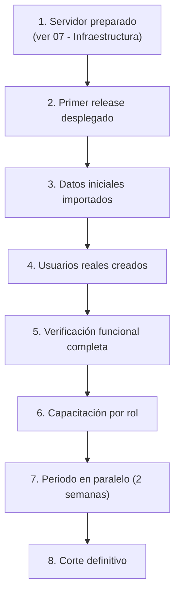

# F8 — Reportes y Puesta en Producción

> [!info] Objetivo
> **Que el centro opere con el sistema y que Dirección tenga los indicadores que
> necesita.** Esta es la fase donde el sistema pasa de "software que funciona" a
> "herramienta que el centro usa todos los días".

---

## 1. Duración

| Dedicación | Duración |
|---|---|
| 8 h/semana | ~3 semanas |
| 15 h/semana | ~1.5 semanas |

---

## 2. Tareas

### 2.1 Migraciones de `reporting`

```text
reporting.saved_reports
reporting.report_schedules
reporting.dashboard_widgets
```

> [!note] `reporting` no tiene datos de negocio
> El módulo `reporting` es el **único** que lee de todos los demás. No tiene tablas de
> negocio propias, salvo el almacenamiento de reportes guardados y la configuración de
> widgets. Todos los datos vienen de los otros schemas.

### 2.2 El catálogo de reportes

| # | Reporte | Para quién | Contenido |
|---|---|---|---|
| R-01 | **Panel de Dirección** | Dirección | Indicadores clave del mes |
| R-02 | Matrícula y permanencia | Dirección | Alumnos inscriptos, por servicio y grupo |
| R-03 | Ocupación de profesionales | Coordinación | Horas asignadas vs. disponibles |
| R-04 | **Asistencia** | Dirección, Coordinación | % de asistencia por grupo, por profesional, por mes |
| R-05 | Alumnos con inasistencias sostenidas | Coordinación | Alertas de seguimiento |
| R-06 | Progreso de planes de atención | Dirección, Coordinación | Objetivos cumplidos por plan |
| R-07 | **Cobranza** | Dirección, Finanzas | Recaudación, morosidad, cuentas con deuda |
| R-08 | Estado de cuenta por familia | Finanzas, Dirección | Detalle por familia |
| R-09 | Deuda por antigüedad | Finanzas | 0–30 / 31–60 / 61–90 / +90 días |
| R-10 | **Actividad de usuarios** | Dirección | Quién hizo qué |
| R-11 | Accesos a datos clínicos | Dirección | Lecturas y grants |
| R-12 | Producción por profesional | Dirección | Notas creadas, planes actualizados |
| R-13 | Consentimientos vigentes | Dirección | Estado de consentimientos |
| R-14 | Documentos por alumno | Secretaría | Inventario |

> [!danger] R-11 es un reporte de seguridad, no de gestión
> "Accesos a datos clínicos" lista **quién leyó qué nota clínica de qué alumno y
> cuándo**. Es una de las piezas centrales del paquete de seguridad. Solo Dirección
> y Administración Técnica lo ven, y su lectura también queda auditada.

### 2.3 La arquitectura de los reportes

```php
// packages/reporting/src/Contracts/Report.php
declare(strict_types=1);

namespace Cai\Reporting\Contracts;

interface Report
{
    public function code(): string;

    public function title(): string;

    public function description(): string;

    /**
     * Permiso necesario para ver el reporte.
     */
    public function requiredPermission(): string;

    /**
     * @param array<string, mixed> $parameters
     * @return array<string, mixed>
     */
    public function run(array $parameters): array;

    /**
     * Columnas del reporte, para la exportación.
     *
     * @return list<ReportColumn>
     */
    public function columns(): array;
}
```

```php
// packages/reporting/src/Reports/AttendanceReport.php
declare(strict_types=1);

namespace Cai\Reporting\Reports;

use Cai\Reporting\Contracts\Report;
use Cai\Reporting\Contracts\ReportColumn;

final class AttendanceReport implements Report
{
    public function code(): string
    {
        return 'attendance';
    }

    public function title(): string
    {
        return 'Asistencia';
    }

    public function requiredPermission(): string
    {
        return 'reporting.reports.attendance';
    }

    public function run(array $parameters): array
    {
        $from = $parameters['from'] ?? now()->startOfMonth();
        $to   = $parameters['to']   ?? now()->endOfMonth();

        return DB::connection('scheduling')->select(
            <<<'SQL'
            SELECT
                s.id                     AS session_id,
                s.starts_at              AS fecha,
                g.name                   AS grupo,
                svc.name                 AS servicio,
                p.display_name           AS profesional,
                COUNT(ar.id)             AS total,
                COUNT(*) FILTER (WHERE ar.status = 'present')             AS presentes,
                COUNT(*) FILTER (WHERE ar.status = 'absent')              AS ausentes,
                COUNT(*) FILTER (WHERE ar.status = 'justified')           AS justificadas,
                COUNT(*) FILTER (WHERE ar.status = 'excused')             AS excusadas,
                ROUND(
                    100.0 * COUNT(*) FILTER (WHERE ar.status IN ('present', 'late'))
                    / NULLIF(COUNT(ar.id), 0), 1
                ) AS pct_asistencia
            FROM scheduling.sessions s
            LEFT JOIN scheduling.attendance_records ar ON ar.session_id = s.id
            LEFT JOIN scheduling.groups g              ON g.id = s.group_id
            LEFT JOIN scheduling.services svc         ON svc.id = s.service_id
            LEFT JOIN scheduling.session_professionals sp ON sp.session_id = s.id
            LEFT JOIN scheduling.professionals p       ON p.id = sp.professional_id
            WHERE s.starts_at BETWEEN ? AND ?
              AND s.status IN ('completed', 'in_progress')
            GROUP BY s.id, g.name, svc.name, p.display_name
            ORDER BY s.starts_at DESC
            SQL,
            [$from, $to]
        );
    }

    public function columns(): array
    {
        return [
            new ReportColumn('fecha', 'Fecha', 'date'),
            new ReportColumn('grupo', 'Grupo', 'string'),
            new ReportColumn('servicio', 'Servicio', 'string'),
            new ReportColumn('profesional', 'Profesional', 'string'),
            new ReportColumn('presentes', 'Presentes', 'integer'),
            new ReportColumn('ausentes', 'Ausentes', 'integer'),
            new ReportColumn('pct_asistencia', '% Asistencia', 'decimal'),
        ];
    }
}
```

### 2.4 La regla de oro de los reportes

> [!danger] Un reporte no puede filtrar lo que el usuario no puede ver
> Cada reporte declara el **permiso** necesario para verlo. Y cada consulta filtra por
> **alcance**, igual que las pantallas. Un reporte no es una puerta trasera.

```php
// packages/reporting/src/Actions/RunReport.php
final class RunReport
{
    public function execute(RunReportData $data): ReportResult
    {
        $report = $this->registry->resolve($data->reportCode);

        // 1. Verificación de permiso
        if (! Auth::user()->hasPermissionTo($report->requiredPermission())) {
            abort(403, 'No tiene permiso para ver este reporte.');
        }

        // 2. Verificación de alcance (delegada al propio reporte)
        $parameters = $this->scopeApplier->apply(
            report: $report,
            parameters: $data->parameters,
            user: Auth::user(),
        );

        // 3. Auditoría: la lectura de un reporte se registra
        Audit::record('report.executed', $report::class, $report->code(), [
            'connection' => 'identity',
            'context'    => ['parameters' => $parameters],
        ]);

        return new ReportResult(
            columns: $report->columns(),
            rows:    $report->run($parameters),
        );
    }
}
```

**Ejemplo de alcance en un reporte:**

```php
// Un profesional solo ve la asistencia de SUS sesiones
final class AttendanceReport implements Report
{
    public function run(array $parameters): array
    {
        $query = DB::connection('scheduling')->table('sessions')
            ->leftJoin('attendance_records', 'attendance_records.session_id', '=', 'sessions.id');

        // El alcance se aplica según el rol
        if (! Auth::user()->hasPermissionTo('reporting.reports.attendance.all')) {
            $query->whereIn('sessions.id', function ($sub) {
                $sub->select('session_id')
                    ->from('session_professionals')
                    ->where('professional_id', Auth::user()->professional_id);
            });
        }

        return $query->get()->all();
    }
}
```

### 2.5 El panel de Dirección

```php
// packages/reporting/src/Filament/Widgets/KeyIndicatorsWidget.php
final class KeyIndicatorsWidget extends StatsOverviewWidget
{
    protected static ?int $sort = 1;

    protected function getStats(): array
    {
        return [
            Stat::make('Alumnos activos', (string) $this->activeStudents())
                ->description('+'.$this->newStudentsThisMonth().' este mes')
                ->color('success'),

            Stat::make('Asistencia del mes', $this->attendanceRate().' %')
                ->description('Objetivo: 80 %')
                ->color($this->attendanceRate() >= 80 ? 'success' : 'warning'),

            Stat::make('Recaudación del mes', Money::format($this->collected()))
                ->description('Meta: '.Money::format($this->target()))
                ->color('primary'),

            Stat::make('Cuentas con deuda', (string) $this->accountsWithDebt())
                ->description(Money::format($this->totalDebt()))
                ->color($this->accountsWithDebt() > 0 ? 'danger' : 'success'),

            Stat::make('Notas en borrador', (string) $this->draftNotes())
                ->description('Más de 7 días: '.$this->staleDraftNotes())
                ->color($this->staleDraftNotes() > 0 ? 'warning' : 'success'),
        ];
    }
}
```

**Widgets del panel:**

| # | Widget | Contenido |
|---|---|---|
| W-01 | Indicadores clave | Los 5 de arriba |
| W-02 | Ocupación semanal | Horas por profesional |
| W-03 | Asistencia del mes | Gráfico |
| W-04 | Alumnos con inasistencias | Lista con enlace a la ficha |
| W-05 | Cobranza y deuda | Gráfico por antigüedad |
| W-06 | Actividad reciente | Últimas acciones relevantes |
| W-07 | Estado del sistema | Versión desplegada, último backup, salud |

> [!note] W-07 es intencional
> Dirección ve **qué versión está desplegada y cuándo fue el último backup**. Es
> información que cualquier persona responsable de un sistema con datos de menores
> debería tener a mano.

> [!danger] El panel NO muestra datos clínicos
> Ningún widget del panel de Dirección incluye notas clínicas, diagnósticos ni
> contenido de planes. Como mucho, **cantidades agregadas** (cuántas notas se
> crearon), si Dirección lo autoriza expresamente. Ver la pregunta abierta P7.

### 2.6 La exportación

```php
// packages/reporting/src/Actions/ExportReport.php
final class ExportReport
{
    public function execute(ExportReportData $data): StreamedResponse
    {
        $result = $this->runner->execute(new RunReportData(
            reportCode: $data->reportCode,
            parameters: $data->parameters,
        ));

        Audit::record('report.exported', Report::class, $data->reportCode, [
            'connection' => 'identity',
            'context'    => ['rows' => count($result->rows)],
        ]);

        return response()->streamDownload(
            function () use ($result): void {
                $handle = fopen('php://output', 'w');
                fputcsv($handle, array_map(fn (ReportColumn $c) => $c->label, $result->columns));

                foreach ($result->rows as $row) {
                    fputcsv($handle, array_map(
                        fn (ReportColumn $c) => $row[$c->key] ?? '',
                        $result->columns
                    ));
                }

                fclose($handle);
            },
            $data->reportCode . '-' . now()->format('Ymd-Hi') . '.csv',
            ['Content-Type' => 'text/csv; charset=UTF-8'],
        );
    }
}
```

**Reglas de exportación:**

| Regla | Detalle |
|---|---|
| Se exporta **exactamente lo que se ve** | El mismo scope del reporte |
| Se registra la exportación | `report.exported` en la auditoría |
| La exportación de datos personales es un evento sensible | Severidad `warning` en `security_events` |
| CSV con BOM UTF-8 | Para que Excel abra bien los acentos |
| Formato alternativo | XLSX con PhpSpreadsheet (si el centro lo pide) |

### 2.7 Los scripts de release y despliegue

```bash
#!/usr/bin/env bash
# scripts/release.sh  (versión final, ver §06.05)
```

Los scripts definitivos que se escriben en esta fase:

| Script | Función |
|---|---|
| `scripts/release.sh` | Desplegar un release nuevo |
| `scripts/rollback.sh` | Volver al release anterior |
| `scripts/restore-from-dump.sh` | Restaurar un `pg_dump` |
| `scripts/backup.sh` | Backup local diario |
| `scripts/backup-external.sh` | Backup externo cifrado |
| `scripts/healthcheck.sh` | Verificación de salud |
| `scripts/prune-releases.sh` | Limpieza de releases antiguos |
| `scripts/status.sh` | Tablero de estado en consola |

Ver [[06.05 Release y Deploy]] y [[06.06 Procedimiento de Rollback]].

### 2.8 La puesta en producción (go-live)



#### La verificación funcional completa

| # | Verificación | Responsable | Resultado |
|---|---|---|---|
| V-01 | Un usuario de cada rol puede iniciar sesión | Admin Técnico | |
| V-02 | Un usuario de cada rol **no** puede ver lo que no le corresponde | Admin Técnico | |
| V-03 | Se crea un alumno con tutores y cuenta familiar | Secretaría | |
| V-04 | Se agenda una sesión grupal y se registra asistencia | Coordinación | |
| V-05 | Se crea y finaliza una nota clínica | Profesional | |
| V-06 | Se registra un pago y se imprime el recibo | Finanzas | |
| V-07 | Se sube un documento y se descarga | Secretaría | |
| V-08 | Se envía un aviso a una familia | Recepción | |
| V-09 | El panel de Dirección muestra los indicadores | Dirección | |
| V-10 | Los 4 niveles de rollback se probaron | Admin Técnico | |
| V-11 | Se restauró un backup y el sistema arrancó | Admin Técnico | |
| V-12 | Se apagó y encendió un kill switch | Admin Técnico | |

> [!danger] V-10, V-11 y V-12 no son opcionales
> **Un rollback que nunca se probó no es un rollback.** Es una suposición. Si no se
> pueden probar los tres niveles en el servidor, el go-live se posterga.

#### La capacitación

| Rol | Duración | Contenido | Material |
|---|---|---|---|
| Dirección | 60 min | Panel, reportes, auditoría, kill switches | Manual 09.01 |
| Secretaría | 120 min | Alumnos, tutores, cuentas, documentos, consentimiento | Manual 09.02 |
| Profesional | 90 min | Agenda, asistencia, planes, notas clínicas | Manual 09.03 |
| Coordinación | 120 min | Agenda, grupos, asignación, reportes de ocupación | Manual 09.04 |
| Finanzas | 120 min | Cobros, pagos, imputación, caja, recibos, reportes | Manual 09.05 |
| Recepción | 60 min | Agenda, consulta, avisos | Manual 09.06 |
| Administración Técnica | 180 min | Usuarios, roles, flags, backups, healthcheck | Manual 09.06 |

### 2.9 El periodo en paralelo

> [!important] Las dos primeras semanas, el centro opera con el sistema antiguo
> El sistema anterior (planillas, cuadernos, carpeta de fichas) **sigue siendo la fuente
> de verdad** durante 2 semanas. El nuevo sistema se usa en paralelo. La transición
> oficial ocurre solo cuando Dirección confirma que los datos están completos.

| Semana | Actividad |
|---|---|
| 1 | El personal usa el sistema. Se reportan errores. Se corrigen en caliente |
| 2 | Se comparan los datos del sistema con los registros antiguos. Se ajustan |
| 3 | Corte oficial. Los registros antiguos se archivan |

**Durante el periodo en paralelo, el dev está disponible en horario laboral.** Es la
única forma de que la transición funcione.

### 2.10 La migración de los datos actuales

```bash
# 1. Planilla de alumnos (formato definido en F3)
php artisan cai:import:students --file=/tmp/alumnos.csv --dry-run
php artisan cai:import:students --file=/tmp/alumnos.csv --report=/tmp/rechazos.csv
php artisan cai:import:students --file=/tmp/alumnos.csv

# 2. Servicios y tarifas
php artisan cai:services:seed --file=/tmp/servicios.csv

# 3. Grupos y alumnos por grupo
php artisan cai:import:groups --file=/tmp/grupos.csv

# 4. Historial de asistencia (si se tiene en planilla)
php artisan cai:import:attendance --file=/tmp/asistencia.csv

# 5. Usuarios reales
php artisan cai:users:import --file=/tmp/usuarios.csv
```

**Reglas de la migración:**

| Regla | Detalle |
|---|---|
| Siempre `--dry-run` primero | Siempre. Sin excepción |
| El CSV **nunca** entra al repositorio | Vive en `/tmp` del servidor y se borra |
| Cada importación queda auditada | Con el conteo de aceptados y rechazados |
| No se importa el historial clínico | **Nunca**. Las notas clínicas empiezan con el sistema |
| Los saldos pendientes se importan como cargos | Con su fecha de vencimiento original |
| Verificación de conteos | El número de alumnos del sistema debe coincidir con la planilla |

---

## 3. Entregables

| # | Entregable | Verificable |
|---|---|---|
| E-01 | 3 tablas de `reporting` migradas | `cai:db:reset` |
| E-02 | 14 reportes implementados | Listado navegable |
| E-03 | Alcance aplicado a cada reporte | Test |
| E-04 | Panel de Dirección con 7 widgets | Captura de verificación |
| E-05 | Exportación CSV con auditoría | Test |
| E-06 | 8 scripts de operación | Ejecutables y probados |
| E-07 | Servidor del centro en producción | Healthcheck verde |
| E-08 | Datos iniciales importados y verificados | Conteo coincidente |
| E-09 | 7 roles capacitados | Acta de capacitación |
| E-10 | Los 4 niveles de rollback probados | Acta de verificación |
| E-11 | Periodo en paralelo completado | Confirmación de Dirección |
| E-12 | Runbook operativo completo | [[10.01 Runbook Operativo]] |

---

## 4. Gate de salida

> [!success] Condición para pasar a F9
> - [ ] El centro **opera todos los días** con el sistema
> - [ ] Dirección consulta los indicadores y los usa en decisiones reales
> - [ ] Los 4 niveles de rollback **fueron probados** en el servidor real
> - [ ] Una restauración de backup **arrancó el sistema** correctamente
> - [ ] Los 7 roles fueron capacitados
> - [ ] Los conteos de alumnos coinciden con la planilla original
> - [ ] No hay errores 500 en el log durante 5 días consecutivos
> - [ ] El panel de Dirección **no** muestra información clínica
> - [ ] El periodo en paralelo terminó con la confirmación de Dirección

---

## 5. Riesgos

| Riesgo | Mitigación |
|---|---|
| El personal no adopta el sistema | Capacitación por rol + periodo en paralelo + el dev disponible |
| Los datos importados están mal | Importador con `--dry-run`, reporte de rechazos y verificación de conteos |
| Un reporte filtra información | Test de alcance por reporte + revisión en el checklist de PR |
| El go-live falla en pleno operación | Se hace en horario sin atención, con el personal informado y el dev presente |
| La migración de datos es más difícil de lo previsto | Se prioriza: sin historial clínico, sin historial de asistencia si no es fiable |
| Dirección quiere el panel antes que los reportes | Se priorizan los indicadores clave (W-01) y el resto sigue en el backlog |
| El servidor del centro no está listo | Es la causa #1 de retraso en esta fase. Prepararlo desde F0 |

---

## 6. Qué se pospone

| Se pospone a | Qué |
|---|---|
| F9 | Endurecimiento de seguridad (MFA obligatorio, rate limiting, CSP estricto) |
| F9 | PITR (restauración punto en el tiempo) |
| F9 | Reportes adicionales de la retroalimentación |
| Etapa 2 | Portal familiar |
| Etapa 2 | Reportes ejecutivos automatizados por email |

---

## 7. Documentos relacionados

- [[08.01 Hoja de Ruta]]
- [[03.07 Documentos, Consentimientos y Notificaciones]]
- [[06.05 Release y Deploy]]
- [[06.06 Procedimiento de Rollback]]
- [[09.07 Importación de Datos Iniciales]]
- [[10.01 Runbook Operativo]]
