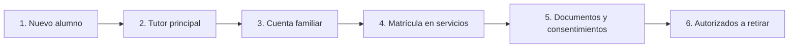

# Manual de Secretaría

> [!info] A quién sirve este manual
> A quien lleva el **expediente administrativo** de los alumnos: alta, datos, tutores,
> cuentas familiares, matrículas y documentos.

---

## 1. Sus credenciales

| Concepto | Valor |
|---|---|
| **Rol** | `secretaria` |
| **Acceso** | `/panel` |
| **Puede** | Crear y modificar alumnos, tutores, cuentas, matrículas, documentos administrativos |
| **No puede** | Ver notas clínicas · Ver datos de pago · Dar de baja usuarios |

---

## 2. El flujo de trabajo

> [!important] El orden importa
> El **tutor principal** se carga antes que la cuenta familiar, porque la cuenta
> necesita saber quién es el contacto administrativo. Y la matrícula antes que los
> documentos, porque el consentimiento depende de para qué se inscribe.

---

## 3. Crear un alumno

**Panel → Alumnos → Nuevo alumno**

### 3.1 Los campos

| Campo | ¿Obligatorio? | Notas |
|---|---|---|
| **Código** | Automático | `ALU-0001`. **No se modifica nunca** |
| **Nombres** | ✅ | Tal como figura en el documento |
| **Apellidos** | ✅ | Idem |
| **Fecha de nacimiento** | Muy recomendable | De ahí se calcula la edad. No se puede poner una fecha futura |
| **Documento** | Muy recomendable | Se usa para detectar duplicados |
| **Estado** | Automático | `active` |
| **Teléfono** | Muy recomendable | Es el contacto de urgencia |
| **Email** | Recomendado | Necesario para recibir avisos |
| **Dirección, barrio, ciudad** | Recomendado | |
| **Fecha de ingreso** | ✅ | |
| **Foto** | Opcional | Se sube después, en Documentos |

> [!danger] El código no se reutiliza
> Cuando un alumno egresa, su código queda **reservado**. Si vuelve al centro meses
> después, se registra como **un alumno nuevo** con código nuevo. La razón: si se
> reutilizara, el historial clínico y económico de la persona anterior quedaría
> mezclado con el de la nueva. Es una decisión de trazabilidad, no un capricho.

### 3.2 Guardar

El botón **Guardar** es suficiente. Los campos que faltan se pueden completar después.

### 3.3 Detectar duplicados

El sistema **avisa** si ya existe un alumno con el mismo documento o con un nombre
muy similar. Si aparece el aviso:

1. Verificar el documento del nuevo alumno.
2. Si es la misma persona, **no crear otro**: reactivar el existente (ver §7).
3. Si son gemelos o dos personas con el mismo nombre, continuar y **anotarlo** en
   el campo de notas para que no se confunda después.

---

## 4. Tutores

**Ficha del alumno → Pestaña Tutores → Añadir**

### 4.1 Los campos

| Campo | ¿Obligatorio? | Notas |
|---|---|---|
| **Nombre y apellido** | ✅ | |
| **Documento** | Muy recomendable | Es lo que permite verificar quién retira al alumno |
| **Parentesco** | ✅ | `padre`, `madre`, `abuela`, `tutor_legal`, `otro` |
| **Tutor legal** | — | Casilla que indica si tiene la tutoría legal |
| **Contacto principal** | — | Solo **uno** por alumno. Es a quien se envía lo administrativo |
| **Autorizado a retirar** | — | Puede figurar como autorizada a retirar al alumno |
| **Recibe avisos** | — | Recibe las comunicaciones administrativas (citas, cuotas) |
| **Contacto de emergencia** | — | A quién se llama en una emergencia |

> [!important] Contacto principal: solo uno
> El sistema **no permite** dos contactos principales. Es una decisión que evita el
> clásico "a quién le mando el aviso" y el "no nos enteramos de nada".
>
> Los demás tutores pueden tener las otras casillas. Una abuela puede estar autorizada
> a retirar y recibir avisos, sin ser el contacto principal.

### 4.2 El tutor que paga

La casilla que define si un tutor recibe los avisos de cuota es **"Recibe avisos"**,
combinada con que sea el contacto principal. Para la facturación, lo que importa es
que exista **un** tutor responsable de la cuenta familiar.

### 4.3 Cambio de tutor

Un tutor **no se elimina**: se le quita la relación con el alumno. El historial de
quién fue tutor y desde cuándo se conserva.

1. Ficha → Tutores → ⋮ → **Quitar relación**.
2. Se le puede indicar el motivo (por ejemplo, "se mudó de ciudad").
3. Se añade el nuevo tutor.

---

## 5. La cuenta familiar

> [!danger] La regla que define todo el modelo financiero
> **Una cuenta familiar puede tener varios alumnos.** Cada alumno tiene su ficha
> propia, su historial propio, sus notas propias. Lo que se comparte es **la cuenta
> de cobro**.

### 5.1 Crear la cuenta

**Panel → Cuentas familiares → Nueva cuenta**

| Campo | Notas |
|---|---|
| **Nombre de la cuenta** | Ej.: "Familia González" |
| **Tutor responsable** | Debe ser un tutor ya cargado de un alumno |
| **Método de pago preferido** | Efectivo, transferencia, etc. |

### 5.2 Agregar alumnos a la cuenta

1. Abrir la cuenta familiar.
2. Pestaña **Alumnos** → **Agregar alumno**.
3. Buscar al alumno por nombre o código.

> [!warning] Un alumno, una cuenta activa
> El sistema **no permite** que un alumno esté en dos cuentas activas a la vez. Si
> aparece un error al agregarlo, es porque ya está en otra: hay que quitarlo de la
> anterior primero (o activar la cuenta anterior).
>
> Esto es una regla explícita del modelo, protegida por una restricción de base de
> datos. Ver [[03.02 Alumnos, Tutores y Cuentas Familiares]] §6.1.

### 5.3 Transferir un alumno a otra cuenta

Si una familia se separa y el alumno pasa a otra cuenta:

1. Cuenta anterior → Alumnos → quitar.
2. Cuenta nueva → Alumnos → agregar.

El historial del alumno **no cambia**: sus pagos anteriores siguen en la cuenta
anterior, que es lo correcto, porque el pago se hizo ahí.

---

## 6. Matriculación

**Ficha del alumno → Pestaña Matrículas → Nueva matrícula**

### 6.1 Los campos

| Campo | ¿Obligatorio? | Notas |
|---|---|---|
| **Servicio** | ✅ | Ej.: Terapia del lenguaje, Tutoría, Musicoterapia |
| **Grupo** | Según el servicio | Si el servicio es grupal, es obligatorio |
| **Fecha de inicio** | ✅ | |
| **Fecha de fin** | Al egresar | Se deja vacío mientras esté activo |
| **Profesional responsable** | Recomendado | Facilita la agenda y el seguimiento |

### 6.2 La diferencia entre servicio y grupo

| Concepto | Qué es | Ejemplo |
|---|---|---|
| **Servicio** | Lo que se paga y se ofrece | "Terapia del lenguaje" |
| **Grupo** | Un conjunto de alumnos con horario fijo | "Grupo Lenguaje A · Mar/Jue 10:00" |
| **Sesión** | Un encuentro concreto | "Sesión del 12/03 a las 10:00" |

> [!important] Una sesión grupal genera varios registros
> 1 sesión grupal = **1** registro de sesión + **N** participantes + **N** registros
> de asistencia. No es "N sesiones". Esto es importante para entender los reportes
> de asistencia: el denominador es el número de **participantes esperados**, no el
> número de sesiones.

### 6.3 Mover a un alumno de grupo

1. Ficha → Matrículas → editar la del grupo anterior.
2. Cambiar el grupo.
3. **No** cerrar la matrícula: el alumno sigue inscripto en el servicio.

---

## 7. Estado del alumno

| Estado | Significado | Qué hacer |
|---|---|---|
| `active` | Inscripto y activo | — |
| `inactive` | Pausado temporalmente (enfermedad, vacaciones prolongadas) | No genera deuda; conserva historial |
| `withdrawn` | Egresó | Cerrar las matrículas; se conservan todos los datos |

### 7.1 Pausar un alumno

1. Ficha → **Datos** → Estado → `inactive`.
2. Anotar el motivo y la fecha de regreso prevista en **Notas**.

> [!tip] Cuándo pausar y cuándo egresar
> **Pausar** es temporal y reversible. **Egresar** es definitivo. Si la pausa va a
> durar más de un mes, conviene egresar y, si el alumno vuelve, se registra de nuevo
> con un código nuevo. Es más ordenado que arrastrar una inscripción dormida durante
> años.

### 7.2 Egresar un alumno

1. Ficha → **Datos** → Estado → `withdrawn`.
2. Fecha de egreso.
3. Cerrar las matrículas (fecha de fin).
4. Informar a Finanzas si tiene deuda (las deudas no desaparecen al egresar).

---

## 8. Documentos

**Ficha del alumno → Pestaña Documentos**

### 8.1 Qué se sube

| Documento | Categoría | Quién lo ve |
|---|---|---|
| Cédula (frontal y dorso) | Identidad | Secretaría, Dirección, Recepción |
| Consentimiento firmado | Administrativo | Secretaría, Dirección |
| Informe de evaluación externa | Clínico | Solo profesionales asignados |
| Fotografía | Identidad | Secretaría, Dirección |

### 8.2 Cómo subir un documento

1. Pestaña Documentos → **Subir**.
2. Elegir el archivo.
3. Cargar la categoría y el título.
4. **Guardar**.

> [!important] El archivo no queda en una carpeta pública
> El documento se guarda en el almacenamiento **privado** del servidor. No hay ninguna
> URL directa: para verlo hay que entrar al sistema con una sesión válida y tener
> permiso. Cada descarga queda registrada.

### 8.3 Los consentimientos

1. Pestaña Documentos → **Consentimientos** → **Registrar consentimiento**.
2. Elegir la plantilla (imagen, audio/video, salida, etc.).
3. Seleccionar **qué tutor** firmó.
4. Adjuntar el documento firmado escaneado o fotografiado.
5. Indicar la fecha de firma.

> [!danger] Solo puede firmar un tutor vigente
> El sistema **verifica** que la persona que figura firmando sea un tutor actual del
> alumno. Si alguien que no es tutor aparece en la lista, es un dato mal cargado:
> hay que corregir la ficha de tutores, no forzar el consentimiento.

---

## 9. Autorizados a retirar

**Ficha del alumno → Pestaña Autorizados**

| Campo | Notas |
|---|---|
| Nombre y documento | Obligatorio |
| Relación | Padre, madre, grandparent, tía, etc. |
| Vigencia | Puede tener fecha de expiración |
| Teléfono | Para verificar por teléfono si hay duda |

> [!important] La autorización de retiro no es una autorización a tomar decisiones clínicas
> Una persona autorizada a retirar al alumno puede llevarlo. **No** puede autorizar
> tratamientos, firmar consentimientos ni acceder a su información clínica.

---

## 10. Consultas frecuentes del centro

### 10.1 "Necesito el teléfono de la madre de un alumno"

Ficha del alumno → Tutores. Si el alumno no está en el sistema, buscar por nombre o
documento.

### 10.2 "Esta familia tiene dos hermanos inscriptos"

Ficha de cualquiera de los dos → Pestaña Matrículas. La cuenta familiar se ve en la
ficha. Para el detalle de pagos, hay que ir a la **cuenta familiar**, no a la ficha
del alumno.

### 10.3 "Me piden un comprobante de que el alumno está inscripto"

No hay comprobante automático en el MVP. La ficha del alumno muestra los datos
actuales, que es lo que la familia suele necesitar.

### 10.4 "El alumno se muda de ciudad pero sigue concurriendo"

No se cambia la ficha. Los datos de contacto se pueden actualizar, y el estado pasa a
`inactive` si la pausa es larga.

### 10.5 "Hay dos fichas con el mismo nombre"

Buscar por documento. Si el documento es el mismo, es un duplicado: reactivar la
correcta y poner la otra en `withdrawn`. Si son personas distintas (gemelos),
continuar.

---

## 11. Errores frecuentes y qué hacer

| Mensaje | Causa | Solución |
|---|---|---|
| "El alumno ya pertenece a otra cuenta familiar" | Doble cuenta activa | Quitarlo de la cuenta anterior |
| "El código de alumno ya existe" | Se intentó reusar un código | Asignar el siguiente; los códigos no se reusan |
| "No se puede finalizar una nota clínica" | Estás en una pestaña clínica | Ese contenido no es accesible para tu rol |
| "La fecha de nacimiento no puede ser futura" | Error de tipeo | Corregir |
| "Falta la extensión bcmath" | Problema del servidor, no del usuario | Avisar al Administrador Técnico |

---

## 12. Documentos relacionados

- [[09.01 Manual de Dirección]]
- [[03.02 Alumnos, Tutores y Cuentas Familiares]]
- [[09.07 Importación de Datos Iniciales]]
- [[04.02 Matriz de Permisos por Rol]]
