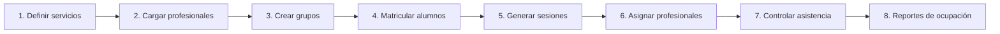

# Manual de Coordinación

> [!info] A quién sirve este manual
> A quien **organiza la atención**: los servicios, los grupos, los horarios, la
> asignación de profesionales y el seguimiento de la asistencia.

---

## 1. Sus credenciales

| Concepto | Valor |
|---|---|
| **Rol** | `coordinacion` |
| **Acceso** | `/panel` |
| **Puede** | Ver todos los alumnos, gestionar servicios, profesionales, matrículas, grupos, sesiones y asistencia |
| **También puede** | Ver planes de atención y notas clínicas de los alumnos asignados |
| **No puede** | Ver datos de pago · Crear o modificar usuarios · Dar de baja alumnos |
| **MFA** | Recomendado |

> [!danger] El acceso clínico de Coordinación es de supervisión
> Coordinación **ve** notas clínicas, pero **no las modifica**. Puede leerlas para
> coordinar, no corregirlas. Y todo lo que lee queda registrado.

---

## 2. El flujo de trabajo

---

## 3. Servicios

**Panel → Servicios**

### 3.1 Qué es un servicio

Lo que el centro **ofrece y cobra**: "Terapia del lenguaje", "Tutoría matemática",
"Musicoterapia", "Apoyo a la integración escolar".

### 3.2 Los campos

| Campo | ¿Obligatorio? | Notas |
|---|---|---|
| **Nombre** | ✅ | |
| **Descripción** | Recomendado | Lo que recibe la familia |
| **Duración por defecto** | ✅ | 30, 45 o 60 minutos. Es un valor por defecto, no fijo |
| **Modalidad** | ✅ | Individual o grupal |
| **Capacidad máxima** | Si es grupal | |
| **Color** | Opcional | Para distinguir en la agenda |
| **Activo** | ✅ | Un servicio inactivo no aparece en las nuevas matrículas |

> [!important] Un servicio no se elimina
> Se **desactiva**. Los alumnos ya inscriptos, las sesiones passadas y los cargos
> generados se conservan.

---

## 4. Profesionales

**Panel → Profesionales**

### 4.1 Los campos

| Campo | Notas |
|---|---|
| Nombre y apellido | Visible para todos |
| Número de registro profesional | Visible para Coordinación y Dirección |
| Especialidad | Texto libre |
| Email y teléfono | Para avisos internos |
| **Alta en `professionals`** | Vincula al usuario del sistema |
| **Servicios que presta** | Si puede dar más de un servicio |
| **Días y horario disponible** | Base para generar la agenda |
| **Estado** | Activo / Inactivo / De vacaciones |

> [!danger] Un profesional inactivo conserva su historial
> Las notas que escribió, las sesiones que dictó y la asistencia que registró siguen
> ahí. "Inactivo" significa "ya no atiende", no "nunca existió".

### 4.2 Vincular un profesional con su usuario

El usuario del sistema (para poder iniciar sesión) y el registro profesional son
**cosas distintas**:

| Registro | Para qué |
|---|---|
| `identity.users` | Para entrar al sistema |
| `scheduling.professionals` | Para tener agenda, sesiones y notas |

Un profesional **debe** tener ambos. La vinculación se hace una vez. Si un
profesional no necesita entrar al sistema (practica pasante, por ejemplo), puede
existir solo en `professionals`.

---

## 5. Grupos

**Panel → Grupos**

### 5.1 Qué es un grupo

Un conjunto de alumnos que asiste **en el mismo horario**. El grupo es la unidad que se
agenda.

| Campo | Notas |
|---|---|
| **Nombre** | "Lenguaje A" |
| **Servicio** | Determina la duración y el tipo de sesión |
| **Profesional responsable** | Quién coordina el grupo |
| **Alumnos** | Se cargan al crear o después |
| **Día y hora** | El patrón semanal |
| **Aula** | Si hay salas |
| **Capacidad** | Máximo de alumnos |

### 5.2 Grupo vs. matrícula

> [!important] No son lo mismo
> - El **grupo** es un contenedor de alumnos con un horario.
> - La **matrícula** es el vínculo entre un alumno y un servicio.
>
> Un alumno puede estar inscripto en un servicio y, dentro de ese servicio, en un
> grupo. Si sale del grupo pero sigue inscripto, se le asignan sesiones individuales
> o queda en lista de espera.

### 5.3 Sacar un alumno de un grupo

1. Grupo → pestaña Alumnos → quitar.
2. **No** se cierra la matrícula: el alumno sigue inscripto en el servicio.

---

## 6. La agenda: sesiones

### 6.1 Crear una sesión de un grupo

**Panel → Sesiones → Nueva sesión**

| Campo | Notas |
|---|---|
| **Grupo** | Solo para sesiones grupales |
| **Fecha y hora** | |
| **Duración** | Por defecto, la del servicio |
| **Profesionales** | Puede haber más de uno (co-terapia) |
| **Aula** | |
| **Asistencia** | Se puede marcar en el momento o después |

### 6.2 Crear varias sesiones a la vez

Para un grupo con horario fijo, la forma eficiente es **generar la serie**:

1. Grupo → **Generar sesiones**.
2. Período: fecha de inicio y de fin.
3. Frecuencia: semanal, con los días seleccionados.
4. Excepciones: feriados, semana sin sesiones.
5. **Generar**.

> [!important] Generar no es borrar
> Si se genera una serie de 40 sesiones y había un feriado en medio, se **cancelan**
> las de ese día (con motivo). No se borran.

### 6.3 Las sesiones individuales

Una sesión individual se crea para **un** alumno:

1. Nueva sesión → tipo `individual`.
2. Elegir el alumno.
3. Elegir el profesional y la hora.

> [!danger] No se puede superponer
> Si se intenta agendar una sesión a la misma hora para el mismo profesional, el
> sistema **rechaza la operación**. No es una advertencia: es una restricción de la
> base de datos. Ver [[08.06 F4 Servicios Profesionales y Agenda]] §4.

### 6.4 Los estados de una sesión

| Estado | Significado |
|---|---|
| `scheduled` | Programada |
| `in_progress` | En curso |
| `completed` | Realizada |
| `cancelled` | No se realizó (con motivo) |
| `rescheduled` | Se movió a otra fecha |

---

## 7. La asistencia

### 7.1 Registrar

Coordination puede registrar asistencia de cualquier sesión:

1. Sesión → **Registrar asistencia**.
2. Marcar el estado de cada participante.
3. Guardar.

### 7.2 Corregir

| Quién | Puede corregir |
|---|---|
| El profesional de la sesión | ✅ |
| Coordinación | ✅ |
| Dirección | ✅ |
| Secretaría | ❌ |
| Finanzas | ❌ |

> [!danger] Una corrección de asistencia queda registrada
> No se borra el registro original: se guarda la corrección con autor, fecha y
> motivo. La asistencia de un menor es información de salud.

### 7.3 Los reportes de asistencia

| Reporte | Qué responde |
|---|---|
| **Asistencia por grupo** | ¿Qué grupo está fallando? |
| **Asistencia por profesional** | ¿La caída es del grupo o del horario? |
| **Asistencia por mes** | ¿Es una tendencia o un episodio? |
| **Alumnos con inasistencias sostenidas** | ¿A quién hay que llamar? |
| **Asistencia por servicio** | ¿Qué servicio tiene más problemas? |

> [!tip] Cómo leer el reporte de inasistencias
> Un alumno con 40 % de inasistencia **en un mes** probablemente tenga un problema
> personal o de horario. Un alumno con 40 % de inasistencia **siempre** tiene un
> problema de adaptación o un horario incompatible. La primera se resuelve con un
> llamado; la segunda, con una intervención clínica.

---

## 8. La asignación de profesionales

### 8.1 Criterios

| Criterio | Cómo se verifica |
|---|---|
| **Horas disponibles** | ¿La cantidad de sesiones asignadas cabe en su horario? |
| **Continuidad** | ¿El alumno mantiene al mismo profesional? |
| **Competencia** | ¿El profesional presta ese servicio? |
| **Carga equitativa** | El reporte de ocupación |
| **Sustitución** | ¿Hay otro profesional disponible si falta uno? |

### 8.2 El reporte de ocupación

**Panel → Reportes → Ocupación de profesionales**

Muestra, por profesional:

| Métrica | Qué significa |
|---|---|
| **Horas asignadas** | Horas de sesión ya agendadas |
| **Horas disponibles** | Horas que declara disponibles |
| **% de ocupación** | Assigned / Available |
| **Horas de la semana** | Reparto semanal |

> [!danger] El %
> Un profesional por encima del 85 % de ocupación no tiene margen para una
> ausencia. Un profesional por debajo del 40 % puede estar mal asignado o el
> centro puede estar por debajo de su capacidad. **El objetivo es 60–80 %**.

### 8.3 Cuando un profesional falta

1. Sesiones → filtrar por profesional y fecha.
2. Para cada sesión, **reasignar** a otro profesional.
3. La reasignación queda registrada.
4. Si el alumno tiene tutor, se le avisa del cambio (si la política lo requiere).

---

## 9. La línea de tiempo del alumno

**Ficha del alumno → Pestaña Historial**

Muestra, en orden cronológico:

| Tipo de evento | Ejemplo |
|---|---|
| Matrícula | "Inscripto en Lenguaje A" |
| Cambio de grupo | "Pasó de Grupo A a Grupo B" |
| Sesión | "Sesión realizada" / "Ausente" |
| Cancelación | "Sesión cancelada: feriado" |
| Cambio de profesional | "Reasignado a la profesional X" |
| Plan de atención | "Plan abierto" / "Plan revisado" |
| Egreso | "Egresó del centro" |

> [!important] Esta línea de tiempo es lo que permite entender una trayectoria
> Cuando una familia pregunta "¿por qué mi hijo no Mejora?", o cuando Dirección
> quiere entender por qué un grupo no funciona, la respuesta está en la línea de
> tiempo: cuándo empezó, qué cambios tuvo, cuántas sesiones efectiva tuvo.

---

## 10. Preguntas frecuentes

**Un alumno pide pasar a otro horario.**
Se lo saca del grupo actual y se lo agrega al grupo del horario nuevo. La matrícula
al servicio **no** cambia.

**Falta un profesional y hay 12 alumnos.**
Ver las opciones:
1. **Reasignar** la sesión a otro profesional disponible.
2. **Cancelar** la sesión con motivo (queda registrado que no se dictó).
3. **Suspender** la sesión por un motivo institucional, avisando a las familias.

Lo que **no** se hace: dictar la sesión sin registro. Un profesional que da una
sesión que no está en el sistema genera una actividad invisible: ni asistencia, ni
nota, ni facturación. Eso es peor que una sesión cancelada.

**¿Puedo ver las notas clínicas de un alumno que no coordino?**
Sí, si tienes asignación vigente sobre ese alumno (típicamente por ser el
profesional responsable de su plan o por un grant). Y queda registrado.

**¿Un alumno no asiste y la familia pide justificar?**
La justificación la registra el profesional o Coordinación en la asistencia. La
familia avisa por teléfono o email; quien lo recibe lo carga en el sistema.

**¿Cómo sé si un grupo está bien dimensionado?**
En el reporte de ocupación, cruzando con la asistencia: un grupo con pocos alumnos
y mucha asistencia puede fusionarse; uno lleno y con mucha ausencia probablemente
necesita más apoyo.

---

## 11. Documentos relacionados

- [[03.03 Servicios, Profesionales y Matrículas]]
- [[08.06 F4 Servicios Profesionales y Agenda]]
- [[09.03 Manual del Profesional]]
- [[09.01 Manual de Dirección]]
- [[04.03 Autorización por Registro]]
