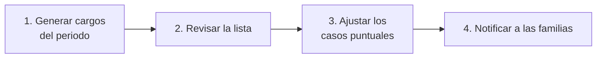

# Manual de Administración Financiera

> [!info] A quién sirve este manual
> A quien cobra: registra pagos, emite recibos, imputa a las cuentas familiares y
> hace el arqueo de caja.

---

## 1. Sus credenciales

| Concepto | Valor |
|---|---|
| **Rol** | `finanzas` |
| **Acceso** | `/panel` |
| **Puede** | Ver familias y saldos, registrar pagos, emitir recibos, manejar la caja, ver reportes de cobranza |
| **No puede** | Ver notas clínicas, planes de atención ni documentos clínicos · Modificar tarifas sin Dirección |
| **MFA** | **Obligatorio.** Es una de las 4 cuentas privilegiadas |

> [!danger] La línea roja de Finanzas
> **Finanzas no ve datos clínicos.** Ni notas, ni diagnósticos, ni contenido de
> planes. Cuando una familia pregunta "¿cómo va mi hijo?", Finanzas puede ver la
> **asistencia** (que es un dato administrativo) y **derivar** la pregunta a
> Coordinación. No puede leer la nota clínica. No es una limitación técnica: es una
> decisión de diseño.

---

## 2. Los conceptos que hay que tener claros

> [!danger] La confusión más común del área de cobranza
> "El saldo del alumno" y "el saldo de la familia" son cosas distintas. Un alumno
> puede tener un saldo de 150.000 y su hermano 0, o al revés. **El saldo que se
> cobra es el de la familia.**

| Concepto | Qué es | Ejemplo |
|---|---|---|
| **Cuenta familiar** | El grupo de cobro | "Familia González" con dos hijos |
| **Cargo** | Lo que el centro **cobra** | Lenguaje, marzo, 250.000 Gs. |
| **Pago** | El **dinero que entra** | Transferencia de 500.000 Gs. |
| **Imputación** | La conexión pago ↔ cargo | 250.000 → Lenguaje de la hija; 250.000 → Tutoría del hijo |
| **Recibo** | El comprobante del pago | `REC-2026-000123` |
| **Saldo** | Lo que falta pagar | Siempre **calculado**, nunca almacenado |
| **Saldo a favor** | Lo que el centro le debe a la familia | Un pago de más |

> [!important] Un pago no pertenece a un solo alumno
> Cuando una familia con dos hermanos paga una sola transferencia, esa transferencia
> se **reparte** entre los cargos de ambos. El recibo es **uno**. El saldo se muestra
> por familia y, debajo, el desglose por hijo.

---

## 3. Generar los cargos del mes

### 3.1 El proceso



**Panel → Cobranza → Generar cargos**

1. Elegir el **periodo** (mes y año).
2. Elegir el **plan tarifario** o el servicio.
3. Se generan los cargos de todos los alumnos inscriptos.
4. Se muestra un resumen: cuántos cargos, por qué importe total.
5. **Confirmar**.

> [!danger] Antes de confirmar, revisá
> - ¿La cantidad de cargos coincide con la cantidad de alumnos inscriptos?
> - ¿El importe total coincide con la cuenta mental del mes?
> - ¿Hay alumnos pausados (`inactive`) que no deberían estar?
> - ¿Hay alumnos que ingresaron a mitad de mes y hay que ajustar?

### 3.2 Si se generó con error

Los cargos **no se borran**. Se **anulan** con motivo, y se generan los correctos.

| Situación | Qué hacer |
|---|---|
| Se generó un mes de más | Anular los cargos con motivo "Generación duplicada" |
| Faltan algunos alumnos | Generar los cargos faltantes individualmente |
| El importe cambió | Anular y regenerar, o aplicar un ajuste |

> [!important] Por qué no se borra
> Porque un cargo puede ya tener **imputaciones** (alguien pagó). Si se borrara, se
> perdería la trazabilidad entre lo cobrado y lo facturado. La anulación con motivo
> deja el rastro: se ve qué se cobró, qué se anuló y por qué.

### 3.3 Los ajustes puntuales

**Panel → Cobranza → Cargos → ⋮ → Aplicar ajuste**

| Tipo | Cuándo |
|---|---|
| `discount` | Descuento por evaluación |
| `surcharge` | Recargo por mora |
| `credit_note` | Nota de crédito por un servicio no prestado |
| `waiver` | Condonación (beca) |
| `correction` | Corrección de un error de monto |

Cada ajuste **requiere un motivo**. Si el ajuste fue un error, se crea un ajuste
inverso que lo referencia. Nada se borra.

---

## 4. Registrar un pago

> [!important] La pantalla más usada del sistema
> La familia llega, paga, y hay que registrarlo en menos de dos minutos.

### 4.1 El flujo

1. **Panel → Cobranza → Registrar pago** (o el botón desde la ficha de la familia).
2. Buscar la familia por nombre o documento.
3. Se muestra el **saldo actual** de la familia.
4. Elegir:
   - **Método**: efectivo, transferencia, giro, tarjeta, otro.
   - **Fecha** del pago.
   - **Referencia** (número de operación, para transferencias).
   - **Monto recibido**.
5. El sistema **propone la imputación** (por antigüedad: primero lo más viejo).
6. Revisar la imputación. Se puede:
   - Cambiarla a otro criterio (por alumno, manual).
   - Imputar específicamente a un hijo.
7. **Confirmar**.
8. Se genera el recibo. **Imprimir**.

### 4.2 Los criterios de imputación

| Criterio | Cuándo usarlo |
|---|---|
| **Por antigüedad** (por defecto) | La mayoría de los casos |
| **Por alumno** | Cuando la familia dice "esto es para mi hijo mayor" |
| **Manual** | Cuando hay que elegir cargo por cargo |

### 4.3 El caso del pago de más

Si la familia paga más de lo que debe:

| Situación | Qué hace el sistema |
|---|---|
| Paga de más | El excedente queda como **saldo a favor** de la familia |
| Paga de menos | Se imputa parcialmente; el resto queda pendiente |

> [!warning] El saldo a favor depende de la política del centro
> Si Dirección decide que el pago a futuro no genera saldo a favor sino un descuento,
> esa es una configuración. Por defecto: **saldo a favor**, que se ve en el estado de
> cuenta y se descuenta de los cargos siguientes.

### 4.4 Si el pago fue un error

**Panel → Cobranza → Pagos → ⋮ → Anular**

1. Indicar el **motivo** (obligatorio, con detalle).
2. Confirmar.

> [!danger] Anular no es borrar
> - El pago queda con estado `voided`.
> - Sus imputaciones se liberan: los cargos vuelven a estar pendientes.
> - El número de recibo **no se reutiliza** (para que no haya dos recibos con el
>   mismo número).
> - Todo queda en la auditoría.

---

## 5. El recibo

### 5.1 Imprimir

En la pantalla del pago, botón **Imprimir recibo**. Se genera un PDF A4.

**El formato del MVP:**

```text
┌──────────────────────────────────────────────────────┐
│  [LOGO]  NOMBRE DEL CENTRO                            │
│           Dirección, teléfono                          │
│           RUC: 80000000-0                            │
├──────────────────────────────────────────────────────┤
│  RECIBO N°  REC-2026-000123              Fecha: 12/03  │
├──────────────────────────────────────────────────────┤
│  Cuenta familiar: González                           │
│  Tutor responsable: María González                    │
│  Método de pago: Transferencia                       │
│  Referencia: 1234567890                              │
├──────────────────────────────────────────────────────┤
│  Detalle de la imputación                            │
│  Alumno      Servicio      Periodo      Importe      │
│  Ana G.      Lenguaje      Marzo        250.000      │
│  Luis G.     Tutoría       Marzo        250.000      │
├──────────────────────────────────────────────────────┤
│  TOTAL RECIBIDO:                          500.000 Gs.  │
│  Saldo pendiente de la cuenta:             0 Gs.      │
├──────────────────────────────────────────────────────┤
│  Recibido por: [usuario]        Firma: _____________ │
└──────────────────────────────────────────────────────┘
```

### 5.2 La numeración

| Formato | `REC-AAAA-NNNNNN` |
|---|---|
| Ejemplo | `REC-2026-000123` |
| Reinicio | Cada 1 de enero |
| Correlatividad | Sin huecos, sin repeticiones |

La numeración se genera con `INSERT ... ON CONFLICT DO UPDATE ... RETURNING`, que es
atómico. **Dos recibos simultáneos nunca obtienen el mismo número.**

### 5.3 ¿Y las familias por email?

> [!warning] En el MVP, no
> El centro entrega recibos en papel. El envío automático por email es de la etapa 2
> (portal familiar). Si el centro necesita avisar por email que se registró un pago,
> se puede enviar un aviso manual con la plantilla `pago_registrado`, que incluye el
> número de recibo.

---

## 6. La caja del día

### 6.1 Abrir la caja

**Panel → Caja → Abrir caja**

1. Se informa el **fondo inicial** con el que se abre.
2. Se confirma.

> [!danger] Una caja por usuario
> No se pueden abrir dos cajas para la misma persona. Si aparece el error, es que ya
> hay una caja abierta: cerrarla primero.

### 6.2 Registrar un pago en efectivo

Cuando el pago es en efectivo, se marca **"también registra en caja"**. El importe
se suma a los ingresos de la caja abierta.

### 6.3 Egresos de caja

**Panel → Caja → Registrar egreso**

| Campo | Obligatorio |
|---|---|
| Monto | ✅ |
| Motivo | ✅ |
| Autorizado por | ✅ |

> [!important] Los egresos son exceptions
> Un egreso de caja (compra de material, retiro para un banco) es una excepción y por
> eso **siempre** lleva motivo y autorización. Es exactamente el tipo de movimiento
> que un control interno tiene que poder explicar.

### 6.4 El arqueo

**Panel → Caja → Cerrar caja**

El sistema muestra:

| Concepto | Cómo se calcula |
|---|---|
| **Fondo inicial** | Lo que se puso al abrir |
| **Ingresos** | Suma de los pagos en efectivo del turno |
| **Egresos** | Suma de los retiros autorizados |
| **Total esperado** | Fondo + Ingresos − Egresos |
| **Total contado** | Lo que se cuenta en el cajón |
| **Diferencia** | Total contado − Total esperado |

> [!warning] El umbral lo define Dirección
> La diferencia aceptable (propuesta: ± 5.000 Gs.) la define el centro. **Pero la
> diferencia siempre se registra**, esté dentro o fuera del umbral. Un arqueo con
> diferencia de 3.000 Gs. que no queda registrado es una pérdida de 3.000 Gs. que
> se repite todas las semanas.

---

## 7. Consultar el saldo de una familia

1. **Panel → Cuentas familiares** → buscar.
2. Abrir la cuenta.
3. Pestaña **Estado de cuenta**:
   - Saldo total.
   - Saldo por alumno.
   - Cargos pendientes con su antigüedad.
   - Historial de pagos e imputaciones.

El estado de cuenta se puede **imprimir** (PDF) para la familia.

---

## 8. Los reportes financieros

| Reporte | Qué responde | Frecuencia de uso |
|---|---|---|
| **Cobranza del mes** | ¿Cuánto se cobró? | Diario |
| **Morosidad por antigüedad** | ¿A quién hay que llamar? | Semanal |
| **Cuentas con deuda** | Lista de familias que deben | Semanal |
| **Cobranza por servicio** | ¿Qué servicio deja más deuda? | Mensual |
| **Pagos por método** | ¿Cuánto entra en efectivo vs. transferencia? | Mensual |
| **Ingresos por periodo** | Gráfico mensual | Mensual |

### 8.1 El reporte de morosidad

| Antigüedad | Acción |
|---|---|
| 0–30 días | Recordatorio amable |
| 31–60 días | Contacto directo con la familia |
| 61–90 días | Dirección se comunica |
| +90 días | Decisión de Dirección |

> [!danger] El sistema no bloquea el servicio por deuda
> El sistema **muestra** la deuda. La decisión de suspender el servicio, de acordar un
> plan de pago o de condonar la deuda es de **Dirección**, y se registra como un
> ajuste con motivo (`waiver`). Automatizar una decisión así sobre menores sería
> inapropiada.

---

## 9. Consultas frecuentes

**"La familia dice que pagó."**
Buscar la fecha y el método en el historial de la cuenta. Si no aparece, verificar si
ingresó por otro canal (efectivo en recepción, transferencia sin referencia). Si
genuinamente no se registró, registrar el pago ahora con la fecha real y la
referencia.

**"Se cobró dos veces."**
Verificar si son dos pagos distintos o un pago duplicado. Si hay dos filas con el
mismo importe, fecha y referencia, es un duplicado: anular una con motivo.

**"El alumno se egresó pero tiene deuda."**
La deuda no desaparece con el egreso. Se cobra normalmente. Si Dirección decide
condonarla, se registra un ajuste `waiver` con motivo.

**"¿Puedo editar el importe de un pago?"**
No. Los pagos no se editan: se anulan con motivo y se vuelve a registrar.

**"El familiar quiere el comprobante por WhatsApp."**
El recibo se imprime y se le entrega en papel. En el MVP no hay envío digital.

**"¿Puedo ver por qué un alumno tiene una nota clínica?"**
No. Esa información no está disponible para el rol de Finanzas.

---

## 10. El cierre mensual

Una rutina de 60 minutos, el primer día hábil del mes:

```text
☐ Verificar el arqueo de caja del último día del mes anterior
☐ Revisar que no haya pagos en estado "pendiente" sin imputar
☐ Comparar la recaudación del mes con la meta
☐ Revisar el reporte de morosidad y definir los contactos de la semana
☐ Generar los cargos del mes nuevo y revisarlos antes de confirmar
☐ Verificar que el total de caja coincida con el total de pagos en efectivo
☐ Guardar el estado de cuenta y los reportes en el directorio del centro
```

> [!important] La conciliación de caja es el control más importante
> Si el total en efectivo de la caja no coincide con la suma de los pagos en efectivo
> del mes, hay un problema. Se investiga **antes** de que el mes cierre.

---

## 11. Documentos relacionados

- [[03.06 Finanzas Familiares]]
- [[08.08 F6 Finanzas Familiares]]
- [[08.12 Backlog Maestro]]
- [[01.07 Preguntas Abiertas y Decisiones Pendientes]]
- [[09.01 Manual de Dirección]]
