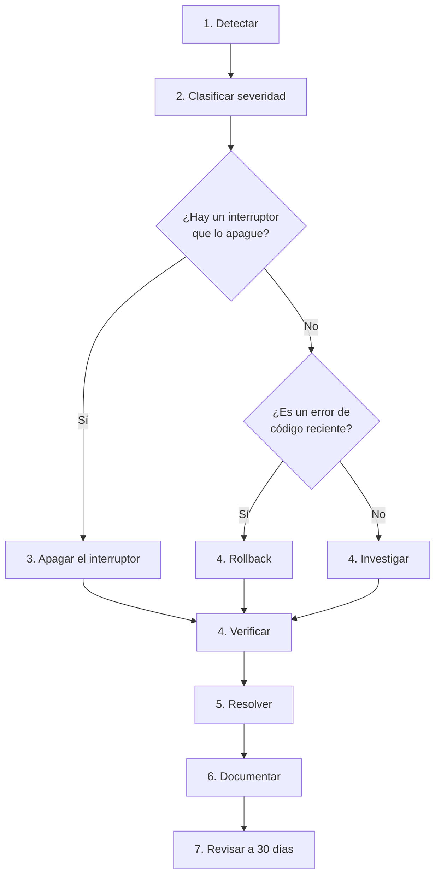

# Gestión de Incidentes

> [!danger] Este documento tiene dos partes y las dos importan
> 1. **La parte técnica**: cómo responder a un incidente del sistema.
> 2. **La parte legal y ética**: qué hacer si el incidente implica una brecha de
>    datos de menores.
>
> La segunda parte no se puede improvisar. Por eso está escrita.

---

# PARTE I — INCIDENTES TÉCNICOS

## 1. Qué es un incidente

| Es un incidente | No es un incidente |
|---|---|
| El sistema está caído | Un usuario escribió mal un dato |
| Hay un error 500 generalized | Un usuario se equivocó de contraseña |
| El backup falló | Un profesional olvidó finalizar una nota |
| Alguien accede sin permiso | El deudor del sistema es lento |
| Se perdió un backup externo | Un alumno no asiste |
| Un archivo se expone por URL | La cola de email tarda 10 minutos |

> [!important] La diferencia
> Un incidente tiene **impacto operativo** y requiere una **respuesta**. Un problema
> del usuario se resuelve con una explicación. Confundirlos lleva a responder con
> urgencia a algo que no la necesitaba, y a no responder a algo que sí.

---

## 2. La clasificación de severidad

| Nivel | Definición | Ejemplos | Respuesta | Restauración |
|---|---|---|---|---|
| 🔴 **P1 · Crítico** | El centro no puede operar | Sistema caído; base de datos inaccesible; ransomware | 15 min | ≤ 4 h |
| 🟠 **P2 · Alto** | Una función esencial no funciona | No se pueden registrar pagos; no se pueden registrar notas | 2 h | ≤ 1 día |
| 🟡 **P3 · Medio** | Hay alternativa manual | Los emails no salen; un reporte falla | 1 día | ≤ 3 días |
| 🟢 **P4 · Bajo** | Molestia o mejora | Un filtro no encuentra algo | 1 semana | Backlog |

> [!danger] La decisión de severidad la puede tomar cualquiera
> Si alguien del personal dice "el sistema no anda", es P1 hasta que se demuestre lo
> contrario. No hace falta esperar al técnico para clasificar.

---

## 3. El flujo de respuesta



### 3.1 Los cinco primeros minutos

```text
1. ANOTAR LA HORA EXACTA. Es el dato más importante del incidente.
2. ¿Todo el sistema o solo una parte?
3. ¿Hay un interruptor que apague esa parte? → USARLO.
4. ¿Se desplegó algo en las últimas horas? → ROLLBACK.
5. ¿Hay un backup de hoy? → Si no, no se toca la base de datos.
6. ¿El centro puede operar sin el sistema por un rato?
   → Si no, avisar a Dirección INMEDIATAMENTE.
```

> [!important] La decisión más importante: no tocar la base de datos
> Ante la duda, **no** se ejecutan comandos de repair ni se restauran backups sin
> necesidad. Un `pg_restore` mal hecho sobre una base que sí funcionaba convierte un
> incidente P1 en una pérdida de datos.

### 3.2 El árbol de decisión

```text
¿El sistema responde?
├── NO → ¿Falló un deploy reciente?
│         ├── SÍ → ROLLBACK
│         └── NO → ¿PostgreSQL está arriba?
│                   ├── NO → systemctl restart postgresql
│                   └── SÍ → ¿Disco lleno? → limpiar
│                             └── NO → ver logs, escalar
└── SÍ → ¿Es una sola función?
          ├── SÍ → ¿Hay interruptor? → APAGAR
          │         └── NO → ¿Es un dato? → corregir el dato
          └── NO →(error 500 en todo) → ROLLBACK
```

---

## 4. La comunicación durante el incidente

> [!danger] Comunicar mal un incidente es peor que el incidente
> Un "no sé qué pasa" sin hora ni impacto genera más ansiedad que el problema real.
> La comunicación es **periódica, aunque no haya novedad**.

| Momento | Qué comunicar | A quién |
|---|---|---|
| **Al detectar** | Qué pasó, hora, impacto inicial | Dirección (si P1) |
| **Cada 30 min** (P1) o **cada 2 h** (P2) | Estado, qué se está haciendo | Dirección + personal afectado |
| **Al resolver** | Qué pasó, qué se hizo, qué se cambia | Dirección + todos los afectados |
| **A las 48 h** | Análisis y acciones preventivas | Dirección |

### 4.1 El mensaje de apertura

```text
[CAI - INCIDENTE P1] 2026-03-12 14:32

Qué pasó: el sistema no permite iniciar sesión. Afecta a todo el personal.
Impacto: el centro no puede registrar attendees ni pagos.
Estado: se investiga. Próxima actualización en 30 minutos (15:02).
Responsable: [nombre]
```

> [!important] Lo que un mensaje de incidente **no** contiene
> - **No** especula sobre la causa ("parece que es la base de datos").
> - **No** da estimates sin fundamento ("esto se resuelve en 10 minutos").
> - **No** es técnico si va al personal del centro: "la base de datos no responde"
>   no le dice nada a una secretaria; "no se puede entrar al sistema" sí.
>
> Cuando el mensaje va al equipo técnico (Dirección, dev, Admin Técnico), puede
> incluir detalle técnico.

---

## 5. La postmortem

> [!important] La postmortem no es un castigo
> Es el momento de entender por qué pasó, para que **no vuelva a pasar**. Se escribe
> sin nombres de personas: se escribe sobre **procesos**.

```text
INCIDENTE: [ID] [Título corto]
Fecha y hora: [inicio] – [fin]
Duración: [x]
Severidad: [P1-P4]
Impacto: [qué se vio afectado, quantificado]

QUÉ PASÓ:
[Descripción factual]

QUÉ SE DETECTÓ:
[Cómo se enteraron: usuario, monitoreo, error 500...]

QUÉ SE HIZO:
[Acciones, con horas]

QUÉ DEBERÍA HABER PASADO:
[Lo que estaba previsto que evitara el incidente]

CAUSA RAÍZ:
[La causa real, no el síntoma]

ACCIONES CORRECTIVAS:
| # | Acción | Responsable | Fecha | Estado |
|---|--------|-------------|-------|--------|
| 1 | | | | |

ENCENDIDOS DE ALARMA:
[Qué señales existían y no se usaron]
```

### 5.1 La pregunta que más valor da

> [!tip] "¿Por qué no lo detectamos antes?"
> Un incidente que dura 4 horas y se detecta a los 10 minutos es un incidente menor.
> Un incidente que dura 4 horas y se detecta a las 4 es un problema de **monitoreo**.
>
> La postmortem tiene que responder las dos preguntas:
> 1. ¿Por qué pasó?
> 2. ¿Por qué no nos enteramos antes?

---

# PARTE II — INCIDENTES DE SEGURIDAD Y DATOS

## 6. Cuándo es un incidente de seguridad

> [!danger] Si hay datos personales de menores (PII), deja de ser un incidente técnico
> Cualquier incidente que incluya **acceso no autorizado**, **pérdida** o
> **exposición de datos** es un incidente de seguridad y activa este procedimiento.

| Situación | Es incidente de seguridad |
|---|---|
| Alguien entra sin permiso | ✅ Sí |
| Un profesional lee notas de alumnos no asignados | ✅ Sí |
| Se expone un documento por URL adivinada | ✅ Sí |
| Se pierden datos | ✅ Sí |
| Ransomware | ✅ Sí |
| Un backup cifrado desaparece | ✅ Sí |
| Un usuario olvidó su contraseña | ❌ No |
| Un profesional leyó mal un dato | ⚠️ Depende: si fue un error de dedo, no; si fue deliberado, sí |

---

## 7. El procedimiento de respuesta a un incidente de seguridad

> [!danger] Los cinco primeros minutos, en orden
> 1. **No** apagues el servidor. Si hay una intrusión activa, apagarla borra la
>    evidencia.
> 2. **No** borres logs.
> 3. **Registra** la hora exacta.
> 4. **Aísla** lo que sea posible sin destruir evidencia.
> 5. **Avisa** a Dirección.

### 7.1 Los niveles

| Nivel | Definición | Ejemplo | Respuesta |
|---|---|---|---|
| **N1** | Sospecha sin confirmación | Un intento de acceso fallido repetido | 24 h |
| **N2** | Acceso no autorizado confirmado sin extracción | Un profesional entra a notas ajenas y lo ve la auditoría | 48 h |
| **N3** | Extracción o exposición de datos | Un documento accesible por URL; datos copiados | Inmediato |
| **N4** | Pérdida total o cifrado del sistema | Ransomware; pérdida del servidor | Inmediato |

---

## 8. Las acciones según el nivel

### 8.1 N1 — Sospecha

```text
☐ Revisar los logs de acceso y de la auditoría
☐ Identificar el patrón (IP, usuario, hora)
☐ Verificar si hay accesos legítimos detrás de esa IP
☐ Si es un intento fallido: fortalecer las defensas, documentar
☐ Si hay un acceso legítimo detrás: verificar el motivo
☐ Registrar en el log de incidentes
```

### 8.2 N2 — Acceso no autorizado confirmado

```text
☐ Suspender la cuenta involucrada (no eliminarla)
☐ Preservar los logs (copia a un medio externo)
☐ Identificar TODO lo que esa cuenta tocó
☐ Evaluar si hubo extracción
☐ Notificar a Dirección
☐ Evaluar si hay obligación de notificación legal
☐ Revocar los grants de acceso activos
☐ Documentar
```

> [!important] Suspender, no eliminar
> Igual que con los usuarios que se van del centro: la cuenta se suspende, pero la
> evidencia (el registro de auditoría) se conserva.

### 8.3 N3 — Exposición de datos

```text
☐ Contener: apagar la funcionalidad afectada (kill switch)
☐ Preservar toda la evidencia
☐ Identificar qué datos y cuántos registros
☐ Identificar a QUIÉNES afectan
☐ Notificar a Dirección INMEDIATAMENTE
☐ Dirección decide la comunicación a las familias
☐ Documentar el incidente con el detalle de la NIST
```

### 8.4 N4 — Pérdida total o cifrado

```text
☐ NO pagar el rescate (no hay garantía y financia el ataque)
☐ Aislar el servidor de la red (desconectar, no apagar a la fuerza)
☐ Preservar el disco para forense (NO formatear)
☐ Evaluar la restauración desde el backup externo cifrado
☐ Verificar que el backup NO esté comprometido
☐ Rotar TODAS las claves
☐ Reconstruir el sistema desde cero
☐ Notificar a Dirección y al asesor legal
☐ Evaluar las obligaciones de notificación
```

> [!danger] Las claves se rotan, siempre
> Si hubo una intrusión, **todas** las claves del sistema se consideran
> comprometidas: `APP_KEY`, claves de cifrado de los backups, contraseñas de
> servicios, tokens de API. Restaurar un backup sin rotar las claves deja la puerta
> abierta.

---

## 9. Las obligaciones de notificación

> [!danger] Esto lo decide Dirección con el asesor legal, no el técnico
> Lo que el técnico **tiene que hacer** es preparar la información que Dirección
> necesita para decidir. Retrasarse en preparar la información retrasa la decisión.

| Situación | Qué hay que preparar |
|---|---|
| Datos de menores expuestos | Qué datos, cuántos alumnos, desde cuándo, a quién |
| Ransomware | Qué sistemas están cifrados, qué datos, desde cuándo |
| Clave comprometida | Qué datos estaban cifrados con ella |
| Documento clínico expuesto | Qué documento, de qué alumno, cuántas descargas |

### 9.1 La información que Dirección necesita

```text
1. Qué pasó, en pocas frases
2. Cuándo pasó exactamente (hora de inicio y de detección)
3. Qué datos están involucrados (tipo y volumen)
4. A cuántos alumnos afecta
5. Qué se hizo para contener
6. Qué se hizo para corregir
7. Qué se hará para que no se repita
8. Si se va a notificar y a quién
```

---

## 10. La trazabilidad

> [!important] Todo incidente queda registrado
> Un incidente que no se documenta, se repite. El registro es lo que permite ver la
> **tendencia**: si hay tres intentos de acceso no autorizado en un mes, hay que
> fortalecer las defensas; si hay tres en un año, es ruido.

```text
Registro de incidentes
| ID | Fecha | Severidad | Tipo | Resumen | Cerrado | Causa raíz | Acción |
|----|-------|-----------|------|---------|---------|------------|--------|
| INC-001 | | P2 | Técnico | | | | |
| INC-002 | | N2 | Seguridad | | | | |
```

---

## 11. Documentos relacionados

- [[10.01 Runbook Operativo]]
- [[10.02 Calendario de Checklists]]
- [[10.04 Recuperación ante Desastres]]
- [[04.07 Checklist Legal y Respuesta a Incidentes]]
- [[04.05 Auditoría de Datos Sensibles]]
- [[06.06 Procedimiento de Rollback]]
