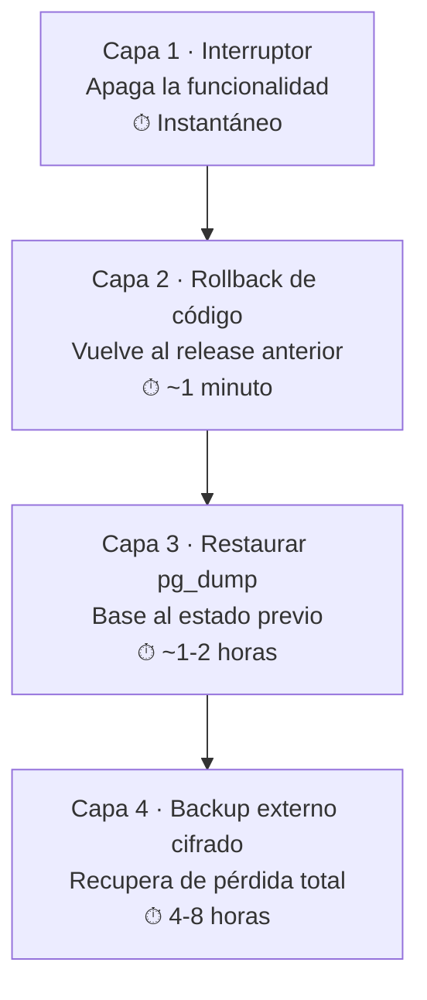
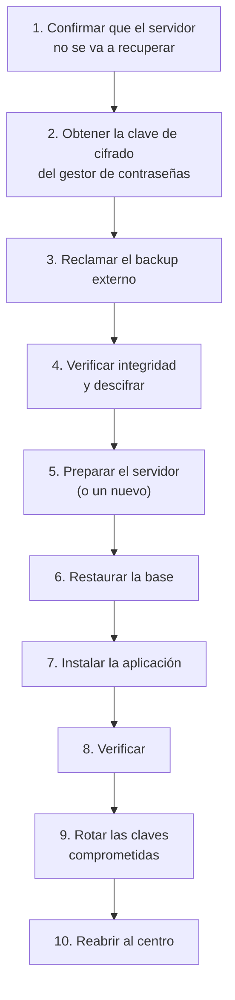

# Recuperación ante Desastres

> [!danger] Este documento existe para el día que todo sale mal
> Disco muerto. Ransomware. Incendio. Un servidor que no prende. Un error inexplicable.
>
> **Este documento se usa cuando ya no queda nada.** Por eso tiene que estar escrito
> con el nivel de detalle necesario para que alguien que nunca lo hizo pueda
> ejecutarlo con el sistema caído.

---

## 1. Los escenarios

| # | Escenario | Probabilidad | Impacto | RPO objetivo | RTO objetivo |
|---|---|---|---|---|---|
| D-1 | Error de código tras un deploy | Alta | Bajo | 0 | 1 min |
| D-2 | Función defectuosa | Media | Medio | 0 | 1 día |
| D-3 | Disco del servidor dañado | Baja | Alto | 24 h | 4 h |
| D-4 | Ransomware | Media | Crítico | 24 h | 4 h |
| D-5 | Pérdida total del servidor (incendio, robo) | Baja | Crítico | 24 h | 8 h |
| D-6 | Base de datos corrupta por error humano | Media | Crítico | 24 h | 4 h |
| D-7 | Actualización del sistema operativo que rompe el servidor | Media | Alto | 0 | 2 h |
| D-8 | Error de configuración (`.env`, Nginx) | Media | Medio | 0 | 30 min |

> [!danger] D-4 y D-5 son los que justifican el backup externo
> Un backup en el mismo servidor que los datos **no protege** de una pérdida del
> servidor ni de un ransomware. Solo protege de un error de software.

---

## 2. Las cuatro capas de protección



| Capa | Cuándo usarla | Dónde está el procedimiento |
|---|---|---|
| **1. Kill switch** | Una funcionalidad hace daño | [[10.03 Gestión de Incidentes]] §8 |
| **2. Rollback** | Error de código tras un deploy | [[10.01 Runbook Operativo]] §5 |
| **3. Restaurar dump** | Dato corrupto, migración con error | §4 de este documento |
| **4. Backup externo** | Pérdida del servidor, ransomware | §5 de este documento |

> [!important] Siempre de la capa más rápida a la más lenta
> No se restaura un backup para arreglar un bug de código: eso es más lento, más
> riesgoso y tira trabajo que no estaba roto. Se empieza por el kill switch, luego
> el rollback, y solo después se toca la base de datos.

---

## 3. El kit de emergencia

> [!danger] Lo que tiene que existir **antes** de necesitarlo
> Un runbook de recuperación sin los recursos a mano es un documento de ficción.

| Recurso | Dónde | Quién lo custodia |
|---|---|---|
| **Clave de cifrado de los backups** | Gestor de contraseñas del centro | Backup Custodian |
| **`APP_KEY`** | Gestor de contraseñas del centro | Backup Custodian |
| **Credenciales del administrador del servidor** | Gestor de contraseñas del centro | Admin Técnico |
| **Credenciales de `admin@cai.local`** | Gestor de contraseñas del centro | Dirección |
| **Especificación del servidor** (CPU, RAM, disco) | [[07.02 Requisitos de Hardware y Software]] | Admin Técnico |
| **Script de instalación** | [[07.03 Instalación del Sistema]] | Admin Técnico |
| **Script de restauración** | `scripts/restore-from-dump.sh` | Admin Técnico |
| **Destino del backup externo** | [[06.07 Backups y Recuperación]] | Backup Custodian |
| **Un disco externo vacío** | En el centro | Admin Técnico |

> [!important] El kit no puede estar solo en el servidor
> Si el servidor muere y el backup externo está cifrado con una clave que solo está en
> el servidor, todo se perdió. La clave **tiene que** estar en el gestor de
> contraseñas del centro, en papel o en la nube del centro, **nunca** solo en la
> máquina.

---

## 4. D-6: restaurar un `pg_dump` (capa 3)

> [!warning] Cuándo usar esta capa
> - La base de datos está **corrupta**.
> - Una migración **alteró datos** de forma irreversible.
> - Un `DELETE` o `UPDATE` masivo se ejecutó por error.
>
> **No** usar para un bug de código (eso es rollback, capa 2).

### 4.1 El procedimiento

```bash
# 1. Estado actual
cd /srv/cai
sudo ./scripts/status.sh
sudo date  # ← anotar la hora

# 2. Poner la aplicación en mantenimiento (para que nadie escriba)
sudo /srv/cai/scripts/maintenance.sh on

# 3. Identificar el dump a restaurar
ls -lh /var/backups/cai/
# Elegir el más reciente ANTERIOR al problema

# 4. Verificar el dump antes de usarlo
sudo /srv/cai/scripts/restore-from-dump.sh --verify=/var/backups/cai/2026-03-12.dump

# 5. Restaurar
sudo /srv/cai/scripts/restore-from-dump.sh \
  --file=/var/backups/cai/2026-03-12.dump \
  --confirm

# 6. Verificar la integridad
sudo -u postgres psql -d cai -c "\dt identity.*"
sudo -u postgres psql -d cai -c "SELECT count(*) FROM identity.users;"
sudo -u postgres psql -d cai -c "SELECT count(*) FROM students.students;"

# 7. Reactivar
sudo /srv/cai/scripts/maintenance.sh off
sudo /srv/cai/scripts/healthcheck.sh
```

### 4.2 Lo que hay que verificar después de restaurar

```text
☐ La base responde
☐ Las 9 tablas de esquema están
☐ El número de alumnos coincide con el esperado
☐ El número de usuarios coincide
☐ La aplicación entra
☐ Se puede abrir una ficha de alumno
☐ Se puede abrir un recibo
☐ La auditoría tiene los eventos de antes del problema
```

> [!danger] La pérdida de datos desde el dump
> Si se restaura un dump de hace 24 horas, se pierden **todos** los registros de las
> últimas 24 horas: notas clínicas, pagos, asistencia.
>
> Por eso el dump se elige **deliberadamente**, y por eso existe el PITR (restauración
> punto en el tiempo), que permite recuperar hasta el minuto anterior.

### 4.3 La alternativa mejor: PITR

Si `pgBackRest` está configurado (ver [[08.11 F9 Endurecimiento y Operación Continua]]):

```bash
# Restaurar a las 14:32 del 12 de marzo (un punto exacto)
sudo -u postgres pgbackrest --stanza=main --type=time \
  --target='2026-03-12 14:32:00' restore

# Reconstruir el WAL desde ese punto
sudo -u postgres pgbackrest --stanza=main --delta restore
```

| Mecanismo | RPO | Cuándo usarlo |
|---|---|---|
| `pg_dump` diario | Hasta 24 h | Procedimientos simples, sin WAL |
| PITR con `pgBackRest` | ≤ 1 h (con `archive_timeout=300`) | Cuando el RPO importa |

---

## 5. D-3, D-4, D-5: recuperar desde el backup externo (capa 4)

> [!danger] Este es el escenario más grave
> El servidor está perdido, cifrado o destruido. Lo único que queda es el backup
> externo cifrado y las claves del gestor de contraseñas.

### 5.1 El procedimiento



### 5.2 Paso a paso

```bash
# --- Paso 1: Preparar el destino ---
# Un servidor nuevo (o un disco nuevo en el servidor actual)

# --- Paso 2: Obtener la clave ---
# Del gestor de contraseñas del centro: "CAI backup externo clave"
# NUNCA del servidor viejo (puede estar comprometido)

# --- Paso 3: Reclamar el backup ---
# Copiar el backup del destino externo al servidor nuevo

# --- Paso 4: Verificar y descifrar ---
gpg --decrypt backup-2026-03-12.gpg > backup-2026-03-12.dump
sha256sum -c backup-2026-03-12.dump.sha256

# --- Paso 5: Instalar el sistema ---
# Seguir [[07.03 Instalación del Sistema]]
sudo ./scripts/install.sh --fresh

# --- Paso 6: Restaurar la base ---
sudo -u postgres pg_restore -d cai --clean --if-exists --no-owner \
  /var/backups/cai/backup-2026-03-12.dump

# --- Paso 7: Configurar ---
# Copiar el .env desde el gestor de contraseñas o desde la copia local
# Regenerar APP_KEY: NO. Si se regenera, se pierden las notas clínicas.
sudo /srv/cai/scripts/install.sh --link-storage --link-env

# --- Paso 8: Verificar ---
sudo /srv/cai/scripts/healthcheck.sh
```

### 5.3 La verificación obligatoria

```text
☐ La base restaurada tiene todas las tablas
☐ El conteo de alumnos coincide con el del último backup
☐ El conteo de usuarios coincide
☐ Se puede abrir una nota clínica (el cifrado sigue funcionando)
☐ La auditoría tiene los eventos anteriores al desastre
☐ Se puede iniciar sesión
☐ Se puede registrar una nota nueva
☐ Se puede registrar un pago
☐ La aplicación responde en /up
```

> [!danger] Si las notas clínicas no se pueden leer, se restauró con otra `APP_KEY`
> El error más grave de una restauración: usar una `APP_KEY` **diferente** a la
> original. Las notas clínicas se descifran con esa clave. Con otra clave, el
> ciphertext no se descifra: **el contenido se pierde**, aunque la base esté
> "correctamente" restaurada.
>
> Por eso la `APP_KEY` se respalda **separadamente** y **nunca** se regenera sin
> confirmación.

---

## 6. Las claves: cuándo y cómo rotarlas

| Situación | ¿Rotar? | Qué se rota |
|---|---|---|
| Ransomware (D-4) | ✅ **Sí, todo** | `APP_KEY`, claves de backup, contraseñas de servicios, tokens |
| Robo o pérdida del servidor (D-5) | ✅ Sí | Contraseñas de servicios, tokens, claves de backup |
| Clave filtrada | ✅ Sí | Esa clave y las dependientes |
| Error de configuración sin exposición | ⚠️ Evaluar | Solo la clave afectada |
| Rotación rutinaria anual | ✅ Sí | Contraseñas de servicios (no la `APP_KEY`) |

> [!danger] Rotar la `APP_KEY` destruye las notas clínicas
> Si la `APP_KEY` cambia, **todas** las notas clínicas existentes quedan
> indescifrables. No hay recuperación.
>
> **Por eso la rotación de la `APP_KEY` solo es válida cuando:**
> 1. Se ha verificado que la nueva clave se puede descifrar con los datos
>    existentes (imposible si es nueva), **o**
> 2. Se acepta la pérdida del historial clínico, **o**
> 3. Se hace una **re-cifrado**: descifrar con la clave antigua y volver a cifrar
>    con la nueva, en un script de una sola vez.

```php
// El re-cifrado (solo para el personal técnico autorizado)
// packages/care/.../RotateEncryptionKey.php
DB::connection('care')->transaction(function () {
    ClinicalNote::chunk(100, function ($notes) use ($oldKey, $newKey) {
        foreach ($notes as $note) {
            $plain = Crypt::decryptString($note->content, false, $oldKey);
            $note->content = Crypt::encryptString($plain, false, $newKey);
            $note->save();
        }
    });
});
```

> [!important] Antes de rotar cualquier clave
> 1. Backup **verificado** de la base.
> 2. La clave nueva, escrita y verificada (cifrado, descifrado, comparar).
> 3. Una ventana de mantenimiento.
> 4. El script probado en una **copia** de la base, no en producción.

---

## 7. El plan de continuidad del negocio

> [!important] Mientras se recupera el sistema, el centro no se detiene
> El disaster recovery técnico es una parte. La otra es: **¿cómo trabaja el centro
> sin el sistema?**

| Periodo | Operación manual | Quién |
|---|---|---|
| **0–4 h** | Se sigue operando: agenda en papel, asistencia en cuaderno, pagos en planilla | El personal |
| **4–24 h** | Se sigue operando, y se **anota todo** para cargar después | El personal |
| **24–72 h** | Si no se recuperó: se evaluan medidas de emergencia (reducir servicios) | Dirección |
| **> 72 h** | Se activa el plan de continuidad extendida | Dirección |

### 7.1 Los datos que hay que anotar en papel durante la contingencia

```text
☐ Asistencia de todas las sesiones (fecha, hora, grupo, presentes/ausentes)
☐ Pagos recibidos (fecha, familia, monto, método, referencia)
☐ Cambios de agenda (cancelaciones, reprogramaciones)
☐ Incidentes relevantes con alumnos
☐ Datos de alumnos nuevos
```

> [!danger] Lo que NO se anota en papel
> **El contenido clínico detallado de las notas.** Si hay que registrar una nota
> clínica en papel, se anota **mínimamente** (qué se trabajó, observaciones generales)
> y se carga al sistema apenas se recupere. La alternativa —llevar las notas en un
> cuaderno abierto en el centro— es exactamente el riesgo que el sistema de cifrado
> evita.

---

## 8. La prueba de restauración

> [!danger] Un plan de recuperación que no se probó no es un plan
> Es una intención. La prueba es trimestral (ver [[10.02 Calendario de Checklists]]
> §9) y su resultado se registra con fecha, duración y observaciones.

### 8.1 Qué se mide

| Métrica | Definición | Objetivo |
|---|---|---|
| **RPO** | Cuánto dato se pierde | ≤ 1 h (con PITR); ≤ 24 h (solo con dump) |
| **RTO** | Cuánto tarda en volver a operar | ≤ 4 h (capa 3 y 4) |
| **Éxito** | ¿El sistema arranca y sirve datos correctos? | 100 % |

### 8.2 La bitácora de pruebas

| Fecha | Escenario probado | RPO real | RTO real | Resultado | Observaciones |
|---|---|---|---|---|---|
| | | | | | |
| | | | | | |

> [!important] Si el RTO medido supera el objetivo
> Hay que **cambiar algo**, no anotar el número. Opciones: un proveedor de backups
> más rápido, un script de restauración más simple, hardware mejor, o **revisar la
> promesa** de recuperación y comunicarla con el número real.

---

## 9. Documentos relacionados

- [[10.01 Runbook Operativo]]
- [[10.02 Calendario de Checklists]]
- [[10.03 Gestión de Incidentes]]
- [[06.07 Backups y Recuperación]]
- [[07.03 Instalación del Sistema]]
- [[08.11 F9 Endurecimiento y Operación Continua]]
