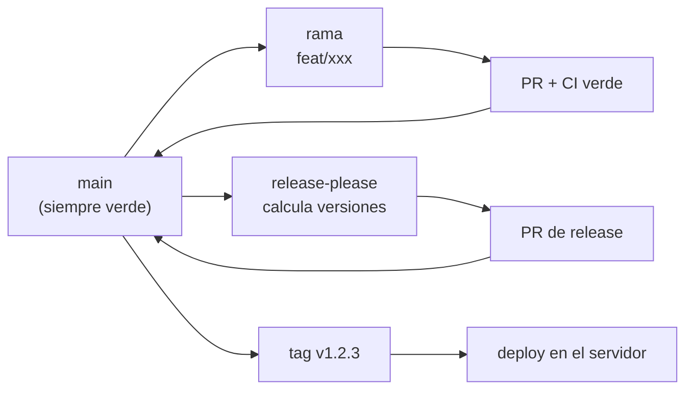

# ADR-0004 — Trunk-based development con tags SemVer

| Campo | Valor |
|---|---|
| **Estado** | Aceptado |
| **Fecha** | 2026-10-22 |
| **Decide** | Responsable técnico |
| **Alcance** | Flujo de trabajo en Git, estrategia de ramas, versionado del código |

---

## 1. Contexto

El repositorio del sistema tiene que sostener:

- Un **despliegue en un servidor único**, con release por symlink.
- **Rollback de código en menos de un minuto**, que exige identificar con precisión
  qué versión estaba desplegada.
- **Un solo desarrollador part-time**, que a veces trabaja en dos cosas a la vez
  (un fix urgente y una funcionalidad nueva).
- **Auditoría**: la Direction tiene que poder preguntar "cuándo cambió esto".

**Restricciones:**
- El repositorio es **privado** en GitHub, con `main` protegida (PR obligatorio, CI
  verde, sin bypass).
- El servidor **no** puede desplegar desde un commit arbitrario: despliega **tags**.
- Las dependencias se instalan con `composer install --no-dev`, así que el
  `composer.lock` tiene que ser **exacto y reproducible**.

**Qué sabemos:**
- El trunk-based con ramas cortas es el flujo que mejor funciona con equipos
  pequeños y despliegue frecuente.
- El versionado SemVer por **paquete** es lo que permite que `cai/billing` evolucione
  a un ritmo distinto de `cai/notifications`.
- Con un solo dev, las ramas largas son un synonymo de conflicto y de merges
  oubliados.

---

## 2. Decisión

**Usamos trunk-based development: `main` es siempre desplegable, el trabajo se hace
en ramas cortas que duran días, y las versiones se marcan con tags SemVer
independientes por paquete, generados automáticamente con `release-please`.**

En detalle:

### 2.1 El flujo



| Elemento | Regla |
|---|---|
| **Rama principal** | `main`. Siempre verde. Es la única que se despliega. |
| **Ramas de trabajo** | `feat/`, `fix/`, `refactor/`, `docs/`. Duración: **menos de 3 días**. |
| **PR** | Obligatorio. Requiere CI verde y 1 aprobación. |
| **Merge** | Squash merge. El `main` tiene un historial legible. |
| **Commits** | Conventional Commits (`feat:`, `fix:`, `docs:`, `refactor:`, `test:`, `chore:`). |
| **Versiones** | SemVer **por paquete**, calculadas por `release-please`. |
| **Tags** | `cai/<paquete>@v<version>`. El release se despliega desde un tag. |
| **Ramas `release/*`** | **No se usan.** El tag es el release. |

> [!important] Por qué no hay ramas `release/*`
> La razón clásica de la rama de release es que varios despliegues a la vez
> comparten correcciones. **Aquí hay un solo servidor y un solo release.** La rama de
> release solo agregaría merge conflicts. El tag cumple la misma función: Congela un
> estado conocido como estable.

### 2.2 El versionado por paquete

Cada paquete de `packages/` tiene su propio `composer.json` con su propia
`version`. `release-please` calcula el.incremento según los commits que tocan ese
paquete:

| Tipo de commit | Incremento |
|---|---|
| `fix:` | PATCH |
| `feat:` | MINOR |
| `BREAKING CHANGE:` | MAJOR |

```json
{
  "name": "cai/billing",
  "version": "1.3.0",
  "require": {
    "php": "^8.3",
    "cai/core": "^1.0"
  }
}
```

> [!danger] Las dependencias entre paquetes declaran rangos, no versiones exactas
> `cai/billing` requiere `cai/core: ^1.0`, no `cai/core: 1.0.0`. Si declarara la
> versión exacta, cada cambio en `core` obligaría a tocar todos los paquetes que lo
> usan, y el versionado por paquete perderá su sentido.
>
> La verificación de que las versiones **declaradas** son **compatibles** con las
> **instaladas** la hace `composer validate` y el `composer.lock` en la CI.

### 2.3 El tag como unidad de despliegue

El servidor despliega **desde un tag**, nunca desde `main`:

```bash
# En el servidor
git fetch --all --tags
git checkout cai/core@v1.4.0
```

> [!important] Por qué el servidor despliega un tag y no `main`
> Porque `main` puede haber cambiado entre el momento del deploy y el momento de la
> verificación. Con un tag, el estado desplegado es **inmutable y reproducible**: si
> hay que volver, se vuelve a un tag exacto, no a "lo que había en main ayer".

---

## 3. Alternativas consideradas

### 3.1 Git Flow

| Aspecto | Detalle |
|---|---|
| **Descripción** | Ramas `develop`, `release/*`, `feature/*`, `hotfix/*`. Merges a `main`. |
| **Ventajas** | Modelo maduro. Ramas de release para estabilizar. Hotfixes separados. |
| **Desventajas** | Manyas ramas, muchos merges, historial ruidoso. Mucho ceremony para un solo dev. |
| **Por qué se descartó** | Git Flow está diseñado para equipos grandes con releases frecuentes a producción. Con una persona, la mitad de sus reglas (¿cuándo se mergea a `develop`? ¿qué entra en la rama de release?) son ruido que genera decisiones, no resultados. |

### 3.2 Ramas por fase del plan

| Aspecto | Detalle |
|---|---|
| **Descripción** | `fase/f3`, `fase/f4`, etc. Cada fase es una rama larga. |
| **Ventajas** | La correspondencia entre fase y rama es evidente. |
| **Desventajas | Las fases duran **semanas**. Las ramas de semanas generan conflictos constantes y `main` queda obsoleto. |
| **Por qué se descartar | El plan de trabajo y el versionado del código son cosas distintas. Mezclarlas produce ramas largas sin ningún beneficio. |

### 3.3 Versionado global único (una versión para todo)

| Aspecto | Detalle |
|---|---|
| **Descripción** | Todo el repositorio tiene una versión: `v1.4.0`. |
| **Ventajas** | Simple de comunicar. Un solo CHANGELOG. |
| **Desventajas | Un cambio en `cai/notifications` obliga a versionar `cai/billing`, aunque no haya cambiado. Los changelogs se mezclan. |
| **Por qué se descartó** | Con nueve paquetes que evolucionan a ritmos distintos, el versionado global genera versiones nominalmente justificadas. El versionado por paquete es más honesto y permite desplegar solo lo que cambió. |

### 3.4 Sin `release-please` (versionado manual)

| Aspecto | Detalle |
|---|---|
| **Descripción** | El dev decide la versión a mano y crea el tag. |
| **Ventajas** | Control total. Sin dependencia extra. |
| **Desventajas | Es un paso manual que se olvida. Un changelog manual se desactualiza. |
| **Por qué se descartó** | `release-please` hace exactamente lo mismo de forma determinística, y además genera el CHANGELOG y el PR de release. Es la diferencia entre una tarea opcional y una automática. |

---

## 4. Consecuencias

### 4.1 Positivas

- **`main` siempre es desplegable.** No hay la pregunta "¿ya se puede subir?".
- **El historial es legible.** Con squash merge, `git log` muestra los cambios, no
  los commits individuales de una rama.
- **El versionado por paquete es automático** y el changelog se genera sin trabajo
  extra.
- **El rollback es preciso**: se vuelve a un tag exacto.
- **El trabajo en paralelo es natural**: una `fix/` de emergencia convive con una
  `feat/` en desarrollo.

### 4.2 Negativas (lo que aceptamos)

- **`main` tiene que estar verde todo el tiempo.** Un commit a `main` que rompe la CI
  bloquea a todos. Con un solo dev, la presión por "subir rápido" es real.
- **Los squash merges pierden el detalle** de los commits intermedios. Es
  intencional: el detalle está en el PR.
- **`release-please` es una dependencia más** que hay que entender, configurar y
  mantener. Si GitHub cambia su API, hay que actualizarlo.
- **La protección de `main` molesta al día a día.** Un push directo se rechaza; hay
  que abrir un PR. Es lo correcto, pero es fricción.
- **Ramas de más de 3 días** generan conflictos. Hay que discipline. Con un dev
  part-time, una `feat/` puede quedar abierta dos semanas por culpa de otra cosa.
- **Requiere que los commits sean conventional.** Si el dev escribe `"arreglo"`, la
  herramienta no puede calcular la versión.

### 4.3 Neutras

- El repositorio privado en GitHub **no** es el entorno de producción: es el
  control de versiones y el pipeline. El despliegue sigue siendo un script en el
  servidor (ver [[ADR-0005 Release por Symlink]]).

---

## 5. Verificación

```text
☐ `main` está protegida: PR obligatorio, CI verde, sin bypass
☐ Un PR con un commit mal formado (no conventional) hace que release-please no calcule versión
☐ `release-please` abre un PR de release con el CHANGELOG correcto
☐ El tag generado tiene el formato `cai/<paquete>@v<version>`
☐ El `composer.json` de cada paquete tiene su campo `version`
☐ El servidor despliega desde un tag, nunca desde `main`
☐ El `composer.lock` está commiteado y la CI verifica que no cambia sin avisar
☐ Las dependencias entre paquetes usan rangos SemVer, no versiones exactas
```

> [!important] La verificación del PR de release
> La primera vez que `release-please` se ejecuta, hay que **revisar el PR que
> genera** antes de mergearlo. Es el momento de comprobar que el versionado por
> paquete se calcula como se espera: un cambio en `cai/care` no debería subir la
> versión de `cai/billing`.

---

## 6. Reversibilidad

| Aspecto | Detalle |
|---|---|
| **¿Se puede revertir?** | Sí |
| **Cómo** | Cambiar la estrategia de ramas en `git` y proteger `main` de otra forma. Los tags existentes siguen siendo válidos. |
| **Costo de revertir** | Bajo. La historia de Git no se pierde. Lo que sí habría que rehacer es el versionado manual de los paquetes. |
| **Señal de que hay que revertir** | Si `release-please` deja de mantenerse (abandono del proyecto, incompatibilidad con GitHub) y el versionado manual resulta viable. Es un escenario poco probable, pero la reversión es de bajo costo. |

---

## 7. Referencias

- [[05.01 Flujo de Trabajo]]
- [[05.02 Commits, Ramas y Versionado SemVer]]
- [[06.01 Estrategia de Versionado]]
- [[06.05 Release y Deploy]]
- [[ADR-0005 Release por Symlink]]
