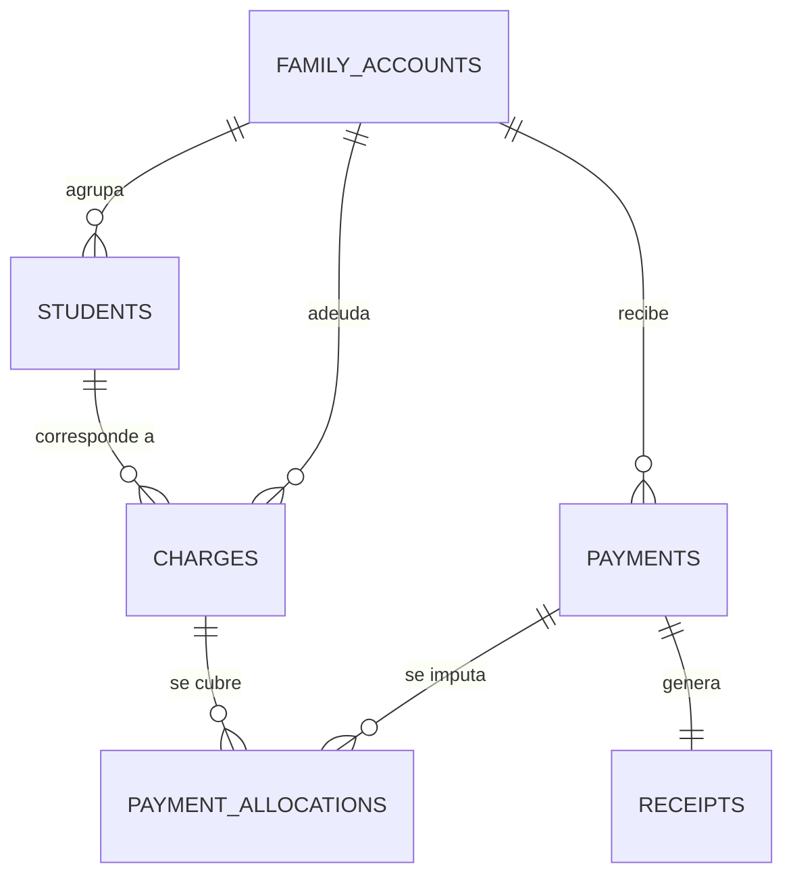

# ADR-0007 — Cuenta familiar compartida con imputación de pagos por alumno

| Campo | Valor |
|---|---|
| **Estado** | Aceptado |
| **Fecha** | 2026-10-22 |
| **Decide** | Dirección, con Administración Financiera |
| **Alcance** | Módulo `billing`, modelo de cargos, pagos, imputaciones y recibos |

---

## 1. Contexto

El centro atiende a **hermanos y a hijos de los mismos tutores**. La práctica
real del centro es que la familia **paga una sola cuota y todos los hermanos
quedan cubiertos**.

Eso obliga a decidir el modelo de cobro:

- ¿El cobro es **por alumno** y la familia paga varios, o es **por familia** y
  el sistema reparte?
- ¿Un pago se **imputa** a un alumno o a un conjunto de alumnos?
- ¿El recibo es **por alumno** o **por familia**?
- ¿Cómo se refleja un pago que cubre **un mes de dos hermanos**?

**Restricciones:**

- El cobro del centro es en **guaraníes (Gs.)**, con importes que a veces
  incluyen decimales y a veces no.
- La **imputación** de pagos debe ser exacta: una diferencia de 100 Gs. en el
  saldo de una familia genera una discusión y una visita al centro.
- Los **recibos** son **en papel** en el MVP (ver [[ADR-0008 Stack Laravel Filament PostgreSQL]]): no hay portal de familias donde descargar.
- **Nada se borra**: los documentos financiero son evidencia.
- La Direction necesita un **estado de cuentas por alumno** (para saber si un
  alumno tiene saldo pendiente) y un **estado de cuentas por familia** (para
  saber si la familia debe).

**Qué sabemos:**

- El modelo de **cargo + imputación** es el que usan los sistemas de cobro con
  varias deudas y varios pagos: separa *lo que se debe* de *lo que se pagó*.
- Un mismo pago puede cubrir **cargos de varios alumnos** y varios cargos del
  mismo alumno.
- El saldo **siempre se calcula** a partir de cargos e imputaciones. Guardar un
  "saldo" mutable es la fuente número uno de descuadres.

**Qué no sabemos:**

- Si Dirección definirá **ajustes por descuento, directorio, o cualquier otro
  criterio** (ver P1, P2 en [[01.07 Preguntas Abiertas y Decisiones Pendientes]]). El modelo de este ADR no lo impide: los ajustes son una
  extensión, no un cambio.

---

## 2. Decisión

**El cobro es por alumno: cada alumno genera sus propios cargos. La familia
tiene una cuenta compartida que agrupa a todos sus hijos, y un pago se imputa
explícitamente a uno o varios cargos mediante imputaciones. El recibo se emite
por pago (por la familia) y las imputaciones quedan visibles en el detalle. El
saldo nunca se edita: se calcula.**

En detalle:

### 2.1 Las cuatro entidades



| Entidad | Qué representa | Clave |
|---|---|---|
| `family_accounts` | El grupo de pago: uno o más alumnos con un responsable común | `id` |
| `charges` | **Lo que se debe**, a nivel de alumno | `id` + `student_id` |
| `payments` | **Lo que se pagó**, a nivel de familia | `id` + `family_account_id` |
| `payment_allocations` | **El puente**: cuánto de qué pago cubre qué cargo | `payment_id` + `charge_id` |

> [!important] La familia es el pagador, el alumno es el deudor
> El cargo pertenece al alumno (es su cobertura la que se compra). El pago
> pertenece a la familia (es quien trae la plata). La imputación es lo que
> conecta ambos y **debe existir siempre**: un pago sin imputación es un
> anticipo sin asignar, y una imputación sin pago es un descuadre.

### 2.2 El cargo

```text
charges
├── family_account_id   ← de quién es la deuda
├── student_id          ← de qué alumno es la cobertura
├── enrollment_id       ← de qué inscripción proviene (nullable: ajustes)
├── fee_plan_id         ← de qué plan de cuotas (nullable: cargo manual)
├── description         ← "Cuota mensual - Terapia de Lenguaje"
├── period              ← "2026-10" (mes que se está cobrando)
├── due_date            ← fecha de vencimiento
├── amount              ← importe del cargo (NUMERIC, nunca FLOAT)
├── amount_paid         ← cache derivado del total imputado (ver §2.5)
└── status              ← pending | partial | paid | voided
```

> [!note] `family_account_id` en el cargo es redundante
> Se puede derivar del alumno (`students.family_account_id`). Se guarda igual
> **a propósito**: permite consultas de "deuda de esta familia" sin pasar por un
> `JOIN` con alumnos, y permite mantener la coherencia cuando una familia se
> reorganiza (un hermano se muda y cambia de cuenta). La regla de coherencia es
> que un cargo pertenece a la familia del alumno **en el momento de la emisión**.

### 2.3 El pago y su reparto

```php
// Un pago de 500.000 Gs. que cubre a dos hermanos
$payment = Payment::create([
    'family_account_id' => $family->id,
    'amount'            => 500000,
    'method'            => 'bank_transfer',
    'paid_at'           => now(),
    'received_by'       => auth()->id(),
]);

// Imputación explícita: 300.000 al hermano mayor, 200.000 al menor
$allocation = PaymentAllocation::create([
    'payment_id' => $payment->id,
    'charge_id'  => $chargeMayor->id,
    'amount'     => 300000,
]);

// Regla dura: la suma de imputaciones nunca puede superar el pago
// y nunca puede superar el cargo.
```

| Regla | Comprobación |
|---|---|
| Imputación ≤ saldo del cargo | `CHECK` en la base + validación de la aplicación |
| Σ imputaciones ≤ importe del pago | Se valida dentro de una transacción |
| Todo pago confirmado tiene ≥ 1 imputación | Regla de negocio |
| Todo cargo `paid` tiene imputación por el total | Derivado del `status` |

### 2.4 El recibo

| Aspecto | Decisión |
|---|---|
| **Se emite por pago**, no por cargo | La familia paga una vez → un recibo |
| **Número** | `REC-AAAA-NNNNNN`, reiniciado cada año |
| **Generación** | `UPDATE receipt_sequences SET last_number = last_number + 1 WHERE year = 2026 RETURNING last_number` (atómico, sin carrera) |
| **Papel** | Se imprime; en el MVP no hay envío por email |
| **Contenido** | Datos de la familia, desglose de imputaciones, importes. **Nunca** información clínica |
| **Anulación** | Un recibo anulado se marca `voided` con motivo; **no se borra y no se reutiliza su número** |

> [!important] Un recibo por pago, con el detalle de imputaciones
> Si el recibo fuera por cargo, la familia de dos hermanos recibiría dos recibos
> por un solo pago en efectivo, lo que genera la pregunta "por qué me cobran
> dos veces". Con un solo recibo por pago y el desglose de imputaciones, la
> explicación está en el propio documento.

### 2.5 El saldo se calcula, no se edita

```sql
-- Forma correcta: subconsulta agregada
SELECT COALESCE(SUM(c.amount), 0) - COALESCE(SUM(a.total), 0) AS balance
FROM billing.charges c
LEFT JOIN (
    SELECT charge_id, SUM(amount) AS total
    FROM billing.payment_allocations
    GROUP BY charge_id
) a ON a.charge_id = c.id
WHERE c.family_account_id = :family
  AND c.status <> 'voided';
```

> [!danger] La trampa conocida: `LEFT JOIN` + `SUM`
> La forma "natural" de escribirlo es unir cargos e imputaciones en un solo
> `LEFT JOIN` y sumar. **Esa forma multiplica los importes**: un cargo con dos
> imputaciones aparece dos veces en el resultado y su importe se suma dos
> veces. El saldo sale mal y nadie sabe por qué.
>
> ```sql
> -- ❌ INCORRECTO (solo como ejemplo de lo que NO hay que escribir)
> SELECT COALESCE(SUM(c.amount), 0) - COALESCE(SUM(pa.amount), 0)
> FROM billing.charges c
> LEFT JOIN billing.payment_allocations pa ON pa.charge_id = c.id
> WHERE c.family_account_id = :family AND c.status <> 'voided';
> ```
>
> La forma correcta es **siempre** una subconsulta agregada por `charge_id`.
> Este es un **test obligatorio** de F6, no una mejora opcional.

`charges.amount_paid` es un **cache** del total imputado. Si el cache y el
cálculo no coinciden, **manda el cálculo** y se regenera el cache.

---

## 3. Alternativas consideradas

### 3.1 Un cargo único por familia (sin importe por alumno)

| Aspecto | Detalle |
|---|---|
| **Descripción** | La familia debe una cuota única. No hay `student_id` en el cargo. El saldo es de la familia, punto. |
| **Ventajas** | Modelo mínimo. Un solo cargo. Imputación trivial. |
| **Desventajas** | No se puede saber si un alumno concreto tiene cobertura. No se puede facturar a un solo hermano. Los planes de atención tienen importes distintos según el nivel del alumno. |
| **Por qué se descartó** | El centro **necesita** el estado de cuentas por alumno: es lo que se revisa al matricular y lo que se pide en las reuniones con familias. Un cargo familiar sin desglose no responde a la pregunta "este alumno está al día?". |

### 3.2 Cobro por alumno sin imputaciones (pago = pago de un cargo)

| Aspecto | Detalle |
|---|---|
| **Descripción** | Cada cargo se paga con uno o varios pagos; cada pago pertenece a un solo cargo. |
| **Ventajas** | Modelo simple. No hay tabla puente. |
| **Desventajas** | **Un pago en efectivo que cubre a dos hermanos no se puede registrar.** Habría que inventar dos pagos con la misma fecha y el mismo comprobante, o peor, "particionar" el pago. El modelo de la cuenta familiar compartida se rompe aquí. |
| **Por qué se descartar** | Es exactamente el caso de uso que motiva este ADR. La tabla de imputaciones no es complejidad gratuitada: es lo que hace posible un pago que cubre varios cargos. |

### 3.3 Saldo almacenado y editable (`family_accounts.balance`)

| Aspecto | Detalle |
|---|---|
| **Descripción** | La cuenta familiar guarda su saldo. Cada pago y cada cargo lo actualizan. |
| **Ventajas** | Consultas instantáneas. Listados rápidos. |
| **Desventajas** | El saldo se desincroniza en cuanto hay una operación anulada, un ajuste o un error. No hay forma de saber si el saldo guardado o el calculado es el correcto. |
| **Por qué se descartó** | Un saldo que se edita a mano es un saldo que algún día está mal, y nadie lo detecta. La regla del centro es: **el saldo se calcula**. Si el rendimiento lo exigiera, se cachea — pero se recalcula y se compara. |

### 3.4 Un recibo por cargo

| Aspecto | Detalle |
|---|---|
| **Descripción** | Cada cargo cubierto genera su propio recibo. |
| **Ventajas** | Cada recibo corresponde a un alumno. Simple de emitir. |
| **Desventajas** | La familia que paga una sola vez recibe dos recibos por el mismo pago. Y si un pago cubre tres meses de un hermano, el recibo es por cargo o por mes (¿cuál? no está definido). |
| **Por qué se descartó** | El recibo es la constancia de un **acto de pago**: la familia entrega plata una vez y recibe un papel. El desglose por alumno va dentro del recibo. |

### 3.5 Cerrar el ciclo en un solo checkout

| Aspecto | Detalle |
|---|---|
| **Descripción** | Al cobrar se eligen cargos a cubrir, se genera el pago y las imputaciones en una sola pantalla. |
| **Ventajas** | Flujo único. Menos pasos. |
| **Desventajas** | Obliga a decidir la imputación en el momento del cobro, cuando muchas veces el ingreso es "un pago del mes" sin detalle y la imputación se hace después, al revisar. |
| **Por qué se descartó** | Se conserva la **imputación como paso explícito y posterior**: el cobro registra la plata que entró; la imputación explica a qué corresponde. Se pueden hacer en el mismo momento (caso normal) o días después (pago recibido por transferencia sin detalle). |

---

## 4. Consecuencias

### 4.1 Positivas

- **El caso real del centro está cubierto**: la familia paga una vez y los
  hermanos quedan cubiertos.
- **El estado de cuentas por alumno y por familia** salen del mismo modelo, sin
  duplicar datos.
- **Nada se borra**: cargos, pagos, imputaciones y recibos quedan como evidencia.
  Lo que se anula, se anula **con motivo** y queda el rastro.
- **La numeración de recibos no tiene colisiones** gracias al
  `UPDATE ... RETURNING` atómico.
- **Los planes de atención con importes distintos** por alumno funcionan sin
  excepciones.
- **El estado "pagado" es derivable**, no un campo que alguien pueda poner a mano.

### 4.2 Negativas (lo que aceptamos)

- **Una tabla más** (`payment_allocations`) y un flujo de imputación que hay que
  explicar a Administración Financiera.
- **El saldo real no se ve en una consulta directa a la tabla de cuentas**: hay
  que calcularlo. Se resuelve con vistas y con el cache `amount_paid`.
- **La imputación es un paso adicional en el cobro**, y es el paso donde más
  errores humanos se cuelan. Se mitiga con: selección de cargos con saldo
  pendiente por defecto, previsualización del resultado y validación en la
  base de datos.
- **Un cargo anulado tiene que quedar marcado**, y los reportes lo tienen que
  excluir explícitamente. Si alguien olvida el filtro, el saldo aparece mal.
- **El redondeo** (P2) sigue sin definirse. La decisión vigente: se almacena el
  importe tal cual y el redondeo, si lo hay, es **solo de presentación**
  (`Money::format()`), nunca al guardar.
- **Una familia con hijos en distintos centros** no se puede modelar como una
  sola cuenta. No es el caso del centro.

### 4.3 Neutras

- `charges.family_account_id` es redundante a propósito (§2.2).
- El módulo `billing` **no conoce** nada del módulo `care`: los cargos apuntan a
  `enrollments` y `fee_plans`, no a planes de atención clínica. La relación con
  la atención es por servicio, no por diagnóstico.

---

## 5. Verificación

```text
☐ Una familia con dos hermanos recibe un solo pago y ambos quedan cubiertos
☐ El estado de cuentas por alumno muestra el saldo correcto de cada hermano
☐ El estado de cuentas por familia es la suma de los estados de sus alumnos
☐ Un cargo con 2 imputaciones NO duplica su importe en el cálculo del saldo (test de la subconsulta agregada)
☐ No se puede imputar más de lo que vale el pago (la transacción lo rechaza)
☐ No se puede imputar más de lo que vale el cargo
☐ Un pago confirmado sin imputaciones se rechaza
☐ Los recibos numerados son consecutivos y sin repeticiones bajo concurrencia
☐ Un recibo anulado no borra su número ni permite reutilizarlo
☐ Un cargo anulado (con motivo) no aparece en el saldo
☐ El saldo calculado y el cache `amount_paid` coinciden (o el cache se regenera)
☐ Las operaciones de cobro, imputación y anulación son transaccionales: si fallan, no queda nada a medias
☐ El recibo en papel no contiene información clínica ni de diagnóstico
☐ El resumen de cuenta impreso coincide con el saldo de la pantalla
```

> [!important] El test de la subconsulta agregada
> Es el error más caro y más difícil de detectar de todo el módulo: un saldo
> inflado **parece** un favor para la familia hasta que un padre complains, o
> hasta que el banco y la contabilidad no coinciden. El test tiene que existir
> con un caso que tenga **dos imputaciones sobre el mismo cargo** y comparar el
> resultado con el cálculo a mano.

---

## 6. Reversibilidad

| Aspecto | Detalle |
|---|---|
| **¿Se puede revertir?** | Sí, con costo |
| **Cómo** | Cambiar el modelo de cargos a uno familiar único y eliminar las imputaciones. Los datos históricos se pueden copiar al nuevo modelo, pero **se pierde el desglose por alumno** salvo que se genere antes un snapshot. |
| **Costo de revertir** | Alto. Es una migración de datos sobre información financiera. |
| **Mitigación** | Los datos se conservan íntegros: nada se borra, todo es historial encadenado. Una reversión se hace con scripts de transformación, no con migración destructiva. |
| **Señal de que hay que revertir** | Si la Direction confirmara que la cobertura es **siempre** idéntica entre hermanos y que nunca hay planes con importes distintos, la granularidad por alumno sería innecesaria. |

---

## 7. Referencias

- [[03.06 Finanzas Familiares]]
- [[03.02 Alumnos, Tutores y Cuentas Familiares]]
- [[01.04 Reglas de Negocio]]
- [[09.05 Manual de Administración Financiera]]
- [[06.02 Versionado de Esquema de BD]]
