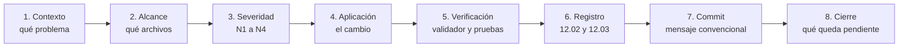

# Política de Cambios y Trazabilidad

> [!info] Qué es este documento
> Define **qué se puede cambiar, quién lo autoriza, cómo queda registrado y cómo
> se revierte**. Es la regla que hace que la bóveda sea una fuente de verdad y
> no un montón de archivos que alguien editó un martes.
>
> Complementa a [[05.07 Gobierno del Cambio]], que dice *cómo se trabaja*; este
> documento dice *qué pasa cuando algo se toca*.

---

## 1. Por qué existe

El proyecto tiene un problema estructural que conviene nombrar:

| Realidad | Consecuencia si no se ataca |
|---|---|
| La bóveda es la **fuente de verdad** de 95+ documentos que definirán el sistema | Un error en un ADR se propaga a 30 documentos sin que nadie lo note |
| El trabajo se hace **con agentes de IA** y con un desarrollador part-time | Un agente puede reescribir media bóveda en un minuto sin dejar rastro |
| No hay equipo de revisión permanente | La única barrera real es el **procedimiento**, no la supervisión |
| El sistema manejará **datos de menores** | Un cambio no registrado es un cambio no auditable |

> [!danger] El agujero que esta política tapa
> Sin registro, no hay forma de responder a tres preguntas que el centro va a
> hacer tarde o temprano: **¿quién cambió esto?**, **¿por qué lo cambió?** y
> **¿podemos deshacerlo?** Sin historial, la respuesta a las tres es "no sé".

**Principio rector:** *la trazabilidad es parte del entregable, no un extra.*

---

## 2. Alcance

### 2.1 Incluido

| Tipo de cambio | Dónde vive | Registro |
|---|---|---|
| Documentación | `sistema cai/**` | Obligatorio |
| Código de aplicación | `app/`, `packages/` | Obligatorio |
| Infraestructura y configuración | `config/`, `infra/`, `.github/` | Obligatorio |
| Esquema de base de datos | `packages/*/database/migrations/` | Obligatorio |
| Reglas del agente | `AGENTS.md`, `opencode.jsonc`, `.opencode/` | Obligatorio |
| Scripts de proceso | `bin/` | Obligatorio |

### 2.2 Excluido

| Cambio | Por qué queda fuera |
|---|---|
| Lectura sin modificación | No cambia nada |
| Trabajo puramente local no committeado (notas del operador) | No es un cambio del proyecto |
| Corrección de un typo que el validador detecta en el mismo commit | Se registra como parte del cambio mayor, no como entrada propia |

---

## 3. Los tres verbos permitidos

En el proyecto **no existe el verbo borrar**. Todo cambio es uno de estos tres:

| Verbo | Qué significa | Cómo se hace | Qué queda en el histórico |
|---|---|---|---|
| **Crear** | Se agrega un documento, archivo o paquete | Se escribe y se registra | El archivo nuevo + entrada de registro |
| **Modificar** | Se cambia el contenido de algo que existe | Se edita y se registra | La versión anterior en Git + entrada de registro |
| **Retirar** | Se deja de usar algo | Se marca `status: deprecated` o `superseded`, se **redirige** y se registra | El archivo retirado + entrada de registro + enlace a su sustituto |

### 3.1 Retirar ≠ borrar

Cuando algo deja de servir, **se retira, no se borra**:

1. El documento pasa a `status: deprecated` (obsoleto pero aún cierto) o
   `status: superseded` (reemplazado por otro, con enlace al sustituto).
2. Se añade una nota al principio del documento que dice **qué lo sustituye** y
   **por qué**.
3. Todos los wikilinks que apuntan a él se actualizan al documento sustituto.
4. El archivo **permanece en el repositorio** y en la bóveda.
5. El cambio se registra en [[12.02 Registro de Cambios]] con tipo `deprecación`.

> [!warning] Excepción única y verificable
> Solo se permite eliminar un archivo en dos casos:
> - **Restauración**: deshacer un commit con `git revert`, que devuelve el estado
>   anterior (y deja el historial de la eliminación, no la esconde).
> - **Dato que nunca debió existir**: una credencial filtrada, un archivo con
>   datos personales reales, un binario gigante. Requiere entrada de registro de
>   tipo `eliminación` con el motivo exacto y **aprobación explícita del
>   responsable técnico**.
>
> En ambos casos, Git conserva el objeto. Nada desaparece: cambia de sitio.

---

## 4. Severidad de los cambios

Todo cambio se clasifica antes de empezar. La severidad determina qué puede
hacer un agente solo y qué necesita aprobación.

| Nivel | Qué es | Ejemplos | Aprobación |
|---|---|---|---|
| **N1 — Editorial** | Tipo, formato, espacios, un enlace que estaba roto, un `updated` desactualizado | Corregir un `|` sin escapar en una tabla | **Ninguna.** Se registra. |
| **N2 — Contenido acotado** | Cambia lo que un documento dice, sin cambiar la decisión | Reescribir una sección, agregar un requisito no bloqueante, actualizar un manual | **Ninguna**, si cumple las reglas de este documento |
| **N3 — Decisión o comportamiento** | Cambia una decisión, un contrato entre paquetes, un esquema de datos, un permiso | ADR nuevo, migración nueva, cambio en `02.03`, política de roles | **ADR nuevo + revisión humana** |
| **N4 — Irreversible o sensible** | Afecta datos reales, claves, infraestructura productive, backups, o elimina algo | Rotación de clave, cambio de firewall, borrado de un archivo | **Aprobación explícita del responsable técnico y registro en [[10.03 Gestión de Incidentes]] si hay riesgo operativo** |

> [!tip] Regla práctica para decidir
> ¿El cambio cambia **lo que el sistema hace** o **lo que se decidió**?
> - No → N1 o N2.
> - Sí → N3, y casi siempre necesita un ADR.
>
> ¿El cambio puede **romper algo en producción** o **tocar datos de menores**?
> - Sí → N4.

### 4.1 Qué NO es un cambio

| No cuenta como cambio | Razón |
|---|---|
| Leer, buscar o responder una pregunta | No modifica nada |
| Correr el validador | Es una verificación, no una modificación |
| `git status`, `git log`, `git diff` | Inspección |
| Un `git revert` | Es la **reversión** de un cambio, registrada como tal |

---

## 5. Matriz de aprobación

| Actividad | Agente de IA puede | Requiere persona |
|---|---|---|
| Editar un documento no-ADR | Sí (N1/N2) | — |
| Editar un ADR **aceptado** | **No** | Solo mediante un ADR **nuevo** que lo sustituya |
| Crear un ADR | Sí, en `status: borrador` | Aceptarlo |
| Mover o renombrar un documento | Sí, si actualiza todos los enlaces | Si rompe el flujo de lectura |
| Tocar `11 - Decisiones ADR/` | Sí, pero el commit **pide confirmación** | Confirmación humana |
| Tocar `02 - Arquitectura/` (fronteras) | No sin ADR | Sí |
| Escribir migraciones | Sí, si son retrocompatibles (expand–contract) | Si son destructivas |
| Tocar `.env`, claves, backups | No | Sí, siempre |
| Borrar un archivo | No | Sí, con motivo registrado |
| `git commit` | Sí, si hay entrada de registro | — |
| `git push` (cualquier rama) | No | Sí, el operador publica manualmente |
| Etiquetar una release | No | Sí |

> [!note] Cómo se materializa esta matriz
> No es una aspiración: la columna "Requiere persona" está implementada como
> **permisos de OpenCode** en `opencode.jsonc` (efectos `deny` y `ask`) y como
> **bloqueo del hook de commit**. Ver [[05.07 Gobierno del Cambio]] §6.

---

## 6. El flujo obligatorio de un cambio

Todo cambio —del typo a la migración— pasa por estos ocho pasos. Los pasos 1 y
8 no se saltan nunca.



### 6.1 Los ocho pasos en detalle

| # | Paso | Qué se hace | Evidencia |
|---|---|---|---|
| 1 | **Contexto** | Se identifica el problema, la decisión o el pedido. Se cita el ID: `RF-xxx`, `RN-xxx`, `RNF-xxx`, `ADR-xxxx`, `P-xx` del backlog o `S-xx` de seguridad | Referencia en la entrada de registro |
| 2 | **Alcance** | Se listan **exactamente** los archivos que se van a tocar. Si el alcance crece durante el trabajo, se vuelve al paso 2 | Lista de archivos en la entrada |
| 3 | **Severidad** | Se clasifica N1–N4 según §4. N3 y N4 se detienen hasta tener la aprobación o el ADR | Nivel declarado en la entrada |
| 4 | **Aplicación** | Se hace el cambio. Si aparece un cambio de decisión, **se detiene** y se escribe el ADR primero (§5) | Diff en Git |
| 5 | **Verificación** | Corre el validador y las pruebas que apliquen. Si algo falla, se corrige o se registra como fallido | Resultado en la entrada |
| 6 | **Registro** | Se escribe la entrada en [[12.02 Registro de Cambios]] y la sesión en [[12.03 Bitácora de Sesiones con IA]] | Entrada `REG-YYYY-NNN` |
| 7 | **Commit** | Commit con mensaje convencional (ver [[05.02 Commits, Ramas y Versionado SemVer]]). El hook verifica que la entrada de registro existe | Commit + tag opcional |
| 8 | **Cierre** | Se anota qué queda pendiente, qué decisión falta y a quién le corresponde. Si el cambio desbloquea una fase, se actualiza el estado en [[08.12 Backlog Maestro]] | Sección "Pendiente" de la entrada |

### 6.2 El paso 5 no es opcional

Un cambio sin verificación es un cambio **no terminado**. Si la verificación
falla, la entrada de registro queda en `estado: fallido` y el commit no se hace.
Si la verificación no aplica (por ejemplo, un cambio puramente editorial que no
toca la bóveda), se registra `verificación: no aplica (cambio de código sin
impacto documental)`.

> [!danger] El error clásico
> "Lo verifiqué a mano y se veía bien." La verificación manual no es
> verificación: es una impresión. El validador existe para que la respuesta sea
> la misma hoy que dentro de seis meses.

---

## 7. Qué se escribe en el registro

### 7.1 Campos obligatorios de una entrada

| Campo | Contenido | Ejemplo |
|---|---|---|
| **Identificador** | `REG-AAAA-NNN`, único y correlativo | `REG-2026-004` |
| **Fecha y hora** | ISO corto con zona horaria | `2026-10-22 11:45 (−03)` |
| **Tipo** | Uno de los de [[12.02 Registro de Cambios]] §2 | `creación` |
| **Autor** | Persona + modelo de IA si lo hubo | `Cesar Benitez · IA `opencode/big-pickle`` |
| **Sesión** | Identificador de la sesión en la bitácora | `SES-2026-004` |
| **Severidad** | N1–N4 | `N2` |
| **Motivo** | **Por qué** se hizo, no qué se hizo. Mínimo una frase | `El ADR-0004 exigía un registro; sin él no había trazabilidad` |
| **Archivos afectados** | Rutas exactas, separadas por coma | `sistema cai/12 - Registro de Cambios/12.02 Registro de Cambios.md` |
| **Rastreo** | IDs de requisitos, reglas de negocio, ADR o backlog | `ADR-0017`, `RN-062` |
| **Verificación** | Comando ejecutado y resultado | `bin/validate-vault.py` → 0 errores |
| **Estado** | `aplicado` · `fallido` · `revertido` · `pendiente de revisión` | `aplicado` |
| **Pendiente** | Qué queda abierto, si algo | `Esperando P1 de Dirección` |

### 7.2 El modelo de IA es un campo de primer nivel

La atribución del modelo no es un detalle: es lo que permite responder
"¿con qué criterio se tomó esta decisión?" dentro de seis meses.

Se registra **el identificador exacto**, no una descripción:

| Se registra | No se registra |
|---|---|
| `opencode/big-pickle` (proveedor + modelo + variante) | "una IA" |
| `anthropic/claude-sonnet-4-5` | "Claude" |
| La variante, si la hubo: `opencode/big-pickle#default` | "el modelo por defecto" |

> [!tip] Por qué importa
> Distintos modelos cometen errores distintos. Un registro que dice "lo hizo la
> IA" es inútil para el diagnóstico; uno que dice `opencode/big-pickle`
> permite comparar qué cambios de cada modelo scrambled.

---

## 8. Qué NO se escribe en el registro

El registro es auditable, y auditable significa que puede salir del entorno de
desarrollo. Por lo tanto:

| Prohibido | Por qué |
|---|---|
| Nombres reales de alumnos, familias o profesionales | Dato personal de menores |
| Números de documento, teléfonos, correos reales | Dato de contacto |
| Diagnósticos o contenido clínico | Datos clínicos cifrados en el sistema; en claro, en un log, es una fuga |
| Claves, contraseñas, tokens, `.env` | Credencial |
| Capturas de pantalla con datos reales | Puede contener todo lo anterior |
| Volcados de base de datos | Contienen todo lo anterior |

**Regla práctica:** si la entrada no se podría leer en voz alta frente al
consejo del centro sin poner a nadie en riesgo, no se escribe.

---

## 9. Reversión sin borrar

Todo cambio debe ser reversible. El mecanismo es escalonado, en línea con
[[06.06 Procedimiento de Rollback]]:

| Nivel | Mecanismo | Alcance | Tiempo |
|---|---|---|---|
| 1 | **Deshacer el cambio** (`git revert`) | El commit exacto | Inmediato |
| 2 | **Restaurar la versión documental anterior** (checkout del tag `doc@vX.Y.Z`) | La bóveda completa | Segundos |
| 3 | **Rollback de la release** (symlink a la release anterior) | El sistema desplegado | ~1 min |
| 4 | **Restauración de base de datos** (`pg_dump` previo) | Los datos | ~10 min |

### 9.1 Cómo se revierte un cambio de documentación

1. `git revert <commit>` (no `git reset --hard`, que borra el rastro).
2. Se **añade** una entrada de registro de tipo `reversión` que cite el
   `REG-YYYY-NNN` original. **No se edita la entrada original**: el historial
   dice la verdad de lo que pasó, incluida la corrección.
3. Si el cambio revertido tenía un ADR, el ADR vuelve a `aceptado` (no se
   borra) y se anota la reversión en su historial interno.

### 9.2 Lo que nunca se hace

| Prohibido | Razón |
|---|---|
| `git reset --hard` sobre trabajo no committeado | Destruye trabajo sin dejar rastro |
| `git rebase` que reescriba historia ya publicada | El tag `doc@vX.Y.Z` dejaría de apuntar a lo que dice apuntar |
| `git push --force` a `main` | Rompe el "main siempre verde" de [[ADR-0004 Trunk-based con Tags SemVer]] |
| Editar una entrada de registro ya escrita | El registro es de solo agregar |

---

## 10. Concurrencia: una sesión por área

Dos agentes (o una persona y un agente) trabajando en la misma zona de la
bóveda al mismo tiempo producen conflictos silenciosos.

| Regla | Detalle |
|---|---|
| Un área de trabajo por sesión | Una sesión declara su área en [[12.03 Bitácora de Sesiones con IA]] |
| Antes de empezar, se mira la bitácora | Si hay una sesión `en curso` que toca los mismos archivos, se espera o se coordina |
| Si hay conflicto, **gana la sesión más reciente** en cuanto al contenido, y la más antigua se re-verifica | La re-verificación la hace quien pierde |
| Las sesiones que duren más de una jornada se cierran explícitamente | Una sesión `en curso` eternal bloquea el trabajo sin que nadie lo note |

> [!note] Por qué esto importa con un solo desarrollador
> El riesgo real aquí no es la concurrencia humana: es que **una sesión
> interrumpida queda "en curso" para siempre** y la siguiente sesión no sabe si
> puede tocar esos archivos. Por eso el estado de sesión se escribe al empezar
> y se cierra al terminar.

---

## 11. Atribución de autoría

La autoría nunca se oculta ni se reescribe.

| Regla | Detalle |
|---|---|
| **Siempre hay una persona responsable** | La IA es herramienta; la responsabilidad del cambio es de quien lo ordena |
| Se registra quién **pidió** el cambio | No es lo mismo "lo pidió Dirección" que "lo pidió el dev" |
| Se registra qué **decidió** la IA por su cuenta | Si no, no hay forma de auditar el alcance real de la autonomía |
| La IA no se presenta como autora de una decisión | Un ADR aceptado lo acepta una persona |

> [!important] La línea que no se cruza
> La IA puede **redactar** un ADR. La IA **no acepta** un ADR. La IA puede
> **ejecutar** un rollback. La IA **no decide** que se revierta producción.
> Esa frontera entre *ejecutar* y *decidir* es la que hace que un error de la
> IA sea recuperable.

---

## 12. Excepciones

Una excepción a esta política se registra ella misma como cambio, indicando:

| Campo | Contenido |
|---|---|
| Qué regla se incumple | Referencia exacta (§) |
| Por qué no se puede cumplir | Motivo concreto, no "era urgente" |
| Qué riesgo se acepta | Descripción |
| Quién lo acepta | Persona |

**No hay excepciones retroactivas.** Si una regla se incumple y no se registra
como excepción, es un incumplimiento, y se corrige y se registra como
incumplimiento.

---

## 13. Comprobación rápida: ¿mi cambio está bien?

```text
☐ ¿Sé por qué existe el cambio y lo puedo citar con un ID?
☐ ¿Enumeré los archivos affected antes de tocarlos?
☐ ¿Clasifiqué la severidad (N1–N4)?
☐ ¿Es N3 o N4? Entonces tiene ADR o aprobación.
☐ ¿Verifiqué (validador / pruebas) y pasó?
☐ ¿Escribí la entrada en 12.02 y la sesión en 12.03?
☐ ¿Registré el modelo de IA exacto si hubo IA?
☐ ¿No hay datos personales reales ni credenciales en el registro?
☐ ¿El commit tiene mensaje convencional y cita los IDs?
☐ ¿Anoté qué queda pendiente?
```

---

## 14. Documentos relacionados

- `AGENTS.md` — la puerta de entrada obligatoria para cualquier agente (vive en
  la raíz del repositorio, fuera de la bóveda, por eso se cita por ruta y no con
  wikilink)
- [[05.07 Gobierno del Cambio]] — las reglas de trabajo que esta política fiscaliza
- [[12.02 Registro de Cambios]] — el registro en sí
- [[12.03 Bitácora de Sesiones con IA]] — quién hizo qué, con qué modelo
- [[12.04 Versionado de la Documentación]] — cómo se corta una versión de la bóveda
- [[ADR-0017 Registro y Trazabilidad de Cambios]] — la decisión que dio origen a esta política
- [[05.02 Commits, Ramas y Versionado SemVer]] — formato de commit y tags
- [[06.06 Procedimiento de Rollback]] — los cuatro niveles de reversión
- [[08.12 Backlog Maestro]] — dónde se anota lo que queda pendiente
