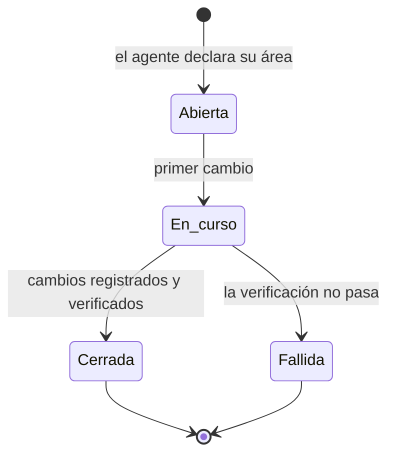

# Bitácora de Sesiones con IA

> [!info] Qué es este documento
> El registro **por sesión de trabajo**: quién la abrió, con qué modelo de IA
> trabajado, qué se tocó y cómo terminó.
>
> [[12.02 Registro de Cambios]] dice *qué* cambió. Este documento dice *quién*
> lo hizo, *con qué herramienta* y *con qué resultado*.

---

## 1. Por qué una bitácora de IA

El proyecto usa IA para producir documentación y, más adelante, código. Eso
tiene dos efectos que hay que poder auditar:

| Efecto | Riesgo | Lo que responde la bitácora |
|---|---|---|
| **El modelo aporta criterio** | Dos modelos distintos toman decisiones distintas ante el mismo pedido | ¿Qué modelo produjo este documento? |
| **El modelo ejecuta cambios** | Un error del modelo se propaga a muchos archivos de una vez | ¿Qué tocó la sesión y con qué resultado? |
| **La escala es alta** | Un humano no puede revisar 95 documentos línea por línea | ¿Cuánto se revisó y qué quedó sin revisar? |

> [!danger] El dato que no se puede recuperar después
> El modelo usado. Ni el historial de Git ni el diff dicen con qué modelo se
> escribió un texto. Si no se registra en el momento, se pierde para siempre.
> Por eso la atribución del modelo se escribe **durante** la sesión, no después.

---

## 2. Ciclo de vida de una sesión



| Estado | Significado | Qué debe tener |
|---|---|---|
| **Abierta** | La sesión existe pero todavía no modificó nada | Fecha, objetivo, área, operador, modelo |
| **En curso** | Está modificando archivos | Lo anterior + archivos tocados hasta ahora |
| **Cerrada** | Terminó bien | Lo anterior + verificación + entradas de registro generadas |
| **Fallida** | Terminó con un error o una verificación rota | Lo anterior + qué falló |

> [!tip] Una sesión que no se cierra bloquea el trabajo
> Si la sesión queda "en curso" para siempre, la siguiente no sabe si puede
> tocar los mismos archivos. Por eso el cierre es explícito y obligatorio, y
> por eso una sesión interrupted por un corte de luz se cierra a mano al
> retomar.

---

## 3. Campos obligatorios

| Campo | Formato | Ejemplo |
|---|---|---|
| **ID** | `SES-AAAA-NNN` | `SES-2026-002` |
| **Inicio** | `YYYY-MM-DD HH:MM (±ZZ)` | `2026-10-22 11:20 (−03)` |
| **Fin** | `YYYY-MM-DD HH:MM (±ZZ)` o `—` | `2026-10-22 12:05 (−03)` |
| **Operador** | Persona que abrió la sesión | `Cesar Benitez` |
| **Herramienta** | Harness y versión | `OpenCode v2.0.32` |
| **Agente** | Modo del agente | `build` |
| **Proveedor** | Identificador del proveedor | `opencode` |
| **Modelo** | Identificador exacto del modelo | `big-pickle` |
| **Variante** | Variante del modelo, si existe | `default` |
| **Objetivo** | Qué se intentó hacer | `Crear la capa de gobierno del cambio` |
| **Área** | Carpeta de la bóveda que se tocó | `12 - Registro de Cambios` |
| **Archivos tocados** | Rutas exactas | ver [[12.02 Registro de Cambios]] |
| **Verificación** | Comando y resultado | `bin/validate-vault.py` → 0 errores |
| **Resultado** | `completado` \| `parcial` \| `fallido` | `completado` |
| **Entradas de registro** | IDs generados | `REG-2026-004` |
| **Pendiente** | Lo que quedó abierto | `—` |

### 3.1 El modelo se registra completo

La forma canónica es `proveedor/modelo#variante`:

| Se escribe | Correcto |
|---|---|
| `opencode/big-pickle#default` | Sí |
| `opencode/big-pickle` | Sí, si no hay variante |
| `big-pickle` | Sí, pero se pierde el proveedor |
| `Big Pickle` | No — es el nombre comercial, no el identificador |
| `IA` | No |

---

## 4. Índice de sesiones

| ID | Fecha | Operador | Herramienta | Modelo | Resultado | Entradas |
|---|---|---|---|---|---|---|
| SES-2026-002 | 2026-10-22 | César Benítez | OpenCode v2.0.32 | `opencode/big-pickle#default` | completado | REG-2026-004 |
| SES-2026-001 | 2026-10-22 | César Benítez | OpenCode v2.0.32 | `opencode/big-pickle#default` | completado | REG-2026-001, REG-2026-002, REG-2026-003 |

<!-- SES-ENTRIES:START -->

---

## SES-2026-002 · Gobierno del cambio y control mecánico

| Campo | Valor |
|---|---|
| **Inicio** | 2026-10-22 11:20 (−03) |
| **Fin** | 2026-10-22 12:05 (−03) |
| **Operador** | César Benítez |
| **Herramienta** | OpenCode v2.0.32 · agente `build` |
| **Proveedor** | `opencode` |
| **Modelo** | `big-pickle` |
| **Variante** | `default` |
| **Objetivo** | Revisar el proyecto, proponer reglas de gobierno del cambio, y crear el mecanismo de versionado, registro y atribución de IA |
| **Área** | `12 - Registro de Cambios`, `05 - Proceso de Desarrollo`, `11 - Decisiones ADR`, `00 - Inicio` + raíz del repositorio |
| **Archivos tocados** | `AGENTS.md`, `CLAUDE.md`, `opencode.jsonc`, `.gitignore`, `.opencode/plugins/cai-log.ts`, `bin/validate-vault.py`, `bin/cai-log.py`, `bin/hooks/pre-commit`, `bin/install-hooks.sh`, 4 documentos nuevos en `12 - Registro de Cambios`, `05.07 Gobierno del Cambio.md`, `ADR-0017`, `Inicio.md`, `00.01 Convenciones de la Vault.md`, `Índice de ADRs.md` |
| **Verificación** | `bin/validate-vault.py` → 0 errores · `git fsck` → limpio · hook de commit probado (bloquea sin registro, permite con registro) · plugin cargado por OpenCode sin error |
| **Resultado** | completado |
| **Entradas de registro** | REG-2026-004 |
| **Decisiones derivadas** | ADR-0017 · [[12.01 Política de Cambios y Trazabilidad]] · [[12.04 Versionado de la Documentación]] |
| **Pendiente** | Crear el repositorio privado en GitHub y proteger `main` (D1) |

---

## SES-2026-001 · Construcción de la bóveda y saneamiento

| Campo | Valor |
|---|---|
| **Inicio** | 2026-10-22 09:05 (−03) |
| **Fin** | 2026-10-22 10:40 (−03) |
| **Operador** | César Benítez |
| **Herramienta** | OpenCode v2.0.32 · agente `build` |
| **Proveedor** | `opencode` |
| **Modelo** | `big-pickle` |
| **Variante** | `default` |
| **Objetivo** | Escribir la bóveda completa del sistema CAI (95 documentos) y corregir los defectos mecánicos de la generación en bloque |
| **Área** | Toda la bóveda (`00 - Inicio` a `11 - Decisiones ADR`) |
| **Archivos tocados** | 95 documentos creados; 13 documentos saneados en una segunda pasada |
| **Verificación** | `check_links.py` → 1186 wikilinks, 0 rotos · `scan_en2.py` → 0 suspect · frontmatter completo en los 95 · 0 tablas malformadas |
| **Resultado** | completado |
| **Entradas de registro** | REG-2026-001, REG-2026-002, REG-2026-003 |
| **Decisiones derivadas** | ADR-0001 … ADR-0010 |
| **Pendiente** | P1 (modelo de cuotas), P2 (redondeo), P4 (retención clínica), P7 (alcance del cifrado), P16 (política de contraseñas) — bloquean F5, F6 y F8 |

<!-- SES-ENTRIES:END -->

---

## 5. Atribución manual: cómo rellenar la bitácora a mano

Si una sesión se registra sin ayuda del plugin:

```bash
bin/cai-log sesion \
  --operador "Cesar Benitez" \
  --modelo "opencode/big-pickle" \
  --variante "default" \
  --agente "build" \
  --objetivo "Corregir los enlaces rotos de 02 - Arquitectura" \
  --area "02 - Arquitectura" \
  --resultado completado
```

El comando escribe la entrada en este documento, actualiza el índice y deja la
sesión en estado `Cerrada`.

---

## 6. Qué se escribe y qué no

| Se escribe | No se escribe |
|---|---|
| Identificador del modelo | Contenido de los prompts completos (pueden traer datos del centro) |
| Área y archivos tocados | Capturas de pantalla |
| Resultado de la verificación | Conversaciones intermedias |
| Motivo y objetivo | Datos de alumnos o familias |

El detalle completo de la regla está en [[12.01 Política de Cambios y Trazabilidad]] §8.

---

## 7. Documentos relacionados

- [[12.01 Política de Cambios y Trazabilidad]] — las reglas de atribución
- [[12.02 Registro de Cambios]] — el historial por cambio
- [[ADR-0017 Registro y Trazabilidad de Cambios]] — la decisión de fondo
- [[05.07 Gobierno del Cambio]] — las reglas de trabajo
- [[04.05 Auditoría de Datos Sensibles]] — la auditoría dentro del sistema, que es distinta de esta
