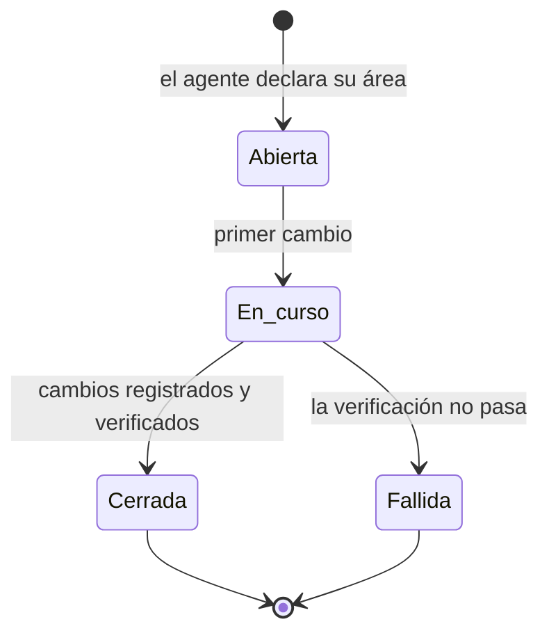

# Bitácora de Sesiones con IA

> [!info] Qué es este documento
> El registro **por sesión de trabajo**: quién la abrió, con qué modelo de IA
> trabajado, qué se tocó y cómo terminó.
>
> [[12.02 Registro de Cambios]] dice *qué* cambió. Este documento dice *quién*
> lo hizo, *con qué herramienta* y *con qué resultado*.

---

## 1. Por qué una bitácora de IA

El proyecto usa IA para producir documentación y, más adelante, código. Eso
tiene dos efectos que hay que poder auditar:

| Efecto | Riesgo | Lo que responde la bitácora |
|---|---|---|
| **El modelo aporta criterio** | Dos modelos distintos toman decisiones distintas ante el mismo pedido | ¿Qué modelo produjo este documento? |
| **El modelo ejecuta cambios** | Un error del modelo se propaga a muchos archivos de una vez | ¿Qué tocó la sesión y con qué resultado? |
| **La escala es alta** | Un humano no puede revisar 95 documentos línea por línea | ¿Cuánto se revisó y qué quedó sin revisar? |

> [!danger] El dato que no se puede recuperar después
> El modelo usado. Ni el historial de Git ni el diff dicen con qué modelo se
> escribió un texto. Si no se registra en el momento, se pierde para siempre.
> Por eso la atribución del modelo se escribe **durante** la sesión, no después.

---

## 2. Ciclo de vida de una sesión



| Estado | Significado | Qué debe tener |
|---|---|---|
| **Abierta** | La sesión existe pero todavía no modificó nada | Fecha, objetivo, área, operador, modelo |
| **En curso** | Está modificando archivos | Lo anterior + archivos tocados hasta ahora |
| **Cerrada** | Terminó bien | Lo anterior + verificación + entradas de registro generadas |
| **Fallida** | Terminó con un error o una verificación rota | Lo anterior + qué falló |

> [!tip] Una sesión que no se cierra bloquea el trabajo
> Si la sesión queda "en curso" para siempre, la siguiente no sabe si puede
> tocar los mismos archivos. Por eso el cierre es explícito y obligatorio, y
> por eso una sesión interrupted por un corte de luz se cierra a mano al
> retomar.

---

## 3. Campos obligatorios

| Campo | Formato | Ejemplo |
|---|---|---|
| **ID** | `SES-AAAA-NNN` | `SES-2026-002` |
| **Inicio** | `YYYY-MM-DD HH:MM (±ZZ)` | `2026-10-22 11:20 (−03)` |
| **Fin** | `YYYY-MM-DD HH:MM (±ZZ)` o `—` | `2026-10-22 12:05 (−03)` |
| **Operador** | Persona que abrió la sesión | `Cesar Benitez` |
| **Herramienta** | Harness y versión | `OpenCode v2.0.32` |
| **Agente** | Modo del agente | `build` |
| **Proveedor** | Identificador del proveedor | `opencode` |
| **Modelo** | Identificador exacto del modelo | `big-pickle` |
| **Variante** | Variante del modelo, si existe | `default` |
| **Objetivo** | Qué se intentó hacer | `Crear la capa de gobierno del cambio` |
| **Área** | Carpeta de la bóveda que se tocó | `12 - Registro de Cambios` |
| **Archivos tocados** | Rutas exactas | ver [[12.02 Registro de Cambios]] |
| **Verificación** | Comando y resultado | `bin/validate-vault.py` → 0 errores |
| **Resultado** | `completado` \| `parcial` \| `fallido` | `completado` |
| **Entradas de registro** | IDs generados | `REG-2026-004` |
| **Pendiente** | Lo que quedó abierto | `—` |

### 3.1 El modelo se registra completo

La forma canónica es `proveedor/modelo#variante`:

| Se escribe | Correcto |
|---|---|
| `opencode/big-pickle#default` | Sí |
| `opencode/big-pickle` | Sí, si no hay variante |
| `big-pickle` | Sí, pero se pierde el proveedor |
| `Big Pickle` | No — es el nombre comercial, no el identificador |
| `IA` | No |

---

## 4. Índice de sesiones

<!-- SES-INDEX:START -->

| ID | Fecha | Operador | Herramienta | Modelo | Resultado | Entradas |
|---|---|---|---|---|---|---|
| SES-2026-024 | 2026-10-27 | Cesar Benitez | OpenCode | `opencode/deepseek-v4.1-flash-free#default` | completado | REG-2026-030 |
| SES-2026-023 | 2026-10-24 | Cesar Benitez | OpenCode | `opencode/deepseek-v4.1-flash-free#default` | completado | REG-2026-029 |
| SES-2026-022 | 2026-10-24 | Cesar Benitez | OpenCode | `opencode/deepseek-v4.1-flash-free#default` | completado | REG-2026-028 |
| SES-2026-021 | 2026-10-23 | Cesar Benitez | OpenCode | `opencode/deepseek-v4.1-flash-free#default` | completado | REG-2026-027 |
| SES-2026-020 | 2026-10-23 | Cesar Benitez | Claude Code | `anthropic/claude-sonnet-4-5` | completado | REG-2026-026 |
| SES-2026-019 | 2026-10-23 | Cesar Benitez | Claude Code | `anthropic/claude-sonnet-4-5` | en curso | REG-2026-025 |
| SES-2026-018 | 2026-10-23 | Cesar Benitez | Claude Code | `anthropic/claude-sonnet-4-5` | completado | REG-2026-024 |
| SES-2026-017 | 2026-10-23 | Cesar Benitez | Claude Code | `anthropic/claude-sonnet-4-5` | completado | REG-2026-023 |
| SES-2026-016 | 2026-10-23 | Cesar Benitez | Claude Code | `anthropic/claude-sonnet-4-5` | parcial | REG-2026-022 |
| SES-2026-015 | 2026-10-23 | Cesar Benitez | OpenCode | `opencode/big-pickle#default` | completado | REG-2026-021 |
| SES-2026-014 | 2026-10-23 | Cesar Benitez | OpenCode | `opencode/big-pickle#default` | completado | REG-2026-020 |
| SES-2026-013 | 2026-10-23 | Cesar Benitez | OpenCode | `opencode/big-pickle#default` | completado | REG-2026-019 |
| SES-2026-012 | 2026-10-23 | Cesar Benitez | OpenCode | `opencode/big-pickle#default` | completado | REG-2026-018 |
| SES-2026-011 | 2026-10-23 | Cesar Benitez | OpenCode | `opencode/big-pickle#default` | completado | REG-2026-017 |
| SES-2026-010 | 2026-10-23 | Cesar Benitez | OpenCode | `opencode/big-pickle#default` | completado | REG-2026-016 |
| SES-2026-009 | 2026-10-23 | Cesar Benitez | OpenCode | `opencode/big-pickle#default` | completado | REG-2026-015 |
| SES-2026-008 | 2026-10-22 | Cesar Benitez | OpenCode | `opencode/big-pickle#default` | completado | REG-2026-014 |
| SES-2026-007 | 2026-10-22 | Cesar Benitez | OpenCode | `opencode/big-pickle#default` | completado | REG-2026-013 |
| SES-2026-006 | 2026-10-22 | Cesar Benitez | OpenCode | `opencode/big-pickle#default` | completado | REG-2026-012 |
| SES-2026-005 | 2026-10-22 | Cesar Benitez | OpenCode v2.0.32 | `opencode/big-pickle#default` | completado | REG-2026-010 |
| SES-2026-004 | 2026-10-22 | Cesar Benitez | OpenCode v2.0.32 | `opencode/big-pickle#default` | completado | REG-2026-009 |
| SES-2026-003 | 2026-10-22 | no declarado | OpenCode · agente `build` | `opencode/big-pickle#default` | pendiente de revisión | — |
| SES-2026-002 | 2026-10-22 | César Benítez | OpenCode v2.0.32 | `opencode/big-pickle#default` | completado | REG-2026-004 |
| SES-2026-001 | 2026-10-22 | César Benítez | OpenCode v2.0.32 | `opencode/big-pickle#default` | completado | REG-2026-001, REG-2026-002, REG-2026-003 |

<!-- SES-ENTRIES:START -->
<!-- SES-2026-024 -->

---

## SES-2026-024 · Cierre de sesión y árbol de trabajo limpio

| Campo | Valor |
|---|---|
| **Inicio** | 2026-10-27 07:36 (−03) |
| **Fin** | 2026-10-27 07:36 (−03) |
| **Operador** | Cesar Benitez |
| **Herramienta** | OpenCode · agente `build` |
| **Proveedor** | `opencode` |
| **Modelo** | `deepseek-v4.1-flash-free` |
| **Variante** | `default` |
| **Objetivo** | Registrar el cierre de la sesión y dejar el árbol de trabajo limpio antes de publicar los commits locales |
| **Área** | 12 - Registro de Cambios |
| **Archivos tocados** | `.obsidian/workspace.json` |
| **Verificación** | `bin/validate-vault.py` → 108 documentos, 1482 wikilinks, 0 errores; python3 -m unittest discover -s bin/tests -> 63 tests OK |
| **Resultado** | completado |
| **Entradas de registro** | REG-2026-030 |
| **Pendiente** | — |

<!-- SES-2026-023 -->

---

## SES-2026-023 · Core: retiro del provider duplicado

| Campo | Valor |
|---|---|
| **Inicio** | 2026-10-24 08:35 (−03) |
| **Fin** | 2026-10-24 08:45 (−03) |
| **Operador** | Cesar Benitez |
| **Herramienta** | OpenCode · agente `build` |
| **Proveedor** | `opencode` |
| **Modelo** | `deepseek-v4.1-flash-free` |
| **Variante** | `default` |
| **Objetivo** | Retirar el CoreServiceProvider vacío duplicado y dejar que la autodetección de Composer cargue una sola vez el provider real |
| **Área** | 12 - Registro de Cambios |
| **Archivos tocados** | `packages/core/src/CoreServiceProvider.php`, `packages/core/src/Providers/CoreServiceProvider.php`, `composer.lock`, `bootstrap/providers.php`, `sistema cai/12 - Registro de Cambios/12.02 Registro de Cambios.md`, `sistema cai/12 - Registro de Cambios/12.03 Bitácora de Sesiones con IA.md` |
| **Verificación** | `php artisan list` → cai:migrate, cai:db:reset; providers cargados → solo Cai\Core\Providers\CoreServiceProvider; ./vendor/bin/pest → 12 passed; deptrac → 0 violaciones |
| **Resultado** | completado |
| **Entradas de registro** | REG-2026-029 |
| **Pendiente** | — |

<!-- SES-2026-022 -->

---

## SES-2026-022 · Core: schemas por módulo, comandos y arranque

| Campo | Valor |
|---|---|
| **Inicio** | 2026-10-24 08:30 (−03) |
| **Fin** | 2026-10-24 08:40 (−03) |
| **Operador** | Cesar Benitez |
| **Herramienta** | OpenCode · agente `build` |
| **Proveedor** | `opencode` |
| **Modelo** | `deepseek-v4.1-flash-free` |
| **Variante** | `default` |
| **Objetivo** | Completar y validar la configuración de schemas por módulo, los comandos de migración y el registro del CoreServiceProvider |
| **Área** | 12 - Registro de Cambios |
| **Archivos tocados** | `config/cai.php`, `config/database.php`, `packages/core/src/Providers/CoreServiceProvider.php`, `packages/core/src/Console/Commands/MigrateModules.php`, `packages/core/src/Console/Commands/DbReset.php`, `packages/core/composer.json`, `bootstrap/providers.php`, `sistema cai/12 - Registro de Cambios/12.02 Registro de Cambios.md`, `sistema cai/12 - Registro de Cambios/12.03 Bitácora de Sesiones con IA.md` |
| **Verificación** | `php artisan --version` → Laravel 13.38.0; ./vendor/bin/pest → 12 passed; deptrac analyse → 0 violaciones |
| **Resultado** | completado |
| **Entradas de registro** | REG-2026-028 |
| **Pendiente** | — |

<!-- SES-2026-021 -->

---

## SES-2026-021 · Sesión de código: recuperación de contraseña, alumno y MultiRoleUser

| Campo | Valor |
|---|---|
| **Inicio** | 2026-10-23 22:40 (−03) |
| **Fin** | 2026-10-23 23:00 (−03) |
| **Operador** | Cesar Benitez |
| **Herramienta** | OpenCode · agente `build` |
| **Proveedor** | `opencode` |
| **Modelo** | `deepseek-v4.1-flash-free` |
| **Variante** | `default` |
| **Objetivo** | Registrar el trabajo de recuperación de contraseña y alta de alumno en el repo de código, con la API de MultiRoleUser corregida |
| **Área** | 12 - Registro de Cambios |
| **Archivos tocados** | `packages/identity/src/PasswordReset/`, `packages/identity/src/Exceptions/PasswordResetException.php`, `packages/identity/src/Authorization/MultiRoleUser.php`, `packages/students/src/Student.php`, `packages/identity/tests/PasswordResetServiceTest.php`, `packages/students/tests/StudentTest.php`, `sistema cai/12 - Registro de Cambios/12.02 Registro de Cambios.md`, `sistema cai/12 - Registro de Cambios/12.03 Bitácora de Sesiones con IA.md` |
| **Verificación** | `./vendor/bin/pest packages/identity/tests packages/students/tests` → 26 passed |
| **Resultado** | completado |
| **Entradas de registro** | REG-2026-027 |
| **Pendiente** | — |


<!-- SES-2026-020 -->
## SES-2026-020 · Integrar patrón IA-safe y checklist pre-vuelo

| Campo | Valor |
|---|---|
| **Inicio** | 2026-10-23 13:50 (−03) |
| **Fin** | 2026-10-23 14:05 (−03) |
| **Operador** | Cesar Benitez |
| **Herramienta** | Claude Code |
| **Proveedor** | `anthropic` |
| **Modelo** | `claude-sonnet-4-5` |
| **Variante** | `default` |
| **Objetivo** | Integrar el patrón operativo IA-safe en `AGENTS.md`, `README.md` y `DESIGN.md`, con checklist de pre-vuelo, anti-slop y revisión en segunda pasada |
| **Área** | 12 - Registro de Cambios |
| **Archivos tocados** | `AGENTS.md`, `README.md`, `DESIGN.md`, `sistema cai/12 - Registro de Cambios/12.02 Registro de Cambios.md`, `sistema cai/12 - Registro de Cambios/12.03 Bitácora de Sesiones con IA.md` |
| **Verificación** | `python3 bin/validate-vault.py` → 0 errores, 0 avisos |
| **Resultado** | completado |
| **Entradas de registro** | REG-2026-026 |
| **Pendiente** | — |

---

<!-- SES-2026-019 -->
## SES-2026-019 · Corregir atribución de IA de la última sesión

| Campo | Valor |
|---|---|
| **Inicio** | 2026-10-23 13:40 (−03) |
| **Fin** | 2026-10-23 13:45 (−03) |
| **Operador** | Cesar Benitez |
| **Herramienta** | Claude Code |
| **Proveedor** | `anthropic` |
| **Modelo** | `claude-sonnet-4-5` |
| **Variante** | `default` |
| **Objetivo** | Corregir la atribución de IA de la última sesión y dejarla alineada con la herramienta real usada |
| **Área** | 12 - Registro de Cambios |
| **Archivos tocados** | `sistema cai/12 - Registro de Cambios/12.02 Registro de Cambios.md`, `sistema cai/12 - Registro de Cambios/12.03 Bitácora de Sesiones con IA.md` |
| **Verificación** | `bin/validate-vault.py` → 0 errores |
| **Resultado** | completado |
| **Entradas de registro** | REG-2026-025 |
| **Pendiente** | — |

---

<!-- SES-2026-017 -->
## SES-2026-017 · Cerrar CORE-01 y CORE-02 con validación

| Campo | Valor |
|---|---|
| **Inicio** | 2026-10-23 12:15 (−03) |
| **Fin** | 2026-10-23 12:25 (−03) |
| **Operador** | Cesar Benitez |
| **Herramienta** | Claude Code |
| **Proveedor** | `anthropic` |
| **Modelo** | `claude-sonnet-4-5` |
| **Variante** | `default` |
| **Objetivo** | Cerrar la sesión de trabajo de CORE-01 y CORE-02 con validación en el repositorio de producto |
| **Área** | packages/core |
| **Archivos tocados** | `packages/core/src/Models/Model.php`, `packages/core/src/Traits/HasAuditTrail.php`, `packages/core/tests/ModelSearchPathTest.php`, `packages/core/tests/HasAuditTrailTest.php` |
| **Verificación** | `php artisan test packages/core/tests/ModelSearchPathTest.php --filter='ModelSearchPathTest'` → 2 passed; php artisan test packages/core/tests/HasAuditTrailTest.php --filter='HasAuditTrailTest' -> 1 passed |
| **Resultado** | completado |
| **Entradas de registro** | REG-2026-023 |
| **Pendiente** | — |

---

<!-- SES-2026-016 -->
## SES-2026-016 · Iniciar CORE-01 y dejar trazabilidad de la sesión

| Campo | Valor |
|---|---|
| **Inicio** | 2026-10-23 12:00 (−03) |
| **Fin** | 2026-10-23 12:10 (−03) |
| **Operador** | Cesar Benitez |
| **Herramienta** | Claude Code |
| **Proveedor** | `anthropic` |
| **Modelo** | `claude-sonnet-4-5` |
| **Variante** | `default` |
| **Objetivo** | Iniciar la implementación del primer núcleo del sistema: CORE-01 con search_path por conexión |
| **Área** | packages/core |
| **Archivos tocados** | `packages/core/tests/Arch/ModuleBoundariesTest.php`, `sistema cai/08 - Plan de Trabajo/08.12 Backlog Maestro.md`, `sistema cai/12 - Registro de Cambios/12.02 Registro de Cambios.md`, `sistema cai/12 - Registro de Cambios/12.03 Bitácora de Sesiones con IA.md` |
| **Verificación** | `bin/validate-vault.py` → pendiente: aún no se valida la implementación |
| **Resultado** | parcial |
| **Entradas de registro** | REG-2026-022 |
| **Pendiente** | — |

---

<!-- SES-2026-015 -->
## SES-2026-015 · Cerrar sesión pendiente de revisión

| Campo | Valor |
|---|---|
| **Inicio** | 2026-10-23 10:40 (−03) |
| **Fin** | 2026-10-23 10:46 (−03) |
| **Operador** | Cesar Benitez |
| **Herramienta** | OpenCode · agente `build` |
| **Proveedor** | `opencode` |
| **Modelo** | `big-pickle` |
| **Variante** | `default` |
| **Objetivo** | Cerrar la sesión pendiente de revisión generada por el plugin |
| **Área** | 12 - Registro de Cambios |
| **Archivos tocados** | `sistema cai/12 - Registro de Cambios/12.02 Registro de Cambios.md`, `sistema cai/12 - Registro de Cambios/12.03 Bitácora de Sesiones con IA.md` |
| **Verificación** | `bin/validate-vault.py` → 0 errores |
| **Resultado** | completado |
| **Entradas de registro** | REG-2026-021 |
| **Pendiente** | — |

---

<!-- SES-2026-014 -->
## SES-2026-014 · Actualizar stack con versiones verificadas

| Campo | Valor |
|---|---|
| **Inicio** | 2026-10-23 11:14 (−03) |
| **Fin** | 2026-10-23 11:14 (−03) |
| **Operador** | Cesar Benitez |
| **Herramienta** | OpenCode · agente `build` |
| **Proveedor** | `opencode` |
| **Modelo** | `big-pickle` |
| **Variante** | `default` |
| **Objetivo** | Actualizar 00.03 con versiones exactas verificadas durante F0 |
| **Área** | 00 - Inicio |
| **Archivos tocados** | `sistema cai/00 - Inicio/00.03 Stack`, `Versiones y Dependencias.md` |
| **Verificación** | `bin/validate-vault.py` → 0 errores/0 avisos |
| **Resultado** | completado |
| **Entradas de registro** | REG-2026-020 |
| **Pendiente** | — |

---

<!-- SES-2026-013 -->
## SES-2026-013 · Actualizar veredicto YAGNI

| Campo | Valor |
|---|---|
| **Inicio** | 2026-10-23 10:12 (−03) |
| **Fin** | 2026-10-23 10:12 (−03) |
| **Operador** | Cesar Benitez |
| **Herramienta** | OpenCode · agente `build` |
| **Proveedor** | `opencode` |
| **Modelo** | `big-pickle` |
| **Variante** | `default` |
| **Objetivo** | Actualizar veredicto YAGNI tras cerrar HERR-14 |
| **Área** | 05 - Proceso de Desarrollo |
| **Archivos tocados** | `sistema cai/05 - Proceso de Desarrollo/05.08 Revision de Calidad de las Herramientas de Gobernanza.md` |
| **Verificación** | `bin/validate-vault.py` → 0 errores/0 avisos |
| **Resultado** | completado |
| **Entradas de registro** | REG-2026-019 |
| **Pendiente** | — |

---

<!-- SES-2026-012 -->
## SES-2026-012 · Optimización documental para agentes

| Campo | Valor |
|---|---|
| **Inicio** | 2026-10-23 09:37 (−03) |
| **Fin** | 2026-10-23 09:37 (−03) |
| **Operador** | Cesar Benitez |
| **Herramienta** | OpenCode · agente `build` |
| **Proveedor** | `opencode` |
| **Modelo** | `big-pickle` |
| **Variante** | `default` |
| **Objetivo** | Añadir mapa por tarea en AGENTS.md, actualizar guías de inicio y alinear documentación tras trasladar deptrac.yaml al repo de producto |
| **Área** | 00 - Inicio |
| **Archivos tocados** | `AGENTS.md`, `README.md`, `sistema cai/00 - Inicio/Inicio.md`, `sistema cai/02 - Arquitectura/02.02 Arquitectura Modular en Paquetes.md`, `sistema cai/02 - Arquitectura/02.03 Reglas de Frontera entre Módulos.md`, `sistema cai/05 - Proceso de Desarrollo/05.07 Gobierno del Cambio.md`, `sistema cai/08 - Plan de Trabajo/08.12 Backlog Maestro.md` |
| **Verificación** | `bin/validate-vault.py` → 0 errores/0 avisos; unittest -> 59 OK; mypy -> sin hallazgos |
| **Resultado** | completado |
| **Entradas de registro** | REG-2026-018 |
| **Pendiente** | — |

---

<!-- SES-2026-011 -->
## SES-2026-011 · Truncado del registro

| Campo | Valor |
|---|---|
| **Inicio** | 2026-10-23 07:25 (−03) |
| **Fin** | 2026-10-23 07:25 (−03) |
| **Operador** | Cesar Benitez |
| **Herramienta** | OpenCode · agente `build` |
| **Proveedor** | `opencode` |
| **Modelo** | `big-pickle` |
| **Variante** | `default` |
| **Objetivo** | Corregir el truncado de resumen y encabezado en cai-log.py para que corte en límite de palabra, con pruebas |
| **Área** | 05 - Proceso de Desarrollo |
| **Archivos tocados** | `bin/cai-log.py`, `bin/tests/test_registro.py`, `sistema cai/05 - Proceso de Desarrollo/05.08 Revision de Calidad de las Herramientas de Gobernanza.md`, `sistema cai/05 - Proceso de Desarrollo/05.09 Herramientas de Gobernanza.md` |
| **Verificación** | `bin/validate-vault.py` → 0 errores/0 avisos; unittest -> 59 OK; mypy -> sin hallazgos |
| **Resultado** | completado |
| **Entradas de registro** | REG-2026-017 |
| **Pendiente** | HERR-14: trasladar deptrac.yaml al repositorio de producto (bloqueado) |

---

<!-- SES-2026-010 -->
## SES-2026-010 · Regla de push manual

| Campo | Valor |
|---|---|
| **Inicio** | 2026-10-23 07:17 (−03) |
| **Fin** | 2026-10-23 07:17 (−03) |
| **Operador** | Cesar Benitez |
| **Herramienta** | OpenCode · agente `build` |
| **Proveedor** | `opencode` |
| **Modelo** | `big-pickle` |
| **Variante** | `default` |
| **Objetivo** | Dejar escrita la regla de que la IA no ejecuta git push: el operador publica manualmente y recibe aviso de los commits pendientes |
| **Área** | 05 - Proceso de Desarrollo |
| **Archivos tocados** | `AGENTS.md`, `opencode.jsonc`, `sistema cai/05 - Proceso de Desarrollo/05.07 Gobierno del Cambio.md`, `sistema cai/05 - Proceso de Desarrollo/05.08 Revision de Calidad de las Herramientas de Gobernanza.md`, `sistema cai/05 - Proceso de Desarrollo/05.09 Herramientas de Gobernanza.md`, `sistema cai/12 - Registro de Cambios/12.01 Política de Cambios y Trazabilidad.md` |
| **Verificación** | `bin/validate-vault.py` → 0 errores/0 avisos; unittest -> 54 OK; mypy -> sin hallazgos |
| **Resultado** | completado |
| **Entradas de registro** | REG-2026-016 |
| **Pendiente** | — |

---

<!-- SES-2026-009 -->
## SES-2026-009 · Auditoría documental post-T4

| Campo | Valor |
|---|---|
| **Inicio** | 2026-10-23 07:03 (−03) |
| **Fin** | 2026-10-23 07:03 (−03) |
| **Operador** | Cesar Benitez |
| **Herramienta** | OpenCode · agente `build` |
| **Proveedor** | `opencode` |
| **Modelo** | `big-pickle` |
| **Variante** | `default` |
| **Objetivo** | Revisar la consistencia de 05.05, 05.08, 05.09 y 08.12 después de la tanda T4 y corregir las referencias desalineadas |
| **Área** | 05 - Proceso de Desarrollo |
| **Archivos tocados** | `sistema cai/05 - Proceso de Desarrollo/05.05 Estrategia de Pruebas.md`, `sistema cai/05 - Proceso de Desarrollo/05.08 Revision de Calidad de las Herramientas de Gobernanza.md`, `sistema cai/05 - Proceso de Desarrollo/05.09 Herramientas de Gobernanza.md`, `sistema cai/08 - Plan de Trabajo/08.12 Backlog Maestro.md` |
| **Verificación** | `bin/validate-vault.py` → 0 errores/0 avisos; unittest -> 54 OK; mypy -> sin hallazgos |
| **Resultado** | completado |
| **Entradas de registro** | REG-2026-015 |
| **Pendiente** | HERR-14 (deptrac.yaml) sigue pendiente del repositorio de producto |

---

<!-- SES-2026-008 -->
## SES-2026-008 · T4: CI de documentación y cierre de la revisión

| Campo | Valor |
|---|---|
| **Inicio** | 2026-10-22 23:45 (−03) |
| **Fin** | 2026-10-22 23:45 (−03) |
| **Operador** | Cesar Benitez |
| **Herramienta** | OpenCode · agente `build` |
| **Proveedor** | `opencode` |
| **Modelo** | `big-pickle` |
| **Variante** | `default` |
| **Objetivo** | Cerrar la tanda T4: pruebas del validador, CI de documentación, documentación de uso y erratas |
| **Área** | 05 - Proceso de Desarrollo |
| **Archivos tocados** | `bin/tests/test_validador.py`, `.github/workflows/ci.yml`, `AGENTS.md`, `README.md`, `sistema cai/06 - Versionado y Rollback/06.09 Guía de Actualización.md` |
| **Verificación** | `unittest` → 54 OK; mypy -> sin hallazgos; bin/validate-vault.py -> 0 errores/0 avisos |
| **Resultado** | completado |
| **Entradas de registro** | REG-2026-014 |
| **Pendiente** | Traslado de deptrac.yaml al repositorio de producto (HERR-14) |

---

<!-- SES-2026-007 -->
## SES-2026-007 · T3: calidad interna y configuración de las herramientas

| Campo | Valor |
|---|---|
| **Inicio** | 2026-10-22 23:22 (−03) |
| **Fin** | 2026-10-22 23:22 (−03) |
| **Operador** | Cesar Benitez |
| **Herramienta** | OpenCode · agente `build` |
| **Proveedor** | `opencode` |
| **Modelo** | `big-pickle` |
| **Variante** | `default` |
| **Objetivo** | Cerrar la tanda T3 de las herramientas de gobernanza: constantes, índice anclado, validación de identificadores, tipos del plugin y configuración sin duplicados |
| **Área** | 05 - Proceso de Desarrollo |
| **Archivos tocados** | `bin/cai-log.py`, `bin/validate-vault.py`, `bin/tests/test_registro.py`, `.opencode/plugins/cai-log.ts`, `opencode.jsonc`, `.github/workflows/ci.yml` |
| **Verificación** | `unittest` → 40 OK; mypy -> sin hallazgos; bin/validate-vault.py -> 0 errores/0 avisos |
| **Resultado** | completado |
| **Entradas de registro** | REG-2026-013 |
| **Pendiente** | T4: CI de documentación, traslado de la configuración de producto y erratas pendientes (HC-10, HC-13, HC-21) |

---

<!-- SES-2026-006 -->
## SES-2026-006 · Implementar la tanda T2 de gobernanza: escritura atómica, flujos unificados, lógica sin sys.exit, validador saneado y correlativo automático

| Campo | Valor |
|---|---|
| **Inicio** | 2026-10-22 23:08 (−03) |
| **Fin** | 2026-10-22 23:08 (−03) |
| **Operador** | Cesar Benitez |
| **Herramienta** | OpenCode · agente `build` |
| **Proveedor** | `opencode` |
| **Modelo** | `big-pickle` |
| **Variante** | `default` |
| **Objetivo** | Implementar la tanda T2 de gobernanza: escritura atómica, flujos unificados, lógica sin sys.exit, validador saneado y correlativo automático |
| **Área** | 05 - Proceso de Desarrollo |
| **Archivos tocados** | `bin/cai-log.py`, `bin/validate-vault.py`, `bin/tests/test_registro.py`, `bin/tests/test_verificar.py` |
| **Verificación** | `python3 -m unittest discover -s bin/tests` → 35 OK; bin/validate-vault.py --quiet -> 0 errores, 0 avisos; mypy -> sin hallazgos |
| **Resultado** | completado |
| **Entradas de registro** | REG-2026-012 |
| **Pendiente** | T3 (HC-15 a HC-20) y T4 (HC-10, HC-13, HC-21) |

---

<!-- SES-2026-005 -->
## SES-2026-005 · Revisión de calidad de las herramientas de gobernanza

| Campo | Valor |
|---|---|
| **Inicio** | 2026-10-22 22:02 (−03) |
| **Fin** | 2026-10-22 22:17 (−03) |
| **Operador** | Cesar Benitez |
| **Herramienta** | OpenCode v2.0.32 · agente `build` |
| **Proveedor** | `opencode` |
| **Modelo** | `big-pickle` |
| **Variante** | `default` |
| **Objetivo** | Revisar las herramientas de gobernanza y documentar diagnóstico, contrato y plan de corrección antes de tocar código |
| **Área** | 05 - Proceso de Desarrollo |
| **Archivos tocados** | `AGENTS.md`, `README.md`, `sistema cai/00 - Inicio/00.01 Convenciones de la Vault.md`, `sistema cai/00 - Inicio/Inicio.md`, `sistema cai/05 - Proceso de Desarrollo/05.05 Estrategia de Pruebas.md`, `sistema cai/05 - Proceso de Desarrollo/05.08 Revision de Calidad de las Herramientas de Gobernanza.md`, `sistema cai/05 - Proceso de Desarrollo/05.09 Herramientas de Gobernanza.md`, `sistema cai/08 - Plan de Trabajo/08.12 Backlog Maestro.md`, `sistema cai/11 - Decisiones ADR/ADR-0018 Verificación de Trazabilidad en un Punto.md`, `sistema cai/11 - Decisiones ADR/Índice de ADRs.md`, `sistema cai/12 - Registro de Cambios/12.02 Registro de Cambios.md`, `sistema cai/12 - Registro de Cambios/12.03 Bitácora de Sesiones con IA.md` |
| **Verificación** | `python3 bin/validate-vault.py --quiet` → 0 errores, 0 avisos |
| **Resultado** | completado |
| **Entradas de registro** | REG-2026-010 |
| **Pendiente** | Aprobar ADR-0018 e implementar las tandas T1 a T4 (ver 05.08 §6) |

---

<!-- SES-2026-004 -->
## SES-2026-004 · Cerrar sesión y dejar trazabilidad de la rama CAI

| Campo | Valor |
|---|---|
| **Inicio** | 2026-10-22 20:40 (−03) |
| **Fin** | 2026-10-22 20:50 (−03) |
| **Operador** | Cesar Benitez |
| **Herramienta** | OpenCode v2.0.32 · agente `build` |
| **Proveedor** | `opencode` |
| **Modelo** | `big-pickle` |
| **Variante** | `default` |
| **Objetivo** | Cerrar la sesión de trabajo de la rama CAI y dejar las entradas de trazabilidad en la bóveda |
| **Área** | 12 - Registro de Cambios |
| **Archivos tocados** | `sistema cai/12 - Registro de Cambios/12.02 Registro de Cambios.md`, `sistema cai/12 - Registro de Cambios/12.03 Bitácora de Sesiones con IA.md` |
| **Verificación** | `bin/validate-vault.py` → 0 errores |
| **Resultado** | completado |
| **Entradas de registro** | REG-2026-009 |
| **Pendiente** | — |

---

<!-- SES-2026-003 -->
## SES-2026-003 · Sesión cerrada automáticamente por el plugin `cai-log`

| Campo | Valor |
|---|---|
| **Inicio** | 2026-10-22T16:10:26.772Z |
| **Fin** | 2026-10-22 16:38 (−03) |
| **Operador** | no declarado |
| **Herramienta** | OpenCode · agente `build` |
| **Proveedor** | `opencode` |
| **Modelo** | `big-pickle` |
| **Variante** | `default` |
| **Objetivo** | *(completar)* |
| **Área** | raíz del repositorio |
| **Archivos tocados** | `bin/validate-vault.py`, `bin/cai-log.py`, `bin/hooks/pre-commit`, `bin/install-hooks.sh`, `CLAUDE.md`, `AGENTS.md` |
| **Verificación** | *(completar)* |
| **Resultado** | pendiente de revisión |
| **Entradas de registro** | REG-2026-004 |
| **Pendiente** | Completar objetivo, verificación y resultado |

<!-- SES-ENTRIES:END -->

---

## 5. Atribución manual: cómo rellenar la bitácora a mano

Si una sesión se registra sin ayuda del plugin:

```bash
bin/cai-log.py sesion \
  --operador "Cesar Benitez" \
  --modelo "opencode/big-pickle" \
  --variante "default" \
  --agente "build" \
  --objetivo "Corregir los enlaces rotos de 02 - Arquitectura" \
  --area "02 - Arquitectura" \
  --resultado completado
```

El comando escribe la entrada en este documento, actualiza el índice y deja la
sesión en estado `Cerrada`.

---

## 6. Qué se escribe y qué no

| Se escribe | No se escribe |
|---|---|
| Identificador del modelo | Contenido de los prompts completos (pueden traer datos del centro) |
| Área y archivos tocados | Capturas de pantalla |
| Resultado de la verificación | Conversaciones intermedias |
| Motivo y objetivo | Datos de alumnos o familias |

El detalle completo de la regla está en [[12.01 Política de Cambios y Trazabilidad]] §8.

---

## 7. Documentos relacionados

- [[12.01 Política de Cambios y Trazabilidad]] — las reglas de atribución
- [[12.02 Registro de Cambios]] — el historial por cambio
- [[ADR-0017 Registro y Trazabilidad de Cambios]] — la decisión de fondo
- [[05.07 Gobierno del Cambio]] — las reglas de trabajo
- [[04.05 Auditoría de Datos Sensibles]] — la auditoría dentro del sistema, que es distinta de esta
